# State Estimation Simulations


> New here? [GETTING_STARTED.md](GETTING_STARTED.md) is a suggested reading-and-running order through every doc and script in this repo, phase by phase. Terms such as SLAM, IMU and pose are defined in [docs/glossary.md](docs/glossary.md).

## A. Introduction

A collection of from-scratch simulations exploring **pose/state estimation**, mostly on manifolds:

 - How **orientation** and **pose** should be integrated and corrected on $SO(3)$ and $`SE(3)`$ rather than treated as flat vectors
 - How a **prior** (a motion model driven by noisy control/odometry inputs) can be fused with **measurements** either **recursively** (Kalman filtering) or in **batch** (Gauss-Newton/Levenberg-Marquardt optimization over factor graphs)
 - How batch smoothing **scales** to a growing problem: incremental solving (iSAM, Bayes tree), sliding-window marginalization, and Local + Global bundle adjustment
 - How the **front-end** turns camera observations into poses for the estimator: Perspective-n-Point (PnP) pose recovery, and triangulation inside bundle adjustment
 - How a **[LiDAR](docs/glossary.md#lidar) front-end** registers scans: point-to-point and point-to-plane [ICP](docs/glossary.md#icp-iterative-closest-point) (iterative closest point) against fitted planes and cylinders, and what a corridor's degeneracy does to each
 - How filtering copes with **non-smooth motion** (ground-contact events, anchor/extend gaits, slipping anchors, heading-dependent friction, uncertain touchdown times), checked with Monte Carlo NEES (normalized estimation error squared) consistency tests

Two implementation styles run side by side for 10 of the 24 simulation scripts (the other 14 are NumPy-only; §C says which and why), split into sibling directories with matching filenames:
- [use_numpy/](use_numpy/): skew-symmetric matrices, $Exp$/$`Log`$ maps, and Jacobians written out by hand (Rodrigues' formula, the $SE(3)$ exponential/logarithm, the analytical inverse right Jacobian), shared across scripts via [use_numpy/lie_utils.py](use_numpy/lie_utils.py).
- [use_manif/](use_manif/): the same math delegated to the [`manif`](https://github.com/artivis/manif) Lie-theory library's Python bindings (`T.rplus`, `T.rminus`, `T.act`, all with analytical Jacobians returned as out-parameters), so no manifold formula is hand-rolled.

Each `use_manif/<name>.py` is the manifpy counterpart of `use_numpy/<name>.py` of the same filename.

## B. Documentation

[docs/](docs/) has the conceptual write-ups behind these simulations:
- **Math foundations:** Jacobian, Lie algebra, quaternions, Umeyama alignment
- The **front-end:** triangulation and PnP, visual-inertial initialization, LiDAR primitives and scan registration
- The **Kalman-filter** family: KF/EKF/IEKF (Kalman filter, extended KF, invariant EKF), telling linear from nonlinear systems (and when linearization holds), UKF/ESKF/[MSCKF](docs/glossary.md#msckf-multi-state-constraint-kalman-filter) (unscented, error-state and multi-state constraint KF) and other variants, left- vs. right-invariant errors, an empirical note on the point-cloud tracking results, and non-smooth-motion filters (saltation-matrix EKF, invariant saltation EKF, [ZUPT](docs/glossary.md#zupt-and-zaru), the two-pad inchworm (and reading both pad sensors), friction-anisotropic process noise, hexapod leg odometry, contact-aided invariant EKF, gait-phase estimation)
- The **factor-graph/smoothing** family: NLS, Gauss-Newton, Levenberg-Marquardt, factor graphs,
pose-graph optimization, bundle adjustment, sparse Cholesky factorization, IMU preintegration, iSAM/iSAM2, elimination and Bayes trees, marginalization

Start at [docs/README.md](docs/README.md) for the full index, or [docs/frontend_backend.md](docs/frontend_backend.md)/[docs/filtering_smoothing.md](docs/filtering_smoothing.md) for the two entry-point overviews, then [docs/slam_mental_map.md](docs/slam_mental_map.md) to see every doc and script placed on one map.

## C. Library structure

### [utils.py](utils.py) - Shared, backend-agnostic helpers

Lives at the repo root (not inside `use_numpy/`/`use_manif/`) since both backends import from it
directly: `true_body_rates` (the shared ground-truth angular/linear-velocity profile several scripts
simulate against), `rotation_matrix_to_quaternion_xyzw`, `umeyama_alignment`/`landmark_errors`
(gauge-freedom alignment for monocular BA, `docs/foundations/umeyama_alignment.md`),
`unscented_weights`/`unscented_sigma_offsets` (UKF sigma-point machinery), `qr_insert_row`
(Givens-rotation incremental [QR](docs/glossary.md#qr-factorization) update, `pose_graph_incremental.py`), `symbolic_eliminate`/
`bayes_tree_affected_path` (elimination-tree construction and affected-region query,
`bayes_tree_construction.py`), `look_at_rotation`/`forward_facing_rotation`/`pair_key` (camera-pose
and pairing helpers for the bundle-adjustment scripts), `nees`/`averaged_nees_bounds` (NEES and its
95% band for an average over Monte Carlo trials, used by the filter-consistency scripts), and
`measure_performance` (the shared timing/peak-memory measurement helper every script's benchmark
printout uses).

### [lidar_utils.py](lidar_utils.py) - Shared LiDAR helpers

Also at the repo root and backend-agnostic: everything in `lidar_primitives.py` that never touches a pose's group
structure, so both backends import one copy. The scenes (`corridor_scene`, `l_corridor_scene`,
`l_corridor_trajectory`), the ray-cast LiDAR (`simulate_scan`), per-point normals and primitive extraction
(`estimate_normals`, `extract_primitives`, `refine_cylinder`, `refine_cylinder_range`), $`S^2`$ helpers for unit
normals and axes (`s2_basis`, `s2_exp`, `s2_log`), extraction scoring (`run_extraction_experiment`), primitive
matching (`match_primitives`), plane-landmark helpers (`plane_fit_information`, `associate_planes`), and the CLI
printers. `docs/frontend/lidar_primitives.md`.

### [use_numpy/](use_numpy/) - Plain numpy, hand-rolled Lie-group math

- [lie_utils.py](use_numpy/lie_utils.py): shared module of the hand-rolled Lie-group helpers (`skew`, `rotation_geodesic_error`, `so3_exp`, `so3_right_jacobian`, `se3_exp`, `se3_log`, `se3_inv`, `se3_adjoint`, `se3_ad`, `compute_so3_inv_right_jacobian`, `compute_se3_inv_right_jacobian`, `se3_right_jacobian`; plus `so3_log`, `so3_left_jacobian`, the $`SE_2(3)`$ helpers `se23_make`, `se23_parts`, `se23_inv`, `se23_exp`, `se23_log`, `se23_adjoint`, and their $`SE_K(3)`$ generalization (any number of columns) `sek3_make`, `sek3_parts`, `sek3_inv`, `sek3_exp`, `sek3_log`, `sek3_adjoint`; also grouped under short names as static methods of `SO3`/`SE3`/`SE23`/`SEK3`, e.g. `SE3.exp`, `SE3.log`, `SO3.inv_right_jacobian`, `SE23.exp`, `SEK3.adjoint`; these are plain functions on arrays, not an object API like manif's). Imported by 14 of the 24 simulation scripts in this directory (`imu_integration_comparison.py`, `eskf_imu_position_fix.py`, `imu_propagation_position_fix.py`, `imu_preintegration.py`, `pointcloud_pose_tracking.py`, `pose_graph.py`, `pose_graph_incremental.py`, `bundle_adjustment.py`, `bundle_adjustment_advanced.py`, `pnp_estimation.py`, `sliding_window_marginalization.py`, `invariant_saltation_ekf.py`, `hexapod_contact_inekf.py`, and `lidar_primitives.py`); none keeps its own inline copy of the skew/Jacobian helpers. The remaining 10 (`bayes_tree_construction.py`, `friction_anisotropic_ekf.py`, `hexapod_gait_ekf.py`, `gait_phase_ekf.py`, `inchworm_zupt_ekf.py`, `inchworm_zupt_zaru_ekf.py`, `inchworm_slip_gate_ekf.py`, `inchworm_two_pad_ekf.py`, `inchworm_two_pad_fusion_ekf.py`, `saltation_matrix_ekf.py`) don't need Lie-group math for what they do. (These counts exclude the `*_v2.py` scripts below and the generators in [generator/](generator/); `pointcloud_pose_tracking_v2.py`, `invariant_saltation_ekf_v2.py`, `eskf_imu_position_fix_v2.py`, `generator/animate_bundle_adjustment.py` and `generator/make_figures.py` import `lie_utils.py` too.)
- [numpy_utils.py](use_numpy/numpy_utils.py): shared `camera_project` (pinhole reprojection with pose/point Jacobians) and `pose_errors` (per-pose rotation and position errors), built on `lie_utils.py`. Imported by `bundle_adjustment.py`, `bundle_adjustment_advanced.py`, `pnp_estimation.py`, `pointcloud_pose_tracking.py` (+ `_v2`) and `pose_graph.py`.
- [imu_integration_comparison.py](use_numpy/imu_integration_comparison.py): naive Euler-angle vs. $SO(3)$ exp-map orientation integration.
- [imu_propagation_position_fix.py](use_numpy/imu_propagation_position_fix.py): high-rate IMU propagation + a low-rate Gauss-Newton position-only correction against a noisy GPS-style fix (the correction's Jacobian has a structurally zero angular block, so the correction never changes orientation; only the IMU [dead-reckons](docs/optimization/factor_graph.md#2-why-do-we-need-it) it), reusing `lie_utils.py`'s $SE(3)$ $Exp$ math.
- [imu_preintegration.py](use_numpy/imu_preintegration.py): IMU preintegration: compresses a burst of high-frequency IMU samples into one relative measurement plus first-order bias Jacobians. When the bias estimate changes, a Taylor-expansion correction updates it instantly, without re-integrating.
- [pointcloud_pose_tracking.py](use_numpy/pointcloud_pose_tracking.py): tracks a rigid object's pose by fusing a motion-model prior (noisy control inputs) with noisy point-cloud measurements of its known geometry. Compares:
  - a recursive **EKF**;
  - a recursive **invariant EKF** (body-frame residual, state-independent measurement Jacobian);
  - a **batch Gauss-Newton** smoother over the whole trajectory;
  - a recursive **UKF** (sigma-point unscented transform via right-perturbation retraction, no Jacobians at all);
  - a recursive **vanilla KF** (redundant 12-dim `[vec(R), t]` ambient state instead of the $SE(3)$ tangent state: exactly linear observation model, but needs a small-angle motion-model truncation and an explicit [SVD](docs/glossary.md#svd-singular-value-decomposition) re-projection back onto $SO(3)$ after every update).

  Reuses `lie_utils.py`'s $SE(3)$ $Exp$/$`Log`$/inverse-right-Jacobian math plus a hand-rolled adjoint/right-Jacobian for the motion-model Jacobians, and reports empirical per-step time and peak memory for each of the six approaches (the five above plus a dead-reckoning baseline).
- [eskf_imu_position_fix.py](use_numpy/eskf_imu_position_fix.py): an IMU-driven error-state Kalman filter with a 1 Hz position fix ([docs/filtering/eskf.md](docs/filtering/eskf.md)), against the same filter without bias states and against a full-state EKF that keeps a quaternion in its state, with and without mapping the covariance through the quaternion's renormalization.
- [pose_graph.py](use_numpy/pose_graph.py): a small closed-loop 3D pose-graph relaxation (odometry drift + one loop closure), jointly optimized via Levenberg-Marquardt, reusing the same `lie_utils.py` $SE(3)$ $Exp$/$`Log`$/inverse-right-Jacobian/adjoint math as `pointcloud_pose_tracking.py`.
- [pose_graph_incremental.py](use_numpy/pose_graph_incremental.py): the [iSAM](docs/optimization/isam_optimization.md) counterpart to `pose_graph.py`'s batch solver - a longer loop streams in one node at a time, and an incremental [square-root-SAM](docs/glossary.md#sam-isam-and-isam2-smoothing-and-mapping) (smoothing and mapping) solver (Givens-rotation QR row insertion via `qr_insert_row` in `utils.py`, plus periodic/loop-closure-triggered full relinearization) is timed against a from-scratch batch re-solve at every step.
- [bayes_tree_construction.py](use_numpy/bayes_tree_construction.py): builds the elimination tree underlying the [Bayes tree](docs/optimization/bayes_tree.md) `iSAM2` relies on (one node per variable, not merged into cliques) - symbolic variable elimination (`symbolic_eliminate` in `utils.py`) over the same square-loop pose-graph topology, then a root-ward affected-path query (`bayes_tree_affected_path`) contrasting a local odometry edge against the loop-closure edge.
- [bundle_adjustment.py](use_numpy/bundle_adjustment.py): jointly refines camera poses **and** 3D landmarks against pinhole reprojection error - cameras on an arc around a landmark cluster, and a landmark counts as observed only if it projects inside the image, so not every camera observes every landmark. Compares three solvers:
  - **landmarks-only refinement** and **poses-only refinement:** independent $3\times3$ / $6\times6$ GN solves, each a "fix one side" strawman;
  - **full joint bundle adjustment:** coupled dense GN over poses + landmarks, gauge-fixed with a prior factor on the first two camera poses;
  - joint-BA results are [Umeyama-aligned](docs/foundations/umeyama_alignment.md) to ground truth before reporting absolute error, since monocular BA only recovers the scene up to an unknown similarity transform.
- [bundle_adjustment_advanced.py](use_numpy/bundle_adjustment_advanced.py): Local **and** Global bundle adjustment, run back to back for direct comparison - the real-time-behavior counterpart to `bundle_adjustment.py`'s single-batch scene.
  - A camera moves keyframe-by-keyframe along a forward-facing arc through a landmark corridor (not a static ring), building a covisibility graph incrementally.
  - Every new keyframe triggers a bounded local Gauss-Newton/Levenberg-Marquardt solve over an active window (new keyframe + covisible neighbors, every other observing keyframe held fixed as a rigid anchor). A periodic Global BA pass re-solves the whole map so far, for contrast.
  - Keyframes 0/1 are hard-fixed forever as the gauge anchor, so no prior factor is needed, unlike `bundle_adjustment.py`. Keyframe 1 keeps its noisy front-end pose, so the anchor pins a wrong scale and orientation (see [bundle_adjustment.md §13.6](docs/optimization/bundle_adjustment.md#136-in-this-repo) and [§14](docs/optimization/bundle_adjustment.md#14-evaluating-the-result-gauge-freedom-and-umeyama-alignment)).
  - Guards against Gauss-Newton divergence (Levenberg-Marquardt damping) and the point-behind-camera reflection ambiguity (`passes_cheirality`/`cull_invalid_points`), which a weakly-constrained, forward-motion scene can hit but `bundle_adjustment.py`'s densely-observed toy scene never does.
- [pnp_estimation.py](use_numpy/pnp_estimation.py): Perspective-n-Point (PnP) - triangulation's inverse ([docs/frontend/triangulation_pnp.md](docs/frontend/triangulation_pnp.md)): given known 3D points and their observed pixels, recovers the unknown camera pose via a closed-form linear [DLT](docs/glossary.md#dlt-direct-linear-transform) (direct linear transform) initial guess (specialized to known intrinsics), then a few Gauss-Newton iterations against the true reprojection error.
- [saltation_matrix_ekf.py](use_numpy/saltation_matrix_ekf.py): a bouncing point mass ([docs/filtering/hybrid_saltation_ekf.md](docs/filtering/hybrid_saltation_ekf.md)) tracked through discrete ground-contact events by a naive EKF (reset-Jacobian-only covariance handling) vs. a saltation-matrix-corrected EKF, plus a Monte Carlo NEES consistency check, and `--detect-time-bias`/`--detect-time-noise-std` params quantifying what happens once contact-detection timing itself is uncertain (doc §8). Plain $\mathbb{R}^6$ state (position/velocity, no rotation).
- [invariant_saltation_ekf.py](use_numpy/invariant_saltation_ekf.py): the bounce of `saltation_matrix_ekf.py` lifted to a tumbling IMU-carrying rigid body on $`SE_2(3)`$ ([docs/filtering/invariant_saltation_ekf.md](docs/filtering/invariant_saltation_ekf.md)), tracked by right-invariant EKFs that differ only in how the covariance crosses a bounce (invariant-naive, reset-Jacobian, saltation, and saltation + a timing-noise term for contact-detection jitter), plus a world-frame EKF baseline; Monte Carlo NEES over mode-matched ticks, with optional contact-detection bias/jitter.
- [inchworm_zupt_ekf.py](use_numpy/inchworm_zupt_ekf.py): a 1D point mass crawling through a known anchor(dwell)/extend gait cycle ([docs/filtering/inchworm_zupt_ekf.md](docs/filtering/inchworm_zupt_ekf.md)), comparing three zero-velocity-update (ZUPT) policies - `never`, `always`, `phase_conditional` - via the same Monte Carlo NEES pattern as `saltation_matrix_ekf.py`. State $x=[p,v]\in\mathbb{R}^2$.
- [inchworm_zupt_zaru_ekf.py](use_numpy/inchworm_zupt_zaru_ekf.py): the planar side extension ([inchworm_zupt_ekf.md §5](docs/filtering/inchworm_zupt_ekf.md#5-side-extension-heading-and-zaru)), state $`x=[p_x,p_y,\theta,v,\omega]`$, an EKF from position-only measurements, with ZUPT and ZARU (zero angular rate) gated by the same anchor schedule.
- [inchworm_slip_gate_ekf.py](use_numpy/inchworm_slip_gate_ekf.py): the second side extension ([inchworm_zupt_ekf.md §6](docs/filtering/inchworm_zupt_ekf.md#6-side-extension-anchor-slip-and-a-measured-gate)): the 1D crawler's anchor phase can slip, and a pad displacement sensor gates the ZUPT instead of, or together with, the known schedule (five policies, NEES by slip/clean-anchor/cruise window).
- [inchworm_two_pad_ekf.py](use_numpy/inchworm_two_pad_ekf.py): the planar two-pad inchworm ([docs/filtering/inchworm_two_pad_ekf.md](docs/filtering/inchworm_two_pad_ekf.md)): a back and a front pad, turning, a displacement sensor read on the anchored pad only, and no position measurement, so slip can only be recovered by measuring it. An EKF on the plain vector $`x=[b_x,b_y,f_x,f_y,\theta]`$ updated by the kinematic closure between the pads, comparing four anchored-pad policies - `never`, `schedule`, `schedule_and_sensor` (veto), `pad_fused` - via Monte Carlo NEES.
- [inchworm_two_pad_fusion_ekf.py](use_numpy/inchworm_two_pad_fusion_ekf.py): the follow-up to the script above ([docs/filtering/inchworm_two_pad_fusion_ekf.md](docs/filtering/inchworm_two_pad_fusion_ekf.md)): the same planar two-pad inchworm, now also reading the moving pad's displacement sensor, predicting the moving pad from the commanded stroke, and with sensor spikes and dropouts. Compares five ways to move the moving pad - `random_walk` (the script above's `pad_fused`), `encoder_model`, `moving_sensor`, `both`, `cross_check` - via Monte Carlo NEES. `cross_check` compares the two sensors before fusing them: a real slip moves both pads so they agree, a sensor fault makes them disagree. Same plain vector state with a wrapped scalar heading; NumPy-only, no `_v2` twin.
- [friction_anisotropic_ekf.py](use_numpy/friction_anisotropic_ekf.py): a crawling unicycle on a friction-anisotropic pad ([docs/filtering/friction_anisotropic_ekf.md](docs/filtering/friction_anisotropic_ekf.md)), comparing `isotropic`/`fixed_anisotropic`/`heading_aware` process-noise policies for the position block of $Q$ as the (exact, noise-free) heading rotates through a full loop. Ordinary EKF throughout (heading itself is exact, so no manifold/linearization question is at stake).
- [hexapod_gait_ekf.py](use_numpy/hexapod_gait_ekf.py): a planar hexapod body tracked from leg odometry alone ([docs/filtering/hexapod_gait_ekf.md](docs/filtering/hexapod_gait_ekf.md)): every stance foot reports its velocity relative to the body, and tripod/ripple/wave gaits (3/4/5 feet down) are compared on the same truth and noise; a second experiment makes one leg slip and compares trusting every foot against per-foot $`\chi^2`$ gating. EKF on $`x = [p_x, p_y, \theta, u, v, \omega] \in \mathbb{R}^6`$.
- [gait_phase_ekf.py](use_numpy/gait_phase_ekf.py): the hexapod of `hexapod_gait_ekf.py` when the feet's touchdown times are uncertain ([docs/filtering/gait_phase_ekf.md](docs/filtering/gait_phase_ekf.md)): liftoffs are commanded, but each foot lands at the commanded time plus an unknown offset (a growing lag, terrain scatter, one blocked leg), seen through a contact detector with a delay and false triggers. The body EKF is unchanged; four ways of setting its stance flags are compared - `schedule`, `detector`, `cpg` (a learned touchdown offset in the style of a [central pattern generator](docs/glossary.md#cpg-central-pattern-generator), after Szadkowski et al.) and `phase_ekf` (a two-state Kalman filter on the lag) - against the true stance, by Monte Carlo NEES, swinging-foot reads and mistiming flags. Plain vector state; reuses `hexapod_gait_ekf.py`'s body, foot model and EKF.
- [hexapod_contact_inekf.py](use_numpy/hexapod_contact_inekf.py): the 3D, IMU-driven counterpart ([docs/filtering/hexapod_contact_inekf.md](docs/filtering/hexapod_contact_inekf.md)): the contact-aided invariant EKF of Hartley et al. on $`SE_{K+2}(3)`$, with each stance foot's world position in the state (added at touchdown, marginalized at liftoff) and leg kinematics as the measurement, against a world-frame error-state EKF on the same data; tripod/ripple/wave gaits, a slipping leg with per-foot $`\chi^2`$ gating, and optional IMU bias states. Reuses `hexapod_gait_ekf.py`'s gait schedules.
- [lidar_primitives.py](use_numpy/lidar_primitives.py): LiDAR scan registration ([docs/frontend/lidar_primitives.md](docs/frontend/lidar_primitives.md)): point-to-point ICP, point-to-plane ICP and matched planes/cylinders (from `lidar_utils.py`'s extraction) as three residuals in one SE(3) Gauss-Newton loop, re-associated every iteration; experiments on extraction accuracy, the convergence basin, the planes-only corridor's degeneracy, and plane landmarks in a Levenberg-Marquardt factor graph.
- [sliding_window_marginalization.py](use_numpy/sliding_window_marginalization.py): gives [docs/optimization/marginalization.md](docs/optimization/marginalization.md) its accompanying script - streams a pure odometry chain, marginalizes the oldest pose via the Schur complement whenever a `--window-size` cap would be exceeded, and compares the resulting bounded-memory solve against `run_full_batch_growing`'s unbounded re-solve-from-scratch baseline across a sweep of trajectory lengths, reusing `pose_graph.py`/`pose_graph_incremental.py`'s building blocks.
- `*_v2.py` ([pointcloud_pose_tracking_v2.py](use_numpy/pointcloud_pose_tracking_v2.py), [saltation_matrix_ekf_v2.py](use_numpy/saltation_matrix_ekf_v2.py), [inchworm_zupt_ekf_v2.py](use_numpy/inchworm_zupt_ekf_v2.py), [inchworm_zupt_zaru_ekf_v2.py](use_numpy/inchworm_zupt_zaru_ekf_v2.py), [inchworm_slip_gate_ekf_v2.py](use_numpy/inchworm_slip_gate_ekf_v2.py), [inchworm_two_pad_ekf_v2.py](use_numpy/inchworm_two_pad_ekf_v2.py), [friction_anisotropic_ekf_v2.py](use_numpy/friction_anisotropic_ekf_v2.py), [invariant_saltation_ekf_v2.py](use_numpy/invariant_saltation_ekf_v2.py), [hexapod_gait_ekf_v2.py](use_numpy/hexapod_gait_ekf_v2.py), [eskf_imu_position_fix_v2.py](use_numpy/eskf_imu_position_fix_v2.py)): class-based versions of those ten scripts. Each recursive filter is a class with `predict`, `update` (not in `inchworm_two_pad_ekf_v2.py`) and `get_state` methods, the inchworm classes adding `measurement_update_*` methods; most also have `step`, and their `run_*` function is a short loop over `step()` (`eskf_imu_position_fix_v2.py`'s `ESKF` and `QEKF` and `invariant_saltation_ekf_v2.py`'s `Filter` have no `step`; their `run_*` functions call `predict` and `update` directly); `pointcloud_pose_tracking_v2.py`'s batch Gauss-Newton smoother is a `BatchGNSmoother` class instead (`linearize` with one method per factor type, `retract`, `solve`). Everything else is unchanged: same command-line flags, outputs bit-identical to the original. `tests/` and `generator/make_figures.py` use the originals.

### [use_manif/](use_manif/) - `manifpy` counterparts (10 of the 24 simulation scripts)

The other 14 scripts are NumPy-only:
- `bayes_tree_construction.py`: pure index/graph bookkeeping, so the result is structurally identical in either backend.
- `saltation_matrix_ekf.py`, `inchworm_zupt_ekf.py`, `inchworm_slip_gate_ekf.py`, `friction_anisotropic_ekf.py`, `hexapod_gait_ekf.py`, `gait_phase_ekf.py`: plain Euclidean states (no manifold question).
- `inchworm_zupt_zaru_ekf.py`, `inchworm_two_pad_ekf.py`, `inchworm_two_pad_fusion_ekf.py`: plain vector states whose heading is a wrapped scalar angle (no manifold group helpers).
- `pnp_estimation.py`, `sliding_window_marginalization.py`: single implementation; the PnP recipe and the bounded-vs-unbounded scaling result are backend-agnostic.
- `hexapod_contact_inekf.py`: its state gains and loses one column per foot ($`SE_{K+2}(3)`$); manif has `SE_2_3` but no group with a varying number of columns, so it uses `lie_utils.py`'s `sek3_*` helpers only.
- `eskf_imu_position_fix.py`: no `use_manif/` counterpart yet.

- [manif_utils.py](use_manif/manif_utils.py): manif versions of `camera_project` and `pose_errors`, shared by `bundle_adjustment.py`, `bundle_adjustment_advanced.py`, `pointcloud_pose_tracking.py` and `pose_graph.py`.
- [imu_integration_comparison.py](use_manif/imu_integration_comparison.py)
- [imu_propagation_position_fix.py](use_manif/imu_propagation_position_fix.py)
- [imu_preintegration.py](use_manif/imu_preintegration.py): same bias-Jacobian preintegration bundle, with the $SO(3)$ $Exp$ map/right Jacobian/skew(hat) math delegated to manif's `rplus` Jacobian out-parameters and `SO3Tangent.hat()` instead of hand-rolled formulas.
- [pointcloud_pose_tracking.py](use_manif/pointcloud_pose_tracking.py): same six solvers (dead reckoning, EKF, invariant EKF, batch Gauss-Newton, UKF, vanilla KF) as the `use_numpy` version, with `motion_model`/`observation_model` built on `manifpy`'s `rplus`/`rminus`/`act` Jacobian out-parameters instead of `lie_utils.py` (the UKF itself uses only the bare `rplus`/`rminus` group operations, no Jacobian out-parameters). The vanilla KF's ambient-state recursion works directly on `T.rotation()`/`T.translation()` numpy arrays instead - it only touches manif for `SO3Tangent(.).hat()` and reconstructs the final pose via `scipy.spatial.transform.Rotation.from_matrix(...).as_quat()`, since manif's `SE3`/`SO3` expose no rotation-matrix constructor.
- [pose_graph.py](use_manif/pose_graph.py)
- [pose_graph_incremental.py](use_manif/pose_graph_incremental.py): same incremental-vs-batch comparison as the `use_numpy` version, with edge Jacobians obtained by chaining `manifpy`'s own `compose`/`rminus` Jacobian out-parameters instead of `lie_utils.py`.
- [bundle_adjustment.py](use_manif/bundle_adjustment.py): same three solvers as the `use_numpy` version, with camera-pose Jacobians obtained by chaining `manifpy`'s own `inverse`/`act` Jacobian out-parameters instead of a hand-rolled closed form; landmarks stay plain numpy $\mathbb{R}^3$ vectors (manif has no notion of those), same as `pointcloud_pose_tracking.py`.
- [bundle_adjustment_advanced.py](use_manif/bundle_adjustment_advanced.py): same Local + Global BA comparison as the `use_numpy` version, with camera-pose Jacobians obtained by chaining `manifpy`'s own `inverse`/`act` Jacobian out-parameters, matching `bundle_adjustment.py`'s own manif version.
- [invariant_saltation_ekf.py](use_manif/invariant_saltation_ekf.py): same five filters (and contact-detection model) as the `use_numpy` version, with the state a `manif.SE_2_3` object: Exp/Log, composition, `adj()` (IMU noise into the invariant error), `act()` (landmark measurements) and `lplus`/`lminus` (the right-invariant error and correction) come from manif, and mean propagation is the group-affine product $`\Gamma\, f_h(X)\, \Upsilon`$. The transition matrix $`\Phi`$, the world-to-invariant map $`T(X)`$, the saltation matrix and $`H`$ stay hand-derived (manif has no notion of them). All matrices use manif's tangent order (position, rotation, velocity) instead of the `use_numpy` order (rotation, velocity, position). Given the same data and initial estimate, both versions give the same estimates and the same covariances once reordered, to within $`10^{-12}`$ (the tests' tolerance).
- [lidar_primitives.py](use_manif/lidar_primitives.py): same registration methods, factor graph and experiments as the `use_numpy` version, with poses as `manif.SE3`: retraction, Log and composition from manif, and the odometry and plane factors' pose Jacobians from manif's `compose`/`rminus` and `SO3.inverse`/`act` out-parameters. The point residuals (about 10k points per iteration) read `T.rotation()`/`T.translation()` once and apply the point-action Jacobian vectorized, checked against `T.act`'s. Agrees with the `use_numpy` version to round-off, except in runs through a nearly singular step, where round-off decides the outcome (see the doc's Scope).

### [generator/](generator/) - Scripts that draw the figures, GIFs and SVGs

- [make_figures.py](generator/make_figures.py): one illustrative PNG per simulation in `assets/`, from the simulations' own output (same defaults, seed and draw order as each script's `main()`, so the numbers match what the script prints); `uv run python generator/make_figures.py [name]`.
- `animate_*.py` ([animate_saltation_ekf.py](generator/animate_saltation_ekf.py), [animate_inchworm_zupt_ekf.py](generator/animate_inchworm_zupt_ekf.py), [animate_inchworm_zupt_zaru_ekf.py](generator/animate_inchworm_zupt_zaru_ekf.py), [animate_inchworm_slip_gate_ekf.py](generator/animate_inchworm_slip_gate_ekf.py), [animate_inchworm_two_pad_ekf.py](generator/animate_inchworm_two_pad_ekf.py), [animate_inchworm_two_pad_fusion_ekf.py](generator/animate_inchworm_two_pad_fusion_ekf.py), [animate_friction_anisotropic_ekf.py](generator/animate_friction_anisotropic_ekf.py), [animate_bundle_adjustment.py](generator/animate_bundle_adjustment.py), [animate_sliding_window_marginalization.py](generator/animate_sliding_window_marginalization.py), [animate_invariant_saltation_ekf.py](generator/animate_invariant_saltation_ekf.py), [animate_hexapod_gait_ekf.py](generator/animate_hexapod_gait_ekf.py), [animate_gait_phase_ekf.py](generator/animate_gait_phase_ekf.py), [animate_hexapod_contact_inekf.py](generator/animate_hexapod_contact_inekf.py), [animate_lidar_primitives.py](generator/animate_lidar_primitives.py)): each re-runs one simulation's default case and writes an animated GIF (the simulated system itself plus the quantity that separates the methods, e.g. reported uncertainty or NEES). The GIFs live in `assets/` and are embedded in the matching doc next to its static figure. They import the simulation's own functions from the installed package, `state_estimation_simulations.use_numpy` (the saltation one uses `saltation_matrix_ekf_v2.py`'s `HybridEKF`), take its scene/noise flags plus `--fps` and `--out` (and `--dpi`, except `animate_lidar_primitives.py`), and need no `ffmpeg` (matplotlib's Pillow writer). The four earlier inchworm ones and the friction one re-run the 500-trial Monte Carlo and the invariant-saltation one the 200-trial one, about 1-1.5 min each; the two-pad fusion one re-runs a 300-trial Monte Carlo (about 2 min); the hexapod gait one animates a single run with the slip switched on (about 40 s), the gait phase one a single run (about 30 s), and the contact-aided InEKF one a single run with a 0.1 rad initial rotation error (seed 4, about 50 s). `tests/` does not cover them.
- [make_frontend_backend_svgs.py](generator/make_frontend_backend_svgs.py): draws the two figures of [docs/frontend_backend.md](docs/frontend_backend.md) (`docs/images/frontend_backend.svg` and `frontend_backend_loop_closure.svg`); every label fits its box in the widest fallback font, checked when the script runs.
- [make_factor_graph_svgs.py](generator/make_factor_graph_svgs.py): draws the two figures of [docs/optimization/factor_graph.md](docs/optimization/factor_graph.md) (`docs/images/factor_graph.svg` and `factor_graph_vs_pose_graph.svg`); same label-fit check as above.
- [make_banner_svg.py](generator/make_banner_svg.py): draws `assets/banner.svg`, the banner at the top of this README.

[generator/README.md](generator/README.md) lists what draws what. The SVG generators reproduce their files byte for byte.

### Root

- [pyproject.toml](pyproject.toml): uv project file. `manifpy` is an optional dependency (the `manif` extra) sourced from the local sibling checkout `../manif` (see Installation below). It also makes the repo an installable Python package, `state_estimation_simulations`: the root (with `utils.py`, `lidar_utils.py`) is the package and `use_numpy/`, `use_manif/` are its subpackages, so scripts import each other as `from state_estimation_simulations.use_numpy.lie_utils import skew` and stay where they are.
- [\_\_init\_\_.py](__init__.py) (also in `use_numpy/`, `use_manif/`): one-line package markers.

## D. Installation

- Install [uv](https://docs.astral.sh/uv/).
- The [use_numpy/](use_numpy/) scripts need no `manifpy`. Without a `../manif` checkout, though, plain `uv sync`/`uv run` fail with "Distribution not found": `uv.lock` records `manifpy`'s local path source, and uv re-checks every source (even the unrequested `manif` extra) before it syncs or runs. Use the committed lockfile as-is to skip that check:
  ```
  export UV_FROZEN=1   # or pass --frozen to every uv sync / uv run
  uv sync
  ```
- The [use_manif/](use_manif/) scripts additionally need `manifpy`, which isn't on PyPI: this project's `pyproject.toml` points `uv` at a local sibling checkout (`../manif`) and builds it automatically (requires a working Eigen3 + CMake toolchain) when you request the `manif` extra: `uv sync --extra manif`.
- Run any script with `uv run` from this repository's root directory, e.g.:
  `uv run python use_numpy/imu_integration_comparison.py`
- To use the code from another project, e.g. a ROS 2 Humble workspace (Python 3.10 or newer), install it in editable mode into that project's environment and import the package:
  ```
  uv pip install -e path/to/state-estimation-simulations   # or: pip install -e path/to/state-estimation-simulations
  python -c "from state_estimation_simulations.use_numpy import pointcloud_pose_tracking"
  ```
- If your shell sources ROS 2 (`source /opt/ros/<distro>/setup.bash`), its `PYTHONPATH` leaks into this project's environment: `uv run pytest` then loads ROS's pytest plugins and fails (e.g. `No module named 'yaml'`). Run this repo's commands with it unset: `env -u PYTHONPATH uv run ...`.

### Running the tests

`tests/` has a pytest suite covering `utils.py`, `use_numpy/lie_utils.py`'s Lie-group math (round-trip and Jacobian-identity checks), and the testable functions in every `use_numpy/`/`use_manif/` simulation script (deterministic, fixed-seed regression checks - e.g. optimized error beats an uncorrected baseline, two solvers agree on the same input, a filter matches its own documented exact-agreement claim). `use_manif/` tests skip cleanly (not fail) if you synced without the `manif` extra (so `manifpy` isn't installed).

```
uv run pytest tests/ -v
```

On a machine with little memory, run one test file per process instead:

```
for f in $(find tests -name 'test_*.py' | sort); do uv run pytest -q "$f"; done
```

## E. Simulations

22 simulations in five groups. Each entry says what the simulation does, lists its scripts, and gives a command that runs it at its defaults; the full flag list is folded under **All flags**.

| Group | # | Simulation | What it shows | `use_manif/` twin | Doc |
|---|---|---|---|---|---|
| **IMU and manifolds** | 1 | [Naive vs. exp-map IMU integration](#1-naive-vs-exp-map-imu-integration) | The same noisy IMU stream integrated as flat Euler angles and on $SO(3)$: the flat update drifts | yes | [imu_preintegration.md](docs/optimization/imu_preintegration.md) |
|  | 2 | [IMU + Gauss-Newton position fix](#2-imu-propagation--gauss-newton-position-correction) | IMU dead reckoning corrected each second by Gauss-Newton against a position fix; orientation stays uncorrected | yes | [imu_preintegration.md](docs/optimization/imu_preintegration.md) |
|  | 3 | [IMU preintegration](#3-imu-preintegration-with-bias-jacobians) | One second of IMU samples compressed into one bundle; a bias update applied by a first-order correction instead of re-integration | yes | [imu_preintegration.md](docs/optimization/imu_preintegration.md) |
| **Kalman filtering** | 4 | [Point-cloud pose tracking](#4-point-cloud-pose-tracking-ekf-vs-invariant-ekf-vs-batch-gauss-newton-vs-ukf-vs-vanilla-kf) | EKF, invariant EKF, UKF, vanilla KF and batch Gauss-Newton on the same $`SE(3)`$ tracking problem | yes | [pointcloud_pose_tracking_empirical_note.md](docs/filtering/pointcloud_pose_tracking_empirical_note.md) |
|  | 5 | [Error-state Kalman filter](#5-error-state-kalman-filter-eskf-vs-a-quaternion-in-the-state) | An IMU-driven ESKF with a position fix, against the same filter without bias states and an EKF with a quaternion in its state |  | [eskf.md](docs/filtering/eskf.md) |
| **Front-end** | 6 | [Perspective-n-Point (PnP)](#6-perspective-n-point-pnp-recovering-a-camera-pose-from-known-3d-2d-correspondences) | A camera pose from known 3D-2D correspondences: closed form, then Gauss-Newton |  | [triangulation_pnp.md](docs/frontend/triangulation_pnp.md) |
|  | 7 | [LiDAR primitives](#7-lidar-primitives-planes-and-cylinders-for-scan-registration) | Point-to-point vs. point-to-plane ICP against fitted planes and cylinders, and a corridor's degeneracy | yes | [lidar_primitives.md](docs/frontend/lidar_primitives.md) |
| **Factor graphs and smoothing** | 8 | [3D pose graph](#8-3d-pose-graph-relaxation) | Odometry drift corrected by a loop closure, with gauge fixing | yes | [pose_graph_optimization.md](docs/optimization/pose_graph_optimization.md) |
|  | 9 | [Bundle adjustment](#9-bundle-adjustment-joint-pose--landmark-refinement) | Landmarks-only and poses-only refinement vs. joint refinement | yes | [bundle_adjustment.md](docs/optimization/bundle_adjustment.md) |
|  | 10 | [Local + Global bundle adjustment](#10-local--global-bundle-adjustment-bounded-windows-vs-whole-map-re-solves) | Bounded local windows plus periodic whole-map passes | yes | [bundle_adjustment.md](docs/optimization/bundle_adjustment.md) |
|  | 11 | [Incremental vs. batch pose graph](#11-incremental-square-root-sam-vs-batch-pose-graph-solving) | Square-root SAM updates vs. re-solving the whole graph at every new node | yes | [isam_optimization.md](docs/optimization/isam_optimization.md) |
|  | 12 | [Bayes tree affected region](#12-bayes-tree-construction-and-affected-region-query) | Which variables a new edge invalidates: a loop closure vs. an ordinary edge |  | [bayes_tree.md](docs/optimization/bayes_tree.md) |
|  | 13 | [Sliding-window marginalization](#13-sliding-window-marginalization-bounded-memory-pose-graph-smoothing) | A bounded window kept by the Schur complement vs. an unbounded re-solve |  | [marginalization.md](docs/optimization/marginalization.md) |
| **Non-smooth and legged motion** | 14 | [Saltation-matrix EKF](#14-saltation-matrix-ekf-tracking-a-point-mass-through-discrete-ground-contact-events) | Carrying a point mass's covariance through a bounce |  | [hybrid_saltation_ekf.md](docs/filtering/hybrid_saltation_ekf.md) |
|  | 15 | [Invariant EKF through a bounce](#15-invariant-ekf-on-se_23-through-a-bounce) | The same bounce with a right-invariant EKF on $`SE_2(3)`$ | yes | [invariant_saltation_ekf.md](docs/filtering/invariant_saltation_ekf.md) |
|  | 16 | [Inchworm ZUPT](#16-inchworm-zupt-exploiting-a-known-anchordwell-schedule) | Zero-velocity updates on a known anchor schedule: at the right ticks, always, or never |  | [inchworm_zupt_ekf.md](docs/filtering/inchworm_zupt_ekf.md) |
|  | 17 | [Two-pad inchworm](#17-two-pad-inchworm-trusting-the-anchored-pad-without-a-position-fix) | No position fix: fusing the anchored pad's measured displacement keeps the estimate accurate through slips |  | [inchworm_two_pad_ekf.md](docs/filtering/inchworm_two_pad_ekf.md) |
|  | 18 | [Two-pad inchworm, both sensors](#18-two-pad-inchworm-reading-both-pad-sensors) | Cross-checking the two pad sensors before fusing removes most sensor faults |  | [inchworm_two_pad_fusion_ekf.md](docs/filtering/inchworm_two_pad_fusion_ekf.md) |
|  | 19 | [Friction-anisotropic process noise](#19-friction-anisotropic-process-noise-fixed-vs-heading-aware-q) | Fixed vs. heading-aware process noise for a pad that slips more sideways than forward |  | [friction_anisotropic_ekf.md](docs/filtering/friction_anisotropic_ekf.md) |
|  | 20 | [Hexapod leg odometry](#20-hexapod-leg-odometry-what-the-gait-changes) | Stance feet as velocity sensors: what the gait changes, and a per-foot slip test |  | [hexapod_gait_ekf.md](docs/filtering/hexapod_gait_ekf.md) |
|  | 21 | [Contact-aided invariant EKF](#21-contact-aided-invariant-ekf-on-a-hexapod-which-filter-knows-yaw-is-unobservable) | Stance feet in the state; only the invariant EKF keeps yaw unobservable |  | [hexapod_contact_inekf.md](docs/filtering/hexapod_contact_inekf.md) |
|  | 22 | [Gait phase](#22-gait-phase-which-feet-are-on-the-ground-when-touchdowns-are-uncertain) | Which feet to read when touchdowns are late or detectors fire falsely |  | [gait_phase_ekf.md](docs/filtering/gait_phase_ekf.md) |

### IMU and manifolds

#### 1. Naive vs. exp-map IMU integration

**Purpose:** Integrates the same noisy gyro and body-velocity stream with a flat Euler-angle update and with the $`SO(3)`$ exponential map. Isolates the error caused by treating rotation as a flat vector.

| Input | Output |
|---|---|
| Noisy gyro rates and body velocities from a known motion | Plots rotation and position error over time (log scale) for both methods |

**Details:** [imu_preintegration.md §7](docs/optimization/imu_preintegration.md#7-what-the-accompanying-scripts-actually-do-and-dont)

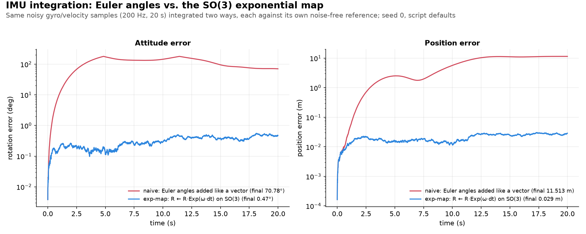

**Scripts:**

- [use_numpy/imu_integration_comparison.py](use_numpy/imu_integration_comparison.py)
- [use_manif/imu_integration_comparison.py](use_manif/imu_integration_comparison.py)

**Run:**

```
uv run python use_numpy/imu_integration_comparison.py --duration 20.0 --dt 0.005 --gyro-noise-std 0.02 --vel-noise-std 0.05 --seed 0 --out out.png
```

<details>
<summary>All flags</summary>

- `--duration`: simulation length in seconds (default `20.0`)
- `--dt`: IMU sample interval in seconds (default `0.005`)
- `--gyro-noise-std`: gyro noise std-dev, rad/s (default `0.02`)
- `--vel-noise-std`: body-velocity noise std-dev, m/s (default `0.05`)
- `--seed`: RNG seed (default `0`)
- `--out`: save the figure to this path instead of showing it (default: show)

</details>

#### 2. IMU propagation + Gauss-Newton position correction

**Purpose:** Propagates a pose with a 100 Hz IMU and corrects it once per second with Gauss-Newton against a noisy position-only fix. Shows that such a fix cannot correct orientation.

| Input | Output |
|---|---|
| A robot with constant body twist; noisy 100 Hz IMU twist and noisy 1 Hz position fix | Prints position error before and after each correction (no plot) |

**Details:** [imu_preintegration.md §7.1](docs/optimization/imu_preintegration.md#71-the-comparison-and-correction-math-concretely)

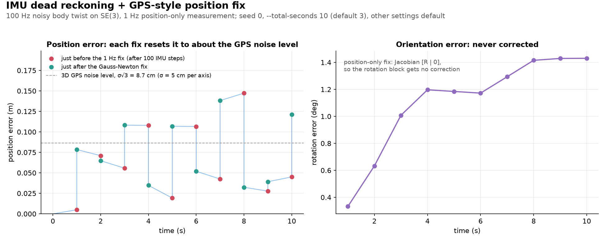

Figure made by `generator/make_figures.py` (a 10 s run; the default is 3 s); the script itself only prints.

**Scripts:**

- [use_numpy/imu_propagation_position_fix.py](use_numpy/imu_propagation_position_fix.py)
- [use_manif/imu_propagation_position_fix.py](use_manif/imu_propagation_position_fix.py)

**Run:**

```
uv run python use_numpy/imu_propagation_position_fix.py --dt-imu 0.01 --total-seconds 3 --snapshots-per-second 4 --gn-tol 1e-6 --gn-max-iters 10 --max-linear-vel 1.0 --max-angular-vel 0.5 --pos-noise-std 0.05 --seed 0
```

<details>
<summary>All flags</summary>

- `--dt-imu`: IMU update interval in seconds (default `0.01`, i.e. 100 Hz)
- `--total-seconds`: total simulation duration in seconds (default `3`)
- `--snapshots-per-second`: number of intermediate IMU steps logged per second (default `4`)
- `--gn-tol`: Gauss-Newton convergence tolerance (default `1e-6`)
- `--gn-max-iters`: maximum Gauss-Newton iterations (default `10`)
- `--max-linear-vel`: max linear velocity magnitude for the random true twist, m/s (default `1.0`)
- `--max-angular-vel`: max angular velocity magnitude for the random true twist, rad/s (default `0.5`)
- `--pos-noise-std`: per-axis std-dev (m) of the Global Position Measurement's Gaussian noise (default `0.05`)
- `--seed`: RNG seed (default `0`)

</details>

#### 3. IMU preintegration with bias Jacobians

**Purpose:** Compresses one second of IMU samples into a single preintegrated bundle with bias Jacobians. Then applies a bias update by a first-order correction instead of re-integrating.

| Input | Output |
|---|---|
| Noise-free IMU samples offset by estimated biases, plus a second set of "optimized" biases | Prints the preintegrated position change before and after the correction (no plot) |

**Details:** [imu_preintegration.md](docs/optimization/imu_preintegration.md)


Figure made by `generator/make_figures.py` at the script defaults; the script itself only prints.

**Scripts:**

- [use_numpy/imu_preintegration.py](use_numpy/imu_preintegration.py)
- [use_manif/imu_preintegration.py](use_manif/imu_preintegration.py)

**Run:**

```
uv run python use_numpy/imu_preintegration.py --frequency-hz 100 --gyro-bias 0.01 -0.01 0.02 --accel-bias 0.05 0.00 -0.05 --linear-vel 1.0 0.1 0.0 --angular-vel 0.0 0.0 0.5 --optimized-gyro-bias 0.008 -0.009 0.018 --optimized-accel-bias 0.045 0.002 -0.048
```

<details>
<summary>All flags</summary>

- `--frequency-hz`: IMU sampling frequency integrated over 1 simulated second (default `100`)
- `--gyro-bias`, `--accel-bias`: initial estimated sensor biases (default `0.01 -0.01 0.02` rad/s, `0.05 0.00 -0.05` $\text{m/s}^2$)
- `--linear-vel`, `--angular-vel`: true commanded body-frame acceleration and angular rate (default `1.0 0.1 0.0` m/s², `0.0 0.0 0.5` rad/s). Despite its name, `--linear-vel` feeds the accelerometer channel and is integrated twice
- `--optimized-gyro-bias`, `--optimized-accel-bias`: post-optimization corrected biases to apply via the Taylor correction

</details>

### Kalman filtering

#### 4. Point-cloud pose tracking: EKF vs. invariant EKF vs. batch Gauss-Newton vs. UKF vs. vanilla KF

**Purpose:** Tracks a rigid object's $`SE(3)`$ pose from a noisy motion prior and noisy point-cloud measurements. Compares dead reckoning and five estimators on the same noisy data; all but the vanilla KF share the same motion and observation models.

| Input | Output |
|---|---|
| A rigid object with known body-frame points; noisy twist control input and noisy point measurements | Prints final errors, RMSE, time and memory per method; plots rotation error, position error and x-y trajectories |

| Solver | Meaning |
|---|---|
| Dead reckoning | Prior only: chains the noisy twists, no measurement correction |
| **EKF** | Recursive filter, linearized with Jacobians |
| **Invariant EKF** | EKF with the residual in the body frame; same corrections here |
| **Batch Gauss-Newton** | Smoother optimizing the whole trajectory at once |
| **UKF** | Recursive filter using sigma points, no Jacobians |
| **Vanilla KF** | Linear filter on a redundant 12-dim state `[vec(R), t]` |

**Details:** [pointcloud_pose_tracking_empirical_note.md](docs/filtering/pointcloud_pose_tracking_empirical_note.md)

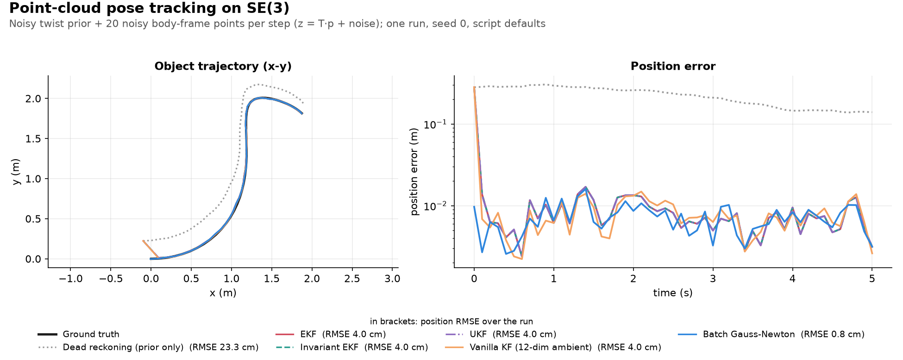

Figure made by `generator/make_figures.py pose_tracking` at the script defaults (seed 0); the script's own plot has three panels (rotation error, position error, x-y path).

**Scripts:**

- [use_numpy/pointcloud_pose_tracking.py](use_numpy/pointcloud_pose_tracking.py)
- [use_numpy/pointcloud_pose_tracking_v2.py](use_numpy/pointcloud_pose_tracking_v2.py): class-based version, same output
- [use_manif/pointcloud_pose_tracking.py](use_manif/pointcloud_pose_tracking.py)

**Run:**

```
uv run python use_numpy/pointcloud_pose_tracking.py --duration 5.0 --dt 0.1 --n-points 20 --vel-noise-std 0.05 --gyro-noise-std 0.02 --point-noise-std 0.03 --init-pose-noise-std 0.1 --gn-tol 1e-6 --gn-max-iters 20 --ukf-alpha 1.0 --ukf-beta 2.0 --ukf-kappa -3.0 --seed 0 --out out.png
```

<details>
<summary>All flags</summary>

- `--duration`: simulation length in seconds (default `5.0`)
- `--dt`: motion/measurement step interval in seconds (default `0.1`)
- `--n-points`: number of body-frame point-cloud landmarks (default `20`)
- `--vel-noise-std`: input linear-velocity noise std-dev, m/s (default `0.05`)
- `--gyro-noise-std`: input angular-velocity noise std-dev, rad/s (default `0.02`)
- `--point-noise-std`: point-cloud measurement noise std-dev, m (default `0.03`)
- `--init-pose-noise-std`: std-dev used to perturb the initial pose guess, and to set the prior/EKF-init covariance (default `0.1`)
- `--gn-tol`: batch Gauss-Newton convergence tolerance (default `1e-6`)
- `--gn-max-iters`: maximum batch Gauss-Newton iterations (default `20`)
- `--ukf-alpha`, `--ukf-beta`, `--ukf-kappa`: UKF scaled-unscented-transform tuning parameters (default `1.0`, `2.0`, `-3.0` - the classical Julier-Uhlmann scaling for this script's 6-dim tangent state, not the textbook tiny-`alpha` default, which collapses the sigma-point spread at this dimensionality)
- `--seed`: RNG seed (default `0`)
- `--out`: save the figure to this path instead of showing it (default: show)

</details>

#### 5. Error-state Kalman filter: ESKF vs. a quaternion in the state

**Purpose:** Shows how an error-state Kalman filter (ESKF) carries orientation: the full IMU model integrates a nominal state, and the filter estimates only a small 15-number error that it injects and resets after each update. Compares it with the same filter without bias states and with an EKF that keeps a quaternion in its state.

| Input | Output |
|---|---|
| A 3D body driven by a noisy, biased 100 Hz IMU, with a noisy 1 Hz position fix | Prints Monte Carlo attitude and position RMSE and NEES per filter, plus an initial-attitude-error sweep; plots errors and NEES |

| Variant | Meaning |
|---|---|
| `eskf` | Nominal state plus a 15-number error state, biases included |
| `eskf_no_bias` | Same, biases assumed zero (9 error states) |
| `qekf_naive` | Quaternion in the EKF state; renormalized, covariance unchanged |
| `qekf_projected` | Same, covariance also mapped through the renormalization |

**Details:** [eskf.md](docs/filtering/eskf.md)


**Scripts:**

- [use_numpy/eskf_imu_position_fix.py](use_numpy/eskf_imu_position_fix.py)
- [use_numpy/eskf_imu_position_fix_v2.py](use_numpy/eskf_imu_position_fix_v2.py): class-based version, same output


**Run:**

```
uv run python use_numpy/eskf_imu_position_fix.py --duration 30.0 --dt 0.01 --fix-rate 1.0 --rate-amp 0.4 --accel-amp 0.5 --gyro-noise-std 0.01 --accel-noise-std 0.05 --gyro-bias-std 0.01 --accel-bias-std 0.05 --gyro-bias-rw 1e-5 --accel-bias-rw 1e-4 --pos-noise-std 0.1 --init-pos-noise-std 0.1 --init-vel-noise-std 0.1 --init-att-noise-deg 2.0 --n-mc-trials 50 --sweep-att-deg 0.5 5.0 10.0 --n-sweep-trials 10 --seed 0 --out out.png
```

<details>
<summary>All flags</summary>

- `--duration`: run length, s (default `30.0`)
- `--dt`: IMU sample interval, s (default `0.01`, i.e. 100 Hz)
- `--fix-rate`: position-fix rate, Hz (default `1.0`)
- `--rate-amp`: body-rate amplitude per axis, rad/s (default `0.4`)
- `--accel-amp`: horizontal world-frame acceleration amplitude, m/s²; the vertical one is 0.4x (default `0.5`)
- `--gyro-noise-std`, `--accel-noise-std`: per-sample IMU noise std-devs, rad/s and m/s² (defaults `0.01`, `0.05`)
- `--gyro-bias-std`, `--accel-bias-std`: std-devs of the constant true biases, also the filters' bias prior, rad/s and m/s² (defaults `0.01`, `0.05`)
- `--gyro-bias-rw`, `--accel-bias-rw`: bias random walk assumed by the filters, rad/s/√s and m/s²/√s (defaults `1e-5`, `1e-4`)
- `--pos-noise-std`: position-fix noise std-dev per axis, m (default `0.1`)
- `--init-pos-noise-std`, `--init-vel-noise-std`: initial position and velocity error std-devs, m and m/s (defaults `0.1`, `0.1`)
- `--init-att-noise-deg`: initial attitude error std-dev per axis, deg (default `2.0`)
- `--n-mc-trials`: Monte Carlo trials at `--init-att-noise-deg` (default `50`)
- `--sweep-att-deg`: extra initial attitude errors for the sweep, deg; give none to skip the sweep (default `0.5 5.0 10.0`)
- `--n-sweep-trials`: Monte Carlo trials per sweep value (default `10`)
- `--no-reset-jacobian`: use $`G = I`$ at the ESKF reset (default: $`G = I - \tfrac12[\delta\theta]_\times`$)
- `--seed`: RNG seed (default `0`)
- `--out`: save the figure to this path instead of showing it (default: show)

</details>

### Front-end

#### 6. Perspective-n-Point (PnP): recovering a camera pose from known 3D-2D correspondences

**Purpose:** Recovers a camera pose from known 3D points and their observed pixels, the reverse of triangulation. A closed-form linear guess (DLT) is refined by Gauss-Newton.

| Input | Output |
|---|---|
| A random camera and 3D points projected to noisy pixels | Prints pose errors for the DLT and refined poses; plots a 3D view of the points and camera poses |

**Details:** [triangulation_pnp.md](docs/frontend/triangulation_pnp.md)

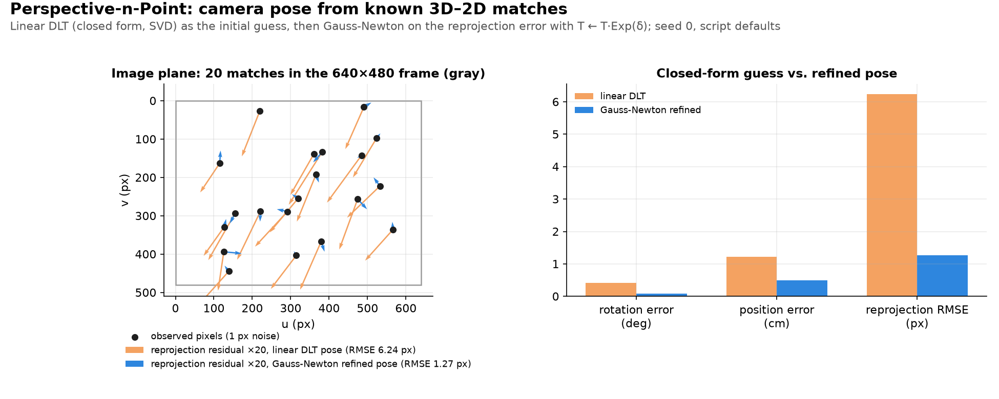

Figure made by `generator/make_figures.py` at the script defaults (seed 0).

**Scripts:**

- [use_numpy/pnp_estimation.py](use_numpy/pnp_estimation.py)

**Run:**

```
uv run python use_numpy/pnp_estimation.py --n-points 20 --pixel-noise-std 1.0 --seed 0 --out out.png
```

<details>
<summary>All flags</summary>

- `--n-points`: number of 3D-2D correspondences (default `20`)
- `--image-width`/`--image-height`/`--focal-length`: pinhole intrinsics (defaults `640`/`480`/`800.0`)
- `--pixel-noise-std`: std-dev of Gaussian pixel noise added to each observation (px, default `1.0`)
- `--gn-tol`/`--gn-max-iters`: Gauss-Newton convergence tolerance and iteration cap (defaults `1e-8`/`20`)
- `--seed`: RNG seed (default `0`)
- `--out`: save the figure to this path instead of showing it (default: show)

</details>

#### 7. LiDAR primitives: planes and cylinders for scan registration

**Purpose:** Registers two simulated LiDAR scans three ways in one $`SE(3)`$ Gauss-Newton loop, after fitting planes and cylinders to each scan. Also tests extraction, degeneracy and plane landmarks.

| Input | Output |
|---|---|
| Simulated corridor scans from a 32-ring LiDAR with range noise | Prints one results table per experiment (no plot) |

| Registration method | Meaning |
|---|---|
| Point-to-point ICP | Pairs each source point with its nearest target point |
| Point-to-plane ICP | Same pairs, but only distance along the target normal counts |
| Primitives | Matches fitted planes and cylinders between scans |

**Details:** [lidar_primitives.md](docs/frontend/lidar_primitives.md)


Figure made by `generator/make_figures.py lidar_primitives` (experiments 2-4 at their defaults); the script itself only prints.

**Scripts:**

- [use_numpy/lidar_primitives.py](use_numpy/lidar_primitives.py)
- [use_manif/lidar_primitives.py](use_manif/lidar_primitives.py): same experiments with manif poses
- [lidar_utils.py](lidar_utils.py): shared scene, LiDAR and extraction helpers
- [generator/animate_lidar_primitives.py](generator/animate_lidar_primitives.py): GIF of one registration; render with `uv run python generator/animate_lidar_primitives.py --out assets/lidar_primitives.gif`

**Run:**

```
uv run python use_numpy/lidar_primitives.py --experiment all --n-trials 10 --n-pairs 10 --n-starts 5 --n-runs 5 --noise 0.01 --seed 0
```

<details>
<summary>All flags</summary>

- `--experiment`: `1` extraction accuracy, `2` convergence basin, `3` degeneracy, `4` planes as landmarks, or `all` (default `all`; several minutes per experiment)
- `--n-trials`: experiment 1, sensor poses per noise/density cell (default `10`)
- `--n-pairs`: experiments 2-3, scan pairs (default `10`)
- `--n-starts`: experiment 2, initial guesses per pair and error size (default `5`)
- `--n-runs`: experiment 4, noise realizations of the trajectory (default `5`)
- `--noise`: experiments 2-4, range noise std, m (default `0.01`)
- `--seed`: RNG seed (default `0`)

</details>

### Factor graphs and smoothing

#### 8. 3D pose-graph relaxation

**Purpose:** Shows how one loop-closure edge lets pose-graph optimization reduce the drift of a noisy odometry loop.

| Input | Output |
|---|---|
| A robot drives a 4-node square loop with noisy relative-pose (odometry) edges and one loop-closure edge back to node 0 | Prints per-iteration error and final errors, odometry vs. optimized; plots the trajectory against ground truth |

**Details:** [pose_graph_optimization.md](docs/optimization/pose_graph_optimization.md)

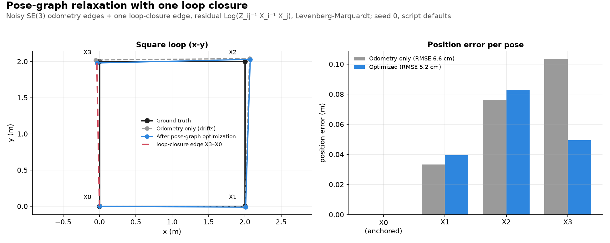

Figure made by `generator/make_figures.py pose_graph` at the script defaults (seed 0); the script's own plot shows only the x-y trajectories.

**Scripts:**

- [use_numpy/pose_graph.py](use_numpy/pose_graph.py): hand-rolled $`SE(3)`$ math
- [use_manif/pose_graph.py](use_manif/pose_graph.py): `manifpy` Jacobians

**Run:**

```
uv run python use_numpy/pose_graph.py --side-length 2.0 --pos-noise-std 0.05 --rot-noise-std 0.01 --loop-noise-scale 0.5 --damping 0.01 --gn-tol 1e-6 --gn-max-iters 10 --seed 0 --out out.png
```

<details>
<summary>All flags</summary>

- `--side-length`: side length of the square ground-truth loop, m (default `2.0`)
- `--pos-noise-std`: odometry-edge translation noise std-dev, m (default `0.05`)
- `--rot-noise-std`: odometry-edge rotation noise std-dev, rad (default `0.01`)
- `--loop-noise-scale`: noise std-dev multiplier for the loop-closure edge (default `0.5`)
- `--damping`: initial Levenberg-Marquardt damping $\lambda$, adapted during the solve by accept/reject scaling (default `0.01`)
- `--gn-tol`: convergence tolerance on the correction step norm (default `1e-6`)
- `--gn-max-iters`: maximum optimization iterations (default `10`)
- `--seed`: RNG seed (default `0`)
- `--out`: save the figure to this path instead of showing it (default: show)

</details>

#### 9. Bundle adjustment: joint pose + landmark refinement

**Purpose:** Compares refining only landmarks, only camera poses, or both together (bundle adjustment) from the same noisy start, to show why the joint solve is needed.

| Input | Output |
|---|---|
| Cameras on an arc looking at a cluster of 3D landmarks, with noisy pixel measurements and a perturbed initial guess | Prints pose, landmark and reprojection errors for each solver; plots the scene and the errors |

| Variant | Meaning |
|---|---|
| Landmarks-only | Poses held fixed, landmarks refined |
| Poses-only | Landmarks held fixed, poses refined |
| Joint BA | Poses and landmarks refined together |

**Details:** [bundle_adjustment.md](docs/optimization/bundle_adjustment.md)

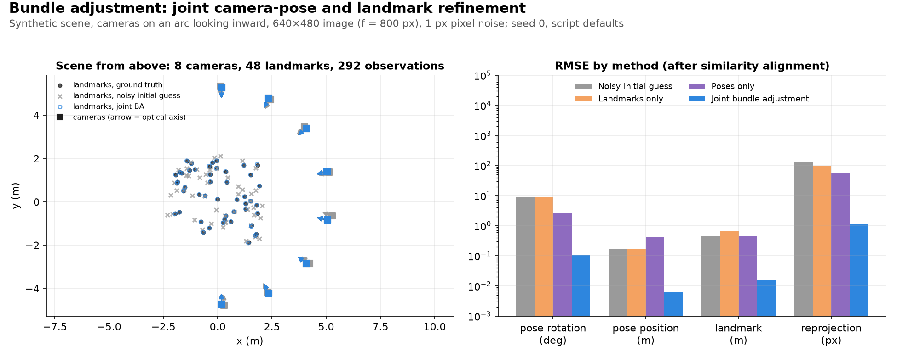

**Scripts:**

- [use_numpy/bundle_adjustment.py](use_numpy/bundle_adjustment.py): hand-derived Jacobians
- [generator/animate_bundle_adjustment.py](generator/animate_bundle_adjustment.py): animated GIF, embedded in [bundle_adjustment.md](docs/optimization/bundle_adjustment.md); render with `uv run python generator/animate_bundle_adjustment.py --out assets/bundle_adjustment.gif`
- [use_manif/bundle_adjustment.py](use_manif/bundle_adjustment.py): `manifpy` Jacobians

**Run:**

```
uv run python use_numpy/bundle_adjustment.py --n-cameras 8 --n-landmarks 60 --camera-radius 5.0 --arc-span-deg 180 --landmark-spread 2.0 --image-width 640 --image-height 480 --focal-length 800 --pose-noise-std 0.1 --landmark-noise-std 0.3 --pixel-noise-std 1.0 --min-observations 2 --gn-tol 1e-6 --gn-max-iters 30 --seed 0 --out out.png
```

<details>
<summary>All flags</summary>

- `--n-cameras`: number of cameras placed on the arc (default `8`)
- `--n-landmarks`: number of 3D landmarks sampled, before dropping under-observed ones (default `60`)
- `--camera-radius`: radius of the camera arc, centered on the landmark centroid, m (default `5.0`)
- `--arc-span-deg`: total angular span of the camera arc, deg (default `180`)
- `--landmark-spread`: half-width of the cube landmarks are sampled in, m (default `2.0`)
- `--image-width`, `--image-height`: image size in pixels; sets `cx`/`cy` and which points are in view (default `640`/`480`)
- `--focal-length`: shared `fx=fy` focal length in pixels (default `800`)
- `--pose-noise-std`: std-dev of the se3 twist used to perturb the initial camera-pose guess, mixed m/rad (default `0.1`)
- `--landmark-noise-std`: std-dev of the Gaussian offset used to perturb the initial landmark guess, m (default `0.3`)
- `--pixel-noise-std`: std-dev of Gaussian pixel measurement noise, px (default `1.0`)
- `--min-observations`: minimum observing cameras a landmark needs to be kept; must be `>= 2` (default `2`)
- `--gn-tol`: Gauss-Newton convergence tolerance (default `1e-6`)
- `--gn-max-iters`: maximum Gauss-Newton iterations (default `30`)
- `--seed`: RNG seed (default `0`)
- `--out`: save the figure to this path instead of showing it (default: show)

</details>

#### 10. Local + Global bundle adjustment: bounded windows vs. whole-map re-solves

**Purpose:** Compares Local BA (optimize only a small window of recent keyframes) with Local BA plus periodic Global BA (re-solve the whole map) as a keyframe path grows.

| Input | Output |
|---|---|
| Keyframes move along a path through a landmark corridor, each starting from a drifting pose estimate | Prints solve counts, times and trajectory errors for both modes; plots path, solve time and error |

**Details:** [bundle_adjustment.md §13.6](docs/optimization/bundle_adjustment.md#136-in-this-repo)


Figure made by `generator/make_figures.py bundle_adjustment_advanced` at the script defaults (seed 0); the script's own plot is a 2x2 grid.

**Scripts:**

- [use_numpy/bundle_adjustment_advanced.py](use_numpy/bundle_adjustment_advanced.py)
- [use_manif/bundle_adjustment_advanced.py](use_manif/bundle_adjustment_advanced.py)

**Run:**

```
uv run python use_numpy/bundle_adjustment_advanced.py --n-keyframes 50 --path-radius 15.0 --arc-span-deg 90 --landmarks-per-keyframe 8 --lateral-spread 2.0 --vertical-spread 1.0 --max-view-range 6.0 --image-width 640 --image-height 480 --focal-length 800 --min-observations 3 --min-shared-for-covisibility 2 --max-window-keyframes 6 --global-ba-interval 8 --relative-pose-noise-std 0.02 --pixel-noise-std 1.0 --gn-tol 1e-6 --gn-max-iters 15 --seed 0 --out out.png
```

<details>
<summary>All flags</summary>

- `--n-keyframes`: number of keyframes along the path (default `50`)
- `--path-radius`: radius of the arc the path follows, m (default `15.0`)
- `--arc-span-deg`: total angular span of the path, deg (default `90`)
- `--landmarks-per-keyframe`: landmarks scattered per keyframe station (default `8`)
- `--lateral-spread`, `--vertical-spread`: half-width of the lateral/vertical landmark offset, m (default `2.0`/`1.0`)
- `--max-view-range`: maximum camera-to-landmark detection range, m - bounds covisibility to nearby keyframes (default `6.0`)
- `--image-width`, `--image-height`: image size in pixels; sets `cx`/`cy` and which points are in view (default `640`/`480`)
- `--focal-length`: shared `fx=fy` focal length in pixels (default `800`)
- `--min-observations`: minimum observing keyframes before a landmark is triangulated; must be `>= 2` (default `3`)
- `--min-shared-for-covisibility`: minimum shared-landmark count for a covisibility edge between two keyframes (default `2`)
- `--max-window-keyframes`: maximum active keyframes per local BA window, including the new one (default `6`)
- `--global-ba-interval`: run a full Global BA pass every this many keyframes, plus once at the end (default `8`)
- `--loop-closure-min-gap`: minimum keyframe-index gap for a covisibility edge to count as a loop closure rather than ordinary local covisibility (default `20`)
- `--relative-pose-noise-std`: std-dev of the se3 twist noise added to each frame-to-frame front-end pose estimate, mixed m/rad - compounds into drift (default `0.02`)
- `--pixel-noise-std`: std-dev of Gaussian pixel measurement noise, px (default `1.0`)
- `--gn-tol`: Levenberg-Marquardt convergence tolerance (default `1e-6`)
- `--gn-max-iters`: maximum accepted GN/LM steps per solve (default `15`)
- `--seed`: RNG seed (default `0`)
- `--out`: save the figure to this path instead of showing it (default: show)

</details>

**Loop closure example:** a path spanning close to 360 degrees returns to its start, so a late keyframe re-observes an early landmark and the same code detects the loop closure. Raise `--n-keyframes` with the span to keep the default keyframe spacing. The closure is detected on every seed tried, but whether the next Global BA pass then helps depends on the seed:

```
uv run python use_numpy/bundle_adjustment_advanced.py --arc-span-deg 350 --n-keyframes 190 --seed 0 --out loop_closure.png
```

#### 11. Incremental (square-root SAM) vs. batch pose-graph solving

**Purpose:** Compares incremental square-root SAM, which updates an existing factorization with each new node, against re-solving the whole pose graph at every node.

| Input | Output |
|---|---|
| A square loop streamed in one noisy odometry node at a time, ending with a loop-closure edge | Prints final errors, full-solve counts and time per node for both solvers; plots the trajectories |

**Details:** [isam_optimization.md](docs/optimization/isam_optimization.md)


Figure made by `generator/make_figures.py pose_graph_incremental` at the script defaults (seed 0), which adds the per-node cost panel; the script's own plot shows only the trajectories.

**Scripts:**

- [use_numpy/pose_graph_incremental.py](use_numpy/pose_graph_incremental.py)
- [use_manif/pose_graph_incremental.py](use_manif/pose_graph_incremental.py)

**Run:**

```
uv run python use_numpy/pose_graph_incremental.py --side-length 2.0 --nodes-per-side 16 --pos-noise-std 0.05 --rot-noise-std 0.01 --loop-noise-scale 0.5 --damping 0.01 --gn-tol 1e-6 --gn-max-iters 10 --anchor-weight 1e6 --relinearize-every 8 --seed 0 --out out.png
```

<details>
<summary>All flags</summary>

- `--side-length`: side length of the square ground-truth loop, m (default `2.0`)
- `--nodes-per-side`: nodes per side of the loop, streamed in one at a time (default `16`)
- `--pos-noise-std`: odometry-edge translation noise std-dev, m (default `0.05`)
- `--rot-noise-std`: odometry-edge rotation noise std-dev, rad (default `0.01`)
- `--loop-noise-scale`: noise std-dev multiplier for the loop-closure edge (default `0.5`)
- `--damping`: initial Levenberg-Marquardt damping for the batch-streaming baseline only (default `0.01`)
- `--gn-tol`: Gauss-Newton convergence tolerance (default `1e-6`)
- `--gn-max-iters`: maximum Gauss-Newton iterations per solve/relinearization (default `10`)
- `--anchor-weight`: information weight of the node-0 gauge-fixing prior (default `1e6`)
- `--relinearize-every`: force a full relinearization every this many new nodes (default `8`)
- `--seed`: RNG seed (default `0`)
- `--out`: save the figure to this path instead of showing it (default: show)

</details>

**Tip:** the script solves many small dense systems, where multithreaded BLAS costs more than it saves. Limit it to one thread to run faster:

```
OMP_NUM_THREADS=1 OPENBLAS_NUM_THREADS=1 uv run python use_numpy/pose_graph_incremental.py
```

#### 12. Bayes tree construction and affected-region query

**Purpose:** Builds the elimination tree behind the Bayes tree for the pose-graph loop and shows which variables a new odometry edge or a loop-closure edge affects.

| Input | Output |
|---|---|
| The square-loop pose-graph topology: odometry edges plus one loop-closure edge, no poses or noise | Prints the affected variables for each edge; plots the elimination chain |

**Details:** [bayes_tree.md](docs/optimization/bayes_tree.md)

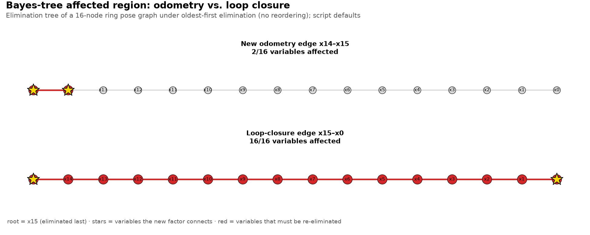

**Scripts:**

- [use_numpy/bayes_tree_construction.py](use_numpy/bayes_tree_construction.py)

**Run:**

```
uv run python use_numpy/bayes_tree_construction.py --nodes-per-side 4 --out out.png
```

<details>
<summary>All flags</summary>

- `--nodes-per-side`: nodes per side of the ring pose graph, same topology as `pose_graph_incremental.py` (default `4`; kept small since this plots an inspectable diagram, not a timing benchmark)
- `--out`: save the figure to this path instead of showing it (default: show)

</details>

#### 13. Sliding-window marginalization: bounded-memory pose-graph smoothing

**Purpose:** Compares a sliding window that marginalizes out its oldest pose with a full batch re-solve at every new node, to show how memory scales with trajectory length.

| Input | Output |
|---|---|
| A noisy odometry chain streamed in one node at a time, run over a sweep of trajectory lengths | Prints information-matrix size, cost and position error per length; plots them against trajectory length |

**Details:** [marginalization.md](docs/optimization/marginalization.md)

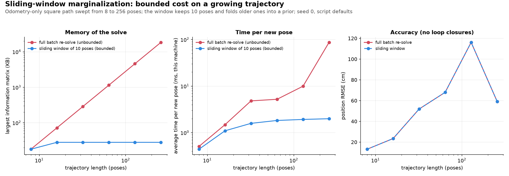

**Scripts:**

- [use_numpy/sliding_window_marginalization.py](use_numpy/sliding_window_marginalization.py)
- [generator/animate_sliding_window_marginalization.py](generator/animate_sliding_window_marginalization.py): animated GIF, embedded in [marginalization.md](docs/optimization/marginalization.md); render with `uv run python generator/animate_sliding_window_marginalization.py --out assets/sliding_window_marginalization.gif`

**Run:**

```
uv run python use_numpy/sliding_window_marginalization.py --nodes-per-side-sweep 2 4 8 16 32 64 --side-length 2.0 --window-size 10 --pos-noise-std 0.05 --rot-noise-std 0.01 --anchor-weight 1e6 --gn-tol 1e-6 --gn-max-iters 10 --seed 0 --out out.png
```

<details>
<summary>All flags</summary>

- `--nodes-per-side-sweep`: sweep of nodes-per-side values, trajectory has 4x this many total poses per entry (default `2 4 8 16 32 64`) - the resource-constraint result is how cost scales across this sweep, not any single run
- `--side-length`: side length of the square ground-truth path, m (default `2.0`)
- `--window-size`: sliding-window size, poses kept live at once (default `10`)
- `--pos-noise-std`: odometry-edge translation noise std-dev, m (default `0.05`)
- `--rot-noise-std`: odometry-edge rotation noise std-dev, rad (default `0.01`)
- `--anchor-weight`: information weight of the node-0 gauge-fixing prior (default `1e6`)
- `--gn-tol`: Gauss-Newton convergence tolerance (default `1e-6`)
- `--gn-max-iters`: maximum Gauss-Newton iterations per solve (default `10`)
- `--seed`: RNG seed (default `0`)
- `--out`: save the figure to this path instead of showing it (default: show)

</details>

### Non-smooth and legged motion

#### 14. Saltation-matrix EKF: tracking a point mass through discrete ground-contact events

**Purpose:** Isolates how an EKF should treat its covariance at a bounce, the sudden jump in a point mass's velocity when it hits the ground. The saltation matrix corrects for the shifted impact time of a perturbed trajectory.

| Input | Output |
|---|---|
| Bouncing point mass in free fall, noisy position measured every step, optional contact-detection timing error | Prints per-method errors and Monte Carlo [NEES](docs/glossary.md#consistency-and-nees) (consistency check); plots height, error and NEES |

| Variant | Meaning |
|---|---|
| Dead reckoning | Exact dynamics, no measurements |
| EKF, naive | Covariance mapped by the reset Jacobian alone |
| EKF, saltation | Covariance mapped by the saltation matrix |

**Details:** [hybrid_saltation_ekf.md](docs/filtering/hybrid_saltation_ekf.md)

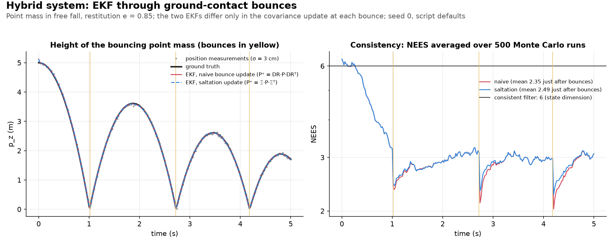

**Scripts:**

- [use_numpy/saltation_matrix_ekf.py](use_numpy/saltation_matrix_ekf.py)
- [use_numpy/saltation_matrix_ekf_v2.py](use_numpy/saltation_matrix_ekf_v2.py): class-based version, same output
- [generator/animate_saltation_ekf.py](generator/animate_saltation_ekf.py): animated GIF; render with `uv run python generator/animate_saltation_ekf.py --out assets/saltation_matrix_ekf.gif`

**Run:**

```
uv run python use_numpy/saltation_matrix_ekf.py --duration 5.0 --dt 0.02 --restitution 0.85 --gravity 9.81 --drop-height 5.0 --init-horizontal-vel 1.0 0.5 --pos-noise-std 0.03 --process-noise-std 0.3 --impact-noise-std 0.005 --init-pos-noise-std 0.1 --init-vel-noise-std 0.2 --detect-time-bias 0.0 --detect-time-noise-std 0.0 --n-mc-trials 500 --seed 0 --out out.png
```

<details>
<summary>All flags</summary>

- `--duration`: simulation length in seconds (default `5.0`) - kept comfortably below the trajectory's own Zeno settling time (bounce intervals shrink geometrically for a lossy bounce; the default stops after 3 well-separated bounces)
- `--dt`: filter/measurement step interval in seconds (default `0.02`)
- `--restitution`: bounce restitution coefficient, 0-1 (default `0.85`)
- `--gravity`: gravitational acceleration magnitude, $\text{m/s}^2$ (default `9.81`)
- `--drop-height`: initial height, m (default `5.0`)
- `--init-horizontal-vel`: initial horizontal velocity, m/s (default `1.0 0.5`)
- `--pos-noise-std`: position measurement noise std-dev, m (default `0.03`)
- `--process-noise-std`: assumed acceleration-disturbance noise std-dev, $\text{m/s}^2$ (default `0.3`)
- `--impact-noise-std`: std-dev of the regularizing floor added to `P` at each bounce, both EKF variants (default `0.005`) - not needed for numerical stability (both filters stay well-behaved at `0`), but it shifts both filters' absolute NEES level together as it grows (see the doc §7)
- `--init-pos-noise-std`/`--init-vel-noise-std`: std-dev used to perturb the initial position/velocity guess (defaults `0.1`/`0.2`)
- `--detect-time-bias`: systematic contact-detection timing offset, s, positive = late detection (default `0.0`, exact detection) - models a real contact sensor's own detection latency, on top of whatever the filter's state estimate already gets wrong about the geometric crossing time
- `--detect-time-noise-std`: std-dev, s, of Gaussian contact-detection timing jitter added on top of `--detect-time-bias` each time a bounce is detected (default `0.0`) - see doc §8 for the measured saltation-vs-naive NEES gap this opens up as jitter grows
- `--max-bounces`: safety cap on bounces processed within one time step (default `20`)
- `--min-bounce-speed`: impact speed, m/s, below which the point mass is treated as at rest (default `1e-3`)
- `--n-mc-trials`: number of Monte Carlo consistency trials (default `500`)
- `--seed`: RNG seed (default `0`)
- `--out`: save the figure to this path instead of showing it (default: show)

</details>

#### 15. Invariant EKF on $SE_2(3)$ through a bounce

**Purpose:** Extends §14's bouncing point mass to a tumbling rigid body with an IMU (gyro and accelerometer), tracked by a right-invariant EKF (RIEKF). Compares five filters that treat the bounce covariance differently.

| Input | Output |
|---|---|
| Rigid body bouncing on the ground, IMU plus body-frame landmark measurements, optional contact-detection timing error | Prints per-filter errors and Monte Carlo [NEES](docs/glossary.md#consistency-and-nees) (consistency check); plots height, position error and NEES |

| Variant | Meaning |
|---|---|
| RIEKF, invariant-naive | Treats the bounce as state-independent |
| RIEKF, reset-Jacobian | Adds the bounce's state dependence |
| RIEKF, saltation | Also corrects the impact timing |
| RIEKF, saltation + timing noise | Adds a contact-detection timing term |
| World-frame EKF, saltation | Non-invariant baseline |

**Details:** [invariant_saltation_ekf.md](docs/filtering/invariant_saltation_ekf.md)

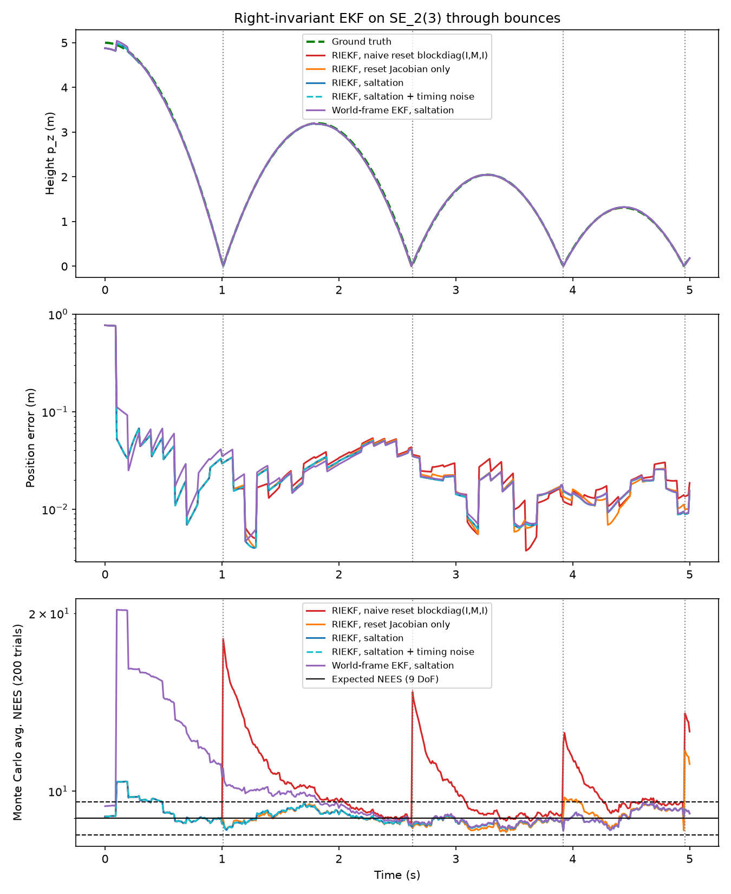

**Scripts:**

- [use_numpy/invariant_saltation_ekf.py](use_numpy/invariant_saltation_ekf.py)
- [use_numpy/invariant_saltation_ekf_v2.py](use_numpy/invariant_saltation_ekf_v2.py): class-based version, same output
- [use_manif/invariant_saltation_ekf.py](use_manif/invariant_saltation_ekf.py)
- [generator/animate_invariant_saltation_ekf.py](generator/animate_invariant_saltation_ekf.py): animated GIF; render with `uv run python generator/animate_invariant_saltation_ekf.py --out assets/invariant_saltation_ekf.gif`

**Run:**

```
uv run python use_numpy/invariant_saltation_ekf.py --duration 5.0 --dt 0.01 --meas-every 10 --restitution 0.8 --gravity 9.81 --drop-height 5.0 --init-velocity 1.0 0.5 0.0 --body-rate 1.0 -0.6 2.0 --gyro-noise-std 0.02 --accel-noise-std 0.3 --meas-noise-std 0.05 --init-rot-std-deg 5.0 --init-vel-std 0.2 --init-pos-std 0.1 --detect-time-bias 0.0 --detect-time-noise-std 0.0 --n-mc-trials 200 --seed 0
```

<details>
<summary>All flags</summary>

- `--duration`: simulation length in seconds (default `5.0`, four bounces) - the run raises an error if an impact gets slower than `min_bounce_speed`, rather than modeling the settling phase
- `--dt`: IMU step in seconds (default `0.01`)
- `--meas-every`: landmark measurement period, in IMU steps (default `10`)
- `--restitution`: bounce restitution coefficient, 0-1 (default `0.8`)
- `--gravity`: gravitational acceleration magnitude, $`\text{m/s}^2`$ (default `9.81`)
- `--drop-height`: initial height, m (default `5.0`)
- `--init-velocity`: initial velocity, m/s (default `1.0 0.5 0.0`)
- `--body-rate`: constant true body angular rate, rad/s (default `1.0 -0.6 2.0`)
- `--gyro-noise-std`/`--accel-noise-std`: IMU noise std-dev per sample, rad/s and $`\text{m/s}^2`$ (defaults `0.02`/`0.3`)
- `--meas-noise-std`: landmark measurement noise std-dev, m (default `0.05`)
- `--init-rot-std-deg`/`--init-vel-std`/`--init-pos-std`: initial right-invariant error std-devs (defaults `5.0` deg/`0.2` m/s/`0.1` m)
- `--detect-time-bias`/`--detect-time-noise-std`: contact-detection timing offset (positive = late) and jitter std-dev, s (defaults `0.0`/`0.0`, exact detection); the bounce is applied at the detected time, clipped into the current tick
- `--max-bounces`: safety cap on bounces processed within one time step (default `5`; `use_numpy` only, the `use_manif` version fixes it at 5)
- `--min-bounce-speed`: impact speed, m/s, below which the run raises a `RuntimeError` instead of modeling the settling phase (default `0.5`; `use_numpy` only, the `use_manif` version fixes it at 0.5)
- `--n-mc-trials`: number of Monte Carlo consistency trials (default `200`)
- `--seed`: RNG seed (default `0`)
- `--out`: save the figure to this path instead of showing it (default: show)

</details>

#### 16. Inchworm ZUPT: exploiting a known anchor/dwell schedule

**Purpose:** Asks whether a filter should use the free zero-velocity update (ZUPT) during the stationary phases of a known anchor/extend gait. Compares three ZUPT policies on a 1D point mass.

| Input | Output |
|---|---|
| 1D point mass alternating anchor (still) and extend (moving) phases, noisy position measured every step | Prints per-policy errors and Monte Carlo [NEES](docs/glossary.md#consistency-and-nees) (consistency check); plots velocity, error and NEES |

| Policy | Meaning |
|---|---|
| `never` | No ZUPT; position measurement only |
| `always` | ZUPT on every tick |
| `phase_conditional` | ZUPT only on scheduled anchor ticks |

**Details:** [inchworm_zupt_ekf.md](docs/filtering/inchworm_zupt_ekf.md)

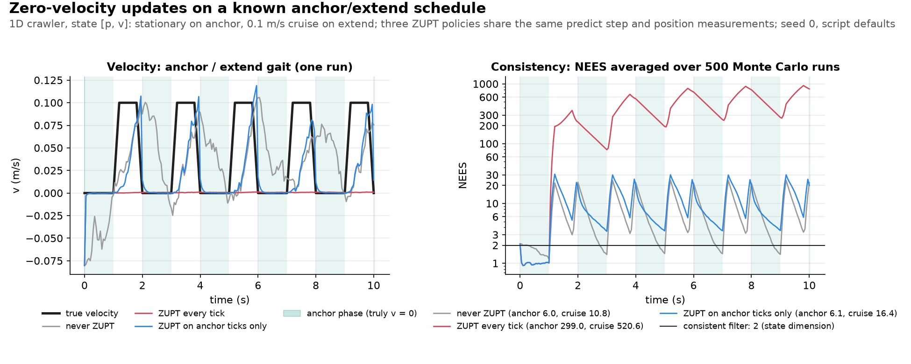

**Scripts:**

- [use_numpy/inchworm_zupt_ekf.py](use_numpy/inchworm_zupt_ekf.py)
- [use_numpy/inchworm_zupt_ekf_v2.py](use_numpy/inchworm_zupt_ekf_v2.py): class-based version, same output
- [generator/animate_inchworm_zupt_ekf.py](generator/animate_inchworm_zupt_ekf.py): animated GIF; render with `uv run python generator/animate_inchworm_zupt_ekf.py --out assets/inchworm_zupt_ekf.gif`
- [use_numpy/inchworm_zupt_zaru_ekf.py](use_numpy/inchworm_zupt_zaru_ekf.py): planar extension with heading and zero-angular-rate update (ZARU), doc §5; same flags plus `--omega-extend`, `--process-noise-ang-std`, `--zaru-noise-std`, `--init-heading-noise-std`, `--init-omega-noise-std`
- [use_numpy/inchworm_zupt_zaru_ekf_v2.py](use_numpy/inchworm_zupt_zaru_ekf_v2.py): class-based version, same output
- [generator/animate_inchworm_zupt_zaru_ekf.py](generator/animate_inchworm_zupt_zaru_ekf.py): animated GIF at matched process noise; render with `uv run python generator/animate_inchworm_zupt_zaru_ekf.py --out assets/inchworm_zupt_zaru_ekf.gif`
- [use_numpy/inchworm_slip_gate_ekf.py](use_numpy/inchworm_slip_gate_ekf.py): anchor slip and a pad-sensor gate, doc §6; flags `--p-slip`, `--v-slip`, `--t-slip`, `--sensor-noise-std`, `--gate-sigmas`, plus the gait and noise flags above; default process noise 0.5 m/s², not 0.15
- [use_numpy/inchworm_slip_gate_ekf_v2.py](use_numpy/inchworm_slip_gate_ekf_v2.py): class-based version, same output
- [generator/animate_inchworm_slip_gate_ekf.py](generator/animate_inchworm_slip_gate_ekf.py): animated GIF; render with `uv run python generator/animate_inchworm_slip_gate_ekf.py --out assets/inchworm_slip_gate_ekf.gif`

**Run:**

```
uv run python use_numpy/inchworm_zupt_ekf.py --duration 10.0 --dt 0.05 --t-anchor 1.0 --t-extend 1.0 --t-ramp 0.2 --v-extend 0.1 --pos-noise-std 0.02 --process-noise-std 0.15 --zupt-noise-std 0.01 --init-pos-noise-std 0.05 --init-vel-noise-std 0.05 --n-mc-trials 500 --seed 0 --out out.png
```

<details>
<summary>All flags</summary>

- `--duration`: simulation length in seconds (default `10.0`)
- `--dt`: filter/measurement step interval in seconds (default `0.05`)
- `--t-anchor`: anchor/dwell phase duration per cycle, s (default `1.0`)
- `--t-extend`: extend phase duration per cycle (including its ramps), s (default `1.0`)
- `--t-ramp`: linear ramp-up/ramp-down duration at each end of the extend phase, s (default `0.2`) - keeps `true_velocity` continuous everywhere; see the doc's §2 (a step jump is an unmodeled acceleration) for why this (and its interaction with `--process-noise-std`) matters
- `--v-extend`: commanded cruise speed during the extend phase, m/s (default `0.1`)
- `--pos-noise-std`: position measurement noise std-dev, m (default `0.02`)
- `--process-noise-std`: assumed acceleration-disturbance noise std-dev, $\text{m/s}^2$ (default `0.15`)
- `--zupt-noise-std`: ZUPT pseudo-measurement noise std-dev, m/s (default `0.01`)
- `--init-pos-noise-std`/`--init-vel-noise-std`: std-dev used to perturb the initial position/velocity guess (defaults `0.05`/`0.05`)
- `--n-mc-trials`: number of Monte Carlo consistency trials (default `500`)
- `--seed`: RNG seed (default `0`)
- `--out`: save the figure to this path instead of showing it (default: show)

</details>

#### 17. Two-pad inchworm: trusting the anchored pad without a position fix

**Purpose:** Asks how a planar inchworm with no position fix, whose two pads swap anchored and moving roles each phase, should treat its anchored pad when it can slip. Compares four policies, from assuming the pad is still to fusing its sensor.

| Input | Output |
|---|---|
| Planar two-pad inchworm with a gyro and an anchored-pad displacement sensor, no position measurement, random anchor slips | Prints per-policy errors and Monte Carlo [NEES](docs/glossary.md#consistency-and-nees) (consistency check); plots top view, sensor reading, error and NEES |

| Policy | Meaning |
|---|---|
| `never` | Anchored pad moves as a loose random walk |
| `schedule` | Anchored pad assumed still |
| `schedule_and_sensor` | As `schedule`, unless the pad sensor shows motion |
| `pad_fused` | Anchored pad moves by its sensor reading |

**Details:** [inchworm_two_pad_ekf.md](docs/filtering/inchworm_two_pad_ekf.md)


**Scripts:**

- [use_numpy/inchworm_two_pad_ekf.py](use_numpy/inchworm_two_pad_ekf.py)
- [use_numpy/inchworm_two_pad_ekf_v2.py](use_numpy/inchworm_two_pad_ekf_v2.py): class-based version, same output
- [generator/animate_inchworm_two_pad_ekf.py](generator/animate_inchworm_two_pad_ekf.py): animated GIF; render with `uv run python generator/animate_inchworm_two_pad_ekf.py --out assets/inchworm_two_pad_ekf.gif`

**Run:**

```
uv run python use_numpy/inchworm_two_pad_ekf.py --duration 20.0 --dt 0.05 --t-phase 1.0 --t-ramp 0.2 --v-stroke 0.1 --l-min 0.15 --steer 0.3 --p-slip 0.5 --v-slip 0.08 --t-slip 0.6 --micro-slip-std 0.01 --gyro-noise-std 0.02 --sensor-noise-std 0.0005 --closure-noise-std 0.001 --closure-lat-noise-std 0.001 --gate-sigmas 3.0 --free-noise-std 0.1 --move-noise-std 0.02 --init-pos-noise-std 0.005 --init-heading-noise-std 0.02 --n-mc-trials 500 --seed 0 --out out.png
```

<details>
<summary>All flags</summary>

- `--duration`: simulation length in seconds (default `20.0`, 10 extend/contract cycles)
- `--dt`: filter/sensor step interval, s (default `0.05`)
- `--t-phase`: duration of each extend or contract phase, s (default `1.0`)
- `--t-ramp`: ramp at each end of a stroke and of a slip pulse, s (default `0.2`)
- `--v-stroke`: peak stroke rate $`\dot l`$ (body-length rate), m/s (default `0.1`)
- `--l-min`: body length at the start of extend, also the steering wheelbase, m (default `0.15`)
- `--steer`: steering angle during extend, rad (default `0.3`)
- `--p-slip`: probability that a phase contains a slip pulse; `0` = never slips (default `0.5`)
- `--v-slip`: peak backward slip speed, m/s (default `0.08`)
- `--t-slip`: slip pulse duration including both ramps, s (default `0.6`; needs `2*t-ramp <= t-slip <= t-phase`)
- `--micro-slip-std`: white creep of the anchored pad, true and assumed by the filter, m/s per axis (default `0.01`)
- `--gyro-noise-std`: gyro noise std-dev, rad/s (default `0.02`)
- `--sensor-noise-std`: pad sensor noise std-dev per reading and axis, m (default `0.0005`)
- `--closure-noise-std`/`--closure-lat-noise-std`: kinematic closure noise std-dev along/across the body axis, m (defaults `0.001`/`0.001`)
- `--gate-sigmas`: veto threshold in std-devs of a still pad's reading (default `3.0`)
- `--free-noise-std`: anchored-pad random walk with no anchor knowledge, used by `never` and the veto, m/s (default `0.1`)
- `--move-noise-std`: moving-pad random walk per tick, m (default `0.02`)
- `--init-pos-noise-std`/`--init-heading-noise-std`: std-dev used to perturb the initial pad positions/heading guess, m and rad (defaults `0.005`/`0.02`)
- `--n-mc-trials`: number of Monte Carlo consistency trials (default `500`)
- `--seed`: RNG seed (default `0`)
- `--out`: save the figure to this path instead of showing it (default: show)

</details>

#### 18. Two-pad inchworm: reading both pad sensors

**Purpose:** Extends §17's `pad_fused` filter, which reads only the anchored pad's sensor, with the moving pad's sensor and sensor faults (spikes, dropouts). Compares five ways to move the moving pad, including a cross-check between the two sensors.

| Input | Output |
|---|---|
| §17's inchworm plus a moving-pad sensor and random sensor faults | Prints per-variant errors, Monte Carlo [NEES](docs/glossary.md#consistency-and-nees) (consistency check) and fault-detection counts; plots readings, error and NEES |

| Variant | Meaning |
|---|---|
| `random_walk` | No moving-pad model (§17's `pad_fused`) |
| `encoder_model` | Anchored pad's motion plus the commanded stroke |
| `moving_sensor` | The moving pad's own sensor reading |
| `both` | Inverse-variance mix of the two above |
| `cross_check` | As `both`, after a disagreement test between the sensors |

**Details:** [inchworm_two_pad_fusion_ekf.md](docs/filtering/inchworm_two_pad_fusion_ekf.md)


**Scripts:**

- [use_numpy/inchworm_two_pad_fusion_ekf.py](use_numpy/inchworm_two_pad_fusion_ekf.py)
- [generator/animate_inchworm_two_pad_fusion_ekf.py](generator/animate_inchworm_two_pad_fusion_ekf.py): animated GIF (about 2 min); render with `uv run python generator/animate_inchworm_two_pad_fusion_ekf.py --out assets/inchworm_two_pad_fusion_ekf.gif`

**Run:**

```
uv run python use_numpy/inchworm_two_pad_fusion_ekf.py --duration 20.0 --dt 0.05 --t-phase 1.0 --t-ramp 0.2 --v-stroke 0.1 --l-min 0.15 --steer 0.3 --stroke-err-std 0.05 --p-slip 0.5 --v-slip 0.08 --t-slip 0.6 --micro-slip-std 0.01 --p-fault 0.2 --t-fault 0.3 --fault-type both --v-spike 0.08 --gyro-noise-std 0.02 --sensor-noise-std 0.0005 --moving-sensor-noise-std 0.0005 --closure-noise-std 0.001 --closure-lat-noise-std 0.001 --gate-sigmas 3.0 --move-noise-std 0.02 --init-pos-noise-std 0.005 --init-heading-noise-std 0.02 --n-mc-trials 300 --seed 0 --out out.png
```

<details>
<summary>All flags</summary>

- `--duration`: simulation length in seconds (default `20.0`, 10 extend/contract cycles)
- `--dt`: filter/sensor step interval, s (default `0.05`)
- `--t-phase`: duration of each extend or contract phase, s (default `1.0`)
- `--t-ramp`: ramp at each end of a stroke and of a slip pulse, s (default `0.2`)
- `--v-stroke`: peak commanded stroke rate, m/s (default `0.1`)
- `--l-min`: body length at the start of extend, also the steering wheelbase, m (default `0.15`)
- `--steer`: steering angle during extend, rad (default `0.3`)
- `--stroke-err-std`: per-phase stroke-rate gain error std-dev, true and assumed by the filter, as a fraction (default `0.05`)
- `--stroke-err-per-cycle`: one stroke gain per cycle (extend and the following contract) instead of per phase, so the body returns to its starting length every cycle (default off)
- `--p-slip`: probability that a phase contains a slip pulse; `0` = never slips (default `0.5`)
- `--v-slip`: peak backward slip speed, m/s (default `0.08`)
- `--t-slip`: slip pulse duration including both ramps, s (default `0.6`; needs `2*t-ramp <= t-slip <= t-phase`)
- `--micro-slip-std`: white creep of the anchored pad, m/s per axis (default `0.01`)
- `--p-fault`: probability of a sensor fault episode per phase and pad sensor; `0` = no faults (default `0.2`)
- `--t-fault`: fault episode duration, s; at most `t-phase` (default `0.3`)
- `--fault-type`: fault kinds drawn, one of `both` (equal probability), `spike`, `dropout` (default `both`)
- `--v-spike`: speed of the spurious backward reading during a spike, m/s (default `0.08`)
- `--random-spike-speed`: each spike gets a speed uniform in `[0.5, 1.5] * v-spike` and a random direction (default off: all spikes backward at `v-spike`)
- `--gyro-noise-std`: gyro noise std-dev, rad/s (default `0.02`)
- `--sensor-noise-std`: pad sensor noise std-dev while the pad is anchored, per reading and axis, m (default `0.0005`)
- `--moving-sensor-noise-std`: pad sensor noise std-dev while the pad moves, per reading and axis, true and assumed by the filter, m (default `0.0005`)
- `--closure-noise-std`/`--closure-lat-noise-std`: kinematic closure noise std-dev along/across the body axis, m (defaults `0.001`/`0.001`)
- `--no-cross-check-inflate`: on a disagreement, trust the chosen sensor fully instead of adding $`r\,r^\top`$ to the increments' covariance (default: inflate)
- `--gate-sigmas`: slip threshold in std-devs of a still pad's reading, and the `cross_check` disagreement gate as a Mahalanobis distance (default `3.0`)
- `--move-noise-std`: moving-pad random walk per tick for `random_walk`, m (default `0.02`)
- `--init-pos-noise-std`/`--init-heading-noise-std`: std-dev used to perturb the initial pad positions/heading guess, m and rad (defaults `0.005`/`0.02`)
- `--n-mc-trials`: number of Monte Carlo consistency trials (default `300`)
- `--seed`: RNG seed (default `0`)
- `--out`: save the figure to this path instead of showing it (default: show)

</details>

#### 19. Friction-anisotropic process noise: fixed vs. heading-aware Q

**Purpose:** Compares three ways of building the process-noise covariance $Q$ for a robot whose pad grips along its forward axis and slips sideways. The question is whether $Q$ must follow the robot's heading as it turns.

| Input | Output |
|---|---|
| A unicycle driving one circular loop with anisotropic random slip, plus noisy position measurements | Prints position error and Monte Carlo NEES per policy; plots paths, error and NEES |

| Variant | Meaning |
|---|---|
| `isotropic` | Direction-blind circle, same total noise |
| `fixed_anisotropic` | Correct ellipse, frozen at the initial heading |
| `heading_aware` | Correct ellipse, re-oriented with the heading estimate |

**Details:** [friction_anisotropic_ekf.md](docs/filtering/friction_anisotropic_ekf.md)

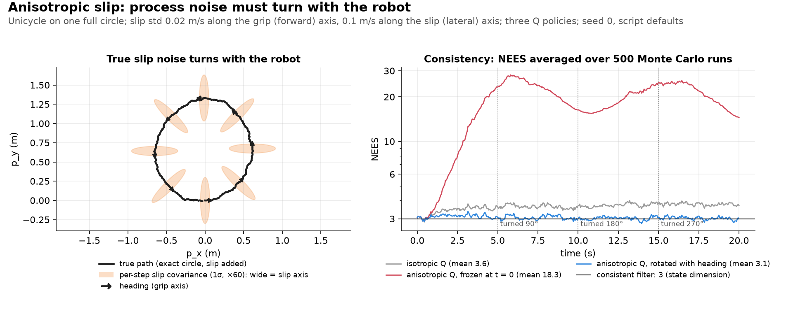

**Scripts:**
- [use_numpy/friction_anisotropic_ekf.py](use_numpy/friction_anisotropic_ekf.py)
- [use_numpy/friction_anisotropic_ekf_v2.py](use_numpy/friction_anisotropic_ekf_v2.py): class-based version, same output
- [generator/animate_friction_anisotropic_ekf.py](generator/animate_friction_anisotropic_ekf.py): animated GIF; render with `uv run python generator/animate_friction_anisotropic_ekf.py --out assets/friction_anisotropic_ekf.gif`

**Run:**

```
uv run python use_numpy/friction_anisotropic_ekf.py --duration 20.0 --dt 0.05 --v-cmd 0.2 --sigma-grip 0.02 --sigma-slip 0.1 --sigma-theta 0.01 --pos-noise-std 0.02 --init-pos-noise-std 0.05 --init-theta-noise-std 0.05 --n-mc-trials 500 --seed 0 --out out.png
```

<details>
<summary>All flags</summary>

- `--duration`: simulation length in seconds (default `20.0`)
- `--dt`: filter/measurement step interval in seconds (default `0.05`)
- `--v-cmd`: constant commanded forward speed, m/s (default `0.2`)
- `--omega-cmd`: constant commanded turn rate, rad/s (default: $2\pi/\text{duration}$, i.e. exactly one full loop, so heading sweeps every orientation relative to the fixed reference)
- `--sigma-grip`/`--sigma-slip`: true body-frame slip std-dev along the grip/forward and slip/lateral axes, m/s (defaults `0.02`/`0.1`)
- `--sigma-theta`: assumed heading process-noise std-dev, all three filter variants, rad/s (default `0.01`)
- `--pos-noise-std`: position measurement noise std-dev, m (default `0.02`)
- `--init-pos-noise-std`/`--init-theta-noise-std`: std-dev used to perturb the initial position/heading guess (defaults `0.05`/`0.05`)
- `--n-mc-trials`: number of Monte Carlo consistency trials (default `500`)
- `--seed`: RNG seed (default `0`)
- `--out`: save the figure to this path instead of showing it (default: show)

</details>

#### 20. Hexapod leg odometry: what the gait changes

**Purpose:** Shows how the gait (tripod, ripple or wave) changes what a planar hexapod can estimate from its legs alone. It also tests slipping feet, foot drift and uncertain contact timing.

| Input | Output |
|---|---|
| A planar hexapod with noisy stance-foot velocity readings | Prints errors and NEES per gait and experiment; plots RMSE and NEES |

| Variant | Meaning |
|---|---|
| `tripod` | 3 feet down at a time |
| `ripple` | 4 feet down at a time |
| `wave` | 5 feet down at a time |

**Details:** [hexapod_gait_ekf.md](docs/filtering/hexapod_gait_ekf.md)

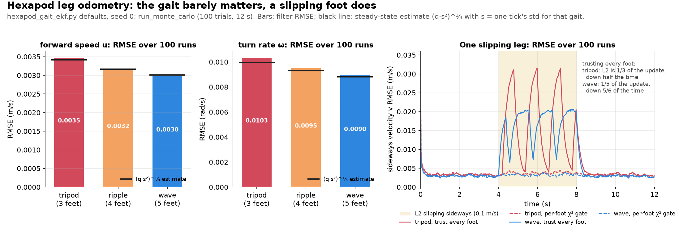

**Scripts:**
- [use_numpy/hexapod_gait_ekf.py](use_numpy/hexapod_gait_ekf.py)
- [use_numpy/hexapod_gait_ekf_v2.py](use_numpy/hexapod_gait_ekf_v2.py): class-based version, same output
- [generator/animate_hexapod_gait_ekf.py](generator/animate_hexapod_gait_ekf.py): animated GIF; render with `uv run python generator/animate_hexapod_gait_ekf.py --out assets/hexapod_gait_ekf.gif`

**Run:**

```
uv run python use_numpy/hexapod_gait_ekf.py --duration 12.0 --dt 0.02 --cycle-period 1.2 --forward-speed 0.1 --turn-rate 0.2 --lin-accel-std 0.05 --ang-accel-std 0.1 --meas-noise-std 0.02 --init-pos-noise-std 0.01 --init-heading-noise-std 0.01 --init-twist-noise-std 0.05 --slip-leg L2 --slip-start 4.0 --slip-end 8.0 --slip-speed 0.1 --foot-drift-std 0.02 --detect-time-noise-std 0.05 --n-mc-trials 100 --seed 0
```

<details>
<summary>All flags</summary>

- `--duration`: simulation length in seconds (default `12.0`)
- `--dt`: filter/measurement step interval in seconds (default `0.02`)
- `--cycle-period`: gait cycle period, s; must be a multiple of `6*dt` (default `1.2`)
- `--forward-speed`/`--turn-rate`: initial forward speed, m/s, and turn rate, rad/s, of the random-walk truth (defaults `0.1`/`0.2`)
- `--lin-accel-std`/`--ang-accel-std`: twist random-walk std-devs, $`\text{m/s}^2`$ and $`\text{rad/s}^2`$, used by both truth and filter (defaults `0.05`/`0.1`)
- `--meas-noise-std`: per-axis std-dev of each foot's relative-velocity reading, m/s (default `0.02`)
- `--init-pos-noise-std`/`--init-heading-noise-std`/`--init-twist-noise-std`: initial-guess std-devs, m, rad and m/s (rad/s for $`\omega`$) (defaults `0.01`/`0.01`/`0.05`)
- `--slip-leg`: leg that slips in the slip experiment, one of `L1`-`L3`, `R1`-`R3` (default `L2`)
- `--slip-start`/`--slip-end`: slip window, s (defaults `4.0`/`8.0`)
- `--slip-speed`: outward sideways slip speed, m/s (default `0.1`)
- `--foot-drift-std`: random drift velocity std-dev of every stance foot in the drift experiment, m/s (default `0.02`)
- `--detect-time-noise-std`: touchdown/liftoff detection-time error std-dev in the jitter experiment, s (default `0.05`)
- `--n-mc-trials`: number of Monte Carlo trials (default `100`; about 3 minutes)
- `--seed`: RNG seed (default `0`)
- `--out`: save the figure to this path instead of showing it (default: show)

</details>

#### 21. Contact-aided invariant EKF on a hexapod: which filter knows yaw is unobservable

**Purpose:** Compares an invariant EKF with a world-frame error-state EKF on the same data. Both keep stance-foot positions in the state, and the question is which one respects that yaw is unobservable.

| Input | Output |
|---|---|
| A 3D hexapod walking with IMU and leg-kinematics measurements | Prints position error and NEES per filter; plots yaw error, NEES and velocity error |

**Details:** [hexapod_contact_inekf.md](docs/filtering/hexapod_contact_inekf.md)


**Scripts:**
- [use_numpy/hexapod_contact_inekf.py](use_numpy/hexapod_contact_inekf.py)
- [generator/animate_hexapod_contact_inekf.py](generator/animate_hexapod_contact_inekf.py): animated GIF; render with `uv run python generator/animate_hexapod_contact_inekf.py --out assets/hexapod_contact_inekf.gif`

**Run:**

```
uv run python use_numpy/hexapod_contact_inekf.py --duration 12.0 --dt 0.02 --cycle-period 1.2 --forward-speed 0.1 --turn-rate 0.2 --gyro-noise-std 0.005 --accel-noise-std 0.05 --contact-noise-std 0.01 --kin-noise-std 0.005 --slip-leg L2 --slip-start 4.0 --slip-end 8.0 --slip-speed 0.1 --n-mc-trials 50 --seed 0
```

<details>
<summary>All flags</summary>

- `--duration`: simulation length in seconds (default `12.0`)
- `--dt`: IMU and kinematics step in seconds (default `0.02`)
- `--cycle-period`: gait cycle period, s; must be a multiple of `6*dt` (default `1.2`)
- `--forward-speed`/`--turn-rate`: initial forward speed, m/s, and turn rate, rad/s, of the random-walk truth (defaults `0.1`/`0.2`)
- `--gyro-noise-std`/`--accel-noise-std`: per-sample IMU noise std-devs, rad/s and $`\text{m/s}^2`$ (defaults `0.005`/`0.05`)
- `--contact-noise-std`: stance-foot velocity noise, body frame, m/s (default `0.01`)
- `--kin-noise-std`: kinematic foot-position noise per axis, m (default `0.005`)
- `--slip-leg`: leg that slips in experiment 2, one of `L1`-`L3`, `R1`-`R3` (default `L2`)
- `--slip-start`/`--slip-end`: slip window, s (defaults `4.0`/`8.0`)
- `--slip-speed`: outward sideways slip speed, m/s (default `0.1`)
- `--n-mc-trials`: Monte Carlo trials per experiment (default `50`; about 4 minutes for all experiments)
- `--seed`: RNG seed (default `0`)
- `--out`: save the figure to this path instead of showing it (default: show)

</details>

#### 22. Gait phase: which feet are on the ground, when touchdowns are uncertain

**Purpose:** Compares four ways of deciding which feet are on the ground when touchdown times are uncertain, with the true stance as a reference. This drops the assumption of §20 that the filter is told the stance.

| Input | Output |
|---|---|
| A tripod-gait hexapod with late and uncertain touchdowns and a contact detector that sometimes fires falsely | Prints wrong-stance counts and NEES per approach; plots stance flags, touchdown offsets and NEES |

| Variant | Meaning |
|---|---|
| `schedule` | Stance starts at the commanded touchdown |
| `detector` | Stance starts at the first detector trigger |
| `cpg` | Central pattern generator (CPG): learns the typical offset; rejects too-early triggers |
| `phase_ekf` | Kalman filter on the touchdown lag; rejects early triggers |
| `oracle` | The true stance (reference) |

**Details:** [gait_phase_ekf.md](docs/filtering/gait_phase_ekf.md)


**Scripts:**
- [use_numpy/gait_phase_ekf.py](use_numpy/gait_phase_ekf.py)
- [generator/animate_gait_phase_ekf.py](generator/animate_gait_phase_ekf.py): animated GIF; render with `uv run python generator/animate_gait_phase_ekf.py --out assets/gait_phase_ekf.gif`

**Run:**

```
uv run python use_numpy/gait_phase_ekf.py --duration 24.0 --dt 0.02 --cycle-period 1.2 --forward-speed 0.1 --turn-rate 0.2 --lin-accel-std 0.05 --ang-accel-std 0.1 --meas-noise-std 0.02 --init-pos-noise-std 0.01 --init-heading-noise-std 0.01 --init-twist-noise-std 0.05 --lag-max 0.2 --terrain-std 0.03 --blocked-leg L2 --blocked-start 10.0 --blocked-end 14.0 --blocked-delay 0.2 --det-delay 0.04 --det-delay-std 0.02 --false-rate 0.1 --cpg-gain 0.3 --cpg-window 0.1 --cpg-mistime 0.1 --ekf-rate-q 1e-5 --ekf-init-lag-std 0.05 --ekf-init-rate-std 0.01 --ekf-gate 3.0 --n-mc-trials 100 --seed 0 --out out.png
```

<details>
<summary>All flags</summary>

- `--duration`: simulation length in seconds (default `24.0`, 20 gait cycles)
- `--dt`: filter/measurement step interval in seconds (default `0.02`)
- `--cycle-period`: commanded gait cycle period, s (default `1.2`)
- `--forward-speed`/`--turn-rate`: initial forward speed, m/s, and turn rate, rad/s, of the random-walk truth (defaults `0.1`/`0.2`)
- `--lin-accel-std`/`--ang-accel-std`: twist random-walk std-devs, $`\text{m/s}^2`$ and $`\text{rad/s}^2`$ (defaults `0.05`/`0.1`)
- `--meas-noise-std`: std-dev of each foot's velocity reading, m/s (default `0.02`)
- `--init-pos-noise-std`/`--init-heading-noise-std`/`--init-twist-noise-std`: initial-guess std-devs, m, rad and m/s (rad/s for $`\omega`$) (defaults `0.01`/`0.01`/`0.05`)
- `--lag-max`: final systematic touchdown lag as a fraction of the swing time, growing linearly from 0 (default `0.2`)
- `--terrain-std`: per-foot, per-step touchdown offset std-dev, s (default `0.03`)
- `--blocked-leg`: leg that gets blocked, one of `L1`-`L3`, `R1`-`R3` (default `L2`)
- `--blocked-start`/`--blocked-end`: blocked window, s (defaults `10.0`/`14.0`)
- `--blocked-delay`: extra landing delay of the blocked leg, s; `0` = off (default `0.2`)
- `--det-delay`/`--det-delay-std`: mean and std-dev of the detection delay, s; the estimators know the mean (defaults `0.04`/`0.02`)
- `--false-rate`: probability of a false trigger early in a swing-down, per step (default `0.1`)
- `--cpg-gain`: CPG learning gain on the touchdown offset (default `0.3`)
- `--cpg-window`: CPG rejects triggers earlier than the learned offset minus this, s (default `0.1`)
- `--cpg-mistime`: CPG mistiming threshold on the offset error, s (default `0.1`)
- `--ekf-rate-q`: phase EKF lag-rate change intensity, $`\text{s}^2/\text{s}^3`$ (default `1e-5`)
- `--ekf-init-lag-std`/`--ekf-init-rate-std`: phase EKF initial lag std-dev, s, and lag-rate std-dev, s/s (defaults `0.05`/`0.01`)
- `--ekf-gate`: phase EKF early-reject and mistiming gate, in σ (default `3.0`)
- `--n-mc-trials`: number of Monte Carlo trials (default `100`)
- `--seed`: RNG seed (default `0`)
- `--out`: save the figure to this path instead of showing it (default: show)

</details>
