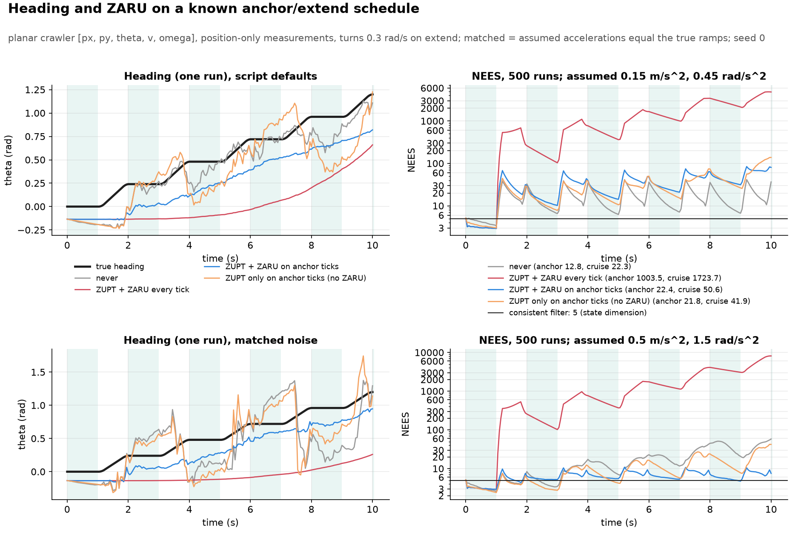
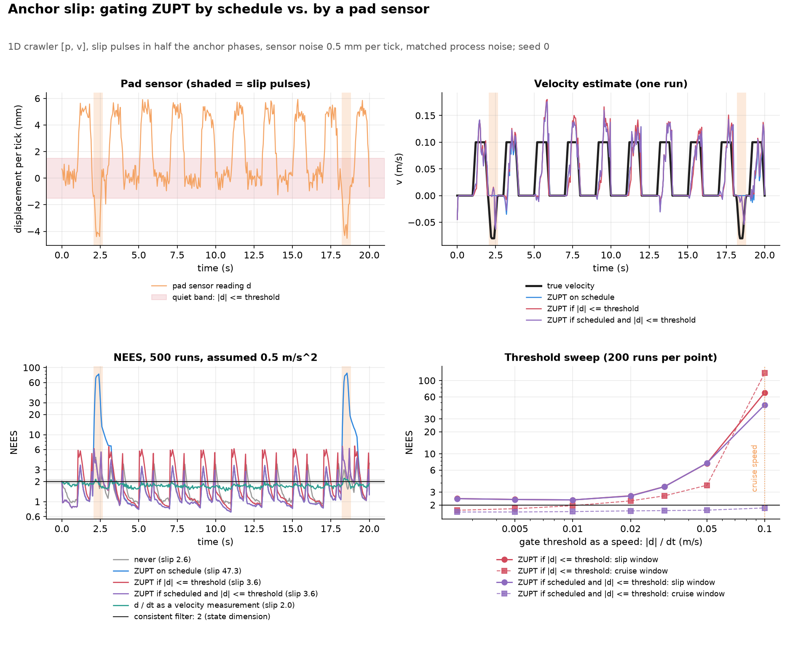

# Phase-conditional ZUPT: exploiting a known anchor/dwell schedule

## Intuition

An inchworm (real or robotic) doesn't move continuously - it cycles between two phases:

```text
ANCHOR                    EXTEND                     ANCHOR
(grip, hold still)   (release, push/pull body)   (grip again, hold still)

  ▓▓●━━━━━●            ▓▓●╲     ╱●--->              ●━━━━━●▓▓
   front anchored        body extends/stretches       new anchor set,
   to ground, v = 0      forward, then contracts       v = 0 again
```

*Illustrative: the toy itself is a point mass with a trapezoidal velocity.*

- **Anchor:** one end is planted on the ground, so that segment is, ideally, stationary ($v = 0$). In this toy the whole point mass stands still, so it's known ground truth.
- **Extend:** the anchor releases, the body pushes forward at some commanded speed, then the new end plants and grips.

The idea: during anchor, "velocity = 0" is a known, free measurement (a ZUPT, Zero-Velocity Update) that we can feed into the filter. It is valid only while we're still. Fed in during extend, it tells the filter something false with high confidence, which is the failure mode the `always` variant (defined in §1) demonstrates.

The same idea is well established for foot-mounted pedestrian navigation (Foxlin 2005), where the shoe is still during each **stance phase** (the part of a step when the foot is planted). For an inchworm robot, a sensor on the anchored segment gets up to three nearly free pieces of information while that segment is planted:

- **velocity ≈ 0**, a zero-velocity update (ZUPT);
- **angular rate ≈ 0**, a zero-angular-rate update (ZARU);
- **an accelerometer reading of gravity plus bias**, since the sensor isn't accelerating, which gives a tilt reference.

None of these holds during release and extend. Three caveats:

- **It applies to the anchored segment, not the whole robot.** In a real inchworm gait the rest of the body moves while one end is planted. This toy's point mass stands in for a sensor on the anchored segment.
- **"Stationary" is approximate.** Micro-slip and vibration mean the zero is never exact, so the ZUPT update below carries a noise $\sigma_{\text{zupt}}$ rather than being treated as exact.
- **Stillness isn't the only time the accelerometer sees just gravity.** Any unaccelerated motion does too. But only at rest do we know the velocity is zero without a motion model.

We work through the simplest concrete version using [`inchworm_zupt_ekf.py`](../../use_numpy/inchworm_zupt_ekf.py)'s 1D crawling point mass.


*Figure: the gait schedule at `use_numpy/inchworm_zupt_ekf.py`'s defaults, plotted by `uv run python assets/make_figures.py inchworm_zupt_ekf_concept`.*

### Scope
This is deliberately a small slice of the real idea.

- It models translation only: ZUPT, not ZARU, which needs gyroscope bias ([glossary](../glossary.md#bias)) and orientation states this toy doesn't carry. §5 adds a heading and ZARU in a planar side extension (still without gyro bias). §6 adds anchor slip and a pad displacement sensor in a second side extension.
- It assumes the gait schedule (when anchor/extend happen) is *known*, not detected. What happens once the schedule itself is uncertain is the subject of [`hybrid_saltation_ekf.md` §8](hybrid_saltation_ekf.md#8-quantifying-contact-detection-timing-jitter), which we lean on rather than repeat.

---

## 1. Why this isn't a hybrid-reset problem

Unlike the bouncing point mass in `hybrid_saltation_ekf.md`, nothing here needs a guard, a reset map, or a saltation matrix ([glossary](../glossary.md#saltation-matrix)). Velocity is externally commanded per phase - an ordinary **switched-linear system** (a different linear model in each phase), not a discontinuous *state* jump the filter's covariance has to be linearized through. The interesting question sits on the **measurement** side: does the filter exploit (or misuse) the zero-velocity information the anchor phase provides?

State is $x = [p, v]$ (1D). The gait cycle alternates:

- **anchor** (duration $t_{\text{anchor}}$): the point mass is exactly stationary, $v = 0$.
- **extend** (duration $t_{\text{extend}}$): the point mass ramps up to a commanded cruise speed $v_{\text{extend}}$, holds it, then ramps back down to exactly $0$ before the next anchor phase begins - continuous everywhere, no instantaneous jump (§2 explains why).

We compare three ways of using the ZUPT **pseudo-measurement** (a value the filter knows from the motion itself rather than from a sensor, here velocity = 0), sharing an identical predict step and the same noisy position measurement every **tick** (one filter time step) - they differ *only* in when an additional ZUPT update runs:

| Variant | ZUPT applied when |
| --- | --- |
| `never` | Never - position-only, ignores the anchor phase entirely |
| `always` | Every tick, regardless of true phase - the schedule-unaware mistake |
| `phase_conditional` | Only on ticks the known schedule marks as anchor - the correct policy |

### 1.1 The filter math, concretely

All three variants run the same Kalman filter over $x = [p, v]^\top$. The script calls it an EKF ([glossary](../glossary.md#ekf-extended-kalman-filter)) to match the rest of this repo, but every model here is exactly linear, so there is no linearization error and it is really a plain KF. Each tick runs up to three steps, in this order: **predict**, **position update**, then (depending on the variant) a **ZUPT update** (`run_ekf`).

#### Predict (`predict`)
A constant-velocity model, with **state-transition matrix** $`\Phi`$, is identical for all variants and both gait phases. The filter doesn't know the commanded velocity, only that it's roughly constant between ticks:

```math
\Phi = \begin{bmatrix} 1 & \Delta t \\ 0 & 1 \end{bmatrix}, \qquad
Q = \begin{bmatrix} \left(\tfrac{1}{2}\sigma_a\Delta t^2\right)^2 & 0 \\ 0 & \left(\sigma_a\Delta t\right)^2 \end{bmatrix}
```

```math
x^{-} = \Phi\,x, \qquad P^{-} = \Phi\,P\,\Phi^\top + Q
```

Superscripts mark the step: $x^-$, $P^-$ are predicted (before the update) and $x^+$, $P^+$ are updated, where $`P`$ is the state **covariance** ([glossary](../glossary.md#covariance)) ([kf_ekf_iekf.md §1](kf_ekf_iekf.md#1-standard-kalman-filter-everything-is-nicely-linear)).

$`\sigma_a`$ is the assumed acceleration-disturbance standard deviation (the script's `--process-noise-std`, §2), and $Q$ (the **process-noise covariance**, [glossary](../glossary.md#predict-and-update-steps)) is a simple diagonal heuristic (the same formula as in `saltation_matrix_ekf.py`), not the textbook continuous white-noise-acceleration $Q$, which also has off-diagonal terms.

#### Measurement updates (`_kf_update`)
Both updates go through the same standard linear-Gaussian update and differ only in $z$, $H$, and $R$ (the measurement, the **measurement Jacobian**, and the **measurement-noise covariance**, [glossary](../glossary.md#ekf-extended-kalman-filter)):

```math
r = z - H x^{-}, \qquad S = H P^{-} H^\top + R, \qquad K = P^{-} H^\top S^{-1}
```

Here $`r`$ is the **innovation**, $`S`$ is its **covariance**, and $`K`$ is the **Kalman gain** ([glossary](../glossary.md#innovation-and-kalman-gain)).

```math
x^{+} = x^{-} + K r, \qquad P^{+} = (I - K H)\,P^{-}
```

| Update | Function | $z$ | $H$ | $R$ | Runs |
| --- | --- | --- | --- | --- | --- |
| Position | `measurement_update_position` | noisy position reading | $`\begin{bmatrix} 1 & 0 \end{bmatrix}`$ | $`\sigma_{\text{pos}}^2`$ | every tick |
| ZUPT | `measurement_update_zupt` | $0$ (pseudo-measurement) | $`\begin{bmatrix} 0 & 1 \end{bmatrix}`$ | $`\sigma_{\text{zupt}}^2`$ | depends on the variant |

ZUPT is a **pseudo-measurement**: no sensor produces that $z = 0$. The filter is simply told "velocity is zero, give or take $\sigma_{\text{zupt}}$", which is only true if the robot really is stationary. $\sigma_{\text{pos}}$ is the standard deviation of the noise on each position reading (m). The script's defaults are $\sigma_{\text{pos}} = 0.02$ m and $\sigma_{\text{zupt}} = 0.01$ m/s. Because the two measurement noises are independent, running the ZUPT update right after the position update in the same tick gives the same result as one joint update with both rows of $H$ stacked.

#### The ZUPT update, written out
With $`H = \begin{bmatrix} 0 & 1 \end{bmatrix}`$ everything reduces to scalars, with $R_{\text{zupt}} = \sigma_{\text{zupt}}^2$ the ZUPT noise variance. Write the predicted covariance as

```math
P^{-} = \begin{bmatrix} P_{pp} & P_{pv} \\ P_{pv} & P_{vv} \end{bmatrix}
\quad\Longrightarrow\quad
S = P_{vv} + R_{\text{zupt}}, \qquad
K = \frac{1}{P_{vv} + R_{\text{zupt}}} \begin{bmatrix} P_{pv} \\ P_{vv} \end{bmatrix}, \qquad
r = 0 - v^{-} = -v^{-}
```

Substituting into the update above:

```math
v^{+} = \frac{R_{\text{zupt}}}{P_{vv} + R_{\text{zupt}}}\,v^{-}, \qquad
p^{+} = p^{-} - \frac{P_{pv}}{P_{vv} + R_{\text{zupt}}}\,v^{-}
```

```math
P_{vv}^{+} = \frac{P_{vv}\,R_{\text{zupt}}}{P_{vv} + R_{\text{zupt}}}, \qquad
P_{pp}^{+} = P_{pp} - \frac{P_{pv}^2}{P_{vv} + R_{\text{zupt}}}
```

Three things follow directly from these formulas:

- **It shrinks velocity toward zero.** The velocity estimate is multiplied by a factor between 0 and 1. The more the filter already trusts its velocity estimate (small $P_{vv}$) relative to the pseudo-measurement, the less it moves; the more uncertain it is, the harder it is pulled to $0$.

- **It corrects position too, through the cross-covariance.** $P_{pv}$ is how the filter has learned that position and velocity errors move together. If the velocity estimate turns out too high, the position estimate has probably drifted ahead too, so $p$ gets pulled back as well (for positive $P_{pv}$). This is how a velocity-only pseudo-measurement also affects position.

- **It always makes the filter more confident, whether or not the claim is true.** $P_{vv}^{+}$ is always smaller than both $P_{vv}$ and $R_{\text{zupt}}$. Nothing in the update checks whether the robot is stationary. So when `always` applies it during extend, the filter reports a velocity standard deviation of at most 0.01 m/s while the true velocity is up to $v_{\text{extend}} = 0.1$ m/s away from the zero it was just told. That built-in overconfidence drives the large `always` NEES values in §3 (**NEES**, 2 on average for a consistent 2-state filter, [glossary](../glossary.md#consistency-and-nees)).

---

## 2. Choosing the ramp: a step jump is an unmodeled acceleration

A true step in velocity ($0$ during anchor, $v_{\text{extend}}$ the instant extend begins) is an unmodeled acceleration spike at every phase transition, the same mechanism as in §3. The predict step's constant-velocity model with a finite process-noise budget can't represent it. So `true_velocity` ramps linearly over a $t_{\text{ramp}}$ window at each end of the extend phase, and velocity is continuous everywhere.

A ramp only helps if it is gentle enough. The rule: compare the true ramp acceleration $v_{\text{extend}} / t_{\text{ramp}}$ with $\sigma_a$, the filter's assumed acceleration disturbance. That ratio measures the mismatch.

| Case | $t_{\text{ramp}}$ | $v_{\text{extend}}$ | $\sigma_a$ | Ratio |
| --- | --- | --- | --- | --- |
| Bad ratio (illustration) | 0.1 s | 0.2 m/s | 0.05 m/s² | $40\times$ |
| Current defaults ($t_{\text{extend}} = 1.0$ s) | 0.2 s | 0.1 m/s | 0.15 m/s² | $\sim 3.3\times$ |

**Intuition:** the ratio counts how many times larger than its assumed disturbance the real acceleration is.
- $\sigma_a$ is an acceleration standard deviation (m/s²): the size of surprise the filter expects.
- At the defaults the ramp accelerates at $`0.1/0.2 = 0.5`$ m/s², against $`0.15`$ m/s² assumed.
- $`0.5/0.15 \approx 3.3`$: each ramp is about 3.3 "standard surprises", not 1.
- The bad-ratio row is the same idea, at $`40`$ standard surprises.

The defaults' $t_{\text{extend}}$ gives 12 cruise and 20 anchor ticks, enough to settle before being measured. The $40\times$ case is far worse, but $3.3\times$ is still a real mismatch, not a negligible one: §3 shows it sets every variant's NEES level and drives the `never`-vs-`phase_conditional` comparison.

The lesson matches the **Zeno**-regime pitfall ([glossary](../glossary.md#zeno-behavior)) in [`hybrid_saltation_ekf.md` §7](hybrid_saltation_ekf.md#7-two-things-worth-knowing-before-reusing-this-pattern): pick simulation parameters with real margin under a hard failure mode, not by trial against the first numbers that come out.

The headline NEES comparison below uses two windows and excludes the ramp ticks themselves: the **anchor window** is the anchor-phase ticks (`is_anchor`), and the **cruise window** is the constant-speed ticks of the extend phase between the two ramps, $t_{\text{ramp}} \le$ time into the phase $< t_{\text{extend}} - t_{\text{ramp}}$ (`is_cruise`). The ramp ticks are a shared transition cost all three variants pay alike, not the phenomenon being measured, the same convention `hybrid_saltation_ekf.md` uses for its shared bounce-tick spike.

---

## 3. The finding: not just "always is wrong while moving"

One might expect `always` to match `phase_conditional` during genuine anchor ticks (both apply the identical, correct update there) and diverge only during motion. It doesn't (seeds 0-3, `n_trials=500`, mean NEES over the cruise-only/anchor-only windows).


*Figure: `use_numpy/inchworm_zupt_ekf.py` at its defaults (seed 0), plotted by `uv run python assets/make_figures.py inchworm_zupt_ekf`.*

The same run, animated over five anchor/extend cycles. The top strip shows the point mass crawling along its track, gold while anchored and green while extending, with a gray footprint at each anchor point and each policy's position estimate below it; `always` falls several centimetres behind (position **RMSE**, [root-mean-square error](../glossary.md#rmse-root-mean-square-error), 0.060 m vs 0.015-0.016 m). The middle panel shows each policy's velocity estimate with its ±2σ band: `always` collapses its band during motion, and `phase_conditional` tightens only on anchor ticks. The bottom panel shows the Monte Carlo NEES (averaged over many randomized runs, [glossary](../glossary.md#monte-carlo-trials)) building up cycle by cycle; `always` climbs to a per-tick peak of about 940, and none of the three is consistent at these defaults.


*Animation: `use_numpy/animate_inchworm_zupt_ekf.py` at its defaults (seed 0, 500 trials), rendered by `uv run python use_numpy/animate_inchworm_zupt_ekf.py --out assets/inchworm_zupt_ekf.gif`.*

| Variant | anchor-only NEES | cruise-only NEES | velocity RMSE (single run) |
| --- | --- | --- | --- |
| `never` | ~6.0 | ~10.8 | ~0.055-0.060 m/s |
| `always` | ~299 | ~521 | ~0.060 m/s |
| `phase_conditional` | ~6.1 | ~16.4 | ~0.043-0.045 m/s |

A consistent 2-**DoF** ([degrees of freedom](../glossary.md#degrees-of-freedom-dof)) filter averages $\text{NEES} = 2$; for an average over 500 trials the 95% interval is about $[1.83, 2.18]$. None of the three is consistent: the four non-`always` windows (6.0-16.4) sit at ~3-8× that value.

**Why every variant is overconfident: the ramps.** The truth has no random disturbance at all. Its only departure from the filters' constant-velocity model is the ramp acceleration, $3.3\times$ the assumed $`\sigma_a`$ (§2). The truth changes speed faster than the filter expects. Per tick, at the defaults $`\Delta t = 0.05`$ s:

- During a ramp the speed really changes by $`0.5 \times 0.05 = 0.025`$ m/s.
- The filter's process noise allows only $`0.15 \times 0.05 = 0.0075`$ m/s (the $`\sigma_a\Delta t`$ in $Q$).
- A confident ZUPT adds to the gap: after each update the filter claims $`\sigma_v \le 0.01`$ m/s, so the real change is about $2.5\times$ that claim.
- Confident and under-sized: that is why the NEES is too high. This is a per-tick scale, not the exact NEES.

Two checks at seed 0 confirm this is the whole story:

| Setting | `never` anchor/cruise | `phase_conditional` anchor/cruise |
| --- | --- | --- |
| Defaults | 6.0/10.8 | 6.1/16.4 |
| No motion ($`v_{\text{extend}} = 0`$) | 1.1/1.0 | 0.8/0.7 |
| $`\sigma_a = 0.5\,\text{m/s}^2`$ (covers the ramps) | 1.4/1.6 | 0.9/1.7 |

- With no motion, every variant is at or below 2 (conservative, since the filters assume noise the truth doesn't have).
- With $\sigma_a$ large enough to cover the ramps, `never` and `phase_conditional` are close to consistent, slightly conservative: all four windows (0.9-1.7) fall below the interval's lower edge of 1.83.

**`always` is dramatically worse everywhere, not just during motion.** Misapplying ZUPT throughout every cruise phase drives the velocity variance artificially tight around a wrong belief. About 20 ticks of correct ZUPT evidence at the start of the next anchor phase can't undo that before the phase ends, so the corruption bleeds into the next cycle and compounds:

- `always`'s NEES at the first tick of anchor phases 2-5 (seed 0; phase 1 precedes any cruise, so it's still ~2 there) is 230, 564, 732, then 798, and within phase 4 it decays only from 732 to 266.
- `phase_conditional`'s starts near 20 and settles near 3.6 in each of those phases.
- `always` gets no accuracy benefit for the trouble. Its velocity RMSE (~0.060 m/s) matches `never`'s, and its position RMSE is far worse (0.060-0.062 m vs. `never`'s 0.011-0.015 m, single runs, seeds 0-3), while it is overconfident throughout.

**A second finding, and what actually causes it.** At the defaults, `phase_conditional` has the best *velocity* accuracy of the three, but not the best position accuracy or calibration:

- Position RMSE (seeds 0-3): `never` 0.0107-0.0147 m vs. `phase_conditional` 0.0157-0.0184 m, worse in every seed.
- Cruise-window NEES: `never` ~10.8 vs. `phase_conditional` ~16.4.

The per-tick NEES shows the mechanism. By the end of an anchor phase, ZUPT has made `phase_conditional` very confident in its velocity (NEES about 3.5). Then the ramp-up arrives with an acceleration its process model doesn't allow for, and the more confident filter is hit harder: at the end of the ramp its NEES jumps to about 30, against about 25 for `never`, and it stays higher through the cruise. The lag in velocity also drags its position.

So this is a property of the under-sized process model, not of ZUPT. With $`\sigma_a = 0.5\,\text{m/s}^2`$, the finding reverses: `phase_conditional` is close to consistent (slightly conservative) and also the most accurate in position (0.0087 m vs. `never`'s 0.0123 m at seed 0). The general lesson is narrower than "trusting a pseudo-measurement is fragile": **an accurate pseudo-measurement makes an unmodeled disturbance hurt more**, because it removes the slack that would otherwise absorb it.

---

## 4. Takeaway for a real phase-gated measurement update

This toy's `never`/`always`/`phase_conditional` split is a minimal stand-in for a general design question in any estimator that fuses a phase-dependent pseudo-measurement: **gate which measurement terms are active by phase within the single update**, rather than applying them unconditionally or leaving them out for simplicity. The payoff is real: clearly better velocity tracking, and a mild failure mode (its worst window, 16.4, is ~30× below `always`'s 521). But it holds only once the rest of the model is sized honestly, especially at the transitions where the constraint switches on and off. Check calibration there rather than assuming a correctly gated filter wins everywhere (§3: gating bugs spill into the next phase, and a gated, confident filter has less slack for model error).

---

## 5. Side extension: heading and ZARU

The 1D toy cannot carry ZARU, since it has no orientation state (Scope). [`inchworm_zupt_zaru_ekf.py`](../../use_numpy/inchworm_zupt_zaru_ekf.py) adds one. A plain 2D copy of §1 would show nothing new: with **isotropic** noise (the same in every direction, [glossary](../glossary.md#isotropic-and-anisotropic)) it splits into two independent 1D filters. A heading is what couples the axes.

### Model
- **State:** $`x = [p_x, p_y, \theta, v, \omega]`$ (position, heading, forward speed, turn rate), a **unicycle**: $`p_x \mathrel{+}= v\cos\theta\,\Delta t`$, $`p_y \mathrel{+}= v\sin\theta\,\Delta t`$, $`\theta \mathrel{+}= \omega\,\Delta t`$, with $`v`$ and $`\omega`$ constant between ticks. The motion is nonlinear in $`\theta`$, so unlike §1.1 this is a real EKF, with $`\Phi`$ the Jacobian of that model.
- **Process noise:** a random linear acceleration (std $`\sigma_a`$) along the heading and a random angular acceleration (std $`\sigma_\alpha`$), mapped to the state with $`\tfrac{1}{2}\Delta t^2`$ to position (along the heading only) or heading and $`\Delta t`$ to the rate. Unlike §1.1's diagonal heuristic, this keeps the correlation between each quantity and its rate.
- **Measurements:** noisy position only (σ = 0.02 m per axis), with no heading sensor. So $`\theta`$ is **observable** (determinable from the measurements, [glossary](../glossary.md#observability)) only through the direction of travel, and not at all while anchored.
- **Pseudo-measurements:** **ZUPT** ($`v = 0`$, σ = 0.01 m/s) and **ZARU** ($`\omega = 0`$, σ = 0.02 rad/s).
- **Truth:** $`v`$ and $`\omega`$ follow the §2 trapezoid, with cruise values 0.1 m/s and 0.3 rad/s. The body turns 0.24 rad in each extend and is exactly still while anchored, so an unconditional ZARU is as false during motion as an unconditional ZUPT.
- **Policies:** `never` (neither), `always` (both on every tick) and `phase_conditional` (both on anchor ticks) treat ZUPT and ZARU together. `phase_conditional_zupt_only` is a control variant: ZUPT on anchor ticks and no ZARU, which isolates what ZARU adds.

### Results
Seed 0, 500 trials. A consistent 5-DoF filter averages NEES 5, with a 95% interval of $`[4.73, 5.28]`$. "Defaults" assumes $`\sigma_a = 0.15\,\text{m/s}^2`$ and $`\sigma_\alpha = 0.45\,\text{rad/s}^2`$, 0.3 times the true ramp accelerations ($`0.5\,\text{m/s}^2`$ and $`1.5\,\text{rad/s}^2`$), as in §3. "Matched" assumes the true ramp values. That matches their size, not their effect, as shown below.

| Policy | Defaults NEES anchor/cruise | Matched NEES anchor/cruise | Matched heading RMSE (single run) |
| --- | --- | --- | --- |
| `never` | 12.80/22.32 | 16.42/18.66 | 0.401 rad |
| `always` | 1003.50/1723.66 | 1217.38/2023.85 | 0.651 rad |
| `phase_conditional` | 22.43/50.65 | 5.33/7.85 | 0.221 rad |
| `phase_conditional_zupt_only` | 21.83/41.92 | 8.07/14.74 | 0.360 rad |



*Figure: `use_numpy/inchworm_zupt_zaru_ekf.py` at its defaults (top) and with `--process-noise-std 0.5 --process-noise-ang-std 1.5` (bottom), seed 0, plotted by `uv run python assets/make_figures.py inchworm_zupt_zaru_ekf`.*

#### With matched noise, ZARU keeps the heading honest
Across seeds 0-3, `phase_conditional` has the lowest overall NEES (6.22-6.38) and the lowest heading RMSE (0.159-0.221 rad) of the four policies in every seed. Dropping ZARU (`phase_conditional_zupt_only`) gives NEES 10.19-11.34, and `never` gives 16.79-19.96. Even `phase_conditional` sits slightly above the interval; the next subsection explains why.

The mechanism shows in $`\sigma_\theta`$, the filter's reported heading standard deviation, $`\sqrt{P_{\theta\theta}}`$ (what its covariance claims, not the actual error spread). While anchored, the body does not move, so position says nothing about $`\theta`$, and $`\theta`$ drifts on $`\omega`$'s uncertainty unless ZARU pins it. Seed 0, first to last tick of anchor phases 2-4:

- Without ZARU (`phase_conditional_zupt_only`), $`\sigma_\theta`$ grows: 0.21 → 0.44, 0.28 → 0.49 and 0.28 → 0.51 rad.
- With ZARU (`phase_conditional`), it shrinks: 0.11 → 0.08 rad in each of the three phases.

#### Why even `phase_conditional` is slightly overconfident
Checking each quantity on its own, as error² divided by its variance (1 = honest), shows where the excess is. Position is split along and across the true direction of travel. These ratios do not add up to NEES, which also counts correlations. Seed 0, 300 trials, after the first second:

| Along-track | Cross-track | $`\theta`$ | $`v`$ | $`\omega`$ |
| --- | --- | --- | --- | --- |
| 1.39 | 1.75 | 2.92 | 0.53 | 0.69 |

The heading carries most of the excess, and position follows it, more across the track than along it: a wrong heading pushes the path sideways. Speed and turn rate are conservative. Changing one thing at a time (overall NEES; baseline 6.29 with these 300 trials, 6.38 with the table's 500). These ablations, including the ramp-length runs below, are one-off seed-0 diagnostics that no script reproduces; their Monte Carlo noise is about ±0.2:

- **No motion:** 2.50. **Moving but never turning:** 3.38. So the turning causes it.
- **Initial error 10 times smaller:** 6.35, so it is not the EKF's linearization at a poor first guess.
- **Assumed accelerations doubled:** 3.49, so "matched" noise is still too small for the turns.

The likely reason is that the filter models the disturbance as independent kicks, one per tick, while the ramp pushes the same way on every ramp tick. Over the 4 ramp ticks the filter allows a turn-rate change of about $`1.5 \times 0.05 \times \sqrt{4} = 0.15`$ rad/s (one standard deviation), but each ramp changes $`\omega`$ by 0.3 rad/s, a 2σ event twice per cycle (ramp up and ramp down), and the heading integrates the difference. If that is the cause, longer and gentler ramps with the noise scaled to match should be worse, since the gap grows like $`\sqrt{n}`$ over $`n`$ ramp ticks. They are: ramp length 0.2 / 0.3 / 0.4 s gives NEES 6.29 / 9.69 / 11.86. This fits the explanation but does not prove it.

#### `always` pins the heading where it started
`always` applies ZUPT and ZARU on every tick, so the filter believes the body never moves or turns. Its $`\sigma_\theta`$ stays at the initial 0.10 rad (0.099-0.101) for the whole run, while the true heading turns through 1.2 rad. Its NEES grows cycle after cycle, and its average is about 1000 or more in both windows at both noise levels (seed 0: 1003.5-2023.9; the anchor window at the defaults is 992.9 and 994.8 in seeds 2 and 3).

#### At the defaults, ZARU does not rescue an under-sized model
The defaults repeat §3's finding. `never` has the lowest NEES in all 4 seeds (15.79-16.14 overall, against 33.68-33.98 for `phase_conditional`). Adding ZARU does not help there: `phase_conditional` is slightly worse than `phase_conditional_zupt_only` in 3 of 4 seeds (by at most 3.2). Both gated filters, made confident by their pseudo-measurements, are hit harder than `never` by ramps their process model doesn't allow for, the lesson of §3.

#### What no policy does: estimate the turn rate
A 1 s extend at 0.1 m/s covers about 8 cm, against 2 cm of position noise. That is likely too little path to see the curvature. Across all four policies, seeds 0-3 and both noise levels, the $`\omega`$ RMSE is 0.14-0.36 rad/s. A constant estimate of 0 would give 0.18 rad/s, the RMS of the true $`\omega`$. ZARU's benefit here is keeping the heading from drifting at rest, not measuring the turn.

The same matched run, animated. The left panel shows the top view, with the true path and heading arrow (gold while anchored, green while extending) and each policy's position and heading. The right panels show the heading with ±2σ bands and the Monte Carlo NEES.


*Animation: `use_numpy/animate_inchworm_zupt_zaru_ekf.py` at its defaults (matched noise, seed 0, 500 trials), rendered by `uv run python use_numpy/animate_inchworm_zupt_zaru_ekf.py --out assets/inchworm_zupt_zaru_ekf.gif`.*

---

## 6. Side extension: anchor slip and a measured gate

§1-§5 assume the anchor phase is exactly still and the schedule is known. A real anchor can slip, and a robot with a displacement sensor in its pad can notice. [`inchworm_slip_gate_ekf.py`](../../use_numpy/inchworm_slip_gate_ekf.py) adds both to the 1D toy and asks when to trust $`v = 0`$. It is a toy, not a model of any robot. A real inchworm with such a pad sensor is the motivation (Kubík & Faigl, reference 5); its authors list Kalman fusion of the sensor with motor and inertial data as future work.

### Model
- **Slip:** each anchor phase contains, with probability 0.5, one backward slip pulse: a trapezoid with peak speed 0.08 m/s and duration 0.6 s, including 0.2 s ramps (a step would be an unmodeled acceleration, §2). The pulses are drawn once per seed and held fixed over the Monte Carlo trials, so a "slip tick" is the same tick in every trial. Seed 0 has pulses in 2 of the 10 anchor phases (24 slip ticks); seeds 1-3 have 6 each (72 ticks).
- **Pad sensor:** each tick it reads $`d_k = \Delta t\, v_k + \epsilon_k`$, the current velocity times the tick length (the displacement over the tick if the velocity were constant), with $`\epsilon_k`$ independent noise of std $`\sigma_d = 0.5`$ mm. Divided by $`\Delta t`$ it is a velocity measurement with std $`0.5\,\text{mm} / 0.05\,\text{s} = 0.01`$ m/s, the same as the ZUPT noise. This is a simplification: a sensor mounted in a pad sees the pad's displacement, and only while that pad is on the ground. Here the sensor reads the body's displacement in every phase, as a ground-facing sensor on the body would.
- **Gate:** the sensor is **quiet** on a tick when $`|d_k| \le d_{\text{thr}} = 3\sigma_d = 1.5`$ mm, a speed of $`d_{\text{thr}} / \Delta t = 0.03`$ m/s.
- **Policies:** all five share §1.1's predict step and the position update, and differ only in the extra velocity information.

| Policy | Extra velocity information |
| --- | --- |
| `never` | None. |
| `schedule` | ZUPT on scheduled anchor ticks. This is §1's `phase_conditional`, blind to slip. |
| `sensor_gate` | ZUPT on ticks where the sensor is quiet, with no schedule. |
| `schedule_and_sensor` | ZUPT on ticks that are both scheduled anchor and quiet. |
| `sensor_fused` | No ZUPT. The reading $`d_k / \Delta t`$ is applied on every tick as a velocity measurement. |

- **Process noise:** the matched 0.5 m/s², as in §5, because at the 1D script's 0.15 m/s² every policy's NEES is dominated by the ramps (§3).
- **Windows:** **clean anchor** is the anchor ticks of phases with no slip pulse, **slip** is the ticks inside a pulse, and **cruise** is as in §3. Ramp ticks, and the anchor ticks of slip phases outside the pulse, count only in the overall average.

### Results
Seed 0, 500 trials, NEES by window. A consistent 2-DoF filter averages NEES 2, with a 95% interval of $`[1.83, 2.18]`$.

| Policy | Clean anchor | Slip | Cruise | Overall |
| --- | --- | --- | --- | --- |
| `never` | 1.42 | 2.58 | 1.64 | 1.66 |
| `schedule` | 0.94 | 47.27 | 1.85 | 4.60 |
| `sensor_gate` | 1.05 | 3.57 | 2.67 | 2.20 |
| `schedule_and_sensor` | 0.94 | 3.56 | 1.70 | 1.54 |
| `sensor_fused` | 1.69 | 1.95 | 1.77 | 1.74 |



*Figure: `use_numpy/inchworm_slip_gate_ekf.py` at its defaults, seed 0, plotted by `uv run python assets/make_figures.py inchworm_slip_gate_ekf`. Shaded = slip pulses. The threshold-sweep panel uses 200 runs per point and its own Monte Carlo seed (the threshold table below uses 500 runs and seed 0).*

#### The schedule is blind to slip
During a pulse `schedule` keeps telling the filter the body is still, with std 0.01 m/s, while it slides back at up to 0.08 m/s. The slip pattern is one draw per seed, so the table below repeats the run for seeds 0-3 (NEES in the window named in each header, 500 trials each, matched process noise 0.5 m/s² as above; "slip ticks" is the number of ticks inside a pulse in that seed):

| Seed | Slip ticks | `schedule` slip | `schedule` overall | `schedule_and_sensor` slip | `schedule_and_sensor` overall | `never` slip | `schedule` cruise | `schedule_and_sensor` cruise | `sensor_gate` cruise |
| --- | --- | --- | --- | --- | --- | --- | --- | --- | --- |
| 0 | 24 | 47.27 | 4.60 | 3.56 | 1.54 | 2.58 | 1.85 | 1.70 | 2.67 |
| 1 | 72 | 48.29 | 11.37 | 3.55 | 1.97 | 2.00 | 2.46 | 1.83 | 2.52 |
| 2 | 72 | 47.58 | 11.16 | 3.56 | 1.98 | 2.13 | 2.35 | 1.80 | 2.51 |
| 3 | 72 | 47.65 | 11.22 | 3.55 | 1.97 | 2.01 | 2.29 | 1.78 | 2.51 |

`schedule`'s slip-window NEES is 47.3-48.3 in every seed, against 2.0-2.6 for `never`. The excess lingers: its cruise NEES is 1.85-2.46, against 1.70-1.83 for `schedule_and_sensor`. Its overall NEES rises from 4.60 (seed 0, 24 slip ticks) to 11.16-11.37 (seeds 1-3, 72 slip ticks), so how bad it looks depends on how often the anchor slips. On clean anchors (seeds 0-3) it matches `schedule_and_sensor` (0.93-0.97 vs 0.92-0.95) and beats `sensor_gate` (1.04-1.10). Slip also costs it its position advantage over `never` in seeds 1 and 3 (single-run RMSE 0.0102 vs 0.0096 m and 0.0125 vs 0.0120 m), though not in seeds 0 and 2.

#### Letting the sensor veto the schedule
`schedule_and_sensor` applies the ZUPT only when the schedule and the sensor agree. Across seeds 0-3 it cuts the slip-window NEES to 3.55-3.56 and the overall NEES to 1.54-1.98 (table above), with clean-anchor NEES no worse than `schedule`'s. With `--p-slip 0` it matches `schedule` (both: overall 1.32, clean anchor 0.93, cruise 1.66), so at the default threshold the veto costs nothing when nothing slips.

The slip window is still above the interval (3.56 vs 2.18 at seed 0). The gate admits the ZUPT on 6 of the 24 slip ticks, at the ends of each pulse, where the true speed (0.003-0.037 m/s) is near or below the 0.03 m/s threshold. Lowering the threshold reduces it (3.56 at 3σ to 2.36 at 1σ; see [Choosing the threshold](#choosing-the-threshold)), though at this noise level it never gets back inside the interval.

#### A gate without the schedule leaks at both ends of the extend phase
`sensor_gate` drops the schedule and applies the ZUPT whenever the sensor is quiet. Its cruise-window NEES is 2.51-2.67 across seeds 0-3, above `schedule_and_sensor`'s in every seed (table above). In every seed it admits the ZUPT on 23-29 of the 200 extend ticks, all within 0.1 s of either end of the extend phase. 10 of them are the first extend tick of each cycle, where the true speed is still exactly 0, so the ZUPT is correct. The other 13-19 are leaks: the ramp speed is 0.025 m/s (or, in two seeds, 0.05 m/s), below or near the 0.03 m/s threshold. The schedule says "extending" on those ticks, so `schedule_and_sensor` skips them.

#### Choosing the threshold
Seed 0, 500 trials, varying only the threshold (in units of $`\sigma_d`$, and as the speed $`d_{\text{thr}} / \Delta t`$):

| Threshold | As a speed | `schedule_and_sensor` slip NEES | `sensor_gate` cruise NEES |
| --- | --- | --- | --- |
| 0.25σ | 0.0025 m/s | 2.44 | 1.71 |
| 0.5σ | 0.005 m/s | 2.37 | 1.80 |
| 1σ | 0.01 m/s | 2.36 | 1.97 |
| 2σ | 0.02 m/s | 2.70 | 2.29 |
| 3σ (default) | 0.03 m/s | 3.56 | 2.67 |
| 5σ | 0.05 m/s | 7.59 | 3.79 |
| 10σ | 0.10 m/s | 46.70 | 126.52 |

- **High threshold:** a threshold at the cruise speed (10σ) lets the gate pass "$`v = 0`$" during cruise. `sensor_gate` then fails the way §3's `always` does, with a confidently wrong ZUPT during motion (cruise NEES 126.5; §3's numbers are at 0.15 m/s², so the comparison is qualitative). `schedule_and_sensor` becomes `schedule` (slip NEES 46.7 vs 47.3).
- **Low threshold:** noise vetoes more anchor ticks, since only about 20% of readings on still ticks fall inside the band at 0.25σ. The tested range shows little cost: clean-anchor NEES rises from 0.94 to 1.08, likely because the position fixes still bound the error. A real cost from losing ZUPT ticks may need a lower threshold, a coarser position sensor or a longer anchor phase to show.
- **Noise-free sensor:** with $`\sigma_d \approx 0`$ (`--sensor-noise-std 1e-6`, threshold 3σ), the slip-window NEES of `schedule_and_sensor` is 2.13, so the excess above comes from the gate's finite resolution (threshold and noise together), mostly the threshold (3.56 to 2.36 at 1σ in the table).

#### Slip slower than the gate
A slip whose peak speed is below the threshold is mostly invisible to the gate. Seed 0, slip-window NEES:

| Peak slip speed | `never` | `schedule` | `schedule_and_sensor` | `sensor_fused` |
| --- | --- | --- | --- | --- |
| 0.02 m/s | 1.52 | 3.60 | 3.29 | 1.72 |
| 0.04 m/s | 1.79 | 12.22 | 4.66 | 1.78 |
| 0.08 m/s (default) | 2.58 | 47.27 | 3.56 | 1.95 |

At 0.02 m/s the gate gives almost nothing over the schedule (3.29 vs 3.60). The harm is also small, and in the slip window `never` beats every ZUPT policy. The gate's benefit appears once the peak slip exceeds the threshold (0.04 m/s: 12.22 → 4.66; 0.08 m/s: 47.27 → 3.56), though at 0.04 m/s it still trails `never` (4.66 vs 1.79).

#### Fusing the reading instead of gating it
`sensor_fused` uses $`d_k / \Delta t`$ as an ordinary velocity measurement and has no gate and no schedule. At seed 0 its NEES is 1.69, 1.95 and 1.77 in the clean-anchor, slip and cruise windows, and its single-run velocity RMSE is 0.009 m/s against 0.039-0.050 for the others. It is also the closest to consistent at the script's under-sized 0.15 m/s² (overall NEES 3.40, against 9.40-17.11 for the other four; slip window 5.33). The comparison is not like for like: the gated policies use the reading only as a yes/no flag, while this one uses its value on every tick, and the toy gives it a velocity sensor in every phase. How much of that a real pad sensor offers is the question the simplification above hides.

#### What this toy does not show
- It does not model a pad sensor that reads only while its pad is on the ground. The reading would then mean something only on scheduled anchor ticks, which is how `schedule_and_sensor` uses it. This is an inference about how such a sensor would be used, not a statement about a specific robot. `sensor_gate` and `sensor_fused` need the body-mounted sensor of the model above.
- The slip is a single pulse shape with one peak speed per run. The sensor has no dropout or quantization, and the thresholds and noise levels are not any robot's.
- The slip pattern is one draw per seed. The sweeps use seed 0 only (2 pulses), and the seed comparison above covers seeds 0-3.

The same default run, animated. The panels share the time axis and show the velocity estimates, the pad reading with its quiet band, the ticks on which each gated policy applies the ZUPT, and the Monte Carlo NEES. Slip pulses are shaded.


*Animation: `use_numpy/animate_inchworm_slip_gate_ekf.py` at its defaults (seed 0, 500 trials), rendered by `uv run python use_numpy/animate_inchworm_slip_gate_ekf.py --out assets/inchworm_slip_gate_ekf.gif`.*

#### Takeaway
When the anchor can slip, "the schedule says anchor" is no longer enough to justify $`v = 0`$. A sensor that can vote against the schedule removes most of the damage (slip-window NEES from about 47 to 3.5). The threshold has to sit well below the cruise speed, or the gate becomes `always`. A gate that replaces the schedule instead of checking it admits the ZUPT at the ends of the extend phase.

---

## 7. References

References 2-4 are further reading, not cited in the text above.

1. Foxlin, E. (2005). *Pedestrian Tracking with Shoe-Mounted Inertial Sensors*. IEEE Computer Graphics and Applications, 25(6), 38-46. https://doi.org/10.1109/MCG.2005.140 - foot-mounted inertial navigation with zero-velocity updates; the basis of this doc's `never`/`always`/`phase_conditional` split, there gated by a stance-phase detector rather than this toy's known anchor/extend schedule.
2. Lubbe, E., Withey, D., & Uren, K. R. (2015). *State Estimation for a Hexapod Robot*. 2015 IEEE/RSJ International Conference on Intelligent Robots and Systems (IROS), 6286-6291. https://doi.org/10.1109/IROS.2015.7354274 - state estimation for a physical hexapod robot, a larger-scale setting than this toy; its method is not reproduced here.
3. Liu, Y., Gao, H., Ding, L., Liu, G., Deng, Z., & Li, N. (2018). *State Estimation of a Heavy-Duty Hexapod Robot with Passive Compliant Ankles Based on the Leg Kinematics and IMU Data Fusion*. Journal of Mechanical Science and Technology, 32(8), 3885-3897. https://doi.org/10.1007/s12206-018-0741-4 - leg-kinematics and IMU fusion on a heavy-duty hexapod with passive compliant ankles, a much less idealized contact setting than this toy's stationary anchor phase.
4. Khalili, H. H., Cheah, W., Garcia-Nathan, T. B., Carrasco, J., Watson, S., & Lennox, B. (2020). *Tuning and Sensitivity Analysis of a Hexapod State Estimator*. Robotics and Autonomous Systems, 129, 103509. https://doi.org/10.1016/j.robot.2020.103509 - tuning and sensitivity analysis of a hexapod state estimator; related in spirit to §3's lesson that the process noise has to be sized honestly before the gating comparison means anything.
5. Kubík, J. & Faigl, J. *Adaptive Friction-based Inchworm-like Locomotion*. CTU Computational Robotics Laboratory. https://comrob.fel.cvut.cz/papers/icra26looper.pdf - an inchworm robot with a laser-mouse displacement sensor in each pad and a fixed slip threshold of 0.42 mm; the motivation for §6. §6 is a 1D toy, not a model of that robot. The venue is not verified.
