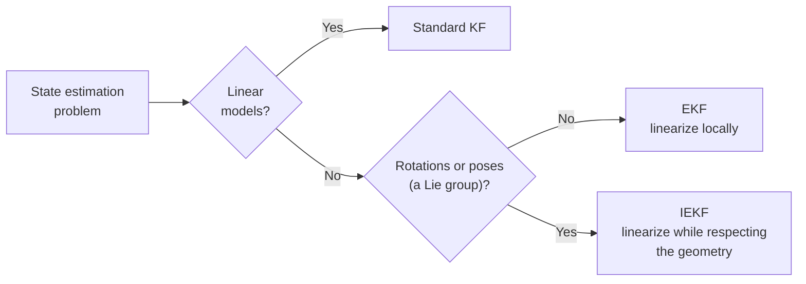

# What are the differences between the standard Kalman Filter, Extended Kalman Filter, and Invariant Extended Kalman Filter?

Start with one idea:

> **A Kalman Filter is a smart way of combining "what I predicted" with "what I measured."**

The three filters differ in **what kind of system they assume** and **how they deal with nonlinear motion**.

This builds directly on:
- **Lie groups and $`SO(3)`$/$`SE(3)`$** from [lie_algebra.md](../foundations/lie_algebra.md) - the geometric structure §3-§5's IEKF discussion is built around.
- The **exponential map** from [lie_algebra.md §8](../foundations/lie_algebra.md#8-the-exponential-map) - the $\exp(\delta\theta^\wedge)$ / $\mathrm{Exp}$ notation used in §5.

---

## 1. Standard Kalman Filter: "Everything is nicely linear"

Say we are tracking a car. We have:

- a previous estimate: "car is at $x = 10$ m, moving at 5 m/s"
- a motion model: "after 1 second, it should be around $x = 15$ m"
- a sensor measurement: "GPS says $x = 14$ m"

The Kalman Filter asks **how much we should trust the prediction versus the measurement**. If GPS is noisy, we might weight the prediction 70% and GPS 30%, giving $0.7 \cdot 15 + 0.3 \cdot 14 = 14.7$ m.

The key assumption is that the state's evolution and the measurement are **linear**:

$$x_k = Fx_{k-1} + w_{k-1} \qquad z_k = Hx_k + v_k$$

where:

- $x$: state
- $z$: measurement
- $F$: linear motion model
- $H$: linear measurement model
- $w$: process noise (everything $F$ doesn't capture: unmodeled dynamics, wind gusts, wheel slip, [IMU](../glossary.md#imu-inertial-measurement-unit) (inertial measurement unit: gyroscope + accelerometer) bias drift, etc.)
- $`Q`$: covariance of process noise, $`Q = \mathrm{Cov}(w)`$
- $v$: measurement noise (GPS jitter, camera pixel noise, IMU noise, etc.)
- $`R`$: covariance of measurement noise, $`R = \mathrm{Cov}(v)`$

The filter needs $`Q`$ and $`R`$, not $w$ and $v$ themselves: the individual noise values are unknown at each step, so it works with their statistics (how large and correlated the noise typically is). This is the same $`Q`$/$`R`$ notation [extra_kf_variants.md §7](extra_kf_variants.md#7-adaptive-kalman-filter) (Adaptive KF) and [§11](extra_kf_variants.md#11-which-ones-should-you-prioritize-learning)'s checklist refer to.

Every KF cycle alternates two steps and carries the filter's uncertainty in a **covariance matrix**, $P$. Unlike $`Q`$ and $`R`$, which describe the noise, $P$ is the covariance of the filter's own **estimation error** $x - \hat x$: how spread out and correlated its belief about $x$ currently is.

### Prediction step
Push the last estimate through the motion model, and grow $P$ by however uncertain that model is ($`Q`$):

$$\hat x_k^- = F\hat x_{k-1} \qquad P_k^- = FP_{k-1}F^\top + Q$$

- The superscript $`{}^-`$ marks the **predicted (prior)** value: after predicting, before the measurement $z_k$ arrives.
- No superscript (written $`{}^+`$ in some other docs) means the **updated (posterior)** value.

### Measurement update step
Compare the predicted measurement $H\hat x_k^-$ against what arrived ($z_k$), and blend the two using the **Kalman gain** $K_k$:

$$K_k = P_k^- H^\top(HP_k^-H^\top + R)^{-1} \qquad \hat x_k = \hat x_k^- + K_k(z_k - H\hat x_k^-) \qquad P_k = (I-K_kH)P_k^-$$

$K_k$ is the "prediction versus measurement" weighting above:
- It is large (trust the measurement more) when $P_k^-$ is large relative to $`R`$.
- It is small (trust the prediction more) when $`R`$ is large relative to $P_k^-$. The 70%/30% split earlier is $K$ in disguise.

### Tiny example (1D, toy numbers)
The 15 m prediction vs. 14 m GPS from the start of this doc.
- Say the prediction variance is $`P=3`$ and the GPS variance is $`R=7`$.
- Then $`K = P/(P+R) = 3/10 = 0.3`$. That is the 30% on GPS (and 70% on the prediction) from before.
- Estimate: $`15 + 0.3\,(14-15) = 14.7`$ m, same as the 70%/30% blend.
- New variance: $`(1-K)P = 0.7 \cdot 3 = 2.1`$, smaller than both $`3`$ and $`7`$. A measurement never leaves us less sure.
- The prediction step does the opposite: $P$ grows by $`Q`$, so we get less sure while we coast.

The standard KF is a straight ruler for a world that behaves like a straight line. It doesn't work directly for rotations, camera poses, or nonlinear robot dynamics.

### A concrete data point
This repo's own `run_vanilla_kf` (same point-cloud pose-tracking benchmark referenced in [§7](#7-geometry-aware-is-not-the-same-as-more-accurate)) is exactly this: a standard linear KF applied directly to a pose, via a redundant **ambient** ([glossary](../glossary.md#minimal-vs-ambient-redundant-parameterization)) `[vec(R), t]` state (`vec` taken row-major, as `R.flatten()` does) rather than the minimal $SE(3)$ tangent every other method there uses. It pays three costs for that: a first-order truncation of the motion model, a 12-number covariance that isn't directly comparable to the 6×6 tangent one, and a post-hoc SVD re-projection (snapping the matrix back to the nearest valid rotation) after every update. See [pointcloud_pose_tracking_empirical_note.md §4](pointcloud_pose_tracking_empirical_note.md#4-vanilla-kf-vs-ekfiekfukf-diverges-by-construction-not-just-approximation) for the measured cost of skipping the manifold structure.

---

## 2. Extended Kalman Filter: "The world is nonlinear, so I'll approximate it locally"

Now say our robot is moving, with state $x = [p_x, p_y, \theta]$ ($\theta$ is its orientation), speed $v$ (here $`v`$ is a scalar speed, not the measurement noise $`v`$ of §1) and turn rate $\omega$. A unicycle moves like this:

```math
p_{x,k+1} = p_{x,k} + v\cos\theta_k\,\Delta t \qquad p_{y,k+1} = p_{y,k} + v\sin\theta_k\,\Delta t \qquad \theta_{k+1} = \theta_k + \omega\,\Delta t
```

This is **nonlinear** because of $\cos\theta$ and $\sin\theta$, so a standard KF can't handle it directly. (For how to tell linear from nonlinear in general, and whether the nonlinearity matters at your uncertainty level, see [linear_nonlinear.md](linear_nonlinear.md).)

The EKF's idea: pretend the system is linear **around the current estimate**, using a **[Jacobian](../glossary.md#jacobian)** (the matrix of first derivatives: how much each output moves when each input is nudged) to approximate the function locally. For the unicycle, the Jacobian (evaluated at $\hat\theta_k$) is:

```math
F_k = \frac{\partial f}{\partial x} = \begin{bmatrix} 1 & 0 & -v\sin\hat\theta_k\,\Delta t \\ 0 & 1 & v\cos\hat\theta_k\,\Delta t \\ 0 & 0 & 1 \end{bmatrix}
```

Think of a curved road: we don't need to understand the whole curve, only to approximate it around where we currently are. The figure takes one piece of the unicycle model, $\cos\theta$, and replaces it by its tangent at the estimate $\hat\theta = 30°$:


*Figure: the tangent is an excellent stand-in when the uncertainty is small (σ = 5°: 0.3 cm gap, means 0.863 vs. 0.866 m) and a poor one when it is large (σ = 40°: 17.5 cm gap, true mean 0.678 m vs. the EKF's 0.866 m). Plotted by `uv run python assets/make_figures.py ekf_linearization_concept`.*

Concretely, the EKF plugs the Jacobian into §1's same two-step cycle, for $x_k = f(x_{k-1}, u_{k-1}) + w_{k-1}$ and $z_k = h(x_k) + v_k$, where $`f`$ is the nonlinear motion model driven by the control input $`u`$, and $`h`$ is the nonlinear measurement model ([glossary](../glossary.md#ekf-extended-kalman-filter)).

### Prediction step
Propagate the mean through the *exact* nonlinear $f$ (only $P$'s growth is linearized), and grow $P$ using the Jacobian $F_k$:

$$\hat x_k^- = f(\hat x_{k-1}, u_{k-1}) \qquad F_k = \frac{\partial f}{\partial x}\Big|_{\hat x_{k-1}} \qquad P_k^- = F_kP_{k-1}F_k^\top + Q$$

### Measurement update step
Same structure as §1's KF, with a fresh measurement Jacobian $H_k$ and the **innovation** (measurement minus predicted measurement) computed against the exact nonlinear $h$:

$$H_k = \frac{\partial h}{\partial x}\Big|_{\hat x_k^-} \qquad K_k = P_k^-H_k^\top(H_kP_k^-H_k^\top+R)^{-1}$$
$$\hat x_k = \hat x_k^- + K_k\big(z_k-h(\hat x_k^-)\big) \qquad P_k = (I-K_kH_k)P_k^-$$

So the only two changes from §1 are: (a) the mean propagates through the true nonlinear $`f`$/$`h`$ instead of a fixed linear $`F`$/$`H`$, and (b) $`F_k`$/$`H_k`$ are **relinearized at the current estimate every step** instead of being fixed matrices. The second point is the "Jacobians evaluated at the drifting state estimate" issue below. Despite that, this local-linearization recipe is one of the most widely used nonlinear filtering approaches.

### But here's the problem with EKF

This matters most in **robotics and SLAM** ([simultaneous localization and mapping](../glossary.md#slam-simultaneous-localization-and-mapping): building a map while locating the robot in it). Say our robot has a pose $X=(R,p)$, with $R$ the rotation and $p$ the position (here $`R`$ is the rotation, not the noise covariance $`R`$ of §1). Rotations are not ordinary vectors:

- In 2D, composing rotations just adds the angles ($90^\circ + 90^\circ = 180^\circ$), and the order doesn't matter.
- In 3D, rotating 90° about x then 90° about y gives a different orientation than the reverse order:

```math
R_x(90^\circ)\,R_y(90^\circ) \neq R_y(90^\circ)\,R_x(90^\circ)
```

3D rotations don't commute, and there is no simple "add the numbers" operation as for positions on a line. They live on a **Lie group**: $SO(3)$ for rotations, $SE(3)$ for 3D poses.

Representing rotations awkwardly isn't the deep problem, though. Plain EKF already has workarounds: quaternions, Euler angles, or multiplicative (small-rotation) perturbations around them, known as the **MEKF** (multiplicative EKF; see Lefferts, Markley, and Shuster, 1982).

The real problem is more subtle: **the EKF's Jacobians are evaluated at the current, drifting state estimate**, which differs every run and every step.
- Each time the filter linearizes at a slightly different point, it linearizes the system's symmetries slightly differently too.
- **Picture:** some things no sensor can see, such as global yaw (the heading angle; every measurement is relative). Such a direction is **unobservable** ([observability](../glossary.md#observability)). An honest filter keeps its uncertainty wide there.
- Each new linearization point acts like a slightly different ruler. Those small differences make the filter feel it measured yaw a little, so its covariance shrinks along a direction nobody observes. (Picture only, no number.)
- **The result:** the EKF can inject spurious information into directions that should stay unobservable (for example, a global orientation offset no sensor can see). The filter is then overconfident in exactly those directions: its covariance claims less error than it really has, which makes it **inconsistent** ([consistency](../glossary.md#consistency-and-nees)). Huang, Mourikis, and Roumeliotis (2010) analyzed this consistency problem for EKF-SLAM.
- The Invariant EKF goes back to Bonnabel (2007), and Barrau and Bonnabel (2017) proved its stability. Barrau and Bonnabel (2015) showed that an invariant EKF-SLAM keeps the unobservable directions unobservable, which gives it better consistency properties than the standard EKF.

That is where the Invariant EKF becomes interesting.

---

## 3. Invariant EKF: "Let's respect the geometry of the problem"

The key insight:

> **Don't treat a robot pose like an ordinary vector if it isn't one.**

(Naming: in this doc and repo, "IEKF" always means the *Invariant* EKF. The same acronym is also used for the *Iterated* EKF, an unrelated idea covered in §9.)

If we change the global coordinate system, the physical situation doesn't change: the robot doesn't behave differently just because we picked another frame. A good estimator should behave consistently under such transformations. This property is called **invariance**.

### Intuition
- Redraw the map (move the origin, rotate the axes): the robot and our estimate both get new coordinates.
- What stays the same is the error $`\eta = \hat X^{-1}X`$ (left form), the truth as seen from our estimate. Left/right picture: [left_right_invariant.md §3](left_right_invariant.md#3-why-invariant---and-why-leftright).

---

## 4. KF vs. EKF vs. IEKF at a glance

| Filter | Assumes | Error (§5) | Mental model |
| --- | --- | --- | --- |
| **KF** | linear motion and measurement models (different mathematical assumptions, not a less accurate filter) | additive, $x - \hat x$ | "The world is linear." |
| **EKF** | nonlinear models, linearized locally (a generic approximation) | additive, or multiplicative for rotations | "The world is nonlinear, so I'll linearize it." |
| **IEKF** | nonlinear models with geometric structure (a Lie group) worth respecting (a geometry-aware approximation) | invariant, $`\eta = \hat X^{-1}X`$ | "The world is nonlinear, so I'll linearize it in a way that respects its geometry/symmetries." |

The IEKF is **not simply "EKF but more accurate"** (§7). It is a different way of constructing the error and performing the linearization.

---

## 5. The really important difference: how do you define error?

Say our **estimated orientation** is $\hat R$ and the **true orientation** is $R$.

- **Ordinary EKF thinking:** the error might be ${R-\hat R}$, but subtraction doesn't naturally make sense for rotations. EKF implementations often represent the rotation with Euler angles or a local perturbation and then linearize.
- **Manifold-error thinking:** ask "what rotation would transform my estimate into the true rotation?" - "my estimate is here; what small motion on the rotation [manifold](../glossary.md#manifold) takes me to the truth?" For example:

$$R = \hat R \exp(\delta\theta^\wedge)$$

where $\delta\theta$ is a **small rotation error** and $`(\cdot)^\wedge`$ turns a 3-vector into its skew-symmetric matrix ([hat operator](../glossary.md#hat-operator)). This is a much more natural geometric representation for robot motion. $\exp$ turns that small rotation vector (via its skew matrix) into an actual rotation matrix; $\mathrm{Exp}$ is the same map written directly on the vector, $`\mathrm{Exp}(\delta\theta) = \exp(\delta\theta^\wedge)`$, and on a 6-vector pose motion (translation first, then rotation) it gives a pose.

### Tiny example (toy case: planar, rotation about $`z`$ only)
- Estimate 30°, truth 32°. The error is $`\delta\theta = (0,0,2^\circ)`$, one small 3-vector.
- In this planar case, left and right errors coincide. They differ only for rotations about different axes.

### A caveat
$R = \hat R \exp(\delta\theta^\wedge)$ instead of $R - \hat R$ is, by itself, just a **manifold** (**multiplicative**) error representation - it is not automatically "invariant." The three ways to define the error are in the table below. Its last column uses two terms. The **linearized error dynamics** are how the error evolves from one step to the next, to first order: the transition matrix $F$ that grows $P$ in $P^- = FPF^\top + Q$. An **invariant-form measurement** is one of the form $Xb$ (a known body point, read in the world frame) or $X^{-1}d$ (a known world point, read in the body frame); see the table in [left_right_invariant.md §4](left_right_invariant.md#4-why-it-actually-matters-not-just-bookkeeping).

| Error | Formula | Used by | Do the linearized error dynamics depend on the estimate? |
| --- | --- | --- | --- |
| **Additive** | $`x - \hat x`$ | classic EKF, EKF-SLAM | yes: the Jacobians are evaluated at the estimate |
| **Multiplicative** (manifold) | $`R = \hat R\exp(\delta\theta^\wedge)`$ | ESKF, MEKF | in general yes (e.g. the velocity error is driven through $`\hat R`$) |
| **Invariant** | $`\eta = \hat X^{-1}X`$ (left) or $`X\hat X^{-1}`$ (right) | IEKF | **no**, for group-affine dynamics with invariant-form measurements |

- Widely-used filters ([ESKF](../glossary.md#eskf-error-state-kalman-filter) (error-state KF), MEKF, the error-state formulations behind most VIO (visual-inertial odometry: camera + IMU) pipelines) already define their error this way without being IEKFs.
- What earns the name **invariant** is a further choice: building the error from the **group action** itself (applying a pose to a point, $X\cdot b = Rb + t$), left- or right-invariant.
- For [group-affine](../glossary.md#group-affine-dynamics-trajectory-independence) dynamics (roughly: motion that respects the group's composition rule; IMU kinematics are the standard example) with invariant-form measurements, this makes the **linearized error dynamics** independent of the current state estimate. That property, not the exp/log notation, is what addresses the consistency problem from §2.

### EKF vs. IEKF, equations side by side

§2 wrote the EKF's predict/update cycle for a vector state. Here we write both filters' equations on the concrete example §1 and §7 use: tracking a pose $T\in SE(3)$ against a known point cloud (`run_ekf`/`run_iekf` in [pointcloud_pose_tracking.py](../../use_numpy/pointcloud_pose_tracking.py)). The point is to see the *one* line where EKF and IEKF diverge, since every other line is identical.

#### Shared setup
- **State:** a pose $T$ (rotation $R$, translation $t$), not a vector. $T$ is the pose $X$ of §2-§3, with the position written $t$ instead of $p$ ($p_i$ below denotes cloud points). $P$ is the 6×6 covariance of the error $\xi$ in $`T = \hat T\,\mathrm{Exp}(\xi)`$, a 6-vector in the [tangent space](../glossary.md#lie-algebra-and-tangent-space) (translation first, then rotation).
- **Motion model:** $`T_k = T_{k-1}\mathrm{Exp}(u_{k-1}\Delta t)`$. The object moves by a [twist](../glossary.md#twist) $`u = [v, \omega]`$ (linear and angular velocity in its own body frame) for $\Delta t$.
- **Observation model:** a point cloud $`\{p_i\}`$ known in the object's own body frame is observed as noisy world-frame points $`z_i = R\,p_i + t + \text{noise}`$.

#### Predict - identical for both filters
The mean is composed with the group operation (not addition), which is *exact* here:

```math
\hat T_k^- = \hat T_{k-1}\mathrm{Exp}(u_{k-1}\Delta t) \qquad P_k^- = J_{\text{self}}\,P_{k-1}\,J_{\text{self}}^\top + J_\tau\,Q\,J_\tau^\top
```

- $`J_{\text{self}} = \mathrm{Ad}_{\mathrm{Exp}(-u_{k-1}\Delta t)}`$ (`se3_adjoint`; $`\mathrm{Ad}`$ is the **adjoint**, [glossary](../glossary.md#adjoint)) is the 6×6 derivative of the predicted pose with respect to the previous pose's error: it carries $P$ forward. It is exact for this composition.
- $J_\tau = J_r(u_{k-1}\Delta t)$ (`se3_right_jacobian`), the [right Jacobian](../glossary.md#right-and-left-jacobians) of $\mathrm{Exp}$, is the 6×6 derivative of the predicted pose with respect to the per-step increment $\tau = u_{k-1}\Delta t$: it carries the twist noise $Q$ into the pose. It is a first-order (in the twist noise) linearization.
- $`Q = \Delta t^2\,\mathrm{diag}(\sigma_v^2 I_3, \sigma_\omega^2 I_3)`$ is the covariance of the twist increment $u\Delta t$, where $`\sigma_v`$ and $`\sigma_\omega`$ are the standard deviations of the linear and angular velocity noise.

The Jacobians' Lie-group details (the motion-model table) and the full per-function math, including the UKF, vanilla KF and batch GN, are in [pointcloud_pose_tracking_empirical_note.md §1.1](pointcloud_pose_tracking_empirical_note.md#11-the-filter-math-concretely).

#### Update - this is where they diverge
Here $`R_{\text{pred}}`$ and $`t_{\text{pred}}`$ are the rotation and translation of the predicted pose $`\hat T_k^-`$.

| | EKF (world-frame residual) | IEKF (body-frame residual) |
| --- | --- | --- |
| Residual (point $i$, stacked over all $i$) | $`r_{k,i} = z_{k,i} - \big(R_{\text{pred}}\,p_i + t_{\text{pred}}\big)`$ | $`r_{k,i} = R_{\text{pred}}^\top(z_{k,i} - t_{\text{pred}}) - p_i`$ |
| Jacobian $H_i$ | $`\left[R_{\text{pred}} \;\; -R_{\text{pred}}\,p_i^\wedge\right]`$ | $`\left[I \;\; -p_i^\wedge\right]`$ |
| Depends on current estimate? | **Yes** - $R_{\text{pred}}$ appears in $H$ itself | **No** - only the fixed, known $p_i$ appears |

Here $M$ is the number of cloud points and $H_i$ is the 3×6 derivative of point $i$'s predicted position (world frame for the EKF, body frame for the IEKF) with respect to $\xi$. $H$ stacks the $M$ blocks ($3M\times6$), $r_k$ stacks the residuals ($3M$ entries) and the correction $K_k r_k$ is a 6-vector.

Both then use the same gain, covariance and pose-update formulas (each with its own $H$ and $r_k$), with $`R_{\text{diag}} = \sigma_p^2 I`$ the point-noise covariance ($`\sigma_p`$ is the point-noise standard deviation in m, 0.03 m by default; named as in the code and the [empirical note](pointcloud_pose_tracking_empirical_note.md); plain $R$ already means rotation in this section):

```math
K_k = P_k^-H^\top(HP_k^-H^\top+R_{\text{diag}})^{-1} \qquad \hat T_k = \hat T_k^-\mathrm{Exp}(K_k r_k) \qquad P_k = (I-K_kH)P_k^-
```

#### What this example does and doesn't show
- The IEKF's $H$ never mentions $R_{\text{pred}}$: it rotates the **measurement** into the **body frame** rather than rotating the **known points** into the **world frame**. For measurements of this invariant form, that is the general IEKF recipe (express the residual through the group action and the state-dependence drops out of $H$).
- Caveat: the benchmark's state-independent $H$ relies on **isotropic** measurement noise (same variance in every direction). With anisotropic noise covariance $`\Sigma`$ (different variance per axis), the body-frame noise $`R_{\text{pred}}^\top \Sigma R_{\text{pred}}`$ depends on the estimate.
- Under isotropic noise, the two pairs give the *same* correction $K_k r_k$ and the same $P_k$ every step (§7). $R_{\text{pred}}$ cancels out of $K_k r_k$ and of $P_k$ because it is an orthogonal matrix acting on both sides of the update. $K_k$ itself differs: $`K_{\text{world}} = K_{\text{body}}\,\mathrm{blkdiag}(R_{\text{pred}})^\top`$ (`blkdiag` is explained in the note below).
- So here the IEKF's advantage is computational and structural ($H$ is never rebuilt from $R_{\text{pred}}$), not statistical.

> **Note:** $`\mathrm{blkdiag}`$ in general means **block-diagonal matrix**, a matrix with the given blocks along its diagonal and zeros everywhere else. Here it stands for $R_{\text{pred}}$ repeated once for each measured point, because the measurement stacks the 3D points one after another:
>
> ```math
> \mathrm{blkdiag}(R_{\text{pred}}) = \begin{bmatrix} R_{\text{pred}} & & 0 \\ & \ddots & \\ 0 & & R_{\text{pred}} \end{bmatrix}
> ```

This benchmark's `run_ekf` is also not the kind of EKF §2 warns about:
- It already uses the same error as the IEKF, $`T = \hat T\,\mathrm{Exp}(\xi)`$ (with $`\xi`$ as defined in the shared setup), which is why the two share a predict step whose Jacobians depend only on the input $u$, not on the estimate.
- Its world-frame $H$ is the body-frame $H$ with each point's rows rotated by $R_{\text{pred}}$: the same information in another frame, so the estimate-dependence is harmless, as the exact equivalence confirms.
- §2's failure mode needs an error defined additively on a vector parametrization (classic EKF-SLAM, with $[x, y, \theta]$ and landmark positions in one flat vector), so that relinearizing at a drifting estimate changes which directions look observable.

So this benchmark shows the IEKF's structural and computational side, not its consistency side.

---

## 6. Why is this useful for SLAM?

Consider a robot state $X = (R, p, v, b_g, b_a)$, where:

- $R$: orientation
- $p$: position
- $v$: velocity (a vector here, not the scalar speed of §2)
- $b_g$: gyroscope bias
- $b_a$: accelerometer bias

An ordinary EKF has to repeatedly calculate Jacobians around the current estimate. But the system has **geometric symmetries**: changing the **global reference frame** shouldn't change the **robot's physical behavior**. The IEKF constructs the **estimation error** so that these symmetries are handled naturally. For dynamics with the right structure (**group-affine**, §5, which covers IMU-driven orientation, velocity and position) and invariant-form measurements, this buys three things:

- the linearized error dynamics don't depend on the current estimate, so a bad estimate doesn't distort the propagated covariance;
- directions no sensor can observe (such as global yaw and position) stay unobservable in the filter, which is what keeps it consistent;
- provable convergence properties (Barrau & Bonnabel 2017).

### The catch is the biases
With $b_g$ and $b_a$ in the state, the dynamics are not group-affine in the standard formulation, so those guarantees no longer hold exactly. Practical filters keep orientation, velocity and position on the group and treat the biases as ordinary vector states (an "imperfect" IEKF). Hartley et al. (2020), following Barrau, note that such a filter can still outperform a standard EKF. On their legged robot, with bias estimation on, it converged better than a quaternion EKF from poor initial estimates.

---

## 7. Geometry-aware is not the same as more accurate

A common misconception is **KF → EKF → IEKF = three levels of accuracy**. That's not quite right: they make different assumptions (§4's "Assumes" column), not three grades of the same one.

An IEKF can sometimes have **better convergence and consistency properties** than a conventional EKF because the linearization is aligned with the system's inherent symmetries. That is not the same as being more accurate everywhere.

**A concrete data point** from this repo's own point-cloud pose-tracking benchmark ([use_numpy/pointcloud_pose_tracking.py](../../use_numpy/pointcloud_pose_tracking.py), [use_manif/pointcloud_pose_tracking.py](../../use_manif/pointcloud_pose_tracking.py)):
- **Accuracy: identical.** Under [isotropic](../glossary.md#isotropic-and-anisotropic) point-noise covariance, EKF and IEKF produce **exactly identical** corrections $K r$ and posterior $P$, so both converge to the same estimate.
  - Proof: the body-frame and world-frame residual/Jacobian pairs differ only by a per-point rotation, which cancels out of $K r$ and $P$ ($K$ itself differs by that rotation).
  - Numerical check: $`K r`$ and the poses agree to ~1e-14, and $`P`$ to round-off (~1e-15 relative to its size).
- **Speed: IEKF wins.** Its fixed Jacobian made it about 27-30% faster per step than EKF at nearly identical memory - [the empirical note's §2.4](pointcloud_pose_tracking_empirical_note.md#24-what-actually-differs-between-them-speed-not-accuracy) measured 260 vs. 369 µs/step. Timing is machine-dependent and noisy: in one re-run the order flipped.
- **Takeaway:** "geometry-aware" doesn't always mean "more accurate" - sometimes it means "cheaper to compute the same answer." The accuracy gap only opens up once the noise model or system structure breaks the symmetry that made them equivalent here (for example, anisotropic measurement noise).

---

## 8. Which one should we use?

The one-liners are in §4's table. As a decision procedure:



The last distinction is the one to internalize: **a robot pose is not just a vector; it has geometry.** That is one of the main reasons the IEKF is attractive for inertial navigation, visual-inertial estimation, and SLAM.

---

## 9. Other prominent variants worth keeping in mind

KF, EKF, and IEKF aren't the whole landscape. A few others come up constantly in robotics/SLAM/VIO work.

| Variant | Core idea | What it fixes | Cost or catch | More in this repo |
| --- | --- | --- | --- | --- |
| **UKF** | push a few sigma points through the *exact* function | no derivatives; captures curvature a first-order Jacobian misses | several times slower per step than EKF/IEKF here | [extra_kf_variants.md §1](extra_kf_variants.md#1-unscented-kalman-filter-ukf), [empirical note §3](pointcloud_pose_tracking_empirical_note.md#3-ukf-vs-ekfiekf-close-but-not-exact) |
| **ESKF** | a nominal state plus a small error state kept near zero | only a near-zero error is linearized; rotations become small rotations | the error estimate must be folded into the nominal state and reset after every update | [extra_kf_variants.md §2](extra_kf_variants.md#2-error-state-kalman-filter-eskf) |
| **MSCKF** | keep past camera poses, not landmarks; use each landmark once, then discard it | state size no longer grows with the number of landmarks | covariance cost grows as the cube of the window of poses | - |
| **Iterated EKF** | relinearize the measurement at the updated estimate and repeat (Gauss-Newton inside one update) | linearization error for very nonlinear or very informative measurements | several update passes per step | - |
| **EqF** | the invariant idea for any symmetry, not just matrix Lie groups | systems whose state is not a Lie group but is acted on by one | the system's symmetry (group action, §5) must be found first | - |

### UKF (Unscented Kalman Filter) - "Don't linearize the function, sample around it instead"

Instead of a Jacobian, the UKF pushes a small, deterministic set of "sigma points" through the *exact* nonlinear function and reconstructs the mean/covariance from the results. No derivatives needed, and it captures curvature a first-order Jacobian misses. The price is compute: in this repo the UKF is several times slower per step than EKF/IEKF ([empirical note](pointcloud_pose_tracking_empirical_note.md)).

### ESKF - "Keep a big slow-changing state and a tiny error state that's always near zero"

Already touched on in §5: the ESKF splits the state into a "nominal" state, integrated directly with the raw nonlinear equations, and a small "error state" that stays close to zero and is safe to linearize. The error is additive for vector states and a small rotation for attitude ($`R = \hat R\exp(\delta\theta^\wedge)`$, as in §5). The filter estimates only the error; after each update that estimate is folded into the nominal state and reset to zero ([extra_kf_variants.md §2](extra_kf_variants.md#2-error-state-kalman-filter-eskf)). It's a common backbone of filter-based VIO (e.g. MSCKF-style systems).

### MSCKF - "Don't put landmarks in the state at all"

Instead of estimating landmark positions jointly with the pose (as EKF-SLAM does), the MSCKF keeps a sliding window of past camera poses and uses each landmark's multi-view geometry to build a constraint *between those poses*, then discards the landmark. The state size, and the covariance cost that grows as its cube, depend on the window of camera poses, not on how many landmarks are seen; each landmark adds only a linear amount of processing when it's used. That is the reason it scales to large scenes.

### Iterated EKF - "One linearization pass isn't enough - relinearize at the new estimate, repeat"

At each update, relinearize the measurement model around the *updated* state estimate and repeat until convergence - equivalent to Gauss-Newton ([glossary](../glossary.md#gauss-newton)) applied inside a single EKF update (Bell & Cathey 1993). This reduces linearization error for measurements that are very nonlinear or very informative.

This is the *other* "IEKF" from §3's naming note: in this doc, IEKF always means the Invariant EKF.

### EqF - "Generalize the invariant idea to any symmetry, not just matrix Lie groups"

The Invariant EKF (§3-§5) needs the state itself to live on a Lie group like $SO(3)$ or $SE(3)$. The Equivariant Filter takes the same core idea - pick errors and linearizations that respect the system's symmetry - and extends it to systems whose state space is not a Lie group but is acted on by one (a **homogeneous space**: one group action can reach every point), which covers more of the systems robots actually estimate. A reasonable "what comes after IEKF" pointer if we want to go further.

---

## 10. One-sentence summary

> **KF, EKF, and IEKF are three answers to the same question - how do we combine a prediction with a measurement - that differ in what they assume about the system (linear for KF, nonlinear but locally linearizable for EKF, nonlinear with geometric structure worth respecting for IEKF), and in how the error is defined and the update is built (§5).**

---

## 11. References

1. Kalman, R. E. (1960). *A New Approach to Linear Filtering and Prediction Problems*. Journal of Basic Engineering, 82(1), 35–45. https://doi.org/10.1115/1.3662552 - the original formulation behind §1's standard KF.
2. Huang, G. P., Mourikis, A. I., & Roumeliotis, S. I. (2010). *Observability-based Rules for Designing Consistent EKF SLAM Estimators*. International Journal of Robotics Research, 29(5), 502–528. https://journals.sagepub.com/doi/10.1177/0278364909353640 - the consistency analysis behind §2's "spurious information into unobservable directions" argument.
3. Lefferts, E. J., Markley, F. L., & Shuster, M. D. (1982). *Kalman Filtering for Spacecraft Attitude Estimation*. Journal of Guidance, Control, and Dynamics, 5(5), 417–429. https://doi.org/10.2514/3.56190 - the classic MEKF reference behind §2's MEKF aside.
4. Barrau, A., & Bonnabel, S. (2017). *The Invariant Extended Kalman Filter as a Stable Observer*. IEEE Transactions on Automatic Control, 62(4), 1797–1812. https://arxiv.org/abs/1410.1465 - the main modern IEKF reference, proving its stability as an observer for group-affine systems; §2, §3, §5 and §6. The invariant-EKF idea itself is older (reference 11).
5. Solà, J., Deray, J., & Atchuthan, D. (2018). *A micro Lie theory for state estimation in robotics*. arXiv:1812.01537. https://arxiv.org/abs/1812.01537 - background for the exp/log/hat (Lie group) notation used in §5, and the theoretical basis of the `manif` library used in this repo's own benchmark referenced in §7.
6. Julier, S. J., & Uhlmann, J. K. (1997). *New extension of the Kalman filter to nonlinear systems*. Proc. SPIE 3068, Signal Processing, Sensor Fusion, and Target Recognition VI, 182–193. https://doi.org/10.1117/12.280797 - the original UKF paper, referenced in §9.
7. Solà, J. (2017). *Quaternion kinematics for the error-state Kalman filter*. arXiv:1711.02508. https://arxiv.org/abs/1711.02508 - the standard ESKF reference, §5 and §9.
8. Mourikis, A. I., & Roumeliotis, S. I. (2007). *A Multi-State Constraint Kalman Filter for Vision-aided Inertial Navigation*. ICRA 2007, 3565–3572. https://doi.org/10.1109/ROBOT.2007.364024 - the original MSCKF paper, §9.
9. Bell, B. M., & Cathey, F. W. (1993). *The iterated Kalman filter update as a Gauss-Newton method*. IEEE Transactions on Automatic Control, 38(2), 294–297. https://doi.org/10.1109/9.250476 - the Iterated EKF reference, §9.
10. van Goor, P., Hamel, T., & Mahony, R. (2020). *Equivariant Filter (EqF)*. arXiv:2010.14666. https://arxiv.org/abs/2010.14666 - the EqF paper, §9.
11. Bonnabel, S. (2007). *Left-invariant extended Kalman filter and attitude estimation*. 46th IEEE Conference on Decision and Control, 1027-1032. https://doi.org/10.1109/CDC.2007.4434662 - an early formulation of the invariant EKF, §2.
12. Barrau, A., & Bonnabel, S. (2015). *An EKF-SLAM algorithm with consistency properties*. arXiv:1510.06263. https://arxiv.org/abs/1510.06263 - the invariant EKF-SLAM whose consistency addresses §2's problem.
13. Hartley, R., Ghaffari, M., Eustice, R. M., & Grizzle, J. W. (2020). *Contact-aided invariant extended Kalman filtering for robot state estimation*. International Journal of Robotics Research, 39(4), 402-430. https://doi.org/10.1177/0278364919894385 - an IEKF with IMU biases handled as vector states (the "imperfect" IEKF), §6.
