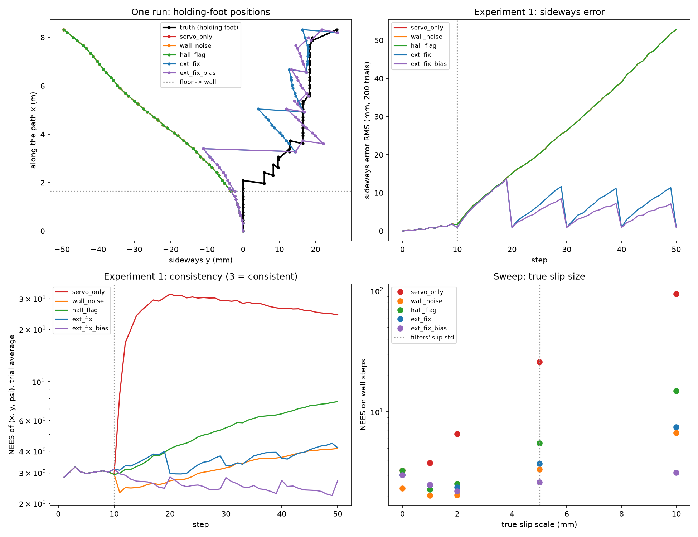

# Magnetic climbing inchworm: odometry that cannot see the slide

## Intuition

**MinchW** is a magnetic climbing **inchworm** ([glossary](../glossary.md#inchworm-gait-and-anchor)) of the Computational Robotics Laboratory of the Czech Technical University in Prague (CTU) (ref. 1). It has two feet, each held to steel by a **hybrid electromagnet** ([glossary](../glossary.md#hybrid-electromagnet)), and six servos, three per leg. It walks by holding one foot while the other moves, then swapping. It has no IMU and no external sensors: it "relies solely on proprioceptive feedback from its servo motors" (ref. 2).

So its only [odometry](../glossary.md#odometry) is the leg kinematics: when both feet hold, the servo angles give where one foot is relative to the other, and chaining these steps gives the path. On a vertical wall, though, its heavy head makes it "slide laterally", and its untextured silicone pads "do not provide enough friction to fully prevent slippage" (ref. 2). When the holding pad slides, the whole robot moves with it: no servo angle changes. The odometry cannot see the slide.

This doc measures what that costs and what fixes it. All rows chain the same servo-based steps; they differ only in what they assume about slides and what else they read:

| Row | Slide model | Extra reading |
| --- | --- | --- |
| `servo_only` | none | - |
| `wall_noise` | slide noise on every wall step | - |
| `hall_flag` | slide noise on flagged steps only | a **Hall-sensor** slip flag ([glossary](../glossary.md#hall-sensor)) in the pad |
| `ext_fix` | as `hall_flag` | + an external position fix every 10 steps |
| `ext_fix_bias` | as `ext_fix`, plus the mean slide per slip as a state | + the same fix |

**Short answer.**

- **The slides are invisible and one-sided, so servo odometry is confidently wrong.** With slides on 30% of the 40 wall steps, `servo_only` ends 47 mm off sideways on average, and its [NEES](../glossary.md#consistency-and-nees) on the wall is 27, where 3 is consistent.
- **Even without slides, the encoders drift sideways.** Rounding each servo angle to its 0.088° count makes the heading wander; after 8.2 m of steps the sideways error is 23 mm RMS. The filter models this correctly (NEES 3.22).
- **A slip flag makes the filter honest only if it also models the slides' direction.** `hall_flag` adds slide noise exactly when a slide happens, yet its NEES is 5.4 on the wall: the slides all go one way and add up, which noise does not describe. In a control where each slide goes to either side at random, the same row is consistent (2.87). Adding the noise on every wall step (`wall_noise`) happens to cover it here (3.25), by being loose.
- **Only an outside reference bounds the error.** An external position fix every 10 steps cuts the position RMSE from 28 mm to 7 mm; estimating the mean slide as well (`ext_fix_bias`) cuts it to 5.6 mm and keeps the filter from becoming overconfident (2.54, slightly underconfident: the assumed 5 mm slide noise is wider than the true slides' 3.0 mm spread around their mean), up to slides twice the size the filters assume.

*Figure: `uv run python use_numpy/magnetic_inchworm_odometry_ekf.py --out assets/magnetic_inchworm_odometry_ekf.png` (about 70 s).*

One run, animated: **seed 0**, the script's default seed and the first Monte Carlo trial (the run in the figure above), picked by a fixed rule: use seed 0 if it has at least one flagged wall slide (it has 9); seed 1's printout was seen while building the animation, before the rule was applied. The top left shows a side view of the two feet and the arch between them over the unrolled surface, and below it the wall plane (along the path vertical, sideways horizontal) with both feet, a trail of where the feet held, a **Hall flag** lamp that lights on a flagged slide, and a star where an external fix lands. The middle panel shows the holding foot's truth and the estimates of `servo_only`, `hall_flag` and `ext_fix_bias` with each row's own sideways ±2σ; `servo_only` and `hall_flag` have the same estimate. The right panel shows each row's sideways error (truth minus estimate) with its own ±2σ, and the sum of the slides so far.

At the end of this run `servo_only` and `hall_flag` are 74.4 mm off sideways, 25.9 mm from the slides (9 flagged slides, mean 2.9 mm, largest 6.7 mm) and 48.5 mm from encoder rounding. Their own ±2σ at the end is 40.9 mm and 50.7 mm, so in this run the encoder share alone (48.5 mm, against 22.5 mm RMS over trials, §4) is outside `servo_only`'s ±2σ; `hall_flag` is outside its own ±2σ on 38 of the 40 wall steps. `ext_fix_bias` ends 0.23 mm off with a ±2σ of 2.0 mm, outside it on 1 of 40 wall steps. This run differs from the 200-trial table in §3: it has fewer slides than the 12 expected per run and a large encoder-rounding share, so its servo error (74.4 mm) is larger than the average 52.8 mm RMS there. **Illustrative, not simulation output:** the foot motion between step poses (a straight interpolation, 3 display frames per step, the slide drawn over the first half of a step), the arch (the script gives poses only at the end of a step, and the assumed arch is taller than gait B's, §1.2, so it is not MinchW's real shape), and the wall-plane view's sideways scale, stretched 30 times; the feet there are markers, not to scale.

![Animation of one run, seed 0: top left, a side view of MinchW's two feet and the assumed arch over the unrolled floor and wall; below it, the wall plane with the two feet, the footprints, a Hall flag lamp that lights on a slide and a star at each external fix, with the sideways scale stretched 30 times; middle, the holding foot's sideways position against the distance along the path for the truth and for servo_only, hall_flag and ext_fix_bias, each with its own plus-minus two sigma; right, the sideways error of the three rows over the steps with their own plus-minus two sigma and the sum of the slides](../../assets/magnetic_inchworm_odometry_ekf.gif)

*Animation: `uv run python generator/animate_magnetic_inchworm_odometry_ekf.py --out assets/magnetic_inchworm_odometry_ekf.gif` (seed 0 by default, `--seed`; sideways scale `--exaggeration`, 30 by default).*

### Scope
Feet positions on the climbing surface in **unrolled coordinates**: $`x`$ along the path (along the floor, then up the wall), $`y`$ sideways, $`\psi`$ the heading about the surface normal. A **step** moves one foot: 10 floor steps, then 40 wall steps; each pair of steps advances the robot 0.3282 m, 8.2 m in all. The corner crossing from floor to wall is not modeled kinematically; it only switches slides on. No IMU, as on the real robot.

---

## 1. The robot

### 1.1 What the sources give
| Fact | Value | Source |
| --- | --- | --- |
| Robot | "Magnetic Inchworm" (the lab page's whole description) | ref. 1 |
| Build | 6 servos (3 per leg), about 0.49 m long, 2.156 kg; Dynamixel XM430-W350 and XM540-W270 | ref. 2, Ch. 4 |
| Adhesion | one hybrid electromagnet per foot: about 300 N unpowered, about 600 N energized (Table 3 lists 300 N), about 0 N with reversed voltage | ref. 2, Sec. 4.2 |
| Sensors | servo feedback only (position, velocity, current); "not equipped with external sensors" | ref. 2, Sec. 6.2, Ch. 9 |
| Gait | vertical gait B, "inchworm-inspired", "characterized primarily by a sliding motion": maximum step 0.3282 m, maximum height 0.1875 m | ref. 2, Sec. 6.2.3 |
| Wall slide | the heavy head makes the robot "slide laterally"; the authors turn a joint "toward the side opposite the electronics module" to counter it. Described with the gait design; the hardware tests cover horizontal gaits only | ref. 2, Sec. 6.2.3, Ch. 8 |
| Slip pad (experimental) | a footpad "developed for experiments on slippage", with Hall sensors and **PTI markers** (motion-tracking markers that "track the robot's position in space"); together they "detect the precise moment of slippage". No on-board slip flag is described | ref. 2, Sec. 4.3 |
| Servo resolution | 4096 counts per revolution (0.088°); **backlash** (gear play: the output can turn this far without the motor turning) 0.25° | ref. 3 |
| Odometry, slide sizes, link lengths | not published | - |

### 1.2 The simulated robot
| Part | Model | Source or assumption |
| --- | --- | --- |
| Joint chain | per leg a yaw joint at the foot (turning about the surface normal) and two **pitch joints** (turning about an axis parallel to the surface, so they lift and lower the leg); foot to first pitch joint 0.05 m, leg links 0.20 m, body 0.09 m (0.49 m stretched) | **assumed**, sized to ref. 2's length |
| Steps | one step extends the front foot to 0.448 m ahead of the rear one, the next closes the rear foot to 0.12 m behind it; each pair advances 0.3282 m | step length from ref. 2; closed spacing **assumed** |
| Servo readings | true angle rounded to a count: uniform error over one count, std 0.025° per joint | ref. 3; uniform rounding, independent from step to step, **assumed** |
| Slides | on a random 30% of wall steps the holding pad slides sideways, always toward the same side (the heavy head's), by a **half-normal** ([glossary](../glossary.md#half-normal-distribution)) amount of scale 5 mm (mean 4.0 mm); none on the floor | one-sided direction inferred from ref. 2's counter-turn of a joint; rate and size **assumed**, swept |
| Hall flag | flags every slide, no false alarms; a miss rate is swept | **assumed** (ref. 2's pad was built for slip experiments, not as an on-board flag) |
| External fix | the holding foot's position, std 1 mm per axis, every 10 steps (like ref. 2's motion-tracking markers) | **assumed**, interval swept |

The assumed arch rises to 0.25 m when the feet are close, above gait B's 0.1875 m, because the real gait slides rather than arches. This changes only how servo rounding maps into the step length; the sideways results come from the two yaw joints and the slides.

---

## 2. Filters

Each row is an EKF on the pose $`(x, y, \psi)`$ of the **holding foot** (the anchor of the next step).

- **Step update:** at the end of each step both feet hold, and the servo readings give the pose of the moving foot relative to the holding one through the [forward kinematics](../glossary.md#forward-and-inverse-kinematics) (FK). The estimate moves to the moving foot: new pose = holding pose composed with that relative pose. Its covariance grows by the servo rounding, mapped through the FK Jacobian.
- **Slide noise** (before the step update): `wall_noise` adds a sideways variance of (5 mm)² on every wall step; `hall_flag`, `ext_fix` and `ext_fix_bias` add it only on flagged steps. 5 mm is the filters' design choice; the true scale is swept.
- **Slide bias** (`ext_fix_bias`): a fourth state, the mean sideways slide per slip (prior std 5 mm). On a flagged step it is added to $`y`$ before the noise. Only the external fix makes it observable: the servos see no slide at all.
- **External fix** (`ext_fix`, `ext_fix_bias`): a position reading of the holding foot, $`(x, y)`$ + noise, every 10 steps.

**Scores**: the position RMSE ([glossary](../glossary.md#rmse-root-mean-square-error)) of the holding foot over all steps; the sideways error at the end; the NEES of $`(x, y, \psi)`$, consistent value 3, averaged over the trials and the steps (and over the wall steps alone). At any one step, the average over 200 [Monte Carlo trials](../glossary.md#monte-carlo-trials) of a consistent filter falls in [2.67, 3.35] 95% of the time; averages over steps are of correlated values, so that band is only a guide.

**Checked** (`tests/use_numpy/test_magnetic_inchworm_odometry_ekf.py`, 7 tests):
- the chain is 0.49 m stretched and reaches both feet spacings;
- pose composition and inverse are consistent;
- slides happen only on the wall, all toward one side, and the default flag marks exactly them;
- the random-sign control keeps the same slide sizes and flags and only draws the side;
- with exact servo readings, `servo_only`'s sideways error at the end equals the sum of the slides;
- without slides, `servo_only` is consistent;
- with slides on every wall step, `ext_fix` keeps the sideways error under 5 mm.

---

## 3. Experiment 1: slides on 30% of wall steps, scale 5 mm (200 trials)

| Row | Position RMSE (mm) | Sideways error at the end: RMS / mean (mm) | NEES (all steps) | NEES (wall steps) |
| --- | --- | --- | --- | --- |
| `servo_only` | 27.95 | 52.80 / +47.45 | 22.17 | 26.96 |
| `wall_noise` | 27.95 | 52.80 / +47.45 | 3.20 | 3.25 |
| `hall_flag` | 27.95 | 52.80 / +47.45 | 4.95 | 5.43 |
| `ext_fix` | 6.97 | 0.98 / +0.08 | 3.51 | 3.63 |
| `ext_fix_bias` | 5.61 | 0.98 / +0.03 | 2.64 | 2.54 |

The first three rows read only the servos and the flag, so their estimates are identical; only their reported uncertainty differs. The last step is a fix step, so the two fix rows end near the fix's 1 mm.

#### The slides add up
On average 12 of the 40 wall steps slide, by 4.0 mm each, so the expected drift is 48 mm toward the heavy side: the measured mean is +47.45 mm. Noise of the same size would add up to about √12 × 5 mm = 17 mm in either direction instead. That is why `hall_flag`, which adds noise of the right size at exactly the right steps, is still overconfident, and its NEES grows step by step on the wall (figure, bottom left).

**Control:** the same 200 runs, with the same slide sizes and steps, but each slide goes to either side with equal chance. A slide's mean square is then the filters' assumed (5 mm)², so the noise model fits:

| Row | Sideways error at the end: RMS / mean (mm) | NEES (wall steps), one-sided | NEES (wall steps), random side |
| --- | --- | --- | --- |
| `servo_only` | 25.88 / +1.34 (one-sided: 52.80 / +47.45) | 26.96 | 9.17 |
| `wall_noise` | as `servo_only` | 3.25 | 2.25 |
| `hall_flag` | as `servo_only` | 5.43 | 2.87 |
| `ext_fix` | 1.01 / +0.01 | 3.63 | 2.97 |
| `ext_fix_bias` | 1.02 / +0.01 | 2.54 | 2.81 |

With the side made random, `hall_flag` becomes consistent (2.87) and the mean drift vanishes (+1.34 mm), so it is the one direction, not the slide size, that defeats slide noise. With no mean slide to learn, `ext_fix_bias` gains nothing over `ext_fix` (position RMSE 6.39 mm against 5.86 mm).

#### The encoders drift too
Each step adds a heading error of 0.036° (std, from the two yaw joints), and a heading error grows into a sideways error with every step after it. Without slides this alone gives 23 mm sideways RMS at the end (§4); the filter covers it.

#### The fix and the bias state
The fix pulls the error back every 10 steps (figure, top right). Between fixes, the slides add up again, and `ext_fix` is slightly overconfident (3.63). `ext_fix_bias` learns the mean slide from the fixes, predicts it, and keeps a smaller error without becoming overconfident (2.54; slightly underconfident, because the filter's 5 mm slide noise is wider than the true slides' 3.0 mm spread around their mean).

---

## 4. Sweeps (100 trials each)

**True slide scale** (the filters still assume 5 mm), NEES on wall steps:

| Scale (mm) | `servo_only` | `wall_noise` | `hall_flag` | `ext_fix` | `ext_fix_bias` |
| --- | --- | --- | --- | --- | --- |
| 0 | 3.28 | 2.34 | 3.28 | 3.00 | 3.00 |
| 1 | 3.80 | 2.03 | 2.29 | 2.49 | 2.49 |
| 2 | 6.58 | 2.05 | 2.55 | 2.37 | 2.21 |
| 5 | 25.87 | 3.34 | 5.51 | 3.73 | 2.62 |
| 10 | 94.19 | 6.69 | 14.88 | 7.50 | 3.14 |

At 0 mm there are no slides, so `hall_flag` equals `servo_only` and the sideways error is the encoders' alone (22.51 mm RMS at the end). Slides of 1-2 mm are covered by every slide-aware row; at twice the assumed size only `ext_fix_bias` stays near 3.

**Hall miss rate** (scale 5 mm), NEES on wall steps:

| Missed | `hall_flag` | `ext_fix` | `ext_fix_bias` |
| --- | --- | --- | --- |
| 0 | 6.08 | 3.73 | 2.67 |
| 10% | 6.54 | 5.03 | 3.91 |
| 25% | 6.83 | 6.35 | 5.01 |
| 50% | 9.86 | 12.31 | 10.48 |

A missed slide adds an error the filter's covariance does not include. The fix rows' NEES rises the most (from 3.73 to 12.31 for `ext_fix`).

**Fix interval** (scale 5 mm), position RMSE (mm) / NEES on wall steps:

| Every | `ext_fix` | `ext_fix_bias` |
| --- | --- | --- |
| 5 steps | 3.89 / 3.28 | 2.97 / 2.53 |
| 10 steps | 6.96 / 3.41 | 5.64 / 2.46 |
| 20 steps | 9.82 / 4.23 | 7.71 / 2.67 |

The longer between fixes, the more slides add up; the bias state keeps the NEES between 2.4 and 2.7 at all three (slightly underconfident, as in §3).

---

## 5. What this toy does not show

- **The real gait and corner.** Gait B slides rather than arches (§1.2), and the floor-to-wall crossing is not modeled.
- **Measured slides.** No slide size or rate is published; all are assumptions, swept. A slide that also turns the pad (heading) is not modeled.
- **Repeated rounding.** Each reading's rounding error is drawn afresh. A real servo returning to the same pose may repeat the same error, which would not average out; the encoder drift would then differ, and the filter's model of it would be wrong.
- **Backlash.** The servos' 0.25° backlash (ref. 3) is not modeled; it may shift the true angle away from the count without the reading changing.
- **An IMU.** MinchW has none (ref. 2). A gyro would see the heading drift but not a pure sideways slide. One wall-climbing robot on steel cylinders estimates its pose with an IMU and an external camera (ref. 4).
- **A real slip flag.** Ref. 2's Hall-sensor pad was built for slip experiments; using it as an on-board flag, and the flag's reliability, are assumed.

---

## 6. Takeaway

A climbing robot that knows only its servo angles cannot see its feet slide. On a wall, the slide has a direction, so treating it as noise, even at exactly the right moments, still leaves the filter overconfident. Some outside reference is needed: here an occasional position fix bounds the error, and estimating the mean slide from those fixes keeps the filter from becoming overconfident across the slide sizes tried.

---

## 7. References

1. Computational Robotics Laboratory, Czech Technical University in Prague. *MinchW* robot page. https://comrob.fel.cvut.cz/robots/michnworm.html - "Magnetic Inchworm."
2. Pham, S. B. (2025). *Design of Motion Strategies for a Magnetic Climbing Robot*. Bachelor's thesis, Czech Technical University in Prague, Faculty of Electrical Engineering. https://dspace.cvut.cz/handle/10467/125770 - MinchW: 6 servos, about 0.49 m, 2.156 kg (Ch. 4); hybrid electromagnets (Sec. 4.2, Table 3); experimental slip footpad with Hall sensors and PTI markers (Sec. 4.3); "relies solely on proprioceptive feedback from its servo motors" (Sec. 6.2); vertical gait B, maximum step 0.3282 m, height 0.1875 m, lateral slide from the heavy head (Sec. 6.2.3, Table 24); hardware tests of horizontal gaits only (Ch. 8); "not equipped with external sensors" (Ch. 9).
3. ROBOTIS. *XM430-W350* and *XM540-W270* e-Manuals. https://emanual.robotis.com/docs/en/dxl/x/xm430-w350/, https://emanual.robotis.com/docs/en/dxl/x/xm540-w270/ - resolution 4096 pulse/rev; backlash 15 arcmin (0.25°).
4. Zhang, W., Huang, T., & Sun, Z. (2022). *Localization of Wall Climbing Robot on Cylinder-Shaped Steel*. ICMAT 2022, 292-303. https://doi.org/10.3233/ATDE221179 - a wall-climbing robot localized with an IMU and a fixed RGB-D camera, two EKFs for attitude (abstract only read for this doc).
