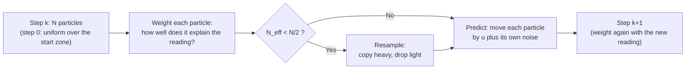
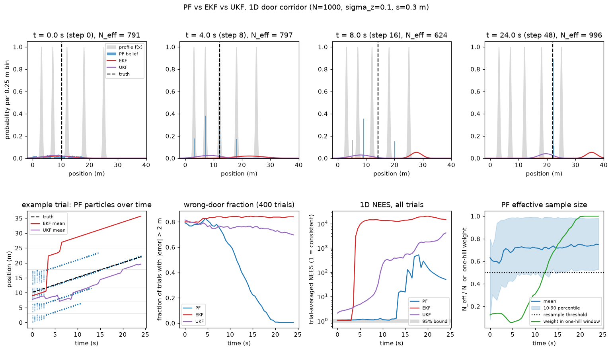

# Particle filter localization: several hills against one hill

**How to read it.**

| Sections | Need first | First pass |
| --- | --- | --- |
| Intuition, §1-§3 (scene, filters, results) | the one-hill filters: [kf_ekf_iekf.md](kf_ekf_iekf.md) §1-§2 and §8 (the several-hills picture); the **UKF**: [extra_kf_variants.md](extra_kf_variants.md) §1; a **likelihood** and Bayes' rule: [probability_basics.md](../foundations/probability_basics.md) §5 | read |
| §4-§6 (particle count, door layout, other sweeps) | §1-§3 | skip: §11 states the findings of §4-§5 |
| §7 (known-start diagnostic), §9-§11 | §1-§3 | read |
| §8 (maximum-likelihood association) | §3 | skip: a labeled variant |

The script is [`particle_filter_localization.py`](../../use_numpy/particle_filter_localization.py) ([README §8](../../README.md#8-particle-filter-localization-several-hills-against-one-hill)); §3-§8 give the command for each of their tables. Sources are numbered [1]-[8] in [References](#12-references).

## Intuition

A filter's **belief** is its answer to "where is the robot?", drawn as hills over the map: high where the robot probably is. The KF, EKF and UKF draw exactly **one hill** (a Gaussian). A **particle filter (PF)** draws any shape, including **several hills** ([kf_ekf_iekf.md §8](kf_ekf_iekf.md#8-which-one-should-we-use) has the picture).

This doc runs one toy where the honest belief has several hills: a robot in a corridor with identical doors, which does not know where it started (**global localization**). The textbook picture is a corridor with three identical doors, where sensing a door leaves one peak per door [1, Fig. 1.1].

```text
 corridor (m)     0    3    7         12        18        25
 doors                 ▌    ▌          ▌         ▌         ▌
 robot, t = 4 s                         ●  (truth 12.15 m, sensor reads 0.98 = "a door")
 PF belief             .18  .385      .263      .172       0     weight within 1 m of each door
 EKF belief           one hill at 22.6 m, width ±5.0 m  (between two doors, 10 m from the truth)
```

*Worked number: example trial 0 (seed 0), 4 s after the start. The PF has four hills, one per door the robot could be at, and puts 0.263 of its weight on the true one. The EKF has one hill, in the wrong place. If the PF is forced to give one number, it also lands between hills (weighted mean 9.58 m, std 4.91 m): the hills are the answer, not their mean.*

Same data, 400 random starts: after 24 s the PF is at the wrong door in **0.5%** of trials (2 of 400), the EKF in **84.0%**, the UKF in **69.8%**. Same code, but start the filters within 0.1 m of the truth: all three have RMSE 0.057 m and no wrong door (§7). So what breaks the EKF and UKF is the one-hill belief at an unknown start, not the sensor model.

Words used below (each defined once here):

| Term | Meaning |
| --- | --- |
| **Particle** | One guess of the robot's position (m). The PF keeps $`N`$ of them. |
| **Weight** | How well a particle's guess fits the latest sensor reading: its likelihood, scaled so all weights sum to 1. Dense, heavy particles make a hill. |
| **Resampling** | Draw $`N`$ new particles from the old ones, with probability proportional to weight: heavy guesses are copied, light ones disappear, all weights reset to $`1/N`$. |
| **Effective sample size** $`N_{\text{eff}}`$ | $`1/\sum_i w_i^2`$ for the normalized weights $`w_i`$ [2, eq. 51]: how many equally weighted particles the weighted set is worth. $`N`$ if all weights are equal; 1 if one particle has all the weight; 2 if two share it equally. |
| **One hill** | At least 0.9 of the weight lies within 1 m of the weighted mean (design choice, §1). |
| **Wrong door** | Final error larger than 2 m, half the smallest door spacing (design choice, §1). |
| **Global localization** | Estimating the position with no initial position estimate: the start is anywhere in a zone. |
| **Design choice** | A value no source fixes. It is chosen here, labeled, and (where cheap) swept. |

---

## 1. Scene, sensor and design choices

The robot drives right along a 30 m corridor with five doors for 48 steps of 0.5 s at a commanded 0.5 m/s (12 m of travel). Every filter knows the commanded step $`u`$ (open-loop odometry) but not the start.

- **Motion:** $`x_{k+1} = x_k + u + w_k`$, with noise $`w_k`$ of std $`\sigma_u = \sqrt{(0.05\,|u|)^2 + 0.01^2} = 0.016`$ m per step.
- **Sensor, "door profile":** a scalar reading $`z_k = f(x_k) + n_k`$ with noise $`n_k`$ of std $`\sigma_z = 0.1`$, where the profile $`f(x)`$ is a unit-height Gaussian bump of width $`s = 0.3`$ m at each door position $`m_j`$, $`f(x) = \sum_j \exp(-(x - m_j)^2 / (2 s^2))`$. $`f`$ is about 1 at a door and 0 elsewhere. The reading never says **which** door. All three filters get the identical $`z = h(x) + \text{noise}`$ with $`h = f`$. A scalar sensor against a stored map is a standard MCL sensor [1, Sec. 8.3.3], and a scalar $`z = h(x) + n`$ with a two-hill posterior is a documented case where an EKF fails, and a PF works [2, Sec. VI].
- **Truth** follows exactly the PF's motion and sensor model, with every noise redrawn in every trial ([Monte Carlo trials](../glossary.md#monte-carlo-trials)). The truth departs from the EKF's and UKF's model in two places: their Gaussian prior (below) against the true uniform start, and the linearization of $`f`$.
- **Start:** uniform over the **start zone** $`[0, 18]`$ m, so the robot never leaves the corridor. The PF's initial particles are uniform over the same zone. The EKF and UKF start from the Gaussian with the same mean and variance: $`N(9,\ 27)`$, std 5.20 m. This is not the full 30 m corridor; the 18 m zone is easier.

| Design choice | Value | Reason |
| --- | --- | --- |
| Door positions | 3, 7, 12, 18, 25 m (spacings 4, 5, 6, 7 m) | No source gives a layout. All spacings differ so that no sighting pattern repeats. The first layout tried (4 m twice) gave 30% PF wrong doors from ambiguity alone (§5). |
| Bump width $`s`$ | 0.3 m | No source gives a door width (the textbook only draws a curve [1]). A bump within ±2s = ±0.6 m is a door about 1.2 m wide. Swept: 0.15, 0.3, 0.6 m. |
| Sensor noise $`\sigma_z`$ | 0.1 (profile height 1) | No source. Swept: 0.05 to 0.4. |
| Motion noise | 5% of the step plus a 1 cm floor | No source for 1D. Small against the 0.25 m step. Swept: 2%, 5%, 10%. |
| Start zone and EKF/UKF prior | $`[0, 18]`$ m; $`N(9, 5.20^2)`$ | The zone is the corridor minus the 12 m travel. The Gaussian matches the uniform's mean and variance. |
| Particles $`N`$ | 1000 | Textbook "often" value [1, p. 97]; swept 50 to 5000. |
| Resampling rule | when $`N_{\text{eff}} < N/2`$ | The usual threshold [3]; swept against $`N/3`$ [4] and every step. |
| Wrong-door threshold | 2 m | Half the smallest spacing (4 m): a larger error could be a shift to a neighbouring door. |
| One-hill window | 0.9 of the weight within 1 m | A quarter of the smallest spacing: wider than the right-case posterior (std 0.06 m), far narrower than the gap between hills. Not tested for sensitivity. |
| UKF parameters | $`\alpha = 1`$, $`\beta = 2`$, $`\kappa = 2`$ | $`n + \kappa = 3`$ for one state, as in `pointcloud_pose_tracking.py`. |

---

## 2. The filters

**PF (bootstrap loop).** Gordon et al. [5, Sec. 3.1, eq. 8] and Thrun et al. [1, Table 4.3] describe the same loop; the script adds two choices of its own:



| Step | Gordon et al. 1993 [5] | Thrun Table 4.3 / 4.4 [1] | This script |
| --- | --- | --- | --- |
| Start | $`N`$ samples from the known prior | - | uniform over the start zone |
| Predict | pass each sample through the system model with a noise draw | line 4: sample from the motion model | $`x \leftarrow x + u + \sigma_u\,\epsilon`$, one draw per particle |
| Weight | likelihood of each sample, normalized (eq. 8) | line 5: $`w = p(z \mid x)`$ | $`w \propto \exp\left(-\tfrac12 ((z - f(x))/\sigma_z)^2\right)`$; kept between resamplings [1, eq. 4.36] |
| Resample | $`N`$ draws with replacement (multinomial), every step | lines 8-11, every step | low-variance sampler [1, Table 4.4] (one random offset, $`N`$ evenly spaced pointers, $`O(N)`$), only when $`N_{\text{eff}} < N/2`$ |

- **Why not resample every step?** Resampling loses diversity (copies replace distinct guesses), so Thrun resamples only when the weight variance is high [1, p. 108-109]. The $`N/2`$ trigger is the usual rule [3]. `--resample-threshold 1.01` is Gordon's every-step version (§6).
- **Why resample at all?** Without it, after a few steps, all but one particle tend to have negligible weight [2, Sec. V-A].
- At the defaults: $`N_{\text{eff}}/N`$ before resampling averages 0.709 (minimum 0.003), and a trial resamples 5.8 times in its 49 steps.

**EKF.** One Gaussian $`(\hat x, P)`$. The update linearizes the sensor at the predicted mean: $`H = f'(\hat x)`$. At the start $`\hat x = 9`$ m is 2 m (6.7 bump widths) from the nearest door, where $`f = 2.2 \times 10^{-10}`$ and $`f' = -5.0 \times 10^{-9}`$ per m: the tangent line is flat, the first update does nothing, and the standard deviation stays 5.20 m (median over trials).

**UKF.** One Gaussian too, but the sensor is evaluated at three sigma points around the mean [6] instead of at one tangent line.

---

## 3. Results

Seed 0, 400 trials, defaults. The tables in §3 come from `uv run python use_numpy/particle_filter_localization.py --ml-variant --out assets/particle_filter_localization.png`.

**Final step (t = 24 s), all trials:**

| Filter | RMSE (m) | Median abs error (m) | Wrong-door rate |
| --- | --- | --- | --- |
| PF | 0.396 | 0.033 | 0.005 (2 of 400) |
| EKF | 9.817 | 6.044 | 0.840 |
| UKF | 7.339 | 6.020 | 0.698 |

- The PF's median error is 3.3 cm, and its RMSE is 0.396 m only because of the 2 wrong-door trials.
- The UKF is less bad than the EKF; no run isolates why.
- The EKF's final mean is outside the corridor $`[0, 30]`$ m in 17.0% of trials.
- All 400 PF trials end as one hill (2 of them at the wrong door). The median time to one hill is 13.0 s (mean 13.2 s); weight within 2 m of the truth at the end: 0.995.

**When it happens** (fraction of trials with a wrong door at each time; seed 0):

| t (s) | 0 | 4 | 8 | 12 | 16 | 24 |
| --- | --- | --- | --- | --- | --- | --- |
| PF | 0.792 | 0.805 | 0.730 | 0.455 | 0.182 | 0.005 |
| EKF | 0.800 | 0.828 | 0.840 | 0.840 | 0.840 | 0.840 |
| UKF | 0.815 | 0.792 | 0.762 | 0.762 | 0.762 | 0.698 |

All three start near 0.8 because the score compares the filter mean with the truth. The PF's mean only becomes right as the hills die out (hills merge around the median 13 s); the EKF never recovers after about 8 s.

**NEES** (1D, [NEES](../glossary.md#consistency-and-nees): $`(x - \hat x)^2 / P`$, which averages 1 for a consistent filter), mean over the last 10 steps of the trial-averaged NEES:

| Filter | All trials (n = 400; bound [0.87, 1.14]) | Right-door trials only: n | NEES | 95% bound | Tail steps in bound |
| --- | --- | --- | --- | --- | --- |
| PF | 97.98 | 398 | **1.01** | [0.87, 1.14] | 10 of 10 |
| EKF | 17590 | 64 | 295.05 | [0.68, 1.38] | 0 of 10 |
| UKF | 2425 | 121 | 3.29 | [0.76, 1.27] | 0 of 10 |

- **Caveat: the right-door subsets differ per filter** (398, 64 and 121 trials), so the right-door column compares each filter with its own successes, not with each other.
- **The PF's all-trials 98 is two trials.** Trials 39 and 333 end confidently at the wrong door (final std 0.061 and 0.052 m, errors +5.45 and +5.65 m). They add 29.7 and 67.2 to the 97.98; without them, the PF's NEES is 1.01. They become one hill at 12.0 s and 13.5 s; the PF's trial-averaged NEES then jumps from 1.3 (13 s) to 17.0 (14 s) and peaks at 523 (18 s). At $`N = 5000`$ no trial is wrong (§4), so it is a finite-$`N`$ effect; no run looked at these two trials' particles.
- When the EKF or UKF is at the right door, it is still overconfident (295, 3.29), unlike the PF.

Timing, one run on trial 0 (single run, varies by about 10% between runs): PF 146.7 µs/step and 155 KiB peak memory, EKF 14.4 µs and 2.6 KiB, UKF 24.5 µs and 7.3 KiB. At $`N = 1000`$ the PF costs about 10 times the EKF's time and 60 times its memory.

---

## 4. Particle count

`uv run python use_numpy/particle_filter_localization.py --sweep particles` (400 trials, same noise draws at every $`N`$).

| $`N`$ | PF wrong door | PF RMSE (m) | PF median abs error (m) | Median time to one hill (s) | Weight within 2 m of the truth |
| --- | --- | --- | --- | --- | --- |
| 50 | 0.490 | 5.600 | 0.260 | 7.0 | 0.510 |
| 100 | 0.247 | 3.865 | 0.051 | 11.0 | 0.752 |
| 500 | 0.007 (3 trials) | 0.659 | 0.034 | 13.0 | 0.993 |
| 1000 | 0.005 (2) | 0.396 | 0.033 | 13.0 | 0.995 |
| 2000 | 0.003 (1) | 0.305 | 0.033 | 13.0 | 0.998 |
| 5000 | 0.000 (0) | 0.057 | 0.033 | 13.0 | 1.000 |

The EKF (0.840) and UKF (0.698) do not depend on $`N`$.

- **Too few particles fail, and fail early.** At $`N = 50`$ and 100, the PF reaches one hill sooner than at $`N \ge 500`$ (7.0 s and 11.0 s, against 13.0 s), while 49% and 25% of trials end at a wrong door. This is consistent with a **premature collapse**: the particles near the true door die in a resampling before the data can rule out the other doors. Likely; no run isolates the mechanism. It matches the literature: with a few particles spread over a large space, MCL may lose all particles near the true pose [1, p. 256], and global localization needs many more samples than tracking [7].
- **From $`N \ge 500`$ on the wrong-door rate is 0 to 3 trials of 400.** Differences between those rows are not resolved. The median time to one hill does not change.
- The cost per step grows with $`N`$ (resampling is $`O(N)`$ [1, Table 4.4]); the sweep did not time it.

---

## 5. Door layout: when the surroundings repeat

`uv run python use_numpy/particle_filter_localization.py --sweep layout`.

| Layout | Doors (m) | PF wrong door | PF ends as one hill | EKF wrong | UKF wrong |
| --- | --- | --- | --- | --- | --- |
| Default: all spacings differ | 3, 7, 12, 18, 25 | 0.005 | 1.000 | 0.840 | 0.698 |
| Spacing 4 m twice | 4, 9, 13, 20, 24 | **0.302** | 0.698 | 0.790 | 0.787 |
| Three doors | 4, 10, 22 | 0.188 | 0.807 | 0.745 | 0.713 |

(The wrong-door threshold and hill window scale with the smallest spacing: 2 m and 1 m for the first two rows, 3 m and 1.5 m for the three-door row.)

This is the honest limit of the method, and of any filter: **when the surroundings repeat, the data cannot say where the robot is.** In the 4 m-twice layout, the door pair at 9 and 13 m and the pair at 20 and 24 m look identical to a robot that sees only one of them.

- Of the 121 wrong-door trials, 119 (98.3%) end with less than 0.9 of the weight in one hill; their median weighted std is 5.39 m. The PF is **correctly keeping two hills**, and its between-hills mean is counted incorrectly by the score. The true hill still holds a median of 0.53 of the weight in those trials. A "best hill" estimate would be scored differently; it is not implemented.
- Three doors: fewer distinct sightings. Likely some starts see only one door in the 12 m of travel; not isolated by a run.
- The default's 0.005 is therefore partly a property of the layout. Layout is a first-order choice, not a detail.

---

## 6. Other sweeps

`uv run python use_numpy/particle_filter_localization.py --sweep width --sweep sigma_z --sweep motion --sweep resample` (each sweep also runs alone with only its own `--sweep`).

| Sweep | Setting | PF wrong door | PF ends as one hill | PF RMSE (m) | EKF / UKF wrong |
| --- | --- | --- | --- | --- | --- |
| Bump width $`s`$ | 0.15 m | 0.000 | 1.000 | 0.055 | 0.795 / 0.767 |
| | 0.3 m (default) | 0.005 | 1.000 | 0.396 | 0.840 / 0.698 |
| | 0.6 m | 0.003 | 1.000 | 0.273 | 0.870 / 0.710 |
| $`\sigma_z`$ | 0.05 | 0.003 | 1.000 | 0.479 | 0.775 / 0.777 |
| | 0.1 (default) | 0.005 | 1.000 | 0.396 | 0.840 / 0.698 |
| | 0.2 | 0.000 | 1.000 | 0.075 | 0.772 / 0.772 |
| | 0.4 | **0.048** | **0.930** | 1.111 | 0.807 / 0.790 |
| Motion noise factor | 0.02 | 0.003 | 1.000 | 0.301 | 0.843 / 0.710 |
| | 0.05 (default) | 0.005 | 1.000 | 0.396 | 0.840 / 0.698 |
| | 0.10 | 0.003 | 1.000 | 0.517 | 0.823 / 0.688 |
| Resampling rule | $`N_{\text{eff}} < N/3`$ [4] | 0.003 | 1.000 | 0.263 | 0.840 / 0.698 |
| | $`N_{\text{eff}} < N/2`$ (default) | 0.005 | 1.000 | 0.396 | 0.840 / 0.698 |
| | every step [5] | 0.005 | 1.000 | 0.559 | 0.840 / 0.698 |

- **Only one row is clearly different:** $`\sigma_z = 0.4`$ (a noisy sensor): 19 of 400 trials at a wrong door, and 7% of trials never settle into one hill (median time to one hill 15.5 s).
- **Everything else is 0 to 2 wrong-door trials of 400**, so the rows are not resolved from each other (the PF RMSE differences are those 0-2 trials). Do not read a ranking out of the width, motion, or resampling rows.
- Resampling every step is as good as the $`N/2`$ rule here, in 1D with $`N = 1000`$. Arulampalam et al. warn that every-step resampling can lose diversity quickly [2]; this toy shows no such cost.
- The EKF and UKF stay between 0.69 and 0.87 in every row: no setting rescues a one-hill filter at a global start.

---

## 7. Known-start diagnostic: it is the start, not the sensor code

`uv run python use_numpy/particle_filter_localization.py --prior-std 0.1` and `... --prior-std 0.5`. Every filter starts from a Gaussian of the given std centred on the true start plus a draw of that std; nothing else changes.

| Start | Filter | RMSE (m) | Wrong door | NEES (bound [0.87, 1.14]) |
| --- | --- | --- | --- | --- |
| Known to 0.1 m | PF | 0.057 | 0.000 | 1.00 |
| | EKF | 0.057 | 0.000 | 1.00 |
| | UKF | 0.057 | 0.000 | 0.98 |
| Known to 0.5 m | PF | 0.057 | 0.000 | 1.00 |
| | EKF | 0.372 | 0.015 | 56.77 |
| | UKF | 0.375 | 0.022 | 62.68 |
| Unknown (default, §3) | PF | 0.396 | 0.005 | 97.98 |
| | EKF | 9.817 | 0.840 | 17590 |
| | UKF | 7.339 | 0.698 | 2425 |

- **With a 0.1 m start, all three filters are the same**, at one hill, and consistent: the sensor model, Jacobian, and filter code work, and the PF has no accuracy advantage.
- **At 0.5 m, wider than the 0.3 m bump,** the EKF and UKF begin to fail (1.5% and 2.2% wrong; NEES 57 and 63) while the PF does not change. This is consistent with a tangent line (or three sigma points) taken over a prior wider than a bump; the unknown-start failure is that effect at 5 m.
- At the full unknown start there is the second, bigger effect: one hill cannot hold several candidate doors (§2: the EKF's first update does nothing).

---

## 8. Variant: the textbook workaround, maximum-likelihood association

The textbook EKF handles unknown door identity by **maximum-likelihood correspondence**: compute how likely the reading is under each door and update with the most likely door only [1, Sec. 7.5.1, Table 7.3]. That needs a different sensor, so this is a labeled variant and not comparable like-for-like with §3 (the PF is not run on it): the signed offset to the nearest door, $`z = m_j - x + n`$ with $`n`$ of std 0.1 m, reported on 94.8% of steps (only if the nearest door is within 3 m). The reading still does not say which door $`j`$ it is.

`uv run python use_numpy/particle_filter_localization.py --ml-variant`:

| Filter | RMSE (m) | Median abs error (m) | Wrong door | NEES, all trials | NEES, right-door trials (n = 108) |
| --- | --- | --- | --- | --- | --- |
| EKF-ML | 7.440 | 6.864 | 0.730 | 34371 | 0.98 (10 of 10 in bound [0.75, 1.28]) |
| UKF-ML | 7.440 | 6.864 | 0.730 | 34371 | 0.98 (same) |

- **UKF-ML equals EKF-ML:** the largest difference in the mean is $`3.4 \times 10^{-14}`$ m, and the same door is chosen at every step. Given the door, the measurement is linear, so the unscented transform is exact. (Tested: `test_ukf_ml_equals_ekf_ml`.)
- The workaround helps only a little (0.730 wrong, against 0.840 for the EKF on the profile sensor). When its guess is right, it is consistent (0.98); when it is wrong, it is confidently wrong (all-trials NEES 34371). The textbook warns that maximum-likelihood association is "brittle if there are many equally likely hypotheses" [1, p. 216]; with 4 to 7 m spacing and a start std of 5.2 m, many doors are about equally likely at the start. No run isolates this as the cause.

---

## 9. Figure and animation



*Figure: `uv run python use_numpy/particle_filter_localization.py --out assets/particle_filter_localization.png` (defaults, seed 0, 400 trials). Top row: grey = door profile $`f(x)`$, blue = PF belief (weights binned in 0.25 m bins), red = EKF Gaussian, purple = UKF Gaussian, dashed = truth, for example, trial 0. Bottom row, left to right: that trial's particles over time (the least readable panel), wrong-door fraction over time (§3), NEES over time (the PF line jumps after 13 s because of the two wrong-door trials, §3), and $`N_{\text{eff}}`$ with the weight inside the one-hill window.*


*Animation: `uv run python generator/animate_particle_filter_localization.py --out assets/particle_filter_localization.gif` (example trial 0; the right panel uses the same 400 trials). The belief (blue) starts with hills everywhere, has one hill at each reachable door by t = 4 s and merges to one at the true position, while the EKF and UKF stay single Gaussians and the EKF mean ends outside the corridor (35.7 m). In this trial, the belief is one hill from t = 14.5 s; the 13.0 s in §3 is the median over the 400 trials. The left axis rescales every frame to the tallest peak (the bars at t = 0 are tiny), and the grey profile is drawn at that height, "not to scale".*

---

## 10. What this toy does not show

- **Dimension.** The state is one number. The particle count needed grows exponentially with the dimension in the literature [8] (for independent unit-variance Gaussian components, at least $`10^{11}`$ particles for 200 dimensions with the prior as proposal); nothing here tests that. §4 shows only the cost of $`N`$ in 1D.
- **A matched model.** The truth follows the PF's own motion and sensor model, so the PF has no model error to survive. Real odometry and door sensors do not.
- **Easy start zone.** The start is uniform over 18 m, not the whole 30 m corridor, and the command is known exactly.
- **No kidnapping or recovery.** There is no random-particle injection. A PF that has collapsed to the wrong door stays there (the 2 trials in §3).
- **Design choices.** Door layout, bump width, $`\sigma_z`$, motion noise, and the two scoring thresholds are not from a source; the layout moves the PF's wrong-door rate from 0.005 to 0.302 (§5). The sensor is not a model of any real door detector.
- **One seed.** Every number is seed 0, 400 trials: one trial is 0.0025.
- **Scoring by the mean.** The wrong-door score uses the weighted mean; a multi-hill belief is scored as wrong whichever hill is right.

## 11. Takeaway

At an unknown start among look-alike places, the belief has several hills; a PF with enough particles keeps them until the data separates them (0.5% wrong door at $`N = 1000`$, 0 of 400 at $`N = 5000`$), while the EKF and UKF cannot hold more than one and are wrong in 84% and 70% of trials from the same data. Too few particles also fail ($`N = 50`$: 49% wrong). When the surroundings themselves repeat, the PF correctly stays at two hills, and no filter can do better (§5). When the start is known to 0.1 m, the one-hill filters match the PF at about a tenth of its time and a sixtieth of its memory (§3, §7). Use a PF when the belief can honestly have several hills and the state is low-dimensional.

---

## 12. References

1. Thrun, S., Burgard, W., & Fox, D. (2005). *Probabilistic Robotics*. MIT Press. ISBN 978-0-262-20162-9 - Fig. 1.1 (three identical doors); Table 4.3 (particle filter), Table 4.4 (low-variance sampler), Eq. 4.36 (weights between resamplings), p. 97 (particle count), p. 108-109 (resampling and diversity); Sec. 7.5.1 and Table 7.3 (maximum-likelihood correspondence, p. 216 "brittle"); Sec. 8.3.3 (scalar sensor against a stored map), p. 256 (few particles in global localization).
2. Arulampalam, M. S., Maskell, S., Gordon, N., & Clapp, T. (2002). *A tutorial on particle filters for online nonlinear/non-Gaussian Bayesian tracking*. IEEE Transactions on Signal Processing, 50(2), 174-188. https://doi.org/10.1109/78.978374 - eq. 51 ($`N_{\text{eff}}`$), Sec. V-A (degeneracy; loss of diversity), Sec. VI (EKF against PF on a scalar nonlinear sensor).
3. Doucet, A., & Johansen, A. M. (2008, v1.1, corrected 2012). *A Tutorial on Particle Filtering and Smoothing: Fifteen years later*. Preprint. https://text.www2.warwick.ac.uk/fac/sci/statistics/staff/academic-research/johansen/publications/DJ11.pdf - resample only when the ESS is below a threshold, typically $`N/2`$.
4. Doucet, A., Godsill, S., & Andrieu, C. (2000). *On sequential Monte Carlo sampling methods for Bayesian filtering*. Statistics and Computing, 10(3), 197-208. https://doi.org/10.1023/A:1008935410038 - resampling when $`N_{\text{eff}} < N/3`$ in their experiments (§6 row).
5. Gordon, N. J., Salmond, D. J., & Smith, A. F. M. (1993). *Novel approach to nonlinear/non-Gaussian Bayesian state estimation*. IEE Proceedings F, 140(2), 107-113. https://doi.org/10.1049/ip-f-2.1993.0015 - the bootstrap filter: Sec. 3.1, eq. 8, resampling at every step.
6. Julier, S. J., & Uhlmann, J. K. (1997). *New extension of the Kalman filter to nonlinear systems*. Proc. SPIE 3068, Signal Processing, Sensor Fusion, and Target Recognition VI, 182-193. https://doi.org/10.1117/12.280797 - the UKF (same entry as in [kf_ekf_iekf.md](kf_ekf_iekf.md#11-references), reference 6).
7. Fox, D., Burgard, W., Dellaert, F., & Thrun, S. (1999). *Monte Carlo Localization: Efficient Position Estimation for Mobile Robots*. Proc. 16th National Conference on Artificial Intelligence (AAAI-99), 343-349. https://cdn.aaai.org/AAAI/1999/AAAI99-050.pdf - Global localization needs many more samples than position tracking.
8. Snyder, C., Bengtsson, T., Bickel, P., & Anderson, J. (2008). *Obstacles to High-Dimensional Particle Filtering*. Monthly Weather Review, 136(12), 4629-4640. https://doi.org/10.1175/2008MWR2529.1 - the ensemble size needed grows exponentially with the problem size (literature only; not tested here).
