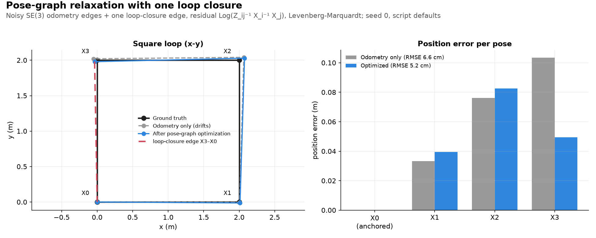
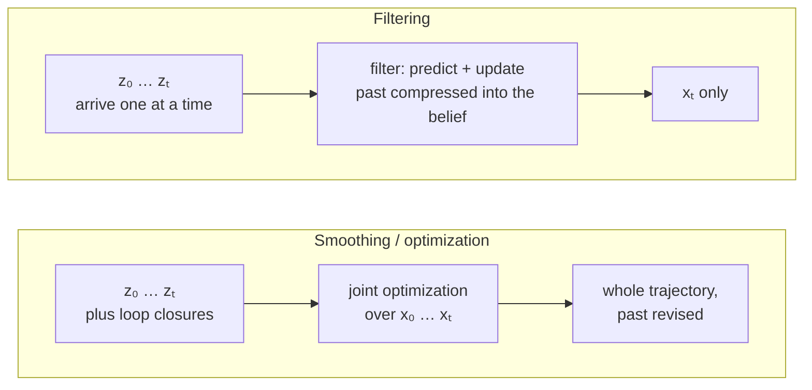

# Filtering vs. Optimization/Smoothing in SLAM

The key to **Filtering vs. Optimization/Smoothing in [SLAM](glossary.md#slam-simultaneous-localization-and-mapping)** is **when the robot is allowed to change its mind about the past**.

---

## 1. The core idea

Suppose a robot moves through a room:

**$t_0 \to t_1 \to t_2 \to t_3 \to t_4$**

At every time step, it gets:

- [IMU](glossary.md#imu-inertial-measurement-unit) (inertial measurement unit) measurements
- camera/[LiDAR](glossary.md#lidar) (laser range scanner) observations
- wheel [odometry](glossary.md#odometry), etc.

The robot wants to estimate:

> **Where am I? What does the environment look like?**

The fundamental difference is:

### Filtering

> **Estimate the current state using everything available up to now.**

### Optimization/Smoothing

> **Estimate a whole trajectory by jointly considering many states and measurements, including information that may arrive later.**

Two one-line mental models:

> **Filtering = "What do I believe right now?"**

> **Smoothing = "Given everything I've seen, what do I now believe my whole trajectory was?"**

---

## 2. Filtering: one step at a time

Imagine the robot is at time $t_3$.

A filter maintains something like:

```text
        past measurements
              ↓
z₀ → z₁ → z₂ → z₃
              ↓
        [ FILTER ]
              ↓
        current state x₃
```

It summarizes the past into the **[current belief](glossary.md#bayes-filter)** (the probability distribution over the current state, given all measurements so far).

For a [Kalman filter](glossary.md#kalman-filter-kf), conceptually:

```text
prediction
    ↓
x₃ predicted
    ↓
new measurement z₃
    ↓
correction
    ↓
x₃ estimated
```

Then the robot moves to $t_4$.

The filter takes the estimate at $t_3$, propagates it forward, incorporates $z_4$, and produces the estimate at $t_4$.

### What the filter forgets

Once the filter has moved on, it generally **doesn't go back and reconsider old states**. It says:

> "I have compressed everything before $t_3$ into my current belief. Now let's continue."

This makes filtering **naturally online** (it processes each measurement as it arrives) and, for small fixed-size states, computationally efficient (see the caveat in [§6](#6-the-computational-difference)).

### The big limitation of filtering

Suppose the robot sees:

```text
A → B → C → D → E
```

At the beginning, it thinks:

```text
A ---- B ---- C ---- D
```

But later, at `E`, it recognizes:

> "Wait! I've seen this place before. This is actually A."

That's a **[loop closure](glossary.md#loop-closure)**.

The previous trajectory must have been wrong: the new information says the robot ended up back near its starting position, not at a separate point `E`.

Therefore, **all those previous poses may need to move**: before the closure `E` sits apart from `A`, and after it `E` coincides with `A` while `B`, `C` and `D` shift to fit (the figure in [§3](#3-optimization-keep-the-history) shows this on a real run).

A pure filter cannot do this: it has already compressed the past, so the old poses are no longer in its state and it cannot move them.

An **EKF-SLAM** filter (an [EKF](glossary.md#ekf-extended-kalman-filter), i.e. extended Kalman filter, whose state holds the current pose and every [landmark](glossary.md#landmark)) still benefits from the loop closure. Through the correlations in its [covariance](glossary.md#covariance) (off-diagonal terms tie the current pose to each landmark, so one correction propagates to the others), it corrects the current pose and the whole landmark map; see [§9](#9-the-precise-distinction).

---

## 3. Optimization: keep the history

Optimization-based SLAM takes a different approach.

Instead of maintaining only:

```text
current state xₜ
```

it maintains many states:

```text
x₀   x₁   x₂   x₃   x₄
 |    |    |    |    |
```

and measurements connecting them:

```text
x₀ ── x₁ ── x₂ ── x₃ ── x₄
   measurements between each consecutive pair
```

The SLAM problem becomes:

> **Find the set of poses and landmarks that best explains all the measurements (a local optimum, in general).**

Mathematically, we write:

```math
{\mathbf{x}^*=\arg\min_{\mathbf{x}}\sum_i \|r_i(\mathbf{x})\|^2}
```

where:

- $\mathbf{x}$ = all poses/landmarks
- $r_i(\mathbf{x})$ = (whitened) measurement [residual](glossary.md#residual-error): the raw residual $`e`$ scaled by $`\Sigma^{-1/2}`$, i.e. $`r = \Sigma^{-1/2} e`$, with $`\Sigma`$ the measurement covariance, so that $`\|r\|^2 = r^\top r = e^\top \Sigma^{-1} e`$
- the solver ([Gauss-Newton](glossary.md#gauss-newton) or a damped variant such as [Levenberg-Marquardt](glossary.md#levenberg-marquardt-lm-and-damping)) finds a local minimum of the total error, so a good [initial guess](glossary.md#initial-guess) matters.

This is the fundamental idea behind **[bundle adjustment (BA)](glossary.md#bundle-adjustment-ba)**, **[pose-graph](glossary.md#pose-graph) optimization**, and many modern SLAM systems.

### Revising the past after a loop closure

Suppose we have:

```text
x₀ → x₁ → x₂ → x₃ → x₄
```

with odometry constraints:

```text
x₀ ── x₁ ── x₂ ── x₃ ── x₄
```

But then we detect a loop:

```text
x₀ ── x₁ ── x₂ ── x₃ ── x₄
│                        │
└────────────────────────┘
          loop closure
```

Optimization says:

> "Let's adjust **all of these poses together** so that all constraints are satisfied as well as possible."

So the error can be distributed over all poses. The figure shows this for the repo's square-loop example:



*Figure: `use_numpy/pose_graph.py` at its defaults (seed 0), a four-pose square loop with one loop-closure edge, plotted by `uv run python generator/make_figures.py pose_graph`. The position RMSE drops from 6.6 cm to 5.2 cm: X3 improves most, while X1 and X2 end slightly worse, because the error is shared among all poses.*

The same run, step by step (dead-reckoned poses, the loop-closure edge, then each optimizer iteration), is animated in [pose_graph_optimization.md §5](optimization/pose_graph_optimization.md#5-pose-graph-optimization-resolves-the-conflict).

The important point is:

**Optimization can revise the past.**

---

## 4. Smoothing: optimization with a probabilistic interpretation

**Smoothing** is closely related to optimization, but the two are worth distinguishing.

Filtering asks:

$${p(x_t \mid z_{0:t})}$$

> "What is my belief about the current state given measurements up to now?"

Smoothing asks something closer to ($`x_{0:t}`$ = the states from time 0 to $`t`$):

$${p(x_{0:t} \mid z_{0:t})}$$

> "Given all measurements, what is my belief about the entire trajectory?"

So:

```text
FILTERING

z₀ z₁ z₂ z₃
     ↓
   x₃ only
```

versus:

```text
SMOOTHING

z₀ z₁ z₂ z₃
 ↓  ↓  ↓  ↓
x₀ x₁ x₂ x₃
 \  |  |  /
  joint estimate
```

Optimization is often the computational mechanism for obtaining this joint estimate. Strictly, least-squares optimization returns the single most likely trajectory (the **MAP** (maximum a posteriori) estimate, i.e. the peak of $`p(x_{0:t} \mid z_{0:t})`$), not the whole distribution.

The uncertainty around it is usually approximated as a Gaussian. Its [information matrix](glossary.md#information-matrix) is the Gauss-Newton [Hessian](glossary.md#normal-equations-and-hessian) $`H = J^\top \Omega J`$ at the solution (its inverse is the posterior covariance; bigger information means smaller uncertainty), where $`J`$ is the stacked **[Jacobian](glossary.md#jacobian)** of the raw residuals $`e`$ and $`\Omega = \Sigma^{-1}`$ is the inverse of the measurement covariance $`\Sigma`$. The whitened Jacobian is the Jacobian of $`r`$ (§3), $`\tilde J = \Sigma^{-1/2} J`$, so the same $`H`$ is simply $`\tilde J^\top \tilde J`$.

**Tiny example** (toy case: one scalar $x$, measurement $r = x - z$ with $\sigma = 0.5$):
- Information $= 1/\sigma^2 = 4$, so the variance is $1/4 = 0.25$.
- A second identical measurement adds its information: $4 + 4 = 8$, and the variance halves to $0.125$.

---

## 5. An analogy

We reconstruct a person's route through a city.

- **Filtering:** at each intersection we take the previous answer, add the new clue (a street sign, a step count), and update "I'm probably here". We carry that belief forward and never reopen old answers.
- **Smoothing:** at the end of the day, we collect all the GPS fixes, photos, timestamps, and landmarks and ask, **"Given everything we know now, where were you at every point during the day?"** The person realizes the landmark seen at 2 PM is the one seen at 10 AM, so the 11 AM, 12 PM and 1 PM positions get revised too.

---

## 6. The computational difference

This gives us a useful trade-off:

|                    | Filtering                      | Optimization/Smoothing                   |
| ------------------ | ------------------------------ | ------------------------------------------ |
| Main question      | Where am I **now**?            | Where was I **throughout the trajectory**? |
| State maintained   | Current belief                 | Many historical states                     |
| Uses past          | Compressed into current belief | Explicitly retained                        |
| Can revise past?   | No (EKF-SLAM updates the map, not past poses) | Yes                         |
| Loop closure       | Harder (no past poses to move; EKF-SLAM corrects the map via correlations) | Natural |
| Computation        | Cheaper for small fixed-size states; $O(n^2)$ per update for EKF-SLAM, with $n$ landmarks (see caveat) | Usually more expensive |
| Memory             | Lower for a fixed-size state; EKF-SLAM's dense covariance grows as $O(n^2)$ | Higher |
| Online operation   | Excellent                      | Possible, but needs management             |
| Agreement with all constraints | Harder              | Stronger                                   |
| Typical idea       | EKF-SLAM                       | Pose graph/factor graph/BA             |

**A caveat on cost:** "filtering is cheaper" holds for small, fixed-size problems, but it inverts at scale.
- **EKF-SLAM** keeps a *dense* joint covariance, so every update costs roughly $O(n^2)$ in the number of landmarks $n$ (Dissanayake et al., 2001).
- **Sparse factor-graph smoothing** exploits the sparsity of the graph instead. With an [incremental](glossary.md#batch-vs-incremental) solver such as iSAM2 (Kaess et al., 2012), an odometry measurement only [re-eliminates](glossary.md#variable-elimination) a small part of the [Bayes tree](glossary.md#bayes-tree) near the newest pose.
- **There is no small worst-case bound:** a loop closure can force re-elimination of most or all of the tree (in the worst case, a full refactorization; Kaess et al. 2012, §4.3), and the cost depends on the [fill-in](glossary.md#fill-in) of the sparse factorization. This repo's [`bayes_tree_construction.py`](../use_numpy/bayes_tree_construction.py) shows both cases on a 16-node square loop. Under its fixed oldest-first [variable ordering](glossary.md#variable-ordering) (the order in which variables are eliminated; it controls fill-in), an odometry edge affects 2 of 16 variables and a loop-closure edge affects all 16; iSAM2 additionally reorders the affected part, so its real cost is lower (see [`bayes_tree.md` §15](optimization/bayes_tree.md#15-where-this-is-implemented-in-this-repo)).

So most updates in a typical SLAM graph (mostly odometry, occasionally a loop closure) are cheap under iSAM2, while EKF-SLAM pays $O(n^2)$ on every update. This is a main reason large-scale SLAM moved from EKF-SLAM toward factor-graph smoothing.

---

## 7. This is where factor graphs fit

A **[factor graph](glossary.md#factor-graph)** is the bridge between the two worlds. It is bipartite: variables (poses, landmarks) are one kind of node, and each **factor** is its own node connected to the variables it constrains. A SLAM factor graph typically contains **three kinds of factors** (■ = factor node, ● = variable node):

- A **landmark factor** ties a pose to a landmark it observed (two such factors, from $x_0$ and $x_2$ to the same landmark):

```text
x₀ ● ──■── ● landmark ──■── ● x₂
```

- A **pose-to-pose factor** ties two consecutive (or, for a loop closure, non-consecutive) poses together via a relative measurement:

```text
x₀ ● ──■── ● x₁ ──■── ● x₂ ──■── ● x₃
```

- A **[unary (prior) factor](glossary.md#prior-unary-factor)** constrains a single variable directly. It removes [gauge freedom](glossary.md#gauge-freedom) or injects an absolute measurement like GPS:

```text
■ ── ● x₀ ──■── ● x₁ ──■── ● x₂
prior
```

Each measurement becomes a factor node imposing a constraint:

```text
IMU:             x₁ ●──■──● x₂
Visual odometry: x₂ ●──■──● x₃
Loop closure:    x₃ ●──■──● x₀
```

Optimization then asks:

> **"What configuration of $x_0$, $x_1$, $x_2$, $x_3$ best satisfies all these constraints?"**

In this repo, the gauge is fixed as follows:

| Script | How the gauge is fixed |
| --- | --- |
| [`pose_graph.py`](../use_numpy/pose_graph.py) | strong prior on node 0's block of the information matrix |
| [`bundle_adjustment.py`](../use_numpy/bundle_adjustment.py) | soft prior factors on the first two cameras (also pins the scale of monocular, i.e. single-camera, BA) |
| [`bundle_adjustment_advanced.py`](../use_numpy/bundle_adjustment_advanced.py) | no prior factor; two [keyframes](glossary.md#keyframe) held constant |

---

## 8. Filtering vs smoothing in one picture



- The filter's past gets **compressed**.
- The smoother's past is **kept around so it can be reconsidered**.


*Figure: a conceptual sketch (the window of 3 is an example size), plotted by `uv run python generator/make_figures.py filtering_smoothing_timeline_concept`.*

### The same picture with numbers: a Kalman filter and its RTS smoother on one data set

**Intuition.** A filter's estimate at tick $`k`$ (one filter step of $`\Delta t = 0.05`$ s) uses the measurements up to tick $`k`$. The **Rauch-Tung-Striebel (RTS) smoother** ([glossary](glossary.md#rts-rauch-tung-striebel-smoother)) is a backward pass run after the filter. It revisits every tick and also uses the measurements that came after it. One run of [`rts_smoother.py`](../use_numpy/rts_smoother.py) (seed 0) shows what that buys. At $`t = 1.95`$ s, the last tick of an extend phase of the 1D inchworm toy of [inchworm_zupt_ekf.md](filtering/inchworm_zupt_ekf.md), the filter cannot know the body is about to stop. Its velocity is 0.122 m/s off, although it claims a standard deviation of $`\sigma = 0.060`$ m/s ($`\sigma`$ is the uncertainty each estimator reports for itself). The smoother's estimate of the same tick is 0.005 m/s off ($`\sigma = 0.022`$ m/s).

#### Three estimates from the same data

The toy is linear: the state is $`x = [p, v]`$ (position in m, velocity in m/s), a position measurement arrives every tick, and a [zero-velocity update (ZUPT)](glossary.md#zupt-and-zaru) ($`v = 0`$) is applied on the scheduled anchor ticks. All three estimates use the same model, the same measurements, and the same noise values:

| Estimate | Uses at tick $`k`$ | How it is computed |
| --- | --- | --- |
| **Filter** | measurements up to tick $`k`$ | forward Kalman filter (the `phase_conditional` filter of `inchworm_zupt_ekf.py`) |
| **RTS smoother** | all measurements | backward pass over the stored filter results |
| **Batch least squares** | all measurements | one linear least-squares problem over all ticks' states |

#### The RTS equations

Notation (all from the forward pass, except the smoothed quantities): $`F`$ is the transition matrix (it maps $`[p, v]`$ to $`[p + \Delta t\, v,\ v]`$), $`Q`$ the process-noise covariance added each step, $`\hat x_k`$ and $`P_k`$ the filter's mean and covariance at tick $`k`$ (after its updates), $`\hat x^-_{k+1}`$ and $`P^-_{k+1}`$ its prediction of tick $`k+1`$ before that tick's measurements, and $`N`$ the last tick. A superscript $`s`$ marks a smoothed quantity.

| Step | Equation | In words |
| --- | --- | --- |
| Store while filtering | $`\hat x^-_{k+1} = F \hat x_k`$, $`P^-_{k+1} = F P_k F^\top + Q`$ | the filter's prediction, kept for the backward pass |
| Start at the last tick | $`\hat x^s_N = \hat x_N`$, $`P^s_N = P_N`$ | no measurements come after tick $`N`$, so the smoother equals the filter there |
| Gain, for $`k = N-1, \dots, 0`$ | $`G_k = P_k F^\top (P^-_{k+1})^{-1}`$ | how strongly tick $`k+1`$ pulls tick $`k`$ along |
| Smoothed mean | $`\hat x^s_k = \hat x_k + G_k (\hat x^s_{k+1} - \hat x^-_{k+1})`$ | all the data moved tick $`k+1`$ by $`\hat x^s_{k+1} - \hat x^-_{k+1}`$ relative to the filter's prediction; the gain passes that shift back to tick $`k`$ |
| Smoothed covariance | $`P^s_k = P_k + G_k (P^s_{k+1} - P^-_{k+1}) G_k^\top`$ | the same pass-back for the uncertainty; it is never larger than $`P_k`$ |

The smoother was introduced by Rauch, Tung and Striebel (1965, reference 9); the equations above are Theorem 8.2, Eq. (8.6) of Särkkä (2013, reference 10).

**Equality with batch least squares.** For a linear Gaussian model, the posterior over the whole trajectory is Gaussian, and its mean is the least-squares solution over all states (for linear systems, the least-squares solution is the posterior mean, reference 10, §1.2). The smoother's output at tick $`k`$ is that posterior's marginal at $`k`$ (reference 10, Eq. 8.1 and Theorem 8.2). So the RTS means must equal the batch solution, and so must the covariances. The batch problem uses the same factors as the filter: a prior on $`x_0`$, one dynamics factor per tick (covariance $`Q`$), one position factor per tick, one ZUPT factor per anchor tick, each weighted by its own covariance. That is the argument; the script checks it numerically. On the run below, the largest difference between the RTS and batch results is 9.6e-15 (means) and 5.5e-17 (covariances), and the tests require at most 1e-9.

#### One run

Errors are the **RMSE** ([root-mean-square error](glossary.md#rmse-root-mean-square-error)) over the ticks, in the units of the quantity.

| Seed 0, ticks 1 to $`N`$ | Filter | RTS smoother |
| --- | --- | --- |
| Position RMSE | 0.0084 m | 0.0036 m |
| Velocity RMSE | 0.0381 m/s | 0.0115 m/s |

- The smoother's velocity $`\sigma`$ divided by the filter's is at most 1.00 (equal at the last tick), 0.84 at the median tick, and 0.37 at the smallest (1.95 s). The smallest eigenvalue of $`P_k - P^s_k`$ over all ticks is 0, so the smoother's covariance is nowhere larger than the filter's.
- At 1.95 s, the position error also drops: filter $`-0.0159`$ m ($`\sigma = 0.0109`$ m), smoother $`-0.0055`$ m ($`\sigma = 0.0040`$ m).
- Tick 0 is the filter's prior (velocity error 0.080 m/s, $`\sigma = 0.050`$ m/s), which no measurement has touched. The smoother's tick-0 error is 0.017 m/s ($`\sigma = 0.024`$ m/s). The tables leave tick 0 out because that gain has nothing to do with the gait.

#### Monte Carlo: accuracy and consistency

[**Monte Carlo trials**](glossary.md#monte-carlo-trials): 500 runs of the same gait, each with a fresh initial guess error and fresh measurement noise. The truth itself has no random disturbance (as in `inchworm_zupt_ekf.py`, called the parent below), so the `matched` scenario below also redraws the process noise. The assumed process noise is set to 0.5 m/s², the true ramp acceleration $`v_{\text{extend}} / t_{\text{ramp}}`$, instead of the parent's under-sized 0.15 m/s²; with 0.15 the truth departs from the filter's model and every estimator's NEES would measure that mismatch ([inchworm_zupt_ekf.md §3](filtering/inchworm_zupt_ekf.md#3-the-finding-not-just-always-is-wrong-while-moving)). RMSE is again taken over the window's ticks; **NEES** ([glossary](glossary.md#consistency-and-nees)) is the squared error in units of the estimator's own claimed covariance, which should average 2 for a 2-state estimator and lie in $`[1.83, 2.18]`$ for a 500-trial average (95% interval).

Per gait window (default scenario; the windows exclude tick 0; the ramp windows are the first and last 4 ticks of each extend phase, 0.2 s each):

| Window | Ticks | Position RMSE filter / smoother (m) | Velocity RMSE filter / smoother (m/s) | NEES filter / smoother |
| --- | --- | --- | --- | --- |
| anchor | 100 | 0.0063 / 0.0037 | 0.0006 / 0.0012 | 0.92 / 0.84 |
| ramp-up | 20 | 0.0051 / 0.0037 | 0.0455 / 0.0180 | 1.67 / 1.36 |
| cruise | 60 | 0.0112 / 0.0042 | 0.0513 / 0.0163 | 1.66 / 0.93 |
| ramp-down | 20 | 0.0099 / 0.0047 | 0.0573 / 0.0229 | 1.88 / 1.48 |
| ticks 1 to $`N`$ | 200 | 0.0084 / 0.0040 | 0.0364 / 0.0129 | 1.31 / 0.99 |
| last tick $`N`$ | 1 | 0.0088 / 0.0088 | 0.0026 / 0.0026 | 1.19 / 1.19 |

Three scenarios, ticks 1 to $`N`$:

| Scenario | Truth and assumed process noise | Position RMSE (m) | Velocity RMSE (m/s) | NEES |
| --- | --- | --- | --- | --- |
| `inchworm` (default) | the parent's deterministic truth, 0.5 m/s² | 0.0084 / 0.0040 | 0.0364 / 0.0129 | 1.31 / 0.99 |
| `inchworm_q015` | same data, the parent's 0.15 m/s² | 0.0161 / 0.0060 | 0.0437 / 0.0152 | 10.45 / 4.17 |
| `matched` | truth drawn from the filter's own model (random process noise 0.5 m/s², random initial state, anchor-tick velocity reading $`v`$ + noise instead of exactly 0) | 0.0081 / 0.0046 | 0.0392 / 0.0206 | 1.97 / 2.01 |

(Each cell: filter / smoother.)

**Accuracy.** The smoother is more accurate in position in every window and in velocity in every window except the anchor phase. Over ticks 1 to $`N`$, its position RMSE is 0.48 times the filter's, and its velocity RMSE is 0.35 times.

**Where the gain is largest.** Velocity RMSE per tick within the gait cycle, over the interior ticks (not the first or last cycle), in m/s, filter then smoother, with and without the ZUPTs in both estimators:

| Tick in cycle (time) | With ZUPT | Without ZUPT |
| --- | --- | --- |
| 39 (1.95 s, last tick before the anchor phase) | 0.0802 to 0.0073 | 0.0774 to 0.0202 |
| 24 (1.20 s, end of the ramp-up) | 0.0913 to 0.0224 | 0.0904 to 0.0301 |
| 25 (1.25 s) | 0.0818 to 0.0155 | 0.0806 to 0.0244 |

These are the three largest reductions, and the largest is the tick right before the anchor phase. Removing the ZUPTs weakens the gain there (0.0073 becomes 0.0202) but does not erase it: the coming ZUPT supplies most of it, and the later position measurements supply the rest.

**Where the smoother is not better.** In the anchor window, the smoother's velocity RMSE (0.0012 m/s) is higher than the filter's (0.0006 m/s). On the deterministic truth, its velocity RMSE exceeds the filter's at 22 of the 40 ticks of the cycle (the 20 anchor ticks, the first ramp-up tick, and the first ramp-down tick); its position RMSE never does. On `matched` truth, it exceeds the filter's at 0 of 40 ticks, in velocity and in position. The deterministic truth departs from the model in two ways: its velocity is exactly 0 on every anchor tick, where the filter's ZUPT pins it, and its slope changes abruptly at the ramp corners. `matched` truth contains neither, and there the smoother is nowhere worse, so the effect comes from that departure, not from the smoother.

**Consistency.** On the deterministic truth both estimators are conservative (NEES below 2), the smoother more so (0.99 vs. 1.31), because the model assumes a random disturbance the truth does not have. On `matched` truth, both are consistent (1.97 and 2.01, inside $`[1.83, 2.18]`$), which checks the smoother's covariance, not only its mean. With the parent's undersized process noise, both are overconfident (10.45 and 4.17): the latter data lower the NEES but do not bring it into the band. In that scenario, at the last tick the smoother has no later data, so its NEES (20.33) equals the filter's (in the default scenario both are 1.19 there, table above).


*Figure: `use_numpy/rts_smoother.py` at its defaults (seed 0, 500 trials), saved by `uv run python use_numpy/rts_smoother.py --out assets/rts_smoother.png`. Gold = anchor ticks. The filter's velocity band balloons during each extend phase and collapses at each ZUPT; the smoother's stays narrow.*

The same run as an animation: the forward pass first (the filter at each tick, with the data not yet measured greyed out), then the backward pass (the smoother, now using all the data), with the 1D track on top and the Monte Carlo velocity RMSE below.


*Animation: `generator/animate_rts_smoother.py` at its defaults (seed 0, 500 trials), rendered by `uv run python generator/animate_rts_smoother.py --out assets/rts_smoother.gif`.*

#### Fixed lag: most of the gain with a short delay

A **fixed-lag smoother** ([glossary](glossary.md#sliding-window-and-fixed-lag-smoothing)) estimates tick $`k`$ from the measurements up to tick $`k + L`$ only, so the estimate arrives $`L`$ ticks late instead of at the end of the run (reference 10, Chapter 10). Here it is the RTS recursion started at tick $`k + L`$ from the stored filter mean there (a test checks that it equals the RTS smoother run on the data truncated at tick $`k + L`$).

| Lag $`L`$ (ticks / s) | Position RMSE (m) | Velocity RMSE (m/s) |
| --- | --- | --- |
| 0 (= filter) | 0.0084 | 0.0364 |
| 5 / 0.25 | 0.0053 | 0.0187 |
| 10 / 0.5 | 0.0046 | 0.0143 |
| 20 / 1.0 | 0.0041 | 0.0132 |
| 40 / 2.0 | 0.0040 | 0.0129 |
| 200 / 10 (full RTS) | 0.0040 | 0.0129 |

Half a second of delay (10 ticks) already removes 94% of the velocity RMSE gap between the filter and the full smoother ($`(0.0364 - 0.0143) / (0.0364 - 0.0129) = 0.94`$); one second leaves 0.0132 against the full smoother's 0.0129.

#### Cost

One run, 200 ticks (median of 15 repeats; peak memory from `tracemalloc` for one call, which includes Python object overhead). The times come from the run logged for this doc on a shared laptop; another run of the same command gave 27, 30, and 15 µs, so read the ratios, not the absolute values:

| Pass | Time per tick | Peak memory | What it holds |
| --- | --- | --- | --- |
| Forward filter, current state only | 38 µs | 6.8 KB | $`\hat x`$, $`P`$ (6 numbers) |
| Forward filter, storing the history | 40 µs | 146 KB | 16 numbers per tick: $`\hat x_k, P_k, \hat x^-_k, P^-_k, F`$ (25 KB for 201 ticks) |
| RTS backward pass | 20 µs | 17 KB on top | the smoothed means and covariances and the gains |

- The backward pass costs about half a forward step per tick, and it needs the whole history: memory grows with the run length, while a plain filter keeps a constant 6 numbers. This is the filtering-vs-smoothing trade-off of [§6](#6-the-computational-difference) in numbers, for a tiny state.
- It is offline: no smoothed estimate exists until the last measurement has arrived. The fixed-lag version above is the online compromise.

#### What this toy does not show

- **A linear 1D model with a known gait schedule.** Nonlinear models need linearized or sigma-point versions of the backward pass (reference 10, Chapters 9 and 10), which this script does not implement.
- **The velocity gain depends on the ZUPT schedule.** The gain at the end of each extend phase comes largely from the known anchor phase that follows (the without-ZUPT column above); a gait without such a known stop would see less.
- **One gait.** The Monte Carlo tables average 500 trials of this one gait; none varies the gait itself.

**Takeaway.** On the same data, the RTS smoother halves the position error and cuts the velocity error to about a third, matches the batch least-squares solution to round-off, and gains most just before a stop. It costs a stored history, an offline backward pass, and, where the truth departs from the model (here, an exactly zero anchor velocity), it can be slightly worse than the filter in velocity during the anchor phase.

---

## 9. The precise distinction

A common shorthand is:

> "Filtering is local, optimization is global."

That is **useful intuition, but not strictly correct**.

A filter can incorporate loop closures and other global information. For example, EKF-SLAM can update the entire state covariance/mean when a landmark is re-observed.

The more precise distinction is:

> **Filtering recursively represents the current posterior (the belief of §2) and [marginalizes](glossary.md#marginalization) old information, whereas smoothing maintains a posterior over multiple states and can jointly revise them.**

### Tiny example (toy case, 1D)
- Prior: $`x_0\sim N(0,1)`$, and $`x_1 = x_0 + 1`$ with extra noise of variance 1. So $`x_1`$ has mean 1 and variance 2.
- Later we learn $`x_0 = 0.4`$ with variance 0.01 (a sharp reading).
- Smoother (still holds $`x_0`$): $`x_0 = 40/101 \approx 0.396`$, so $`x_1 \approx 1.396`$, and var($`x_1`$) drops from 2 to about 1.01.
- Filter that already dropped $`x_0`$: it only has $`x_1\sim N(1,2)`$, so it cannot use a reading of $`x_0`$.

---

## 10. Where the modern systems fit

A rough map is:

```text
                State Estimation
                       │
          ┌────────────┴────────────┐
          │                         │
      Filtering                 Smoothing
          │                         │
    ┌─────┴─────┐             ┌─────┴─────┐
    │           │             │           │
   KF          EKF        Fixed-lag    Full
                           smoothing   smoothing
                               │           │
                               ▼           ▼
                         Factor graphs/Optimization
```

(KF and EKF stay in the dense, recursive filtering loop; [fixed-lag](glossary.md#sliding-window-and-fixed-lag-smoothing) and full smoothing (which keeps the whole trajectory) are the methods usually solved via sparse factor-graph optimization.)

Examples:

- **EKF-SLAM** → filtering
- **[MSCKF](glossary.md#msckf-multi-state-constraint-kalman-filter)** (Multi-State Constraint Kalman Filter) → an EKF-based filter for visual-inertial estimation, run over a sliding window of poses. Landmarks never enter the state; each is used once as a constraint between window poses, then dropped. Because of the window, it fits the fixed-lag box only loosely.
- **[VINS-Mono](glossary.md#vins-mono)/VINS-Fusion** → nonlinear optimization + sliding window
- **[ORB-SLAM](glossary.md#orb-slam)** → heavily optimization-based
- **GTSAM-based systems** (GTSAM is a factor-graph optimization library) → factor-graph optimization
- **iSAM/iSAM2** → incremental smoothing/optimization

(See [optimization/marginalization.md](optimization/marginalization.md) for the actual mechanics of how a state gets marginalized out and why that's what makes a bounded sliding window possible.)

This is one corner of the repo-wide map in [slam_mental_map.md](slam_mental_map.md), which places every doc and script on one picture.

---

## 11. And this matters a lot for SLAM + state estimation for resource-constrained robots with discontinuous/hybrid motion

A robot with discontinuous/hybrid motion (bio-inspired locomotion, legged contact events, and similar) might experience:

```text
normal motion
     ↓
contact
     ↓
jump/climb/discrete transition
     ↓
new contact
     ↓
normal motion
```

### The filtering question

> **"Given the state right now, what happens next?"**

A filter asks this for both **smooth motion** and **hybrid motion**. The difference is what happens when the answer is a little wrong:

| | Smooth motion | Hybrid motion |
|---|---|---|
| Next step | Integrate the motion model | Also decide **when** the jump happens (e.g., touchdown), then apply it |
| Uncertainty | Ordinary Jacobian of the motion model carries the covariance forward | **[Saltation matrix](glossary.md#saltation-matrix)**: the reset map's Jacobian plus a correction for the jump happening slightly earlier or later ([hybrid_saltation_ekf.md §2](filtering/hybrid_saltation_ekf.md#2-why-the-reset-maps-own-jacobian-is-not-enough)) |
| A wrong call | A small error; the next measurements pull it back | A wrong decision, e.g. contact detected late ([§8](filtering/hybrid_saltation_ekf.md#8-quantifying-contact-detection-timing-jitter)) or "velocity = 0" while still moving ([inchworm_zupt_ekf.md §3](filtering/inchworm_zupt_ekf.md#3-the-finding-not-just-always-is-wrong-while-moving)); the filter can't go back and redo it |

### The smoothing question

> **"Given the measurements before and after, what trajectory fits them all best?"**

A smoother asks this for any motion. For **hybrid motion**, that includes the transition itself: **when** contact really happened, and what the state was at that moment. Measurements from after the transition often settle the call a filter had to make blind.

### Summary

> **Filtering is like continuously updating a belief about where the robot is.**

> **Smoothing/optimization is like periodically reopening the entire notebook and rewriting the past trajectory so that everything observed so far fits together as consistently as possible.**

---

## 12. References

1. Thrun, S., Burgard, W., & Fox, D. (2005). *Probabilistic Robotics*. MIT Press. - the online-SLAM-vs-full-SLAM framing behind §1's and §6's filtering/smoothing distinction.
2. Dissanayake, M. W. M. G., Newman, P., Clark, S., Durrant-Whyte, H. F., & Csorba, M. (2001). *A Solution to the Simultaneous Localization and Map Building (SLAM) Problem*. IEEE Transactions on Robotics and Automation, 17(3), 229–241. https://doi.org/10.1109/70.938381 - the $O(n^2)$ dense-covariance growth of EKF-SLAM referenced in §6's caveat.
3. Dellaert, F., & Kaess, M. (2006). *Square Root SAM: Simultaneous Localization and Mapping via Square Root Information Smoothing*. International Journal of Robotics Research, 25(12), 1181–1203. https://doi.org/10.1177/0278364906072768 - the sparse smoothing/factor-graph approach behind §4, §7, and §6's caveat.
4. Kaess, M., Johannsson, H., Roberts, R., Ila, V., Leonard, J. J., & Dellaert, F. (2012). *iSAM2: Incremental Smoothing and Mapping Using the Bayes Tree*. International Journal of Robotics Research, 31(2), 216–235. https://doi.org/10.1177/0278364911430419 - the incremental sparse solver behind §6's caveat and §10's iSAM/iSAM2 entry.
5. Dellaert, F., & Kaess, M. (2017). *Factor Graphs for Robot Perception*. Foundations and Trends in Robotics, 6(1–2), 1–139. https://doi.org/10.1561/2300000043 - general reference for the factor-graph formulation used throughout §7.
6. Mourikis, A. I., & Roumeliotis, S. I. (2007). *A Multi-State Constraint Kalman Filter for Vision-Aided Inertial Navigation*. ICRA 2007, 3565–3572. https://doi.org/10.1109/ROBOT.2007.364024 - the MSCKF reference in §10.
7. Qin, T., Li, P., & Shen, S. (2018). *VINS-Mono: A Robust and Versatile Monocular Visual-Inertial State Estimator*. IEEE Transactions on Robotics, 34(4), 1004–1020. https://doi.org/10.1109/TRO.2018.2853729 - the VINS-Mono/VINS-Fusion reference in §10.
8. Mur-Artal, R., Montiel, J. M. M., & Tardós, J. D. (2015). *ORB-SLAM: A Versatile and Accurate Monocular SLAM System*. IEEE Transactions on Robotics, 31(5), 1147–1163. https://doi.org/10.1109/TRO.2015.2463671 - the ORB-SLAM reference in §10.
9. Rauch, H. E., Tung, F., & Striebel, C. T. (1965). *Maximum likelihood estimates of linear dynamic systems*. AIAA Journal, 3(8), 1445–1450. https://doi.org/10.2514/3.3166 - the RTS smoother of §8's worked example (bibliographic data checked on Crossref; its equations are taken from reference 10).
10. Särkkä, S. (2013). *Bayesian Filtering and Smoothing*. Cambridge University Press. https://doi.org/10.1017/CBO9781139344203 (author's PDF: https://users.aalto.fi/~ssarkka/pub/cup_book_online_20131111.pdf) - Theorem 8.2 and Eq. (8.6) (the RTS equations), Eq. (8.1) (the smoothing distribution), §1.2 (for linear systems the least-squares solution is the posterior mean) and Chapter 10 (fixed-lag smoothing), all used in §8's worked example.

### Further reading

- Awesome Legged Robot Localization and Mapping (GitHub list maintained by KwanWaiPang). https://github.com/KwanWaiPang/Awesome-Legged-Robot-Localization-and-Mapping - a curated, ongoing list of localization and mapping work on legged robots, where §11's contact-driven, discontinuous motion shows up in practice. A link collection, not a peer-reviewed source.
