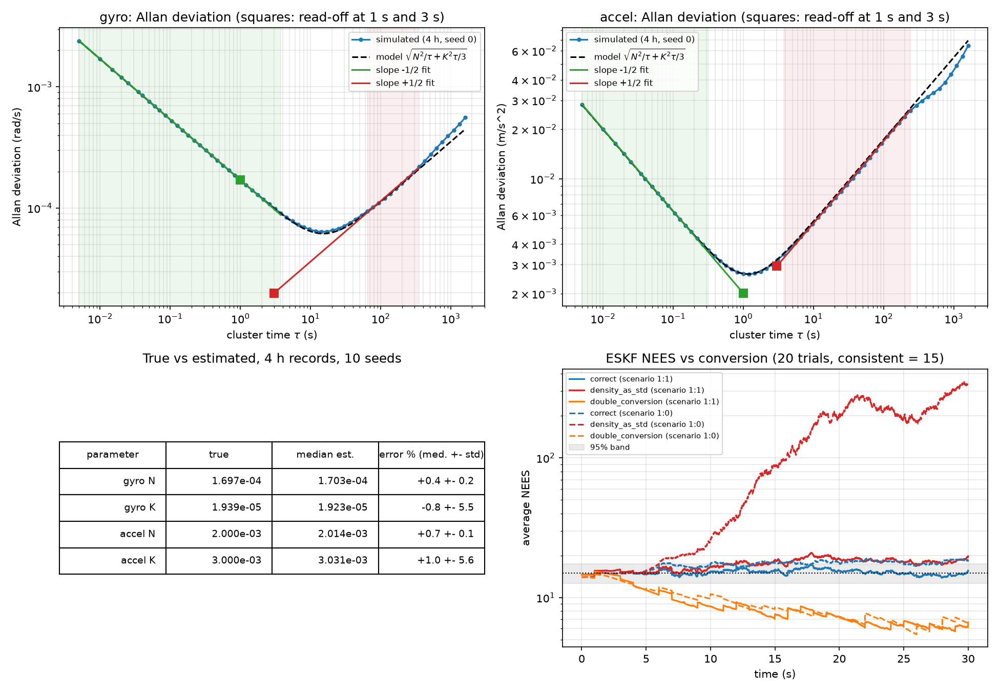
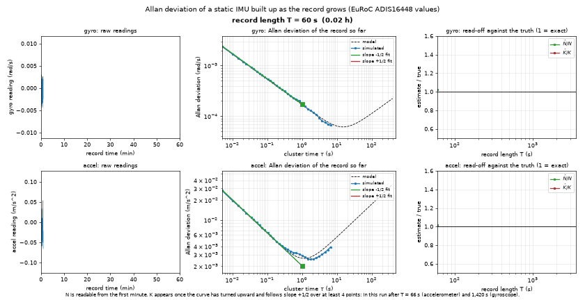

# Noise identification: where Q and R come from (Allan variance)

**How to read it.** The Intuition and §1-§5 need only the mean, the variance and the standard deviation ([probability_basics.md](probability_basics.md) §1). §6 also needs the ESKF ([eskf.md](../filtering/eskf.md); §2.2 introduces $`Q`$ and $`L`$) and NEES (probability_basics.md §7). §5 is `--part 1` and §6 is `--part 2` of [`imu_allan_variance.py`](../../use_numpy/imu_allan_variance.py) ([README §4](../../README.md#4-imu-noise-from-a-static-recording-allan-deviation)); §6 also runs [`eskf_imu_position_fix.py`](../../use_numpy/eskf_imu_position_fix.py) ([README §6](../../README.md#6-error-state-kalman-filter-eskf-vs-a-quaternion-in-the-state)) without editing it. Sources are numbered 1-7 in [References](#9-references).

## Intuition

Every IMU filter in this repo is given noise values, such as `--gyro-noise-std 0.01`. A datasheet or calibration file gives them in other units, and you can read them off a recording of a motionless sensor.

Leave a gyroscope still and average its readings over increasingly long windows. Two things happen:

- **White noise** averages down: the longer the window, the smaller the leftover.
- **Bias drift** does not: the bias wanders, so a longer window sees more of it.

**Worked number** (the EuRoC gyroscope of §1, white-noise density $`N = 1.7\times10^{-4}`$ rad/s/√Hz, bias random-walk density $`K = 1.9\times10^{-5}`$ rad/s²/√Hz):

| Averaging window | White part left | Drift part | Which dominates |
| --- | --- | --- | --- |
| 1 s | $`1.7\times10^{-4}`$ rad/s | $`1.1\times10^{-5}`$ rad/s | white noise |
| 100 s | $`1.7\times10^{-5}`$ rad/s | $`1.1\times10^{-4}`$ rad/s | drift |

(white part $`N/\sqrt{\tau}`$, drift part $`K\sqrt{\tau/3}`$, with $`\tau`$ the window in seconds.) The **Allan deviation** plots this leftover spread against the window length on log-log axes. White noise appears as a line of slope −1/2, the drift as a line of slope +1/2, and the two values $`N`$ and $`K`$ are read off the lines. This doc does that on simulated data with known truth (§3-§5), then shows what a wrong density-to-per-sample conversion does to the [ESKF](../filtering/eskf.md) (§6). Implemented in [`imu_allan_variance.py`](../../use_numpy/imu_allan_variance.py).

## 1. The noise model

One axis of a gyroscope or accelerometer reads $`y = \text{truth} + b + n`$. All three terms below are per axis and independent between axes (Kalibr's model, reference 1).

| Term | Symbol | Meaning | Units (gyroscope \| accelerometer) |
| --- | --- | --- | --- |
| White noise | $`n`$ | fast, uncorrelated jitter on every reading | rad/s \| m/s² |
| **Noise density** | $`N`$ | strength of the white noise; its power spectral density is $`N^2`$ | rad/s/√Hz \| m/s²/√Hz |
| Bias | $`b`$ | slowly varying offset added to every reading | rad/s \| m/s² |
| **Bias random walk** density | $`K`$ | strength of the white noise whose integral is the bias, $`\dot b = K w`$ (called the rate random walk coefficient in references 6 and 7) | rad/s²/√Hz \| m/s³/√Hz |
| **Angle/velocity random walk** | | the datasheet name for $`N`$ (gyroscope/accelerometer): integrating white noise on the rate or the acceleration gives a random walk in the angle or the velocity (reference 1) | |
| **Bias instability** | | the flat bottom of the Allan curve, between the white-noise and random-walk regions: its Allan variance reaches a plateau (reference 6, eq. C.5; reference 4); datasheets usually quote it in place of $`K`$ (reference 1) | same as the readings |

**Default values.** The script's preset is the EuRoC MAV dataset's IMU, an ADIS16448 (reference 2) sampled at 200 Hz (references 2, 3). The values come from a copy of the dataset's `imu0/sensor.yaml` in the EuRoC-rs crate's test data (reference 2), not from the original dataset archive:

| Parameter | `sensor.yaml` key | Value | Units |
| --- | --- | --- | --- |
| Gyroscope $`N`$ | `gyroscope_noise_density` | $`1.6968\times10^{-4}`$ | rad/s/√Hz |
| Gyroscope $`K`$ | `gyroscope_random_walk` | $`1.9393\times10^{-5}`$ | rad/s²/√Hz |
| Accelerometer $`N`$ | `accelerometer_noise_density` | $`2.0\times10^{-3}`$ | m/s²/√Hz |
| Accelerometer $`K`$ | `accelerometer_random_walk` | $`3.0\times10^{-3}`$ | m/s³/√Hz |

Bias instability is **not simulated**: none of the sources used here gives a simulation model for it together with its Allan-variance formula.

## 2. Continuous density vs. per-sample std

A filter sees samples every $`\Delta t`$ seconds, not a continuous signal. Kalibr's conversion (reference 1), with $`w[k] \sim \mathcal{N}(0,1)`$ a fresh standard-normal draw per step:

```math
n[k] = \frac{N}{\sqrt{\Delta t}}\, w[k], \qquad b[k] = b[k-1] + K\sqrt{\Delta t}\, w'[k]
```

- **Per-sample std** of the white noise: $`N/\sqrt{\Delta t}`$. A shorter $`\Delta t`$ gives a larger per-sample std because each sample averages the noise over a shorter time (a wider band of the noise gets through).
- **Per-step std** of the bias walk: $`K\sqrt{\Delta t}`$.
- The conversion assumes the sensor low-pass filters its noise at $`1/(2\Delta t)`$; simply subsampling a faster signal does not allow it (reference 1).

| Rate | $`\Delta t`$ | Gyroscope per-sample std $`N/\sqrt{\Delta t}`$ | Accelerometer per-sample std |
| --- | --- | --- | --- |
| 100 Hz | 0.01 s | $`1.7\times10^{-3}`$ rad/s | $`2.0\times10^{-2}`$ m/s² |
| 200 Hz | 0.005 s | $`2.4\times10^{-3}`$ rad/s | $`2.8\times10^{-2}`$ m/s² |

Using the density $`N`$ directly as the per-sample std at 100 Hz is $`\sqrt{1/\Delta t} = 10`$ times too small. §6 shows what that does.

## 3. Allan deviation

**Cluster time** $`\tau = m\,\Delta t`$: the length of the window. Splitting a record into windows of $`m`$ samples and averaging each gives the **cluster averages** $`\bar a_i`$. The **Allan variance** is half the mean squared difference of neighboring averages (reference 4, eq. 19):

```math
\mathrm{AVAR}(\tau) = \frac{1}{2(n_c - 1)} \sum_i \left(\bar a_{i+1} - \bar a_i\right)^2, \qquad \mathrm{ADEV}(\tau) = \sqrt{\mathrm{AVAR}(\tau)}
```

with $`n_c`$ the number of clusters (at least 9 for a meaningful value, reference 4). The script uses the **overlapping** estimator, which forms the windows at every sample offset instead of every $`m`$-th and so uses the data fully (reference 5, eq. 10). With the running sum $`x[j] = \Delta t \sum_{i \le j} y[i]`$ ($`x[0] = 0`$) of the $`n`$ readings it becomes (reference 5, eq. 11), one cumulative sum for every $`\tau`$, so $`O(n)`$ per $`\tau`$:

```math
\mathrm{AVAR}(\tau) = \frac{\sum_{j=0}^{n-2m} \left(x[j+2m] - 2x[j+m] + x[j]\right)^2}{2\,(n - 2m + 1)\,\tau^2}
```

($`n+1`$ values of $`x`$ give $`n-2m+1`$ terms; eq. 11 of reference 5 writes the same count as $`N-2m`$ with $`N = n+1`$.) A test checks it against a slow version of eq. 10 on explicit cluster averages (they agree to $`10^{-10}`$).

**Expected curve of the model.** For white noise of density $`N`$, the variance is $`N^2/\tau`$ (reference 6, eq. C.3; reference 7, eq. 17), a line of slope −1/2. For a biased random walk of density $`K`$ it is $`K^2\tau/3`$ (reference 6, eq. C.7; reference 7, eq. 21), a line of slope +1/2. The same two slopes are tabulated in reference 5 (Table 16). In discrete time, the white term is exactly $`N^2/\tau`$, and the bias-walk term is $`K^2 \Delta t\,(2m^2+1)/(6m)`$, which tends to the quoted $`K^2\tau/3`$ for large $`m`$; this exact discrete form is derived here from the covariance of the estimator's term and checked by a test against a brute-force variance. Together:

```math
\mathrm{ADEV}(\tau) = \sqrt{\frac{N^2}{\tau} + \frac{K^2\tau}{3}}
```

The two terms cross at $`\tau_c = \sqrt{3}\,N/K`$: 15 s for the gyroscope and 1.2 s for the accelerometer of §1. A record must reach well beyond $`\tau_c`$ before the random-walk line is visible; in §5 the +1/2 fit region starts at about 3 to 4 times $`\tau_c`$ (3.75 s = 3.2 $`\tau_c`$ for the accelerometer, 64 s = 4.2 $`\tau_c`$ for the gyroscope). The largest usable $`\tau`$ is $`n\,\Delta t / 9`$ (the 9-cluster rule).

## 4. Reading the parameters off the plot

Following references 6 and 7 (and Kalibr, reference 1):

- **$`N`$**: fit a line of slope −1/2 to the white-noise region and read it at $`\tau = 1`$ s (reference 6, §C.1.1; reference 7; also reference 4).
- **$`K`$**: fit a line of slope +1/2 to the random-walk region and read it at $`\tau = 3`$ s, since $`K^2\tau/3 = K^2`$ there (reference 6, §C.1.3; reference 7).

The script picks the regions automatically from the local log-log slope (least squares over five neighboring points, window ±0.1 around −1/2 and +1/2). White region: the run of points from the shortest $`\tau`$ whose slope is in the window. Random-walk region: the longest run of at least 4 points after the curve's minimum. If no such run exists, $`K`$ is reported as unresolved, not guessed. Both fits are fixed-slope, so each is the log-mean of $`\mathrm{ADEV}\sqrt{\tau}`$ (or $`\mathrm{ADEV}/\sqrt{\tau}`$, times $`\sqrt{3}`$).



*Figure: `uv run python use_numpy/imu_allan_variance.py --out assets/imu_allan_variance.png` (run from the repo root, seed 0, EuRoC preset; the curves are the first of the 10 records, 4 h long). Green and red shading: the auto-chosen fit regions; squares: the read-offs at 1 s and 3 s; dashed black: the model curve. Bottom right: Part 2 with the preset (solid) and without bias walk (dashed), 20 trials (the script's default; §6's table uses 50).*

## 5. Results: record length

Each record is simulated with the EuRoC values at 200 Hz, 10 seeds per sensor. The three lengths are nested: the 0.25 h record is the first 0.25 h of the 1 h record, which is the first 1 h of the 4 h record. Error = $`100\,(\text{estimate}/\text{truth} - 1)`$ in %; "resolved" counts the seeds where the fit found a region. `uv run python use_numpy/imu_allan_variance.py --part 1` (the values below are its printed output at the defaults).

| Parameter | Record | Median estimate | Median error % | Std of error % | Resolved |
| --- | --- | --- | --- | --- | --- |
| Gyroscope $`N`$ | 0.25 h | $`1.698\times10^{-4}`$ | +0.08 | 0.67 | 10/10 |
| | 1 h | $`1.700\times10^{-4}`$ | +0.17 | 0.25 | 10/10 |
| | 4 h | $`1.703\times10^{-4}`$ | +0.38 | 0.20 | 10/10 |
| Gyroscope $`K`$ | 0.25 h | $`2.17\times10^{-5}`$ | +11.7 | 10.4 | **2/10** |
| | 1 h | $`2.11\times10^{-5}`$ | +8.8 | 13.7 | 9/10 |
| | 4 h | $`1.92\times10^{-5}`$ | −0.8 | 5.5 | 9/10 |
| Accelerometer $`N`$ | 0.25 h | $`2.012\times10^{-3}`$ | +0.58 | 0.31 | 10/10 |
| | 1 h | $`2.016\times10^{-3}`$ | +0.79 | 0.15 | 10/10 |
| | 4 h | $`2.014\times10^{-3}`$ | +0.68 | 0.07 | 10/10 |
| Accelerometer $`K`$ | 0.25 h | $`3.002\times10^{-3}`$ | +0.07 | 5.8 | 10/10 |
| | 1 h | $`3.046\times10^{-3}`$ | +1.5 | 4.0 | 10/10 |
| | 4 h | $`3.031\times10^{-3}`$ | +1.0 | 5.6 | 10/10 |

- **$`N`$ is read within 1% at every length**, spread under 1%. The small positive median is the read-off itself: the same fit applied to the noise-free expected curve (the exact discrete model) gives +0.34 to +0.46% (gyroscope) and +0.66 to +0.69% (accelerometer), because the bias walk adds a little to the curve at the long-$`\tau`$ end of the white-noise region.
- **The accelerometer $`K`$ is read with a median error under 1.6% and a spread of about 6% from 0.25 h on**: its random walk dominates beyond $`\tau_c \approx 1.2`$ s, so even 0.25 h (clusters up to 100 s) holds the +1/2 line.
- **The gyroscope $`K`$ needs the long record.** Its curve turns upward only beyond $`\tau_c \approx 15`$ s, and 0.25 h reaches $`\tau = 100`$ s: only 2 of 10 seeds found a +1/2 region at 0.25 h, so the median at 0.25 h is two numbers. At 4 h, the median error is −0.8% with a 5.5% spread (9 of 10 resolved). Likely cause of the unresolved cases: too few points left between the minimum and the 9-cluster limit for a run of 4 (seed 0 at 0.25 h: "walk none").
- Fit regions of seed 0 at 4 h: gyroscope white 0.005-3.75 s, walk 64-352 s; accelerometer white 0.005-0.32 s, walk 3.75-241 s.
- Cost: the Allan deviation of one 4 h record (2,880,000 samples) takes 252 ns per sample and 92 MB peak memory.



*Animation: `uv run python generator/animate_imu_allan_variance.py --out assets/imu_allan_variance.gif` (one record per sensor, seed 0 of that script, 1 h, 45 record lengths). In this record, the random-walk fit first finds a region at T = 66 s for the accelerometer and at T = 1,420 s for the gyroscope; at 1 h $`\hat N/N`$ is 1.002 and 1.005 and $`\hat K/K`$ is 0.904 and 0.892 (gyroscope, accelerometer). This is one draw, so it illustrates the table above and does not replace it.*

## 6. What a wrong conversion does to an ESKF

[`eskf_imu_position_fix.py`](../../use_numpy/eskf_imu_position_fix.py) is used without editing it. What its parameters mean:

| Parameter | Meaning | Where it enters |
| --- | --- | --- |
| `gyro_noise_std`, `accel_noise_std` | **per-sample** std of the white noise (rad/s, m/s²) | squared into $`Q`$, the 12×12 covariance the filter assumes for the IMU noise and bias walks; $`L`$, the matrix that maps that noise into the error state, carries the $`\Delta t`$ factors |
| `gyro_bias_rw`, `accel_bias_rw` | bias random-walk **density** $`K`$ (rad/s²/√Hz, m/s³/√Hz) | squared into $`Q`$; its block of $`L`$ carries $`\sqrt{\Delta t}`$ |
| `gyro_bias_std`, `accel_bias_std` | std of the true constant bias draw, and the filters' prior | initial covariance |

- **Truth:** `generate_trial` with per-sample stds $`N/\sqrt{\Delta t}`$ at $`\Delta t = 0.01`$ s (EuRoC preset, 100 Hz), and the script's defaults for motion, 1 Hz position fix, bias draw and initial error. That truth has constant biases, so `add_bias_walk` adds the preset's walk (per-step std $`K\sqrt{\Delta t}`$) on top from a spawned random stream, and the bias error is scored against the drifting truth.
- **Filters** (same trials; they differ only in the per-sample std put in $`Q`$; all use the same $`K`$):
  - **correct**: $`N/\sqrt{\Delta t}`$;
  - **density_as_std**: $`N`$, the density used directly (10 times too small at 100 Hz);
  - **double_conversion**: $`N/\Delta t`$, an already converted per-sample std converted a second time (10 times too large).
- **Score:** the [NEES](../glossary.md#consistency-and-nees) of the 15-state error, averaged over 50 [Monte Carlo](../glossary.md#monte-carlo-trials) trials (each redraws motion, biases, bias walk, IMU noise, position-fix noise and initial error) and over the second half of the 30 s run, with the 95% band $`[13.5, 16.6]`$ for 50 trials from `averaged_nees_bounds` (consistent = 15). **Overconfident** means NEES above the band (the filter's covariance is smaller than its actual error); **underconfident**, below it. The position and attitude RMSE of the same runs are reported too.
- **Scenarios** (`noise_scale:bias_walk_scale`). $`N`$ is multiplied by the first number and $`K`$ by the product of both, so a second number of 0 switches the bias walk off. `1:1` is the preset. `1:0` removes the bias walk from the truth and from every $`Q`$, which is the script's own constant-bias truth with nothing in $`Q`$ that is not in the truth. `10:1` and `100:1` multiply $`N`$ and $`K`$ by 10 and 100: Kalibr notes that static-data values of low-cost IMUs may need raising by 10x or more (reference 1), so these are what-ifs, not measured values.

`uv run python use_numpy/imu_allan_variance.py --part 2 --mc-trials 50` (default scenarios, seed 0). The table uses `--mc-trials 50`; the script's default is 20 trials (band $`[12.7, 17.5]`$), which is what the §4 figure shows:

| Scenario | Filter | NEES | Attitude RMSE (deg) | Position RMSE (m) | Verdict |
| --- | --- | --- | --- | --- | --- |
| `1:1` | correct | 15.69 | 1.212 | 0.1745 | inside band |
| | density_as_std | 18.96 | 1.214 | 0.1747 | overconfident (mild) |
| | double_conversion | 7.14 | 1.352 | 0.1839 | underconfident |
| `1:0` | correct | 18.59 | 1.091 | 0.1732 | above the band |
| | density_as_std | **196.68** | 1.097 | 0.1743 | overconfident |
| | double_conversion | 6.73 | 1.154 | 0.1824 | underconfident |
| `10:1` | correct | 14.83 | 2.097 | 0.2306 | inside band |
| | density_as_std | 21.87 | 2.073 | 0.2322 | overconfident |
| | double_conversion | 6.20 | 3.676 | 0.2779 | underconfident |
| `100:1` | correct | 15.54 | 10.09 | 0.4494 | inside band |
| | density_as_std | 31.68 | 10.29 | 0.4542 | overconfident |
| | double_conversion | 5.80 | 13.81 | 0.5300 | underconfident |

- **The density used as the per-sample std is overconfident** (NEES above the band) in all four scenarios. The size depends on the bias-walk term: 18.96 against 15.69 at the preset (a mild excess, 2.4 above the band's top of 16.6), 31.68 at $`100\times`$ the noise, and 196.68 against 18.59 when the bias walk is absent from $`Q`$. Likely, the bias walk in $`Q`$ keeps the bias uncertainty from shrinking and so limits the harm; this was not isolated by a separate ablation.
- **Its RMSE is almost identical to the correct filter's** (position 0.1747 vs 0.1745 m, attitude 1.214 vs 1.212 deg at the preset). An RMSE comparison would not reveal the mistake; only the NEES does.
- **Where the 197 lives.** `--part 2 --mc-trials 50 --scenarios 1:1 1:0 --block-check` re-runs the same trials and prints the NEES of each 3-state block next to the joint one (consistent: 3 per block, 15 joint). In scenario `1:0`, density_as_std has block NEES of 3.4 (position), 4.0 (velocity), 4.6 (attitude), 5.1 (accelerometer bias) and 5.8 (gyroscope bias), yet a joint NEES of 196.7; the correct filter has 3.3 to 4.5 per block and 18.6 joint. The overconfidence is therefore in the cross-covariances between blocks, not in any single block's variance. At the preset (`1:1`), the blocks are 2.7 to 4.2, and the joint is 19.0.
- **The opposite mistake (double conversion) is underconfident** (NEES 5.8 to 7.1, below the band) and costs accuracy as the noise grows: position RMSE 5% above the correct filter at the preset, 21% at $`10\times`$, 18% at $`100\times`$; attitude RMSE 12%, 75%, 37%.
- **Truth vs. model.** Scenario `1:0` is the case where the filters' $`Q`$ contains exactly what the truth contains; there, the correct filter's NEES, 18.59, is above the band's top (16.6), so a small overconfidence remains even with the right noise. It comes from the ESKF's first-order linearization, not a model or code mismatch. With every uncertainty scaled by $`\lambda`$ on the same 50 trials (`uv run python use_numpy/imu_allan_variance.py --part 2 --mc-trials 50 --lambda-scan`), the NEES tends to a limit of 15.6, inside the band, and the excess over the $`\lambda = 0.01`$ run is +3.0, +0.74, +0.19 and +0.03 at $`\lambda`$ = 1, 0.5, 0.25 and 0.1: it falls as $`\lambda^2`$. It grows with the gap between position fixes: NEES 354 at 5 s (50 trials) and 11,279 at 10 s (20 trials). The dominant term is the second-order attitude error in the rotated specific force; at these 1 s fixes, its tilt² and yaw × tilt parts are of similar size ([eskf.md §4.3](../filtering/eskf.md#43-larger-initial-attitude-errors)).

## 7. What this toy does not show

- **Bias instability (flicker noise)** is not simulated, so the flat region between the two lines never appears, and the read-off here does not account for it.
- **Temperature and scale-factor errors.** Static data at constant temperature ignores both, so the identified values are optimistic. Kalibr's advice for low-cost IMUs is to raise them by 10x or more (reference 1). §6's `10:1` and `100:1` rows show the filter side of that, not a measurement.
- **Axis misalignment and cross-axis coupling**: each axis is simulated and fitted alone.
- **Real recordings** have quantization, a sensor-internal filter, and non-Gaussian tails; here the noise is exactly the model's, so the read-off errors are probably smaller than on a real sensor.
- **The EuRoC values** are the dataset file's values as copied in the EuRoC-rs crate (reference 2); they were not re-derived by an Allan analysis of the dataset's own static data.
- **Part 2** is one 30 s trajectory family with 1 Hz position fixes and 50 trials per scenario in the table (95% band $`[13.5, 16.6]`$); the scenario `1:1` excess (18.96) is outside it by 2.4. It uses the EuRoC density at 100 Hz, not the sensor's native 200 Hz.

## 8. Takeaway

- A static recording gives the filter's noise values: $`N`$ from the −1/2 line at 1 s, $`K`$ from the +1/2 line at 3 s. $`N`$ was read to within 1% from 0.25 h; the accelerometer $`K`$ to a median error under 1.6% (spread about 6%) from 0.25 h; the gyroscope $`K`$ was resolved in only 2 of 10 records at 0.25 h and had a 13.7% spread at 1 h, and a 5.5% spread at 4 h.
- The continuous density becomes a per-sample std by $`1/\sqrt{\Delta t}`$, and a bias-walk density by $`\sqrt{\Delta t}`$. Using the density directly as the per-sample std makes the ESKF overconfident, by a margin that depends on the rest of $`Q`$ (NEES 19.0 vs 15.7 here, 197 vs 18.6 with no bias walk), and its RMSE does not reveal it.
- Check a conversion by NEES, not by RMSE.

## 9. References

1. Kalibr wiki, "IMU Noise Model" (ETH Zurich ASL). https://github.com/ethz-asl/kalibr/wiki/IMU-Noise-Model - the measurement model $`y = \omega + b + n`$, the discrete conversions $`\sigma_{g_d} = \sigma_g/\sqrt{\Delta t}`$ and $`\sigma_{b_{gd}} = \sigma_{b_g}\sqrt{\Delta t}`$, the units table, the read-off "$`\sigma_g`$ at $`AD(\tau = 1\,s)`$, $`\sigma_{b_g}`$ at $`\tau = 3\,s`$" and the advice to raise static values by 10x or more for the lowest-cost sensors.
2. EuRoC `imu0/sensor.yaml` ("VI-Sensor IMU (ADIS16448)", `rate_hz: 200`), as a copy in the test data of the EuRoC-rs crate (not the original dataset archive). https://github.com/eduidl/EuRoC-rs/blob/main/test_data/imu0/sensor.yaml (raw: https://github.com/eduidl/EuRoC-rs/raw/refs/heads/main/test_data/imu0/sensor.yaml) - the four noise values of §1 with the units shown there.
3. Burri, M., Nikolic, J., Gohl, P., Schneider, T., Rehder, J., Omari, S., Achtelik, M. W., & Siegwart, R. (2016). The EuRoC micro aerial vehicle datasets. *The International Journal of Robotics Research*, 35(10), 1157-1163. https://doi.org/10.1177/0278364915620033 (bibliographic data checked in Crossref; the dataset page https://ethz-asl.github.io/datasets/euroc-mav/ lists a 200 Hz MEMS IMU; the paper's text itself was not readable here, so the noise values come from reference 2).
4. Woodman, O. J. (2007). *An introduction to inertial navigation*. University of Cambridge Computer Laboratory, Technical Report UCAM-CL-TR-696, ISSN 1476-2986. https://www.cl.cam.ac.uk/techreports/UCAM-CL-TR-696.pdf - §5.1: the Allan variance of binned averages (eq. 19-20, at least 9 bins), white noise as slope −0.5 read at $`\tau = 1`$, bias instability as the minimum.
5. Riley, W. J. (2008). *Handbook of frequency stability analysis*. NIST Special Publication 1065. https://doi.org/10.6028/NIST.SP.1065 (https://nvlpubs.nist.gov/nistpubs/Legacy/SP/nistspecialpublication1065.pdf) - §5.2.4 (p. 16): the overlapping Allan variance, eq. 10 on averages and eq. 11 on integrated data; Table 16 (p. 68): the Allan-variance slope $`\mu`$ is −1 for white FM and +1 for random-walk FM.
6. IEEE Std 952-1997, *IEEE Standard Specification Format Guide and Test Procedure for Single-Axis Interferometric Fiber Optic Gyros*, IEEE, 1998 (reaffirmed 2008). https://doi.org/10.1109/IEEESTD.1998.86153 (DOI checked in Crossref; year as printed on the standard) - Annex C (informative): eq. C.3 $`\sigma^2(\tau) = N^2/\tau`$, "the numerical value of N can be obtained directly by reading the slope line at t = 1" (p. 64); eq. C.4-C.5 and Figure C.2, the Allan variance of bias instability reaches a plateau (p. 65); eq. C.7 $`\sigma^2(\tau) = K^2\tau/3`$, slope +1/2, "the magnitude of this noise can be read off the slope line at t = 3" (p. 66).
7. El-Sheimy, N., Hou, H., & Niu, X. (2008). Analysis and modeling of inertial sensors using Allan variance. *IEEE Transactions on Instrumentation and Measurement*, 57(1), 140-149. https://doi.org/10.1109/TIM.2007.908635 (Crossref-verified) - p. 143: eq. 17 $`\sigma^2(T) = Q^2/T`$ (angle/velocity random walk), Q read at $`T = 1`$; eq. 21 $`\sigma^2(T) = K^2T/3`$ (rate random walk), K read at $`T = 3`$; eq. 19 and Figure 3, the bias-instability plateau.
