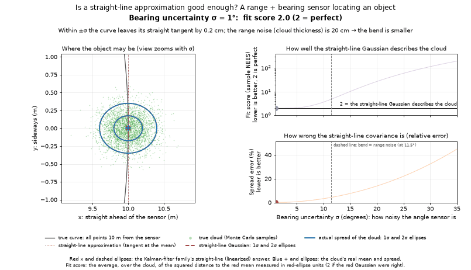

# Probability basics for state estimation: describing, fusing and checking uncertainty

An estimate is not a single number: it is a number plus how far to trust it. Everything a Kalman filter does with that trust comes down to four operations:

| Operation | Section | One-line version |
| --- | --- | --- |
| Describe the uncertainty | §1-§2 | a mean and a variance (or a covariance matrix) |
| Push it through a map | §3 | the variance scales with the square of the map; noise adds variance |
| Merge two estimates | §4-§5 | weight each by $`1/\text{variance}`$; the result is more certain than either |
| Check it afterwards | §7 | does the claimed uncertainty match the real errors? |

§6 shows why minimizing squared errors, which the optimization docs do, is the same thing as merging Gaussian beliefs.

**How to read it.** §1-§6 need only the mean, the variance, and the bell curve; they never need a Kalman filter (it is mentioned only as "where this is used next"). §7 assumes you have seen a filter run. Every number below is printed by [`probability_basics.py`](../../use_numpy/probability_basics.py) at seed 0 (commands in [Run it](#run-it)); sources are numbered [1]-[3] in [References](#references).

---

## 1. Uncertainty as a distribution

**Worked example.** A prediction says a robot is at $`x = 15`$ m, with variance 3 m². Its **standard deviation** is $`\sigma = \sqrt{3} = 1.73`$ m: a typical miss is about 1.7 m, so the robot is probably between 13.3 m and 16.7 m.

Terms (all for one uncertain quantity $`x`$, here a position in m):

- **Random variable** $`x`$: a quantity whose value is uncertain.
- **Distribution** (density $`p(x)`$): how plausible each value is; the area under it is 1.
- **Mean** $`\mu`$ (m): the probability-weighted average value, the best single guess.
- **Variance** $`\sigma^2`$ (m²): the average squared distance from the mean, $`\sigma^2 = E[(x-\mu)^2]`$ [3, eq. 1.4.5-3, p. 37].
- **Standard deviation** $`\sigma`$ (m): the square root of the variance, in the unit of $`x`$.
- **Gaussian** (normal) distribution $`\mathcal{N}(\mu, \sigma^2)`$: the bell curve fixed by $`\mu`$ and $`\sigma^2`$ alone. Written $`x \sim \mathcal{N}(\mu, \sigma^2)`$ ("$`x`$ is distributed as") [2, eq. 2.35, p. 15]:

```math
p(x) = \frac{1}{\sqrt{2\pi\sigma^2}} \exp\left(-\frac{(x-\mu)^2}{2\sigma^2}\right)
```

**The 68 / 95 / 99.7 rule.** For a Gaussian, the share of outcomes within $`k`$ standard deviations of the mean is fixed (computed from the density above with `scipy.stats.norm`):

| Within | Share of outcomes | Range for $`\mu = 15`$ m, $`\sigma = 1.73`$ m |
| --- | --- | --- |
| $`\pm 1\sigma`$ | 68.3% | 13.27 m to 16.73 m |
| $`\pm 2\sigma`$ | 95.4% | 11.54 m to 18.46 m |
| $`\pm 3\sigma`$ | 99.7% | 9.80 m to 20.20 m |

**Why the Gaussian.** It stays Gaussian when pushed through a linear map (§3) and when two of them are multiplied (§4-§5), so a filter can carry just $`\mu`$ and $`\sigma^2`$. When the noise is not Gaussian, or the map is not linear, that is an approximation.

---

## 2. Two variables at once

**Worked example.** A 2D position $`(x_1, x_2)`$ in m with standard deviations 1.0 m and 0.5 m, whose errors tend to move together. This is the input of the script's linear-map check (§3).

- **Covariance** $`\mathrm{cov}(x_1, x_2) = E[(x_1-\mu_1)(x_2-\mu_2)]`$ (m²): positive when $`x_1`$ and $`x_2`$ tend to be above their means together, negative when one is high while the other is low, 0 when neither tells you about the other [3, eq. 1.4.6-5, p. 39].
- **Correlation coefficient** $`\rho = \mathrm{cov}(x_1,x_2) / (\sigma_1 \sigma_2)`$ (no unit, between -1 and 1): the covariance rescaled so it does not depend on the units [3, eq. 1.4.6-6, p. 39].
- **Covariance matrix** $`P`$ (also written $`\Sigma`$ in the books): the variances on the diagonal and the covariances off it; symmetric [2, eq. 2.14, p. 12]. The repo writes $`P`$ for the covariance of an estimate.

```math
P = \begin{bmatrix} \sigma_1^2 & \rho\,\sigma_1\sigma_2 \\ \rho\,\sigma_1\sigma_2 & \sigma_2^2 \end{bmatrix}
= \begin{bmatrix} 1 & 0.25 \\ 0.25 & 0.25 \end{bmatrix} \text{ m}^2 \qquad (\sigma_1 = 1.0 \text{ m},\ \sigma_2 = 0.5 \text{ m},\ \rho = 0.5)
```

- **Uncertainty ellipse**: the points where the Gaussian density is constant, $`(x-\mu)^\top P^{-1} (x-\mu) = M^2`$; $`M = 1, 2`$ give the "1σ" and "2σ" ellipses [2, eq. 2.95 and Fig. 2.6, p. 29]. Its axes are the eigenvectors of $`P`$ (the directions along which the errors are uncorrelated), and its half-lengths are $`M`$ times the square roots of the eigenvalues. Here the 1σ ellipse has half-axes 1.04 m and 0.42 m, the long one tilted 17° from the $`x_1`$ axis.
- **Isotropic** uncertainty is the same in every direction, $`P = \sigma^2 I`$ (a circle); **anisotropic** uncertainty is not (an ellipse) ([glossary](../glossary.md#isotropic-and-anisotropic)).

| $`P`$ (m²) | Shape of the 1σ ellipse |
| --- | --- |
| [[1, 0], [0, 1]] | circle of radius 1 m (isotropic) |
| [[1, 0], [0, 0.25]] | ellipse 1 m by 0.5 m, axes along $`x_1`$, $`x_2`$ (anisotropic, uncorrelated) |
| [[1, 0.25], [0.25, 0.25]] | tilted ellipse 1.04 m by 0.42 m (anisotropic, correlated) |

**A 2D "1σ" is not 68%.** The share inside the 1σ and 2σ ellipses is smaller than in 1D, because the miss can be in either direction (for 2D the share outside the $`M`$-ellipse is $`e^{-M^2/2}`$, from the chi-square density in [3, eq. 1.4.17-10, p. 59] with $`n = 2`$):

| | 1σ | 2σ | 3σ |
| --- | --- | --- | --- |
| 1D interval | 68.3% | 95.4% | 99.7% |
| 2D ellipse | 39.3% | 86.5% | 98.9% |

---

## 3. Propagating uncertainty through a map

**Worked number.** Position $`x \sim \mathcal{N}(15 \text{ m}, 3 \text{ m}^2)`$ is doubled, $`y = 2x`$. The mean doubles to 30 m, but the standard deviation also doubles (1.73 m to 3.46 m), so the variance is multiplied by $`2^2 = 4`$: 12 m².

**Linear map.** For $`y = a x`$ the mean is $`a\mu`$ and the variance $`a^2 \sigma^2`$. For a vector $`y = A x`$ ($`A`$ a constant matrix), the covariance becomes $`A P A^\top`$ [2, eqs. 2.58a-b, p. 20; the book writes $`G`$ for $`A`$]:

```math
y \sim \mathcal{N}\left(A\mu,\; A P A^\top\right)
```

The script's check (a) pushes 200,000 samples of $`x \sim \mathcal{N}([1, 2], P)`$ with the $`P`$ of §2 through $`A = [[1, 0.5], [0, 2]]`$ and compares with the formula (the sample covariance uses the $`N-1`$ divisor [2, eq. 2.16b, p. 12]):

| | Mean (m) | Covariance (m²) |
| --- | --- | --- |
| Formula | [2.0, 4.0] | [[1.3125, 0.75], [0.75, 1.0]] |
| 200,000 samples | [1.9966, 3.9956] | [[1.3059, 0.7457], [0.7457, 1.0014]] |

The relative Frobenius error (matrix norm of the difference over that of the formula) is 0.0047. By hand, with $`(a_1, a_2) = (1, 0.5)`$ the first row of $`A`$, the top-left entry is $`a_1^2 P_{11} + 2a_1a_2 P_{12} + a_2^2 P_{22} = 1\cdot1 + 2\cdot0.5\cdot0.25 + 0.25\cdot0.25 = 1.3125`$. Drawing many random samples and measuring their statistics, as here, is a **Monte Carlo** check.

**Independent noise adds covariances.** If $`y = x + w`$ with noise $`w \sim \mathcal{N}(0, Q)`$ independent of $`x`$, then $`P_y = P + Q`$ [2, eq. 2.90, p. 28]. With $`P = 3`$ m² and $`Q = 1`$ m², $`P_y = 4`$ m²: **adding noise only ever grows the uncertainty.** The Kalman filter's predict step is $`P^- = F P F^\top + Q`$: this rule with a linear motion map $`F`$ and process noise $`Q`$ ([kf_ekf_iekf.md §1](../filtering/kf_ekf_iekf.md#1-standard-kalman-filter-everything-is-nicely-linear)).

**Nonlinear map: use the Jacobian, and know it is local.** A Gaussian pushed through a nonlinear $`g`$ is generally not Gaussian [1, p. 49]. The standard fix replaces $`g`$ by its tangent at the mean, $`g(x) \approx g(\mu) + G (x - \mu)`$, where the **Jacobian** $`G = \partial g / \partial x`$ at $`x = \mu`$ is the matrix of how each output moves per unit change of each input; then [2, eq. 2.85, p. 26; 1, eq. 3.50, p. 50]:

```math
y \approx \mathcal{N}\left(g(\mu),\; G P G^\top\right)
```

It is only as good as the tangent is close to $`g`$ over the spread of $`x`$. The test below is the sample-and-compare check of [linear_nonlinear.md §4.2](../filtering/linear_nonlinear.md#42-numerical-sample-and-compare-works-for-any-model); the filter docs call this Jacobian $`F`$ (motion model) or $`H`$ (measurement model).

**Example: a range-bearing sensor.** A sensor reports range $`r = 10`$ m ($`\pm 0.2`$ m) and bearing $`\theta = 0°`$ ($`\pm \sigma_\theta`$), independent errors; the position is $`(x, y) = (r\cos\theta,\ r\sin\theta)`$. At $`\theta = 0`$ the Jacobian with respect to $`(r, \theta)`$, in that column order, is $`G = [[1, 0], [0, 10 \text{ m}]]`$, so the linearized cloud has $`y`$ standard deviation $`10\ \text{m} \cdot \sigma_\theta`$ ($`\sigma_\theta`$ in radians: 5° is 0.087 rad, so 0.87 m) and $`x`$ standard deviation 0.2 m. Script check (b): 200,000 samples per row (the Monte Carlo cloud, with the same random numbers rescaled for every row):

| Bearing std $`\sigma_\theta`$ | Mean offset (m) | Mean offset ($`\sigma`$) | Covariance error | Sample NEES |
| --- | --- | --- | --- | --- |
| 1° | 0.0014 | 0.007 | 0.002 | 2.002 |
| 5° | 0.0379 | 0.184 | 0.007 | 2.094 |
| 15° | 0.3372 | 0.665 | 0.076 | 10.214 |
| 30° | 1.2826 | 0.751 | 0.324 | 114.755 |

Columns, in words:
- **Mean offset (m):** distance between the linearized mean and the sample mean.
- **Mean offset ($`\sigma`$):** the same offset in units of the sample spread (a Mahalanobis distance, §6).
- **Covariance error:** relative size of (linearized covariance minus sample covariance); 0 means identical.
- **Sample NEES:** the squared error of each sample under the linearized Gaussian, averaged (defined in §7); 2 means the linearized Gaussian describes the cloud.

Reading (measured):
- Up to 5°, the tangent is almost exact. At 1°, the covariance error (0.002) is below the 0.0047 that sampling noise alone gives in check (a), where the formula is exact.
- Then it breaks, and the sample NEES notices first: 10.2 at 15°, although the covariance error is only 0.076. At $`\theta = 0`$ the tangent has zero slope in $`x`$ ($`\partial x/\partial\theta = -r\sin\theta = 0`$), so the linearized $`x`$ variance stays at $`0.2^2 = 0.04`$ m² while the true cloud bends toward the sensor, $`x = r\cos\theta \approx r(1 - \theta^2/2)`$.
- At 30° the cloud is a crescent (figure panel 2b), whose true mean has moved to $`10\,e^{-\sigma_\theta^2/2} = 8.72`$ m (for Gaussian $`\theta`$ with $`\sigma_\theta`$ in radians, $`E[\cos\theta] = e^{-\sigma_\theta^2/2}`$; here $`\sigma_\theta = 0.524`$ rad); the linearized mean stays at 10 m (offset 1.28 m, as printed).

---

## 4. Combining two estimates

**Worked number.** [kf_ekf_iekf.md §1](../filtering/kf_ekf_iekf.md#1-standard-kalman-filter-everything-is-nicely-linear) weights the prediction 70% and the GPS 30%. Where does that come from? A prediction of 15 m with variance $`\sigma_1^2 = 3`$ m² and a measurement of 14 m with variance $`\sigma_2^2 = 7`$ m² (noisier). Weight each by one over its variance: $`1/3 : 1/7 = 7 : 3`$, i.e. 70% and 30%, and $`0.7 \cdot 15 + 0.3 \cdot 14 = 14.7`$ m.

**Inverse-variance weighting.** For two independent Gaussian estimates of the same quantity, the fused estimate is [2, eqs. 2.69a-b, p. 22; 1D example Fig. 2.3, p. 23]:

```math
\frac{1}{\sigma^2} = \frac{1}{\sigma_1^2} + \frac{1}{\sigma_2^2}, \qquad
\mu = w_1 \mu_1 + w_2 \mu_2, \quad w_1 = \frac{\sigma_2^2}{\sigma_1^2 + \sigma_2^2},\ \ w_2 = \frac{\sigma_1^2}{\sigma_1^2 + \sigma_2^2}
```

- **Information** is the inverse variance, $`1/\sigma^2`$ (m⁻²): how much the estimate pins the quantity down. **Information adds**, so the fused variance is smaller than either input: $`1/3 + 1/7 = 10/21`$ m⁻², i.e. $`\sigma^2 = 2.1`$ m² (inputs: 3 and 7).
- The weights come out as $`w_1 = 7/10`$ and $`w_2 = 3/10`$, exactly the 70/30 above (the script chose 3 and 7 so that they are round).
- Independence matters: the formula assumes the two errors have no common source [2, eqs. 2.21-2.23, p. 13].
- If $`\sigma_2^2 \to \infty`$ the measurement is ignored; if $`\sigma_2^2 \to 0`$ it replaces the prediction.

**The gain form.** Rewrite the fused mean as the prediction plus a fraction $`K`$ of the surprise $`\mu_2 - \mu_1`$ (algebra on the weights, $`K = w_2`$):

```math
\mu = \mu_1 + K (\mu_2 - \mu_1), \qquad K = \frac{\sigma_1^2}{\sigma_1^2 + \sigma_2^2}, \qquad \sigma^2 = (1 - K)\,\sigma_1^2
```

$`K`$ is the 1D **Kalman gain**: $`K = 3/10 = 0.3`$, so $`\mu = 15 + 0.3\,(14 - 15) = 14.7`$ m and $`\sigma^2 = 0.7 \cdot 3 = 2.1`$ m². In the Kalman filter's letters $`\sigma_1^2`$ is the predicted variance $`P^-`$ and $`\sigma_2^2`$ the measurement variance $`R`$, giving $`K = P^-/(P^- + R)`$, the gain of [kf_ekf_iekf.md §1](../filtering/kf_ekf_iekf.md#1-standard-kalman-filter-everything-is-nicely-linear) with $`H = 1`$ (Thrun's Table 3.1, lines 4-6 [1, p. 36], with his $`\bar\Sigma`$ for $`P^-`$ and his $`Q`$ for $`R`$). A Kalman filter repeats this update every step.

**Check by Monte Carlo.** In each of 100,000 trials, both estimates are drawn around the same true value with independent errors and fused. The variance of the fused value across trials (one standard error is 0.45% of each value):

| Estimate | Formula (m²) | Monte Carlo (m²) |
| --- | --- | --- |
| Input 1 alone | 3.0000 | 2.9773 |
| Input 2 alone | 7.0000 | 7.0067 |
| Naive 50/50 average | 2.5000 | 2.4997 |
| **Fused (70/30)** | **2.1000** | **2.0926** |

- All four agree with the formula within 2 standard errors (the largest gap, input 1 alone, is 1.7).
- The fused estimate beats both inputs, and also the 50/50 average (variance $`(3+7)/4 = 2.5`$ m² from the rule $`A P A^\top`$ of §3 with $`A = [0.5, 0.5]`$).
- Unbiased: the mean error of the fused estimate is +0.0011 m (standard error 0.0046 m).

---

## 5. Bayes' rule

**Worked numbers.** Multiply the two bell curves of §4 point by point and rescale to area 1: the result is a bell curve with mean 14.700000 m and variance 2.100000 m² (script: 20,001 grid points spanning the two means plus or minus 10 standard deviations): the same as §4 to the printed digits.

**Bayes' rule** turns a belief and a measurement into a new belief [1, eqs. 2.14-2.15, p. 13; 2, eqs. 2.8-2.9, p. 11]:

```math
p(x \mid y) = \eta\; p(y \mid x)\; p(x)
```

- $`p(x)`$, the **prior**: the belief about $`x`$ before the measurement $`y`$ (here $`\mathcal{N}(15, 3)`$).
- $`p(y \mid x)`$, the **likelihood**: how probable the reading $`y`$ is if the true value were $`x`$. As a function of $`x`$ for $`y = 14`$ m with noise variance 7 m², it is $`\mathcal{N}(x; 14, 7)`$.
- $`p(x \mid y)`$, the **posterior**: the updated belief.
- $`\eta`$: the normalizer, the one number that makes the posterior's area 1.

On a grid: list many values of $`x`$, multiply prior and likelihood at each, divide by the sum [1, eqs. 2.16-2.18, p. 13]. This needs no Gaussian assumption.

| Method | Mean (m) | Variance (m²) |
| --- | --- | --- |
| §4 closed form | 14.700000 | 2.100000 |
| Grid Bayes | 14.700000 | 2.100000 |
| §4 gain form | 14.700000 | 2.100000 |

**Gaussian times Gaussian is Gaussian, and the product is exactly §4**: precisions add, and means are precision-weighted [2, eqs. 2.68-2.69, p. 22]. So a Kalman filter's measurement update is Bayes' rule, solved in closed form because everything stays Gaussian.

**Several hills.** The grid recipe also works when the prior or the likelihood has several peaks, e.g. a sensor that cannot tell two identical doors apart. The posterior keeps both peaks; no single Gaussian can. A sum of Gaussians is a **Gaussian mixture** [3, §1.4.16, p. 55], and squeezing one into a single Gaussian fits poorly once its centers are more than about two standard deviations apart [3, p. 57]. Keeping several hills is what [particle_filter.md](../filtering/particle_filter.md) does.

---

## 6. Why least squares

**Worked number.** The fusion of §4 is the minimum of one sum of weighted squared errors, one term per estimate:

```math
J(x) = \frac{(x - 15)^2}{3} + \frac{(x - 14)^2}{7}
```

Setting the derivative to zero, $`7(x-15) + 3(x-14) = 0`$, gives $`x = 14.7`$ m: the fused mean again. The weights $`1/3`$ and $`1/7`$ are the inverse variances of §4.

**Why.** The negative logarithm of a Gaussian density is a squared error divided by the variance, plus a constant that does not depend on $`x`$ [2, eqs. 3.8a-c, p. 41]. Taking the logarithm does not move the peak of a positive function, so **maximizing** the posterior $`p(x \mid y) \propto p(y \mid x)\,p(x)`$ is the same as **minimizing** $`J`$, the sum of one such term per factor [2, eq. 3.2, p. 39; eq. 3.3, p. 40; eqs. 3.9-3.11, pp. 41-42]. Terms:

- **Maximum a posteriori (MAP)** estimate: the $`x`$ at the peak of the posterior. In the example, the first term of $`J`$ is the prior and the second is the measurement.
- **Maximum likelihood**: the same without the prior term. Here, that is the measurement alone, $`x = 14`$ m.
- **Information matrix** $`\Omega = P^{-1}`$: for vectors, the weight of a term is $`e^\top \Omega\, e`$ for the error $`e`$ (the 1D weight $`1/\sigma^2`$ above). Precise measurements get a large $`\Omega`$ and count more.
- **Mahalanobis distance** $`d = \sqrt{e^\top P^{-1} e}`$: the error measured in standard deviations, taking the shape of the uncertainty into account [2, p. 28; each term of $`J`$ is a squared Mahalanobis distance, p. 41].

**Worked Mahalanobis number.** Take $`P = [[0.25, 0.06], [0.06, 0.04]]`$ m² (standard deviations 0.5 m and 0.2 m, correlation 0.6; the $`P`$ of §7). Two errors of the same length, 0.5 m:

| Error $`e`$ (m) | Euclidean length (m) | Mahalanobis $`d`$ |
| --- | --- | --- |
| [0.5, 0] | 0.5 | 1.25 |
| [0, 0.5] | 0.5 | 3.13 |

The second direction is the one the estimate knows well ($`\sigma_2 = 0.2`$ m), so the same Euclidean error is a much bigger surprise. The solver side (iterating when the errors are nonlinear) is in [nonlinear_least_square.md §12](../optimization/nonlinear_least_square.md#12-add-measurement-uncertainty).

---

## 7. Is the filter honest?

**Worked number.** An estimator reports its uncertainty as a covariance. If it reports $`P`$ but its real errors have covariance $`P_{\text{true}}`$, how do we find out? Script part 3 builds a stand-in (no filter is run): in every trial, the error $`e \sim \mathcal{N}(0, P_{\text{true}})`$ is drawn fresh, with $`P_{\text{true}} = [[0.25, 0.06], [0.06, 0.04]]`$ m² (the $`P`$ of §6), but the estimator reports $`P = c\,P_{\text{true}}`$. Terms:

- **Estimation error** $`e = x_{\text{true}} - \hat x`$ (m): the true state minus the estimate $`\hat x`$.
- **Honest** (**consistent**): the errors have zero mean and the reported $`P`$ matches their real covariance ($`c = 1`$) [3, eqs. 5.4.1-2, 5.4.1-3, p. 233]. **Overconfident**: $`P`$ smaller than the real covariance ($`c < 1`$). **Underconfident**: $`P`$ larger ($`c > 1`$).
- **NEES** (normalized estimation error squared): $`\epsilon = e^\top P^{-1} e`$, the squared Mahalanobis distance (§6) of the error under the *reported* covariance [3, eq. 5.4.2-2, p. 234]. It needs the true state, so it is computed in simulation.
- **Chi-square** with $`n`$ degrees of freedom: the sum of squares of $`n`$ independent standard normal values. When the estimator is honest, one NEES value is chi-square with $`n`$ = the state dimension; its **mean is $`n`$ and its variance $`2n`$** [3, eqs. 1.4.17-8, 1.4.17-9, p. 59; 2, eq. 2.93, p. 29 and Exercise 2.5.8, p. 35]. For $`n = 2`$: the mean is 2, and 95% of honest trials fall below 5.991.

**Averaging over Monte Carlo trials.** Repeat $`N`$ independent trials (each redraws the error) and average the NEES. For an honest estimator, $`N`$ times the average is chi-square with $`Nn`$ degrees of freedom, which gives a 95% acceptance band around $`n`$ [3, eqs. 5.4.2-4 to 5.4.2-6, p. 235]. It is roughly $`n \pm 1.96\sqrt{2n/N}`$ (the variance of the average is $`2n/N`$); for $`n = 2`$ and $`N = 1000`$ the repo's `averaged_nees_bounds` gives [1.878, 2.126]. The same function reproduces the book's example, $`n = 2`$, $`N = 50`$: [1.5, 2.6] [3, p. 235].

**Result.** Reporting $`c\,P_{\text{true}}`$ divides every NEES by $`c`$ (algebra: $`e^\top (c\,P_{\text{true}})^{-1} e = e^\top P_{\text{true}}^{-1} e / c`$), so the average NEES is $`n/c`$. The error is the same in all three rows; only the claim changes. 1000 trials, seed 0:

| $`c`$ | Reported | Average NEES | Expected $`n/c`$ | Inside [1.878, 2.126] | Trials above 5.991 | Predicted |
| --- | --- | --- | --- | --- | --- | --- |
| 1 | honest | 1.902 | 2.000 | yes | 3.5% | 5.0% |
| 0.25 | overconfident | 7.608 | 8.000 | no | 48.2% | 47.3% |
| 4 | underconfident | 0.475 | 0.500 | no | 0.0% | 0.0% |

- **Overconfident** (claims 4 times too small a covariance): NEES about 4 times too large, and almost half the trials exceed the honest 5% threshold.
- **Underconfident**: NEES below $`n`$; no trial exceeds the threshold.
- The honest row is inside the band but at its low edge, with 3.5% of trials above the threshold instead of 5% (2.2 standard errors low). A 95% band excludes about 1 honest run in 20, so one out-of-band run is a reason to rerun with more trials or another seed, not a verdict: `--seed 1` gives 2.000 and 5.2% (printed).
- NEES measures honesty, not accuracy: all three rows have the same errors.

**Gating is the same test on a measurement.** The **innovation** $`\nu`$ is the measurement minus its prediction, with covariance $`S`$; its NIS $`\nu^\top S^{-1} \nu`$ is chi-square with the measurement's dimension, and **gating** rejects a measurement whose NIS exceeds a chi-square quantile (e.g. 5.991 for a 2D measurement, which an honest, correct measurement exceeds 5% of the time) ([glossary](../glossary.md#gating-chi-square-gate)). Unlike NEES, NIS needs no true state.

---

## 8. Cheat sheet

| Concept | Symbol | One-line meaning | Used in |
| --- | --- | --- | --- |
| Mean, variance, standard deviation | $`\mu`$, $`\sigma^2`$, $`\sigma`$ | center, squared spread, spread in the unit of $`x`$ | everywhere |
| Gaussian | $`\mathcal{N}(\mu, \sigma^2)`$ | bell curve fixed by mean and variance | [glossary: Gaussian noise](../glossary.md#gaussian-noise) |
| Covariance matrix | $`P`$ or $`\Sigma`$ | variances and covariances of several variables | [kf_ekf_iekf.md §1](../filtering/kf_ekf_iekf.md#1-standard-kalman-filter-everything-is-nicely-linear) |
| Process/measurement noise covariance | $`Q`$ / $`R`$ | covariance of the noise added by the motion model / the sensor | [kf_ekf_iekf.md §1](../filtering/kf_ekf_iekf.md#1-standard-kalman-filter-everything-is-nicely-linear) |
| Linear propagation | $`A P A^\top`$ | covariance after $`y = Ax`$ | predict step, §3 |
| Linearized propagation | $`G P G^\top`$ | covariance after $`g`$, using its Jacobian $`G`$ at the mean | [linear_nonlinear.md](../filtering/linear_nonlinear.md) |
| Information | $`1/\sigma^2`$, $`\Omega = P^{-1}`$ | inverse covariance; adds when estimates are fused | [factor_graph.md §4](../optimization/factor_graph.md#4-optimization-means-minimizing-all-those-errors) |
| Inverse-variance weights | $`w_1, w_2`$ | fusion weights proportional to $`1/\sigma^2`$; sum to 1 | §4 |
| Kalman gain (1D) | $`K`$ | fraction of the surprise added to the prediction | [kf_ekf_iekf.md §1](../filtering/kf_ekf_iekf.md#1-standard-kalman-filter-everything-is-nicely-linear) |
| Prior, likelihood, posterior | $`p(x)`$, $`p(y \mid x)`$, $`p(x \mid y)`$ | belief before, sensor model, belief after | [particle_filter.md](../filtering/particle_filter.md) |
| MAP / maximum likelihood | | the peak of the posterior / of the likelihood alone | [glossary: MAP](../glossary.md#map-maximum-a-posteriori-estimate) |
| Mahalanobis distance | $`d`$ | error in standard deviations, shape-aware | [glossary](../glossary.md#mahalanobis-distance) |
| NEES, averaged NEES | $`\epsilon`$ | $`e^\top P^{-1} e`$; averages $`n`$ when honest | [linear_nonlinear.md §4.4](../filtering/linear_nonlinear.md#44-after-the-fact-consistency-tests) |
| Chi-square | $`\chi^2_n`$ | sum of $`n`$ squared standard normals; mean $`n`$, variance $`2n`$ | [glossary](../glossary.md#chi-square-distribution) |
| NIS, gating | $`\nu^\top S^{-1}\nu`$ | NEES-like test on a measurement; no truth needed | [glossary](../glossary.md#gating-chi-square-gate) |

---

## Run it

```bash
uv run python use_numpy/probability_basics.py --out assets/probability_basics.png   # all three parts, a few seconds
uv run python use_numpy/probability_basics.py --part nees --seed 1                  # one part (fusion, propagation or nees; repeat the flag for several)
uv run python generator/animate_probability_basics.py --out assets/probability_basics.gif   # the §3 sweep as a GIF, about 16 s
uv run pytest -q tests/use_numpy/test_probability_basics.py
```


*Figure: `uv run python use_numpy/probability_basics.py --out assets/probability_basics.png` (seed 0). Panel 1: §4-§5 (the histogram of 100,000 fused estimates lies under the closed-form curve and the grid-Bayes dots). Panels 2a, 2b: the range-bearing example of §3 at 1° and 30° bearing noise (the linear-map check is printed only). Panel 3: §7, bars green inside the 95% band, red outside.*

The §3 example, animated. Left: the sample cloud, the linearized 1σ/2σ ellipses (red, dashed) and the ellipses of the sample covariance (blue), with the view zoomed so the shape stays comparable. Right: the sample NEES (log scale; 2 means a perfect fit) and the covariance error against the bearing standard deviation, with a moving marker.



*Animation: `uv run python generator/animate_probability_basics.py --out assets/probability_basics.gif` (seed 0; its rows at 1°, 5°, 15° and 30° equal the §3 table).*

---

## What this doc does not cover

- **Non-Gaussian errors** (heavy tails, outliers, several hills beyond the single idea of §5).
- **Correlated errors between the two fused estimates**: §4 assumes independence.
- **A running filter**: §7 uses a stand-in estimator whose error is drawn directly; real filters have errors that depend on the filter's own history.
- **Whiteness and bias tests of the innovations**, which [3, p. 234] also lists as consistency criteria.

---

## References

Page and equation numbers are the ones printed in the books, except [1]: the PDF available here is an "early draft" (1999-2000), so its numbering may differ from the 2005 print.

1. Thrun, S., Burgard, W., & Fox, D. (2005). *Probabilistic Robotics*. MIT Press (ISBN 978-0-262-20162-9). Used: Bayes' rule and the normalizer (eqs. 2.13-2.18, p. 13); Kalman filter algorithm (Table 3.1, p. 36); EKF linearization (p. 49 and eq. 3.50, p. 50).
2. Barfoot, T. D. (2017). *State Estimation for Robotics*. Cambridge University Press. https://doi.org/10.1017/9781316671528; free PDF at http://asrl.utias.utoronto.ca/~tdb/bib/barfoot_ser17.pdf. Used: Bayes' rule (eqs. 2.8-2.9, p. 11); covariance and sample statistics (eqs. 2.14, 2.16, p. 12); independence and the normalized product (eqs. 2.17-2.23, pp. 12-13); the 1D Gaussian (eq. 2.35, p. 15); linear map (eqs. 2.58a-b, p. 20); product of Gaussians (eqs. 2.68-2.69, p. 22; Fig. 2.3, p. 23); linearization (eq. 2.85, p. 26); eq. 2.90, Mahalanobis distance and the trace identity (eq. 2.92, p. 28); the uncertainty ellipse and $`E[(x-\mu)^\top \Sigma^{-1}(x-\mu)] = n`$ (eqs. 2.93, 2.95, Fig. 2.6, p. 29); MAP as least squares (eqs. 3.2-3.11, pp. 39-42); Exercise 2.5.8 (p. 35).
3. Bar-Shalom, Y., Li, X.-R., & Kirubarajan, T. (2001). *Estimation with Applications to Tracking and Navigation*. Wiley. https://doi.org/10.1002/0471221279. Used: variance (eq. 1.4.5-3, p. 37); covariance and correlation coefficient (eqs. 1.4.6-5, -6, p. 39); Gaussian mixtures (§1.4.16, pp. 55-57); chi-square (§1.4.17, eqs. 1.4.17-8 to -10, pp. 57-59); consistency (eqs. 5.4.1-2 to -4, p. 233); NEES and its average with the worked bounds (eqs. 5.4.2-2 to -6, pp. 234-235).
