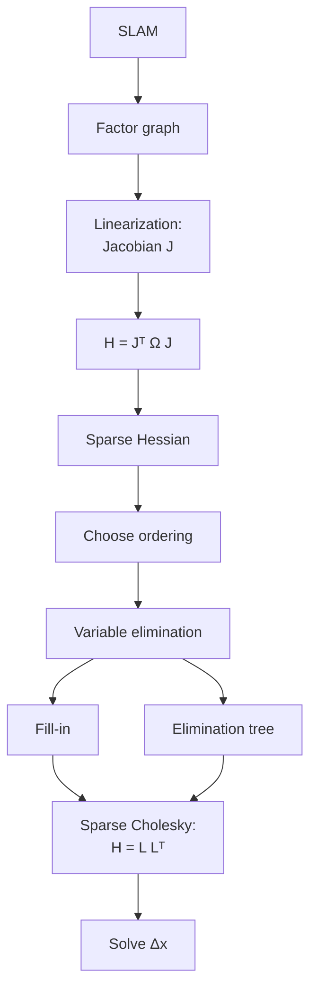

# Elimination trees

> An elimination tree tells us **which variables depend on which other variables during sparse [Cholesky](../glossary.md#cholesky-factorization) elimination**.

---

## 1. Start with the simplest example

Suppose our sparse matrix has this structure, with each number a variable. Draw an edge i ─ j whenever the entry $`H_{ij}`$ of the sparse [Hessian](../glossary.md#normal-equations-and-hessian) $`H`$ of the linearized problem is nonzero (the factor graph with the factor nodes folded away):

```text
1 ─ 2 ─ 3 ─ 4
```

We [eliminate](../glossary.md#variable-elimination) in the order $1 \rightarrow 2 \rightarrow 3 \rightarrow 4$:

- Eliminating 1 leaves its information with its only neighbor, 2: `1 → 2`.
- Eliminating 2 passes it on to 3: `2 → 3`.
- Eliminating 3 passes it on to 4: `3 → 4`.

Here "information" means a correction: eliminating a variable leaves a [Schur complement](../glossary.md#schur-complement) on its remaining neighbors, and the tree records which neighbor is eliminated first, its parent.

This produces the **elimination tree**:

```text
4
▲
│
3
▲
│
2
▲
│
1
```

Here 2 is the **parent** of 1, 3 is the parent of 2, and so on. Information flows from child to parent.

---

## 2. Why call it a tree?

Each variable has at most one parent: the earliest-eliminated variable among its later neighbors, counting the neighbors that fill-in creates (§3). Following parents only moves forward in the elimination order, so there are no cycles. A connected problem gives a single root; a disconnected graph gives a forest with several roots.

For example:

```text
       5
      / \
     3   4
    / \
   1   2
```

could be the dependencies created during elimination.

The tree is **not necessarily the original graph**:

- The original graph says who directly interacts with whom.
- The elimination tree says who depends on whom during factorization (§5 compares them side by side).

---

## 3. Connecting it to sparse Cholesky

We want $`H=LL^\top`$, where $`H`$ is the Hessian of the linearized problem and $`L`$ is its lower-triangular Cholesky factor, computed by eliminating variables one by one. Take this graph:

```text
1 ─ 2 ─ 3
    │
    4
```

- **Eliminate 1.** It has one neighbor, so 2 takes over its information and no fill-in appears: $\text{parent}(1)=2$.
- **Eliminate 2.** It still has **two** neighbors, 3 and 4, which were never directly connected. Removing 2 forces them to pick up each other's dependency, so a new edge $3 \leftrightarrow 4$ appears ([fill-in](../glossary.md#fill-in)), and $\text{parent}(2)=3$.
- **Eliminate 3.** Its only remaining neighbor is 4, via that fill-in edge: $\text{parent}(3)=4$.

The result is the same chain as §1's tree, but for a different reason. §1's chain came from a graph that was already a chain; here the 3–4 link exists only because eliminating 2 created it. That is §2's point: the tree is not the original graph.

---

## 4. The really useful intuition: information flows upward

Imagine each variable carries some information. When a child is eliminated, its information is passed to its parent:

```text
parent
  ▲
  │
child
```

For example:

```text
 Pose 3
  ▲
  │
 Pose 2
  ▲
  │
 Pose 1
  ▲
  │
Landmark 1
```

We can think:

> "Landmark 1 has been eliminated, but its information still affects Pose 1."

Then Pose 1 is eliminated, and its resulting information affects Pose 2. So information propagates **up the tree**.

---

## 5. Elimination tree vs. factor graph

The two structures answer different questions.

**Factor graph** ([glossary](../glossary.md#factor-graph)): which variables are connected by measurements?

```text
x1 ─ factor ─ l1
x1 ─ factor ─ l2
x2 ─ factor ─ l2
x2 ─ factor ─ l3
```

**Elimination tree:** what must be computed before what? Here it is for the [elimination order](../glossary.md#variable-ordering) $l_1$, $l_2$, $l_3$, $x_1$, $x_2$:

```text
        x2
       /  \
      x1   l3
     /  \
   l1    l2
```

$l_2$ touches both $x_1$ and $x_2$, so eliminating it creates a fill-in link between them. Then $x_1$ is the first remaining neighbor of $l_2$, so $\text{parent}(l_2)=x_1$, and the new fill-in link between $`x_1`$ and $`x_2`$ makes $x_2$ the parent of $x_1$.

§11 shows where both sit in the full pipeline.

---

## 6. Why is this useful?

There are two major reasons.

### A. Understand fill-in

Recall the fill-in example from [`sparse_cholesky_factorization.md`](sparse_cholesky_factorization.md): eliminating 2 from `1 ─ 2 ─ 3` creates the link `1 ─── 3`.

The elimination tree records the resulting dependency structure, and §10 makes this precise: the parent of $j$ is the first sub-diagonal nonzero in column $j$ of the sparse factor $L$.

### B. Efficient computation

Suppose the tree looks like:

```text
        8
       /  \
      6    7
     / \    \
    4   5    1
   / \
  2   3
```

- Variables 2 and 3 do not depend on each other, and both must be processed before 4.
- Similarly, 4 and 5 are independent of each other, and both come before 6.

The computational dependencies are visible immediately:

```text
2 ─┐
   ├──> 4 ─┐
3 ─┘       │
           ├──> 6 ─┐
5 ─────────┘       │
                   ├──> 8
1 ──> 7 ───────────┘
```

The two subtrees under 8, {6, 4, 5, 2, 3} and {7, 1}, share nothing until 8, so they can be processed fully in parallel. This exposes **parallelism**.

---

## 7. This becomes very important for iSAM2

**iSAM2** ([details](isam2_optimization.md); an [incremental solver](../glossary.md#batch-vs-incremental)) uses a [**Bayes tree**](bayes_tree.md), which is built directly from the elimination tree (the pipeline is drawn once, in §11).

Concretely, a Bayes tree is the elimination tree with some of its nodes merged into **cliques**, where each clique stores the conditional density produced when its variables were eliminated ([bayes_tree.md §13](bayes_tree.md#13-one-more-important-concept-cliques)).

- **Elimination tree:** "What depends on what?"
- **Bayes tree:** "What probabilistic information is summarized by each clique?"

Because each clique summarizes only its own subtree, a new measurement changes just the cliques on the path from the touched variables to the root ([bayes_tree.md §7](bayes_tree.md#7-heres-where-it-becomes-powerful-for-isam2)). That is what makes the Bayes tree suit **incremental SLAM**.

---

## 8. A SLAM example

Imagine a robot trajectory:

```text
x1 ─ x2 ─ x3 ─ x4 ─ x5
```

and landmarks:

```text
     l1
     │
x1 ─ x2 ─ x3 ─ x4 ─ x5
     │         │
     l2        l3
```

Suppose we use the elimination order $x_1$, $l_1$, $l_2$, $l_3$, $x_2$, $x_3$, $x_4$, $x_5$: $x_1$ and the landmarks first, then the remaining poses oldest first.

The elimination tree is:

```text
              x5
              │
              x4
             /  \
           x3    l3
           │
           x2
          / | \
        x1  l1  l2
```

The tree depends on the elimination ordering:

> **There isn't one universally fixed elimination tree for a problem. Change the ordering, and you can change the tree.**

---

## 9. Why ordering matters so much

Consider two possible strategies.

### Bad ordering

```text
Eliminate:
Pose 1
Pose 2
Pose 3
...
Landmarks
```

In [bundle adjustment](../glossary.md#bundle-adjustment-ba), where each pose observes many landmarks, this creates lots of fill-in. Eliminating a pose connects every landmark it sees to every other one (§3's fill-in rule), so the landmark block fills in densely. We might end up with a nearly dense lower-triangular $L$, which means a lot of computation (counts in the table below).

---

### Better ordering

Eliminate the landmarks first:

```text
Landmarks
   ↓
Poses
```

Landmarks never touch each other directly, so eliminating one only connects the poses that observe it. The structure stays much sparser. This is exactly bundle adjustment's [Schur-complement](../glossary.md#schur-complement) trick ([bundle_adjustment.md §12](bundle_adjustment.md#12-block-sparsity-and-the-schur-complement)): eliminate every landmark first, then solve the much smaller camera-only system.

The resulting $L$ has far fewer nonzeros. It is always $n \times n$, so only its sparsity changes.

**Counting it.** Here are the counts for two bundle-adjustment graphs at block level (one node per camera or landmark, $n$ nodes in total). Entries are counted in the lower triangle of $L$, diagonal included (nnz = number of nonzero entries, as in [sparse_cholesky_factorization.md §5](sparse_cholesky_factorization.md#5-ordering-becomes-extremely-important)), and fill-in = nnz($L$) minus the nonzeros of the lower triangle of $H$. All numbers come from the repo's `utils.symbolic_eliminate`.

| Graph | Order | nnz($L$) | fill-in | dense $n(n+1)/2$ |
| ----- | ----- | -------- | ------- | ---------------- |
| Toy: 4 cameras, 12 landmarks, $n=16$ | Poses first | 130 | 66 | 136 |
| Toy: 4 cameras, 12 landmarks, $n=16$ | Landmarks first | 70 | 6 | 136 |
| Toy: 4 cameras, 12 landmarks, $n=16$ | Interleaved | 133 | 69 | 136 |
| BA scene: 8 cameras, 48 landmarks, $n=56$ | Poses first | 1471 | 1123 | 1596 |
| BA scene: 8 cameras, 48 landmarks, $n=56$ | Landmarks first | 376 | 28 | 1596 |
| BA scene: 8 cameras, 48 landmarks, $n=56$ | Interleaved | 1098 | 750 | 1596 |

- **Toy assumption:** every camera sees every landmark.
- **BA scene:** the seed-0 defaults of `bundle_adjustment.py`, 292 observations, so each camera sees only some of the landmarks.
- **Interleaved:** each camera followed by the landmarks it is the first to see.
- **Reading it:** poses first leaves $L$ nearly dense in both graphs, while landmarks first keeps fill-in to 6 and 28 entries.

The sparsity plots of $H$ and $L$ for the BA scene (with 6 and 3 scalar unknowns per camera and landmark) are the figure in [sparse_cholesky_factorization.md §5](sparse_cholesky_factorization.md#5-ordering-becomes-extremely-important).

---

## 10. The tree comes from the factor, not the graph

The elimination tree is **the dependency structure of the Cholesky factorization**, not a picture of the original matrix's graph (§3's tree contains a 3–4 link the original graph lacks).

Precisely (Liu 1990), it's read off the sparsity of the **factor** $L$, with the variables numbered in elimination order:

```math
\text{parent}(j) = \min\{\, i > j : L_{ij} \neq 0 \,\}
```

That is, the parent of $j$ is the row of the first nonzero below the diagonal in column $j$ of $L$. $L$'s pattern depends on both the matrix's pattern and the elimination order, so the same matrix under two different orderings can give two different trees (§9's point).

---

## 11. The big picture

The concepts above connect into one pipeline:



The elimination structure then feeds the Bayes tree (§7) and iSAM2. Here $`J`$ is the [Jacobian](../glossary.md#jacobian) of the residuals, and $`\Omega`$ in $`H = J^\top \Omega J`$ is the measurement [information matrix](../glossary.md#information-matrix).

### The simplest mental model

If we remember only three things:

- **Factor graph:** "Who talks to whom?"
- **Sparse Cholesky:** "How can we solve the resulting system without wasting work on zeros?"
- **Elimination tree:** "What computations depend on what other computations?"

This will make **Bayes trees and iSAM2** much easier to understand.

This is one corner of the repo-wide map in [slam_mental_map.md](../slam_mental_map.md), which places every doc and script on one picture.

---

## 12. References

1. Liu, J. W. H. (1990). *The Role of Elimination Trees in Sparse Factorization*. SIAM Journal on Matrix Analysis and Applications, 11(1), 134-172. https://doi.org/10.1137/0611010 - the original definition and analysis of the elimination tree this doc builds intuition for, including the parent/child dependency-structure framing used throughout.
