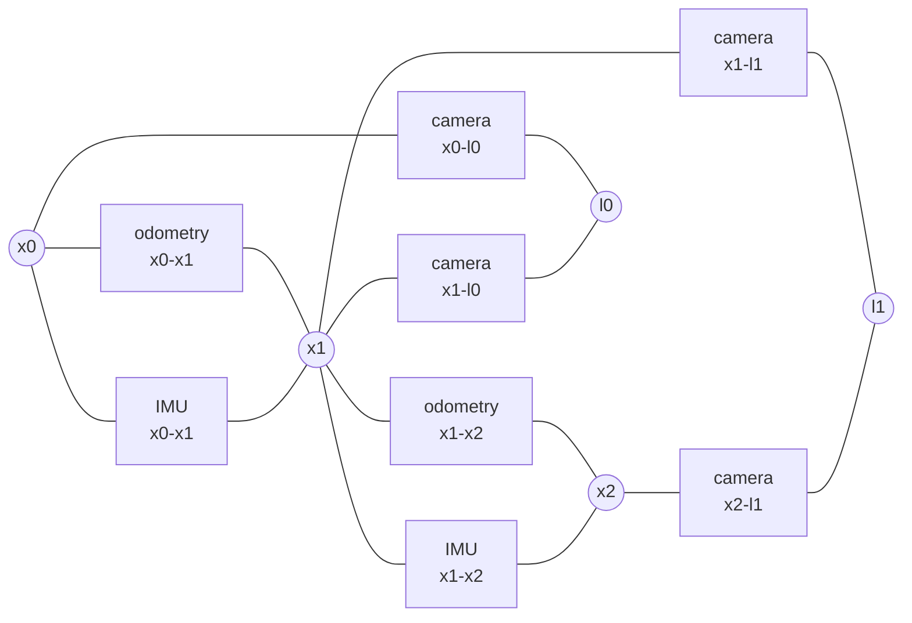

# Factor-graph Optimization

## 1. The core idea

A **factor graph** represents:

> **"What unknowns do we have, and what pieces of evidence tell us about them?"**

It is a **bipartite** graph (edges join only nodes of different kinds) with two kinds of nodes (§6 spells out the distinction):

- **Variables** = things we don't know: robot poses, [landmarks](../glossary.md#landmark), sensor biases, etc.
- **Factors** = measurements/constraints: [odometry](../glossary.md#odometry), camera observations (each measures the [reprojection error](../glossary.md#reprojection-error): the pixel gap between where a landmark was seen and where the estimates project it), [IMU](../glossary.md#imu-inertial-measurement-unit), GPS, [loop closures](../glossary.md#loop-closure), etc.


*Figure: the poses and loop closure of §2, plus a landmark and each other kind of factor listed in §6. The IMU factor is drawn on one pair of poses only (§5 draws one per consecutive pair). Regenerate with `uv run python generator/make_factor_graph_svgs.py`.*

- The circles are **variables**: poses (blue) and a landmark (purple).
- The squares are **factors**, each joined to the variables it touches. A **binary factor** touches two variables. A **unary factor**, such as a [prior](../glossary.md#prior-unary-factor) or GPS fix, touches just one.

---

## 2. Why do we need it?

Suppose the robot moves:

```text
x0 → x1 → x2 → x3
```

The odometry says:

```text
x1 is 1m ahead of x0
x2 is 1m ahead of x1
x3 is 1m ahead of x2
```

But every measurement has error.

Integrating the odometry's own numbers (each step reported as "1m ahead") gives an estimate of $`3.00`$ m. Maybe the real motion, though, was:

```text
x0  →  x1  →  x2  →  x3
  1.02   0.97    1.05 m
```

so the real position is about $`3.04`$ m. Zero-mean per-step errors partly cancel, but nothing corrects them, so on average the drift keeps growing (like $`\sqrt n`$ for $n$ independent steps). Here the estimate (3.00 m) and the real position (3.04 m) diverge.

> **Note:** each per-step measurement ($x_1$ is 1m ahead of $x_0$, etc.) is **odometry**: an estimate of the *incremental* pose change from onboard motion sensors (wheel encoders, IMU, visual odometry, ...).
> - **Dead reckoning** chains ("integrates") these increments to track pose from a starting point, as the `3.00 m` estimate above was computed. With no correction, drift grows the longer we integrate; the loop closure below fixes exactly that.
> - The term is also used for propagating a motion *model* with no measurements (e.g. the `saltation_matrix_ekf.py` baseline in the README): same "no correction" idea, same growing error.

Now imagine that at $x_3$ the camera re-observes a landmark it first saw from $x_0$. Recognizing a previously seen place like this is a **loop closure**, and it gives a direct measurement between $x_0$ and $x_3$ - say, 3.03 m:

```text
x0 ── 1 m ── x1 ── 1 m ── x2 ── 1 m ── x3
│                                      │
└─────────────── 3.03 m ───────────────┘
```

The loop-closure measurement says:

> "$`x_3`$ is 3.03 m from $x_0$ - not the 3.00 m that the chained odometry claims."

Now we have conflicting information.

The optimizer can adjust:

```text
x0, x1, x2, x3
```

so that **all measurements are as consistent as possible**.

That's the essence of factor-graph optimization.

Worked number: the optimizer only sees the measurements, the three 1 m odometry steps and the 3.03 m loop closure (the true 1.02/0.97/1.05 m are unknown to it). Weighting all four equally, least squares lengthens each step by $`0.0075`$ m to 1.0075 m, so $`x_3 = 3.0225`$ m: a compromise between the odometry's 3.00 m and the loop closure's 3.03 m, and closer to the true 3.04 m than odometry alone.

---

## 3. A factor is basically an error function

A [pose](../glossary.md#pose) $`X_i`$ is a rigid motion (rotation plus translation, an [SE(3)](../glossary.md#so3-and-se3) element), so $`X_i^{-1}X_j`$ is the motion from $i$ to $j$. Suppose we have two poses $`X_i, X_j`$, and odometry gives a measured relative transformation $`Z_{ij}`$. We can calculate what the relative transformation *would be* according to our current estimates:

$$
\hat Z_{ij}=X_i^{-1}X_j
$$

Then compare them. $Z_{ij}^{-1}\hat Z_{ij}$ is itself a transform, equal to the identity exactly when the estimate agrees with the measurement. The log map turns it into a 6-vector (a translation part and a rotation part) that optimization can square and sum:

```math
e_{ij} = \mathrm{Log}\left(Z_{ij}^{-1}\hat Z_{ij}\right) = \mathrm{Log}\left(Z_{ij}^{-1} X_i^{-1} X_j\right) \in \mathbb{R}^6
```

This is the residual `pose_graph.py` uses ([pose_graph_optimization.md §15.7](pose_graph_optimization.md#157-the-solver-concretely)). pose_graph_optimization.md §15 writes the measurement $`Z_{ij}`$ as $`\tilde T_{ij}`$, the pose $`X_i`$ as $`T_i`$ and the residual $`e_{ij}`$ as $`r_{ij}`$; [lie_algebra.md](../foundations/lie_algebra.md) explains Log.

Conceptually:

```text
              measurement
                  ↓
Xi ─────────── Factor ─────────── Xj
                  ↓
             "How wrong
              are Xi,Xj?"
```

The factor answers:

> **Given my current estimates of the variables, how badly do they violate this measurement?**

---

## 4. Optimization means minimizing all those errors

Suppose we have the example of §2:

```text
x0 ── odometry ── x1 ── odometry ── x2 ── odometry ── x3
│                                                      │
└──────────────────── loop closure ────────────────────┘
```

We have four errors, $`e_{01}(x_0,x_1)`$, $`e_{12}(x_1,x_2)`$, $`e_{23}(x_2,x_3)`$ and $`e_{03}(x_0,x_3)`$, and the optimizer looks for poses that minimize:

```math
\boxed{
\min_{x_0,x_1,x_2,x_3}
\sum_k \|e_k\|^2
}
```

More realistically, each measurement has different reliability:

$$
\boxed{
\min_X
\sum_k
e_k^\top\Omega_k e_k
}
$$

where $\Omega_k=\Sigma_k^{-1}$ is the [**information matrix**](../glossary.md#information-matrix), the inverse of the measurement [covariance](../glossary.md#covariance) $\Sigma_k$ (called $W_i$ in [nonlinear_least_square.md §12](nonlinear_least_square.md#12-add-measurement-uncertainty); downstream docs such as [sparse_cholesky_factorization.md](sparse_cholesky_factorization.md) use $\Omega$). Here $X$ is all variables stacked, while $x_i$ (or $X_i$ in §3) is a single pose (sibling docs write the stacked vector as $x$).

> **Note:** a precise sensor (small $\Sigma_k$) gives a *large* $\Omega_k$, so its error counts more in the sum; a noisy sensor (large $\Sigma_k$) gives a *small* $\Omega_k$ and is down-weighted. The term $e_k^\top\Omega_k e_k$ is a **squared Mahalanobis distance** - see the [glossary](../glossary.md#mahalanobis-distance) for the definition and the isotropic special case where it collapses to plain squared error divided by a constant.

So:

> **Factor-graph optimization = find the variable values that make all measurement factors as happy as possible.**

---

## 5. Why call it a "graph"?

The problem naturally looks like a graph. Below, variables are circles, factors are squares, and every edge joins a variable to a factor:



Here landmark $l_0$ is seen from $x_0$ and $x_1$, and $l_1$ from $x_1$ and $x_2$. IMU factors link consecutive poses, like odometry factors do.

Every measurement becomes a **factor connecting the variables it depends on**, so the graph shows the **structure of the estimation problem**.

---

## 6. The really important distinction: variable vs factor

### Variable

Something we're trying to estimate (§1); here:

- $x_0$ = robot pose
- $x_1$ = robot pose
- $l_0$ = landmark position
- $b$ = IMU bias

### Factor

Something that constrains those variables (§1); typical kinds (a camera reprojection factor's error is the pixel gap defined in §1):

```text
Odometry factor
IMU factor
Camera reprojection factor
GPS factor
Loop-closure factor
Prior factor
```

For example:

```text
        camera measurement
                ↓
              Factor
             /      \
            /        \
          x1          l0
       robot pose   landmark
```

The camera measurement doesn't directly "set" $x_1$ or $l_0$. Instead it says:

> "$`x_1`$ and $l_0$ should satisfy this observation."

---

## 7. Factor graph vs pose graph

A **[pose graph](pose_graph_optimization.md)** might look like:

```text
x0 ── x1 ── x2 ── x3
│                 │
└─────────────────┘
```

Usually:

- nodes = robot poses
- edges = relative pose constraints (each edge is a binary factor between two poses)

A **factor graph** is more general:

```text
              l0
               ●
              / \
       camera/   \camera
            /     \
x0 ●──IMU──●──IMU──● x2
          x1
```

IMU factors link consecutive poses, and each camera factor links a pose to the landmark it observes. A pose graph would keep only the poses and the relative-pose factors between them.


*Figure: the graph of §1 as a factor graph (top) and as a pose graph (bottom). A pose graph keeps the poses and the factors between them (here odometry, IMU and loop closure) and draws them as edges; the landmark and the camera and GPS factors are left out. The prior stays as an anchor on x0, which removes the [gauge freedom](../glossary.md#gauge-freedom). Regenerate with `uv run python generator/make_factor_graph_svgs.py`.*

It can represent:

- poses
- landmarks
- velocity
- IMU biases
- calibration parameters
- time offsets
- sensor extrinsics (each sensor's mounting pose relative to the robot body)
- etc.

So:

> **A pose graph is a special case of a factor graph.**

---

## 8. Where Gauss-Newton enters

Factor-graph optimization is usually a **[nonlinear least-squares](../glossary.md#nonlinear-least-squares) problem**.

We have:

```math
\min_X \sum_i e_i(X)^\top \Omega_i\, e_i(X)
```

But the errors are nonlinear because poses involve rotations and transformations.

So we linearize:

- $`\oplus`$ is the **retraction** that applies a small update $`\Delta X`$ to a state ([glossary](../glossary.md#retraction)).
- $`\Delta X`$ is the stacked small step in tangent-space coordinates: 6 numbers per pose, 3 per landmark.
- $`J`$ is the **Jacobian** of $`e`$ with respect to $`\Delta X`$ ([glossary](../glossary.md#jacobian)): the derivative of the stacked residual, one column per entry of $`\Delta X`$ ([nonlinear_least_square.md §7](nonlinear_least_square.md#7-the-key-trick-make-the-nonlinear-problem-locally-linear)).

$$e(X\oplus\Delta X)\approx e(X)+J\Delta X$$

Then **[Gauss-Newton](gauss_newton.md)** solves (every factor's error stacked into $e$, its $\Omega_i$ blocks into $\Omega$):

```math
J^\top \Omega J\,\Delta X = -J^\top \Omega\, e
```

and updates $`X \leftarrow X \oplus\Delta X`$. For poses, that $\oplus$ is often implemented using **[Lie algebra](../foundations/lie_algebra.md)/$`SE(3)`$**. [Levenberg-Marquardt (LM)](../glossary.md#levenberg-marquardt-lm-and-damping) solves the same linear system with added damping.

Put together, the pieces above connect like this:

```text
Factor graph
     ↓
Nonlinear least squares
     ↓
Gauss-Newton/Levenberg-Marquardt
     ↓
Linearization
     ↓
Solve linear system
     ↓
Update poses/landmarks
     ↓
Repeat
```

---

## 9. An analogy: people locating objects

Imagine several people reconstructing the positions of objects in a room. We don't know where anything is, but people give us statements:

> Person A: "B is approximately 2 meters east of me."

> Person B: "C is approximately 1 meter north of me."

> Person C: "The lamp is 3 m west of me."

> GPS: "A is approximately here."

Each statement becomes a **factor**, and together they form a giant network of constraints. Our job is:

> **Move all the unknown positions around until the entire network of statements is as consistent as possible.**

---

## 10. Measurements don't have to be perfect

Suppose:

```text
Odometry says:
x1 should be here ─────────┐
                           │
Camera says:
x1 should be there ────────┤ → compromise
                           │
IMU says:
x1 should be somewhere else┘
```

As in §2, the optimizer doesn't choose one measurement. It finds the configuration with the **best overall compromise**, weighted by measurement uncertainty (§4). The result is a **local optimum**: better than nearby solutions, not necessarily the best overall. It therefore relies on a good initial guess.

When a loop closure arrives, the optimizer can distribute the accumulated error across the entire trajectory; the before/after loop-closure figure in [pose_graph_optimization.md §15.7](pose_graph_optimization.md#157-the-solver-concretely) ([`assets/pose_graph.png`](../../assets/pose_graph.png)) shows this.

This is why graph optimization suits [SLAM](../glossary.md#slam-simultaneous-localization-and-mapping) (simultaneous localization and mapping): one loop closure corrects the whole trajectory, not just the last pose.

---

## 11. The one picture to remember

The one picture to remember is the bipartite graph of §1: **variables** (what we want to know) are circles, **factors** (what our sensors tell us) are attached to the variables they constrain, and **optimization** finds the variable values that best satisfy all factors simultaneously.

The hierarchy:

> **SLAM** = estimation problem

> **Factor graph** = representation of that estimation problem

> **Factors** = sensor/measurement constraints

> **Nonlinear least squares** = mathematical formulation

> **Gauss-Newton/Levenberg-Marquardt** = optimization method

> **Lie algebra** = convenient way to optimize poses on SE(3)

That is the conceptual bridge connecting the optimization-based SLAM topics in this doc set.

---

## 12. References

1. Kschischang, F. R., Frey, B. J., & Loeliger, H.-A. (2001). *Factor Graphs and the Sum-Product Algorithm*. IEEE Transactions on Information Theory, 47(2), 498–519. https://doi.org/10.1109/18.910572 - the original, general (non-robotics) definition of a factor graph as a bipartite graph of variable nodes and factor nodes, behind §1 and §6's variable/factor terminology.
2. Dellaert, F., & Kaess, M. (2017). *Factor Graphs for Robot Perception*. Foundations and Trends in Robotics, 6(1–2), 1–139. https://doi.org/10.1561/2300000043 - the standard robotics-focused reference for factor graphs in SLAM (poses, landmarks, IMU/camera/loop-closure factors), behind §1, §5, §6, and §7's pose-graph-vs-factor-graph distinction.
