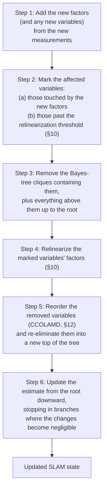

# iSAM2

## 1. The big idea

**iSAM2 = Incremental Smoothing and Mapping 2**

> **iSAM2 continuously solves a SLAM optimization problem without restarting from scratch every time a new measurement arrives.**

Suppose the robot has estimated four poses, then moves one more step:

```text
x1 ─── x2 ─── x3 ─── x4 ─── x5
```

- **Naive optimizer:** "New information! Let's optimize $x_1, \ldots, x_5$ all over again." That is expensive.
- **iSAM2:** "Most of the previous solution is still good. I'll update only the parts that actually need significant changes."

---

## 2. Recap: what normal SLAM optimization does

Take four poses $x_1, x_2, x_3, x_4$ and measurements $z_{12}, z_{23}, z_{34}$ between them:

```text
x1 ─── x2 ─── x3 ─── x4
   z12    z23    z34
```

We want the poses that best explain all measurements:

```math
X^*=\arg\min_X \sum_i \lVert r_i(X) \rVert_{\Omega_i}^2
```

where $`X`$ stacks all the poses, $`r_i(X)`$ is the residual (predicted minus measured) of the $i$-th measurement, $`\lVert r \rVert_{\Omega}^2 = r^\top \Omega\, r`$ weights it by the [information matrix](../glossary.md#information-matrix) $`\Omega_i`$ of that measurement (large $`\Omega_i`$ = trusted more), and $`X^*`$ is the best-fit $`X`$.

Each odometry measurement says roughly how far the robot moved. The true step was 1 m each time, but every measurement carries a little noise:

```text
x1 ── 1.02 m ── x2 ── 0.97 m ── x3 ── 1.05 m ── x4
```

On its own, this chain has nothing to reconcile: placing the poses exactly 1.02, 0.97 and 1.05 m apart satisfies every measurement with zero residual. Optimization only has real work once a measurement is **redundant**, say a second sensor measures the distance from $x_1$ to $x_4$ directly:

```text
x1 ── 1.02 m ── x2 ── 0.97 m ── x3 ── 1.05 m ── x4
│                                               │
└─────────────────── 2.90 m ────────────────────┘
```

The chain adds up to 3.04 m, but the direct measurement says 2.90 m. They can't all be exactly right, so optimization finds the poses that make **all measurements reasonably happy at once**, weighting each by how much it is trusted. Doing this from scratch at every step is the batch approach that iSAM and iSAM2 replace ([`isam_optimization.md` §1-§3](isam_optimization.md#1-the-problem-with-ordinary-batch-optimization)).

---

## 3. The problem with doing this repeatedly

A robot running at 10 Hz grows the graph with every measurement (1000 poses at t1000), and batch optimization re-solves the whole graph after every new one, so the cost keeps growing with the trajectory. **iSAM** and then **iSAM2** avoid this ([`isam_optimization.md` §1](isam_optimization.md#1-the-problem-with-ordinary-batch-optimization)).

---

## 4. iSAM's basic idea

iSAM (incremental Smoothing and Mapping) does not re-solve all variables each time. It **reuses the previous factorization**.

Each solve is a Gauss-Newton step $H\Delta x=-b$ (the glossary's [normal equations](../glossary.md#normal-equations-and-hessian); see [`gauss_newton.md`](gauss_newton.md)) for the step $\Delta x$ added to the unknowns, with the Hessian $H=J^\top \Omega J$ (the information matrix of the linearized problem) and $b=J^\top \Omega r$. $J$ is the [Jacobian](../glossary.md#jacobian): the matrix of derivatives of the residuals with respect to the unknowns. iSAM never forms $H$: it factorizes the whitened Jacobian $A$ (each row scaled by the square root of its $\Omega$), so $H=J^\top \Omega J=A^\top A=R^\top R$, where $R$ is the upper-triangular square-root factor ($R=L^\top$ for the Cholesky factor $L$ of §7; it is not a rotation). The pipeline is factor graph, then whitened Jacobian $A$, then $A=QR$ ($Q$ orthogonal, $H=R^\top R$), then solve for $\Delta x$ (Givens-rotation details: [`isam_optimization.md` §3](isam_optimization.md#3-why-is-this-possible)).

The expensive part is often the **factorization**. When a new pose arrives, most of the old information hasn't changed, so **iSAM keeps the old factorization $R$ and updates it**.

---

## 5. Think of it like editing a huge spreadsheet

The spreadsheet analogy (change one cell, update only the formulas that depend on it) is in [`isam_optimization.md` §4](isam_optimization.md#4-an-analogy-editing-a-spreadsheet) and applied to iSAM vs iSAM2 in §6.1's at-a-glance summary.

---

## 6. But what makes iSAM2 special?

iSAM2 improves on the **original iSAM** (the 2008 algorithm) with three ideas:

1. **Bayes tree** (§7-§9)
2. **Selective [relinearization](../glossary.md#relinearization)** (§10-§11; the iSAM2 paper calls it **fluid relinearization**)
3. **Variable reordering** (§12)

### 6.1 iSAM vs. iSAM2, side by side

**At a glance.** Think of a huge spreadsheet where results depend on other results, and one input cell changes:
- **iSAM:** the whole factorization is one big triangular block $R$. A new measurement edits it row by row. It can't cheaply tell which formulas a relinearization or reordering touches, so every so often it rebuilds the entire sheet.
- **iSAM2:** the same numbers kept as a tree (the Bayes tree), where every part knows its parent. A new measurement redoes only the branch it touches, so no periodic rebuild is needed.
- An ordinary measurement is like changing one cell: a few formulas to recompute. A loop closure is like changing a cell many formulas depend on: a much larger region, up to the whole sheet in the worst case (§12's fixed-order example: 16 of 16 variables).

The table below compares the two, with plain batch optimization for reference.

iSAM2 solves the same problem as iSAM, on the same factorization. iSAM's **square-root information matrix** $R$ (the triangular factor with $`H=R^\top R`$, $`R=L^\top`$) and iSAM2's Bayes tree hold the same numbers, for the same variable ordering and [linearization point](../glossary.md#linearization) (the estimate at which the Jacobians were computed). They are just organized differently. What changes is how much each one can do *incrementally*:

| | Batch optimization | iSAM (Kaess et al. 2008) | iSAM2 (Kaess et al. 2012) |
| --- | --- | --- | --- |
| Same in all three | Same nonlinear least-squares objective, full history kept, sparse factorization | Same | Same |
| Data structure | n/a (everything is re-solved each time) | A sparse upper-triangular matrix $R$ | A Bayes tree: the same factorization, grouped into **cliques** (a clique is a group of variables eliminated together, one node of the Bayes tree; §7) |
| New measurement | Reoptimize everything | Folded into $R$ as a new row, with Givens rotations | The cliques it touches, and everything above them, are removed, [re-eliminated](../glossary.md#variable-elimination) and put back (§8-§9) |
| Relinearization | Broad | Periodic batch step: every variable at once | Selective: only variables that moved past a threshold (§10) |
| Variable reordering | Important | Periodic batch step: COLAMD (a fill-reducing ordering heuristic; [glossary](../glossary.md#variable-ordering)) over every variable | Incremental: CCOLAMD over just the re-eliminated part, dynamically managed (§12) |
| [Loop closure](../glossary.md#loop-closure) | Full re-solve, same as any other step | The Givens sweep runs through most of $R$, and the fill-in it adds stays until the next batch step | A large affected region, up to a full re-solve in the worst case (§19), but re-eliminated right away with a fresh ordering (§9, §12) |
| Updating the estimate | n/a (everything is re-solved each time) | Back-substitution through $R$ | Starts at the root and stops in branches where the changes are negligible (§13) |
| Periodic batch steps | Every update is one | Required: the only way to relinearize and reorder | None |
| Real-time suitability | Lower | Cheaper per update except around loop closures, so good for online SLAM ([`isam_optimization.md` §8](isam_optimization.md#8-batch-vs-incremental)) | Higher |

One idea sits behind every row. In matrix form, iSAM can't cheaply tell which part of $R$ a relinearization or a reordering would touch, so it periodically does both for everything. The Bayes tree makes those dependencies explicit (each clique knows its parent), so iSAM2 can redo exactly the affected part at every step and never needs a batch step.

This repo implements the iSAM column minus COLAMD reordering, with loop closures handled by a full rebuild ([`isam_optimization.md` §14](isam_optimization.md#14-where-this-is-implemented-in-this-repo)), and only the tree-building part of the iSAM2 column (§19).

---

## 7. Bayes tree - the most important intuition

Quick recap: [Cholesky](../glossary.md#cholesky-factorization) factorization splits $H$ into $H = LL^\top$ ($L$ lower-triangular; the upper-triangular $R$ of §4 is $R = L^\top$). Solving $H\Delta x=-b$ then takes two cheap triangular solves instead of one matrix inversion.

- $H$ is sparse: two poses only interact if a factor directly connects them, so the factorization skips arithmetic on known zeros.
- Eliminating a variable can turn some of those zeros into nonzeros ([fill-in](../glossary.md#fill-in)), which is why the [variable ordering](../glossary.md#variable-ordering) matters (§12).
- Full derivation: [`sparse_cholesky_factorization.md`](sparse_cholesky_factorization.md). Worked elimination example: [`elimination_tree.md`](elimination_tree.md).

After linearization, SLAM gives exactly the $H\Delta x=-b$ system above, and this sparse elimination is run on it. Conceptually:

```text
Factor graph
     ↓
Sparse matrix
     ↓
Cholesky/QR
     ↓
Bayes tree
```

The **Bayes tree** ([glossary](../glossary.md#bayes-tree)) is a tree representation of that factorization. Given a new [factor](../glossary.md#factor), iSAM2 can walk straight to the affected part of the tree instead of recomputing everything.

This doc needs only that. For how elimination produces the tree, the cliques, the probabilistic interpretation and a worked loop-closure example, see [`bayes_tree.md`](bayes_tree.md).

---

## 8. Intuition: only the part near the new variable changes

The robot adds $x_5$ and receives a measurement involving it. Usually the new information mainly affects the solution around $x_5$, so iSAM2 conceptually touches only the top of the tree instead of recomputing everything. Schematically (the newest variable lives at the root, §12):

```text
Before:                              After the update:

  [x3 x4]  ← root                      [x4 x5]  ← new root (x4, x5 eliminated last)
     │                                    │
  [x2|x3]  ← reused                    [x3|x4]  ← re-eliminated
     │                                    │
  [x1|x2]  ← reused                    [x2|x3]  ← reused
                                          │
                                       [x1|x2]  ← reused
```

In `[x2|x3]`, the bar reads "given": x2 is the variable eliminated at that node and x3 its separator ([`bayes_tree.md` §13](bayes_tree.md#13-one-more-important-concept-cliques)).

Batch optimization would instead recompute all of $x_1, \ldots, x_5$.

---

## 9. But what about loop closure?

Suppose the robot drives around:

```text
x1 ─ x2 ─ x3
          │
x6 ─ x5 ─ x4
```

It realizes: "Wait! $x_6$ is actually close to $x_1$." We add a loop-closure factor:

```text
x1 ─ x2 ─ x3
┆         │
x6 ─ x5 ─ x4

┆ = new loop-closure factor (x6 ↔ x1)
```

The new measurement can now affect **many old poses**. iSAM2 doesn't blindly update only $x_6$; it identifies the affected region of the Bayes tree and redoes that computation. A normal odometry edge gives a small affected region and a small update; a loop closure gives a large affected region and a larger update (measured example: the figure in §11). Ordinary updates are small and loop closures are the occasional large ones, which is a big part of why iSAM2 suits real-time SLAM.

---

## 10. Selective relinearization

A nonlinear problem $f(x)$ (the stacked residuals $r_i$ of §2, with $x$ standing for the unknowns $X$) is approximated around the current estimate:

```math
f(x+\Delta x) \approx f(x)+J\Delta x
```

**Intuition:** $J$ is a tangent line, accurate only near the point where it was built. Relinearizing builds a fresh tangent at the new point.

If $x$ changes significantly, the Jacobian $J$ becomes outdated and we must relinearize (new Jacobians, then optimize again). The naive approach relinearizes **everything**. iSAM2 asks: "Which variables actually moved enough that their linearization is no longer accurate?"

```text
x1   x2   x3   x4   x5
 │    │    │    │    │
small small small BIG small
             ↑
       relinearize
```

Only the important variables are relinearized. This is **selective relinearization**.

It isn't free for that one variable, though. Relinearizing $x_4$ changes every factor that touches $x_4$, so every Bayes-tree clique containing $x_4$, and everything on the path from there up to the root, has to be re-eliminated, exactly as if a new factor had arrived there (§8-§9). In iSAM2 (Kaess et al. 2012), a variable counts as having moved "enough" when its change from the point it was last linearized at exceeds a threshold. The variables marked this way, together with the ones touched by new factors, make up the affected region of each update.

---

## 11. Why selective updates pay off

Illustrative only (made-up numbers, not measured): in a SLAM graph with 10,000 poses, after a new measurement maybe only 50 variables have changed significantly. A batch optimizer might effectively reconsider all 10,000, while iSAM2 focuses on the affected portion. The exact behavior depends on the graph and ordering.

The measured counterpart from this repo (counts in §19):


*Figure: `use_numpy/bayes_tree_construction.py` at its defaults, plotted by `uv run python assets/make_figures.py bayes_tree_construction`. Red marks the variables that must be re-eliminated.*

---

## 12. Variable ordering is also crucial

The amount of computation in sparse Cholesky depends heavily on the [variable ordering](../glossary.md#variable-ordering), which decides two things at once:

- **Fill-in:** how dense the factorization gets ([sparse_cholesky_factorization.md](sparse_cholesky_factorization.md)).
- **Where each variable sits in the Bayes tree.** The last variable eliminated becomes the root, and an update's affected region is the path from the touched cliques up to the root (§8-§9).

A fixed order can be fine for one and terrible for the other. This repo's own example ([bayes_tree.md §15](bayes_tree.md#15-where-this-is-implemented-in-this-repo)) eliminates a square loop of 16 poses oldest first. Fill-in stays small (no **separator**, the variables a clique shares with its parent, larger than 2). But the tree comes out as a single chain with the first pose at the bottom, so a loop closure touching the first pose invalidates all 16 variables.

iSAM2 therefore reorders as it goes. Each time it re-eliminates the affected part of the tree, it picks a new order for just those variables with **constrained COLAMD (CCOLAMD)**.

- CCOLAMD is a fill-reducing ordering, constrained so that the variables touched by the newest factors are eliminated last.
- Those variables end up near the root.
- The next measurement usually involves the same recent variables, so it disturbs only a few cliques.

```text
new measurement → affected variables → reorder them → re-eliminate affected region → update Bayes tree
```

This aims to keep both the fill-in and the next update small.

---

## 13. The complete iSAM2 picture

Putting everything together, one iSAM2 update (simplified from Algorithm 1 of Kaess et al. 2012):



Everything below the removed top of the tree keeps its factorization untouched (its estimates can still be updated in step 6).

### Intuition for step 6
- Each clique's estimate is computed from its parent's: in symbols, child $`\delta = R_{cc}^{-1}(d - R_{sep}\,\delta_{parent})`$ (in practice a triangular solve with $`R_{cc}`$: back-substitution through the clique, [glossary](../glossary.md#back-substitution)), where $`\delta`$ is the part of $`\Delta x`$ belonging to the clique's variables, $`R_{cc}`$ is the clique's own diagonal block of the triangular factor $R$, $d$ is the clique's own right-hand side and $R_{sep}$ couples it to its parent.
- If the parent's $\delta$ barely moved and the clique's own $d$ is unchanged, the child's $\delta$ does not change either.
- So the update can stop at that branch, and everything below it is skipped safely.
- (Conceptual only: this repo does not implement iSAM2.)

---

## 14. iSAM2 vs EKF

**EKF-SLAM** ([glossary](../glossary.md#ekf-extended-kalman-filter)) is a **filtering** approach: it maintains the current estimate and uncertainty, and old information is compressed into the current state. **iSAM2** is an incremental **smoothing**/optimization approach: it keeps the history (historical variables and constraints) and continuously optimizes it. Full comparison: [`filtering_smoothing.md`](../filtering_smoothing.md).

---

## 15. iSAM2 vs batch optimization

The batch-vs-iSAM2 comparison (new measurement, history, nonlinear optimization, sparse factorization, relinearization, variable ordering, loop closure, real-time suitability) is the Batch column of the table in §6.1.

The key difference isn't a different SLAM objective; it is **how intelligently the solution is updated**.

---

## 16. Ordinary measurement vs. loop closure, in spreadsheet terms

An ordinary measurement touches a small region; a loop closure can touch up to the whole tree in the worst case (§12's fixed-order example: 16 of 16 variables). The spreadsheet picture is in §6.1; the loop-closure case is §9.

---

## 17. A common misconception: iSAM2 only optimizes the newest pose

That is not correct. iSAM2 maintains a **global smoothing solution**: if a loop closure says $x_{100} \approx x_1$, the correction propagates backward and old poses change. The cleverness is that iSAM2 determines **which parts need computational attention** rather than recomputing the entire problem. Same point as [`isam_optimization.md` §9](isam_optimization.md#9-isam-doesnt-mean-never-touch-old-variables).

---

## 18. The one-sentence mental model

> **iSAM2 is an incremental nonlinear least-squares solver for SLAM that maintains a Bayes-tree factorization and efficiently updates only the parts of the solution affected by new information.**

**Bayes tree + selective relinearization + variable reordering → incremental update**

---

## 19. Where this is implemented in this repo

Partially. The Bayes-tree construction is implemented; the rest is not:
- [`bayes_tree_construction.py`](../../use_numpy/bayes_tree_construction.py) builds the [elimination tree](../glossary.md#elimination-tree) underlying this doc's §7 Bayes tree (symbolic elimination, which tracks only which variables end up connected and uses no numbers, over this repo's pose-graph topology, via `symbolic_eliminate`/`bayes_tree_affected_path` in `utils.py`).
- It keeps one node per variable and never merges them into cliques, so its affected counts are counts of variables, not cliques. The tree is built once from all edges, the loop-closure edge included, and then queried per edge.
- It quantifies §9's "small vs. large affected region" claim with a computed example instead of only prose (figure in §11): with the default 16 nodes (`--nodes-per-side 4`), the newest odometry edge affects 2/16 variables and the loop-closure edge affects 16/16. This is the worst case, because the elimination order is *fixed* (oldest node first; §12's variable reordering is not implemented), so the entire tree, not just a subtree, gets invalidated (details: [`bayes_tree.md` §15](bayes_tree.md#15-where-this-is-implemented-in-this-repo)).

**§10 selective relinearization and §12 variable reordering (CCOLAMD) remain unimplemented.** No numeric solve is integrated with the tree above.

[`pose_graph_incremental.py`](../../use_numpy/pose_graph_incremental.py) (both `use_numpy/` and `use_manif/`) implements the **original iSAM** mechanism from [`isam_optimization.md`](isam_optimization.md) instead:
- incremental Givens-rotation QR row insertion into a running square-root-information matrix;
- periodic and loop-closure-triggered full relinearization;
- no Bayes tree.

Its module docstring explicitly calls out the Bayes tree and COLAMD as out of scope; see [`isam_optimization.md` §14](isam_optimization.md#14-where-this-is-implemented-in-this-repo) for exactly where that line is drawn.

So this page's Bayes tree has a runnable counterpart. iSAM2 as a whole (the tree, selective relinearization and dynamic reordering working together against a numeric solve) is still not reached by any single script in `use_numpy/` or `use_manif/`.

---

## 20. References

1. Kaess, M., Johannsson, H., Roberts, R., Ila, V., Leonard, J. J., & Dellaert, F. (2012). *iSAM2: Incremental Smoothing and Mapping Using the Bayes Tree*. International Journal of Robotics Research, 31(2), 216–235. https://doi.org/10.1177/0278364911430419 - the Bayes tree, selective (fluid) relinearization, and dynamic variable reordering this whole doc walks through.
2. Kaess, M., Ranganathan, A., & Dellaert, F. (2008). *iSAM: Incremental Smoothing and Mapping*. IEEE Transactions on Robotics, 24(6), 1365–1378. https://doi.org/10.1109/TRO.2008.2006706 - the predecessor algorithm (incremental QR updates, no Bayes tree) that [`isam_optimization.md`](isam_optimization.md) covers and that `pose_graph_incremental.py` actually implements.

See also [`bayes_tree.md`](bayes_tree.md) for the full elimination-to-tree mechanism behind §7, and [`isam_optimization.md`](isam_optimization.md) for the non-Bayes-tree predecessor algorithm this doc builds on.
