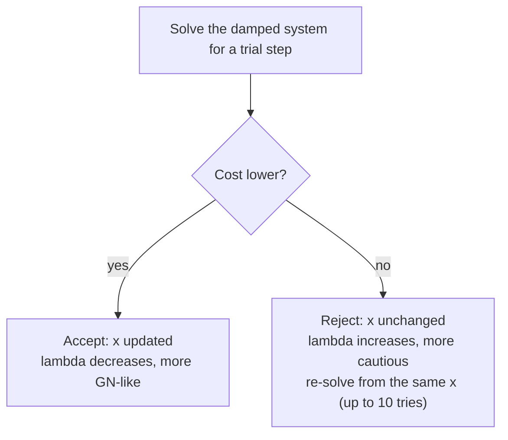

# Levenberg-Marquardt

**Levenberg-Marquardt (LM)** sits between [Gauss-Newton (GN)](gauss_newton.md) and gradient descent:

> **Gauss-Newton is fast but can be unstable. Gradient descent is stable but can be slow. LM tries to get the best of both.**

---

## 1. Start with the problem

In [SLAM](../glossary.md#slam-simultaneous-localization-and-mapping)/[bundle adjustment](bundle_adjustment.md)/[factor graphs](factor_graph.md), we usually have:

```math
\min_x \frac12\sum_i \|e_i(x)\|^2
```

where:

- $x$ = all unknown states stacked together, e.g. the poses $x_i$ and landmarks $l_j$
- $e_i(x)$ = measurement error from factor $i$

We'll call this cost $f(x)$.

For example:

```text
       camera observation
              ↓
x1 ●──────── Factor ────────● l1
       "How inconsistent
        is this observation?"
```

We want to adjust $x_1$ and $l_1$ so that the error becomes smaller.

---

## 2. Why not just use [Gauss-Newton](gauss_newton.md)?

Gauss-Newton linearizes the error, $e(x+\Delta x)\approx e(x)+J\Delta x$ (with $`J`$ the [Jacobian](../glossary.md#jacobian) of $`e`$), then solves

$$\boxed{J^\top J\Delta x=-J^\top e}$$

and updates $x\leftarrow x+\Delta x$. (A single pose $x_i$ of §1 is written $T$ from here on, while $x$ stays the whole stacked state. For a pose $T$ in [SE(3)](../glossary.md#so3-and-se3) the update is a [retraction](../glossary.md#retraction), $T \leftarrow T\cdot\mathrm{Exp}(\Delta x)$, not plain addition - see [gauss_newton.md §8](gauss_newton.md#8-why-is-this-everywhere-in-slam).)

This works very well **when the estimate is already reasonably close to the solution**. Now suppose the initial estimate is poor:

```text
True solution
      ★

                 Current estimate
                       ●
```

The linear approximation is only valid near the current estimate, but Gauss-Newton trusts it fully, so the step can be far too long and overshoot:

```text
Current
   ●
    \
     \
      \      ← huge step
       \
        ●
       diverge
```

The step's *direction* is still downhill whenever $J$ has full column rank: for $`f = \tfrac12\|e\|^2`$, $`\Delta x^\top\nabla f = -\|J\Delta x\|^2 < 0`$ unless we're already at a stationary point. The problem is the step's *length*. When $J^\top J$ is singular or nearly so, the step can also become huge or not exist at all.

---

## 3. Gradient descent has the opposite problem

Gradient descent just moves in the direction that decreases the error. For $`f = \tfrac12\|e\|^2`$ the gradient is $\nabla f = J^\top e$, and the step goes straight downhill:

$$\boxed{\Delta x = -\alpha J^\top e}$$

where $\alpha$ is the **step size**. It uses only the **slope**, with no $J^\top J$ term (the Gauss-Newton approximation of the [Hessian](../glossary.md#normal-equations-and-hessian), i.e. the curvature).

**Safer:** to first order a step changes the cost by $`-\alpha\|\nabla f\|^2 < 0`$, so a small enough $\alpha$ always lowers it, and there's no matrix to invert.

**Slow:** $\alpha$ must stay small enough not to overshoot in the steepest direction, so in a long, narrow valley the steps zigzag across it and crawl along it.

For example, $f = \tfrac12(x^2 + 100y^2)$ is 100× steeper in $y$, so $\alpha$ must stay below $2/100 = 0.02$. Starting from $(10, 1)$:

- $\alpha = 0.019$ needs **361 steps** to get within $0.01$ of the minimum.
- $\alpha = 0.021$ **diverges**.
- Gauss-Newton gets there in **one step**, because $J^\top J$ rescales each direction by its own curvature. Here the errors are $e = (x,\ 10y)$, so $J = \text{diag}(1, 10)$ and $J^\top J = \text{diag}(1, 100)$.


*Figure: the valley example above, plotted by `uv run python assets/make_figures.py lm_gradient_descent`. Left: contours with the three paths (for step size 0.021 only the first 9 steps are drawn). Right: the distance to the minimum per step on a log axis, 361 steps to reach the 0.01 tolerance for 0.019 and growing past 1e8 after 194 steps for 0.021.*

§5 shows that LM with a large $\lambda$ takes this gradient-descent step with $\alpha = 1/\lambda$, and §10 shows how Marquardt's scaling removes this valley problem when the valley runs along the parameter axes, as it does here.

---

## 4. The damping idea

LM adds a **damping parameter** $\lambda \ge 0$ to the Gauss-Newton equation:

$$\boxed{(J^\top J+\lambda I)\Delta x=-J^\top e}$$

That one extra term $\lambda I$ does two jobs:

- **Controls the step:** $\lambda$ slides LM between Gauss-Newton and gradient descent (§5).
- **Keeps the system solvable:** $J^\top J$ is only positive *semi*-definite ($v^\top J^\top J v \ge 0$ for all $v$, with equality possible for some $v \ne 0$), and in SLAM it's often singular (see [gauss_newton.md §4](gauss_newton.md#4-the-optimization-problem)). For any $\lambda > 0$, $`v^\top(J^\top J+\lambda I)v = \|Jv\|^2 + \lambda\|v\|^2 > 0`$ for every $v \neq 0$, so the damped system always has a unique solution.

---

## 5. What does $\lambda$ actually do?

Think of $\lambda$ as a **caution knob**.

### Large $\lambda$

$\lambda I$ dominates $J^\top J+\lambda I$, so the solution is approximately

$$\Delta x \approx -\frac{1}{\lambda}J^\top e$$

Since $J^\top e$ is the gradient of $`\tfrac12\|e\|^2`$, this is a **gradient-descent** step with step size $1/\lambda$ (compare [gauss_newton.md §10](gauss_newton.md#10-gauss-newton-vs-gradient-descent)'s $-\alpha\nabla f$) - and a large $\lambda$ means a *short* step.

### Small $\lambda$

The damping becomes almost irrelevant, $J^\top J+\lambda I\approx J^\top J$, so LM behaves like **Gauss-Newton**: larger, faster steps.

So LM slides along one dial, with gradient descent and Gauss-Newton as its two ends:

```text
CAUTIOUS                                AGGRESSIVE
large λ ←────────────── LM ──────────────→ small λ
gradient-descent-like            Gauss-Newton-like
```

---

## 6. How does LM decide whether to be cautious?

LM never measures how far it is from the solution - it can't know that. Instead, $\lambda$ follows **how well the last step worked**:

- **Cost decreased** (e.g. 100 → 60): **accept** the step, trust the linear model more, $\lambda \downarrow$. The next iteration is more Gauss-Newton-like.
- **Cost increased** (e.g. 100 → 150): **reject** the step, so $x$ stays exactly where it was. Then $\lambda \uparrow$ and re-solve from the same point for a shorter, more cautious step. Repeat until the cost decreases, or stop when a retry limit is hit.

Because a bad step is never kept, the cost $f$ never goes up from one accepted step to the next.



In practice $\lambda$ tends to grow while the linear model predicts poorly (often far from the solution) and shrink near the solution, where the model becomes accurate - but that's a consequence of the rule, not the rule itself.

> **Note:** "did the cost drop?" is the simplest acceptance test, and the one this repo uses (§13). Many solvers instead use the **gain ratio**: the actual cost reduction divided by the reduction the linear model predicted. A ratio near 1 means the model is trustworthy ($\lambda \downarrow$); a small or negative ratio means it isn't ($\lambda \uparrow$).

> **Note:** damping makes each step *safe*, not *global*. LM still only goes downhill from where it starts, so if a poor initial estimate sits in the basin of a wrong local minimum, LM converges to that minimum. In SLAM a reasonable initialization (odometry, a good [front end](../glossary.md#front-end-and-back-end)) is still needed.

---

## 7. Why this matters in SLAM

SLAM is strongly nonlinear, mainly because of **rotations** ($SE(3)$ poses) and **camera projection**. For example:

$$u =\pi(TX)$$

where:

- $u$ = the predicted pixel coordinates of the landmark in the image
- $z$ = the measured pixel coordinates of the landmark (the measurement)
- $X$ = 3D landmark (the $l_j$ of §1)
- $T$ = camera pose (the $x_i$ of §1), written here as world-to-camera, so $TX$ is the landmark in the camera frame. [bundle_adjustment.md](bundle_adjustment.md) uses the inverse convention, and its 3D point $P$ is not a covariance: see [nonlinear_least_square.md §3](nonlinear_least_square.md#3-then-what-makes-it-nonlinear).
- $\pi$ = camera projection

The [reprojection error](../glossary.md#reprojection-error) is $e = \pi(TX)-z$ (prediction minus measurement, the same convention as [gauss_newton.md](gauss_newton.md)'s residual $r$), and we optimize:

```math
\min_{T,X}\frac12\|\pi(TX)-z\|^2
```

That nonlinearity is why LM is a common choice for bundle adjustment, pose-graph and factor-graph optimization, pose estimation, and calibration.

---

## 8. LM on a factor graph

Take the small factor graph from [factor_graph.md §5](factor_graph.md#5-why-call-it-a-graph), where landmark $l_0$ is seen from $x_0$ and $x_1$, and $l_1$ from $x_1$ and $x_2$:

```text
       l0    l1
       ●     ●
      / \   / \
     /   \ /   \
    ●─────●─────●
    x0    x1    x2
```

Each factor produces an error $e_1(x), e_2(x), e_3(x), \dots$. The total cost weights each error by its measurement's [information matrix](../glossary.md#information-matrix) $\Omega_i$ (the same weighting as [factor_graph.md §4](factor_graph.md#4-optimization-means-minimizing-all-those-errors)):

```math
f(x)=\frac12\sum_i e_i(x)^\top\Omega_i\, e_i(x)
```

Linearize, $e(x+\Delta x)\approx e(x)+J\Delta x$, where $e$ and $J$ stack every factor's error and Jacobian, and $\Omega$ is block-diagonal with the $\Omega_i$ on its diagonal. Then LM solves

$$\boxed{(J^\top\Omega J+\lambda I)\Delta x = -J^\top\Omega e}$$

and updates the poses and landmarks - the same loop as [gauss_newton.md §5](gauss_newton.md#5-the-algorithm-loop), with damping added.

---

## 9. LM vs Gauss-Newton

|                 | Gauss-Newton                        | Levenberg-Marquardt           |
| --------------- | ----------------------------------- | ----------------------------- |
| Basic idea      | Trust local quadratic approximation | Control how much to trust it  |
| Step            | More aggressive                     | Adaptive                      |
| Stability       | Can be fragile far from solution    | Generally more robust         |
| Near solution   | Very fast                           | Approaches GN                 |
| Extra parameter | None                                | $\lambda$                     |

---

## 10. Marquardt's scaling

The damping term is often written with a matrix $D$ instead of $I$:

```math
(J^\top J+\lambda D)\Delta x=-J^\top e, \qquad D=\text{diag}(J^\top J)
```

This is Marquardt's version: each parameter is damped in proportion to its own curvature.

- **Unit-independent:** the step no longer depends on how individual parameters are scaled (e.g. metres vs. millimetres). Plain $\lambda I$ doesn't have that property.
- **Per-parameter gradient descent:** with a large $\lambda$ it becomes a gradient-descent step scaled per parameter, rather than §5's plain one.
- **Fixes §3's valley, if axis-aligned:** there $D = \text{diag}(1, 100)$, so with a large $\lambda$ the step becomes $-\tfrac{1}{\lambda}D^{-1}\nabla f = -\tfrac{1}{\lambda}(x,\ y)$. Both directions shrink at the same rate, and the zigzag is gone. A valley running diagonally to the axes keeps its zigzag, because a diagonal $D$ can't rescale a tilted direction.
- **Catch:** a parameter that no measurement constrains has a zero on that diagonal and gets no damping at all, so implementations clamp the diagonal to a small positive floor (a floor this small doesn't make the step well-conditioned; the pose-graph code anchors node 0 separately, §13).

Implementations differ in the details, but the concept is the same: **add damping to make the optimization step safer**.

---

## 11. Where LM fits

The step rule and the solve strategy are two separate choices:

```text
                 SLAM
                  │
             Factor Graph
                  │
          Nonlinear least squares
                  │
             Linearization
                  │
             Jacobian J
                  │
   ┌──────────────┴──────────────┐
   │                             │
Step rule                  Solve strategy
├── Gauss-Newton           ├── Batch (re-solve everything)
└── Levenberg-Marquardt    └── Incremental (iSAM/iSAM2)
```

Any step rule can be paired with either strategy ([batch vs. incremental](../glossary.md#batch-vs-incremental)). [iSAM](isam_optimization.md) and [iSAM2](isam2_optimization.md) change *how* the linear system is re-solved as new measurements arrive; they still need a rule for the step itself (this repo's incremental solver, [`pose_graph_incremental.py`](../../use_numpy/pose_graph_incremental.py), uses plain Gauss-Newton).

---

## 12. The one-sentence intuition

> **Levenberg-Marquardt is Gauss-Newton with a safety knob: when its steps keep failing, it takes cautious gradient-descent-like steps; when they keep working, it reduces the damping and behaves like fast Gauss-Newton.**

---

## 13. Where this is implemented in this repo

The pose-graph and bundle-adjustment LM solvers here use §10's Marquardt form, $`(H + \lambda\,\text{diag}(H))\Delta x = -J^\top\Omega e`$ with $H = J^\top\Omega J$ (the Gauss-Newton Hessian; plus the pose-graph anchor below), and share these rules:

- the diagonal is clamped to at least $10^{-12}$;
- §6's rule is followed literally: a trial step is kept only if it lowers the total cost; otherwise it's rejected, $\lambda$ doubles, and the step is re-solved from the same point (at most 10 tries per iteration);
- poses are updated by retraction (§2), landmarks by plain addition.

Per script:

- [`pose_graph.py`](../../use_numpy/pose_graph.py)'s `run_pose_graph_optimization` (both `use_numpy/` and `use_manif/`):
  - starts from `--damping` (default $0.01$); after an accepted step $\lambda \leftarrow \max(\lambda/2,\ 10^{-7})$, after a rejected one $\lambda \leftarrow \max(2\lambda,\ 10^{-6})$;
  - adds a large constant, $10^6 I$, to the first pose's $6\times6$ block of $H$. Pinning that pose removes the [gauge freedom](../glossary.md#gauge-freedom), so $H$ isn't singular to begin with;
  - reused by [`pose_graph_incremental.py`](../../use_numpy/pose_graph_incremental.py) for its batch baseline (its incremental solver runs plain Gauss-Newton);
  - reused by [`sliding_window_marginalization.py`](../../use_numpy/sliding_window_marginalization.py) with an initial damping of $0$, so its first step is a pure Gauss-Newton step. After that, the floors above keep $\lambda \ge 10^{-7}$.
- [`bundle_adjustment_advanced.py`](../../use_numpy/bundle_adjustment_advanced.py) (both versions):
  - starts from $\lambda = 10^{-3}$; halves it (floor $10^{-7}$) after an accepted step and doubles it (no floor) after a rejected one;
  - weights all reprojection residuals equally;
  - counts a trial step that puts any point behind a camera as infinite cost, so it's always rejected.
- [`lidar_primitives.py`](../../use_numpy/lidar_primitives.py)'s `optimize_plane_graph` (experiment 4; both versions): same accept/reject scheme and 10 retries, but:
  - starts from $\lambda = 10^{-3}$; halves it (floor $10^{-9}$) after an accepted step and multiplies it by $4$ after a rejected one;
  - anchors pose 0 with $10^{12} I$ instead of $10^6 I$;
  - updates each plane landmark (an $S^2$ normal, i.e. a unit-length 3D vector, plus an offset) with the $S^2$ exponential map for the normal: the 2-component step rotates the normal along a great circle instead of being added to it.

---

## 14. References

1. Levenberg, K. (1944). *A Method for the Solution of Certain Non-Linear Problems in Least Squares*. Quarterly of Applied Mathematics, 2(2), 164–168. https://doi.org/10.1090/qam/10666 - the original damped least-squares method behind §4's $(J^\top J+\lambda I)\Delta x=-J^\top e$.
2. Marquardt, D. W. (1963). *An Algorithm for Least-Squares Estimation of Nonlinear Parameters*. Journal of the Society for Industrial and Applied Mathematics, 11(2), 431–441. https://doi.org/10.1137/0111030 - the scale-invariant diagonal-damping variant $D=\text{diag}(J^\top J)$ behind §10.
3. Triggs, B., McLauchlan, P. F., Hartley, R. I., & Fitzgibbon, A. W. (2000). *Bundle Adjustment - A Modern Synthesis*. In Vision Algorithms: Theory and Practice (LNCS vol. 1883, pp. 298–372). Springer. https://doi.org/10.1007/3-540-44480-7_21 - the reprojection-error/bundle-adjustment application of LM behind §7.
4. Dellaert, F., & Kaess, M. (2017). *Factor Graphs for Robot Perception*. Foundations and Trends in Robotics, 6(1–2), 1–139. https://doi.org/10.1561/2300000043 - general reference for the factor-graph formulation behind §1 and §8.
