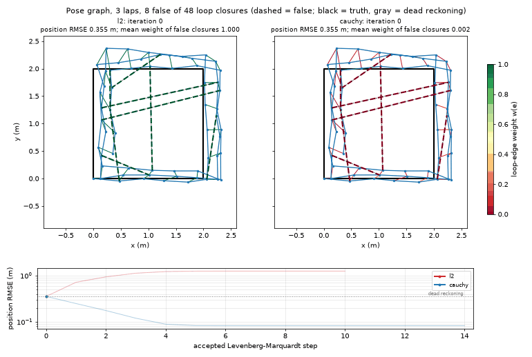
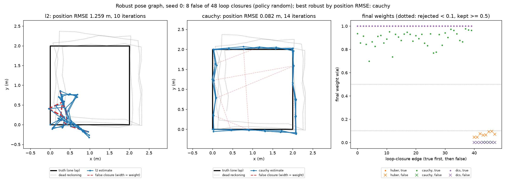

# Robust pose-graph optimization against false loop closures

**How to read it.**

| Sections | Need first | First pass |
| --- | --- | --- |
| Intuition, §1-§3 | the pose graph and loop closure: [pose_graph_optimization.md](pose_graph_optimization.md) §1-§14 (§12 for the **information matrix**); the kernels (Huber, Cauchy, DCS) and the kernel scale: [§16](pose_graph_optimization.md#16-robust-loss-functions-used-to-handle-false-loop-closures); the damped step: [levenberg_marquardt.md](levenberg_marquardt.md) §1-§9 | read |
| §4 (kernel scale) | §1-§3 | read |
| §5 (variants, failure cases) | §1-§4 | skip |
| §6-§7 | §1-§4 | read |

The results come from [`pose_graph_robust.py`](../../use_numpy/pose_graph_robust.py) ([README §13](../../README.md#13-3d-pose-graph-with-false-loop-closures-plain-least-squares-vs-robust-kernels)), which reuses the solver of [`pose_graph.py`](../../use_numpy/pose_graph.py) ([README §12](../../README.md#12-3d-pose-graph-relaxation)). Sources are numbered 1-5 in [References](#8-references).

## Intuition

A **false loop closure** is an edge that claims "I have been here before" about two places that are not the same. Plain least squares ($`L_2`$) believes it as strongly as every other edge, and drags the whole map together to satisfy it.

A worked number from this toy (§1): at the dead-reckoning start, a false closure has a residual of $`e = 93.4`$ standard deviations (median over 160 false closures; $`e`$ is defined in §1). The table shows how hard each method still pulls on the map from that edge. The pull is $`w(e) \cdot e`$: weight times residual, the slope of the cost.

| Method | Weight $`w(e)`$ at $`e = 93.4`$ | Pull $`w \cdot e`$ (standard deviations) |
| --- | --- | --- |
| `l2` | 1 | 93.4 |
| `huber` | 0.038 | 3.55 |
| `cauchy` | 0.0014 | 0.13 |
| `dcs` | $`8.3 \times 10^{-6}`$ | 0.0008 |

(Kernel scale $`\tau = 3.548`$, §2. These are the formulas of the existing [kernel section](pose_graph_optimization.md#16-robust-loss-functions-used-to-handle-false-loop-closures) evaluated at one residual.) Huber's weight is small, but its pull stays at the threshold $`\tau`$, however wrong the edge is; Cauchy and DCS let the pull fall to nearly zero.

Result, at 20% false closures over 20 seeds (position RMSE over all nodes, §3): `l2` 1.38 m, `huber` 0.66 m, `cauchy` 0.106 m, `dcs` 0.102 m. The same graph without any false closures gives 0.102 m for `l2`.

*Animation: `generator/animate_pose_graph_robust.py` at its defaults (seed 0, 20% false closures, `l2` next to `cauchy`), rendered by `uv run python generator/animate_pose_graph_robust.py --gif-out assets/pose_graph_robust.gif`. Frame $`k`$ shows the poses after accepted step $`k`$; nothing is interpolated. `cauchy` is the lowest-RMSE robust method on this seed (§3.1), not a general winner.*

## 1. Scenario

[`pose_graph.py`](../../use_numpy/pose_graph.py) relaxes one loop with one closure, too few to show a wrong one. [`pose_graph_robust.py`](../../use_numpy/pose_graph_robust.py) (and its manifpy twin [`use_manif/pose_graph_robust.py`](../../use_manif/pose_graph_robust.py)) drives the same 2 m square for several laps.

| Item | Value |
| --- | --- |
| Trajectory | the square, 5 odometry segments per side, 20 nodes per lap, 3 laps: 60 nodes. Heading stays fixed, as in `pose_graph.py` |
| Odometry edges | 59, between consecutive nodes; noise 0.05 m / 0.01 rad (the `pose_graph.py` defaults) |
| True loop closures | 40: every node of laps 2 and 3 to the node at the same place one lap earlier; noise $`0.5\times`$ the odometry noise, as in `pose_graph.py` |
| False loop closures | a fraction of the true count: 0, 10, 20, 30% = 0, 4, 8, 12 edges |
| Initial guess | dead reckoning (the odometry edges composed from node 0) |

Symbols, each in words:
- $`X_i`$: the pose of node $`i`$ (position and orientation).
- $`Z_{ij}`$: the measured pose of node $`j`$ relative to node $`i`$ on edge $`(i,j)`$.
- $`r_{ij} = \mathrm{Log}(Z_{ij}^{-1} X_i^{-1} X_j)`$: the **residual**, a 6-vector (3 translation in m, 3 rotation in rad) that is zero when the poses agree with the measurement. Same as `pose_graph.py`.
- $`\Omega`$: the edge's **information matrix**, the inverse of its noise covariance. Here it is diagonal, $`1/\sigma^2`$ for each component, using the true noise of the edge type.
- $`e = \sqrt{r^\top \Omega\, r}`$: the **scalar residual**, the [Mahalanobis distance](../glossary.md#mahalanobis-distance) of the residual, i.e. the residual measured in standard deviations. For a correct edge at the truth, $`e^2`$ follows a [chi-square distribution](../glossary.md#chi-square-distribution) with 6 degrees of freedom.

Using the true $`\Omega`$ is a change from `pose_graph.py`, which uses an identity matrix on every edge. A kernel threshold measured in standard deviations needs $`\Omega`$ to match the noise.

**False closures** follow the outlier generator of Sünderhauf & Protzel (reference 1), which their code `generateDataset.py` implements (references 3 and 4). Defaults and variants:

| Choice | Default | Variants (flags) | Source |
| --- | --- | --- | --- |
| Node pair | **random**: both indices uniform over the nodes, sorted, never consecutive | `local`: second node within 20 nodes after the first (`--outlier-policy local`) | refs 1, 4 |
| Measurement | Gaussian relative pose: translation 0.3 per axis, roll/pitch/yaw 10 deg | identity, "perfect match" (`--outlier-meas identity`) | refs 3, 4 |
| Grouping | none | `--outlier-group 10`: 10 consecutive pairs sharing one measurement (the sources use 10 or 20) | refs 1-3 |
| Information matrix | same as the true closures | none | ref 4 |
| Same-place pairs | redrawn | none | this file |

The last row is this file's rule, not the source's: a pair at the same place (index difference a multiple of 20) would not be false, so it is redrawn. The source's numbers (0.3, 10 deg) belong to its datasets and are applied unchanged here, so a false closure's measurement is spread around "same place" (the identity pose) by 12 standard deviations of the loop noise per translation axis and 35 per rotation axis, and the real relative pose of its two nodes is usually far from the identity as well. That is the reason for the size of $`e`$ below.

**Residuals at the dead-reckoning start** (`--experiment diagnostics`, 20 seeds, 20% false closures):

| Closures | Count | $`e`$ median | min | max | Share with $`e \le \tau`$ |
| --- | --- | --- | --- | --- | --- |
| true | 800 | 19.9 | 5.4 | 41.1 | 0 |
| false | 160 | 93.4 | 30.2 | 166.6 | 0 |

From the dead-reckoning guess, every closure, true or false, is beyond the threshold, because the drift (0.44 m position RMSE over 20 seeds) is large compared to the closures' noise (0.025 m). At the $`L_2`$ solution of the outlier-free graph, the true closures have median $`e = 1.1`$ (max 2.3).

Odometry edges are **never robustified**, as in the sources: Sünderhauf & Protzel state that the odometry constraints "remain unchanged" (ref. 1, Eq. 1), and Agarwal et al. scale only the loop-closing terms (ref. 2, Eq. 1 and the text after Eq. 15).

## 2. Methods

All four minimize $`\sum_{\text{odometry}} \tfrac{1}{2} e^2 + \sum_{\text{loops}} \rho(e)`$ with $`\rho`$ the kernel's cost (the $`\tfrac{1}{2}`$ convention of the existing doc). $`\tau`$ is the kernel scale, in standard deviations; $`\Phi = \tau^2`$.

| Method | Cost $`\rho(e)`$ | Weight $`w(e)`$ | Weight for large $`e`$ | Cost for large $`e`$ |
| --- | --- | --- | --- | --- |
| `l2` | $`\tfrac{1}{2} e^2`$ | 1 | 1 | unbounded, quadratic |
| `huber` | $`\tfrac{1}{2}e^2`$ for $`e \le \tau`$, else $`\tau (e - \tfrac{1}{2}\tau)`$ | 1, then $`\tau / e`$ | $`\propto 1/e`$ | unbounded, linear |
| `cauchy` | $`\tfrac{\tau^2}{2}\ln(1 + e^2/\tau^2)`$ | $`1/(1 + e^2/\tau^2)`$ | $`\propto 1/e^2`$ | logarithmic |
| `dcs` | $`\tfrac{1}{2}e^2`$ for $`e^2 \le \Phi`$, else $`\tfrac{1}{2}\left(3\Phi - \tfrac{4\Phi^2}{\Phi + e^2}\right)`$ | $`s^2`$ with $`s = \min\!\left(1, \tfrac{2\Phi}{\Phi + e^2}\right)`$ | $`\propto 1/e^4`$ | bounded, $`\tfrac{3}{2}\Phi`$ |

- **Convex or not:** `l2` and `huber` are convex in the residual; `cauchy` and `dcs` are not (their cost flattens). None of them makes the pose problem convex: the residual itself is nonlinear in the poses. A non-convex kernel can end in a wrong solution when started far from the right one; §4 and §5 look for that.
- **DCS formula:** $`s = \min(1, 2\Phi/(\Phi + \chi^2_l))`$ and the information matrix scaled by $`s^2`$, with $`\chi^2_l`$ the squared residual of the edge (ref 2, Eq. 15 and the sentence after it). In this file's notation $`\chi^2_l = e^2`$.
- **DCS cost:** the paper gives the weight, not a cost. The cost in the table is the integral of the weight, $`\rho(e) = \int_0^e u\, w(u)\, du`$, which makes the weight exactly $`w = \tfrac{1}{e}\,\partial\rho/\partial e`$; it is a derivation of this file, checked by finite differences in the tests. g2o's DCS kernel instead returns the cost $`s^2 e^2`$ (ref 5), which decreases again for large $`e`$; that is not used here.
- **DCS and switchable constraints:** a **switchable constraint** gives every loop edge a switch variable $`s_{ij} \in [0,1]`$ that scales its information matrix by $`s_{ij}^2`$, plus a prior that pulls the switch toward 1 (ref 1, Eq. 1). DCS derives its $`s`$ from that cost: setting the switch's derivative to zero gives $`s = \Phi/(\Phi + \chi^2_l)`$ (ref 2, Eq. 8), and the paper then takes the upper bound $`2\Phi/(\Phi + \chi^2_l)`$ capped at 1 (Eq. 14-15), which removes the switch variables from the optimization. So DCS is a closed-form relative of switchable constraints, not the same method numerically. Switchable constraints themselves are not implemented here.
- **IRLS inside Levenberg-Marquardt:** at the start of each accepted-step iteration, each loop edge's information matrix is multiplied by its weight at the current poses; the step is then a damped Gauss-Newton step as in `pose_graph.py` (same Jacobians, node 0 anchored, adaptive damping, see [Levenberg-Marquardt](levenberg_marquardt.md)). A step is accepted only if the matching robust cost $`\sum \rho`$ goes down. With `l2` and identity information matrices, it reproduces `pose_graph.py`'s solver to $`10^{-9}`$ (test).
- **Kernel scale (a design choice, not from the sources):** $`\tau^2`$ is the 95% quantile of the chi-square distribution with 6 degrees of freedom, 12.59, so $`\tau = 3.548`$; Huber's $`\delta`$ and Cauchy's $`k`$ equal $`\tau`$ and DCS's $`\Phi`$ equals $`\tau^2`$. This follows the existing doc's guidance (§16.5). The DCS paper uses $`\Phi = 1`$ unless stated otherwise, from the switch-prior value of ref. 1 (ref. 2, §V-A); that value is tested separately in §4.

## 3. Results

Position RMSE is taken over all 60 nodes. Node 0 is anchored at the truth (test: it stays within $`10^{-6}`$), so no trajectory alignment is needed. Rotation RMSE is the geodesic angle error in degrees. **Rejected** is a false closure with final weight below 0.1; **kept** is a true closure with final weight at least 0.5.

### 3.1 One run

*Figure: `uv run python use_numpy/pose_graph_robust.py --out assets/pose_graph_robust.png` (default run, 2 min 42 s including §3.2 and the 5-seed sweep; `--experiment single --out ...` writes the same file). Left and middle: truth (black), dead reckoning (gray dotted), estimate (blue), false closures (red dashed, wider and more opaque when the weight is higher). Right: final weight of each loop edge.*

Seed 0, 20% false closures (8 of 48):

| Method | Position RMSE (m) | Rotation RMSE (deg) | Iterations | False rejected | True kept | Largest false weight |
| --- | --- | --- | --- | --- | --- | --- |
| dead reckoning | 0.3546 | 3.012 | - | - | - | - |
| `l2` | 1.2592 | 7.879 | 10 | 0/8 | 40/40 | 1 |
| `huber` | 0.5629 | 2.729 | 17 | 8/8 | 40/40 | 0.097 |
| `cauchy` | 0.0817 | 0.863 | 14 | 8/8 | 40/40 | 0.0036 |
| `dcs` | 0.0913 | 0.890 | 10 | 8/8 | 40/40 | $`4.6 \times 10^{-5}`$ |

`l2` ends worse than dead reckoning (1.26 m against 0.35 m). `huber` rejects all 8 by the 0.1 criterion but still leaves 0.56 m, as the pull column of the Intuition table predicts. In the animation, `cauchy` gives all 8 false closures a weight below 0.1 at iteration 0, while all 40 true closures start below 0.5 (they end at a mean weight of 0.89, none below 0.5): the kernel is already treating every closure as doubtful, yet the map relaxes onto the square.

### 3.2 Over seeds and false-closure fractions

20 seeds (0 to 19); for each seed, the odometry, the true closures, and the false closures are drawn from separate random streams of the seed, so only the number of false closures changes with the fraction, and the false closures at 10% are the first ones of those at 30%. Check printed by the run: dead-reckoning RMSE is identical across fractions (mean 0.4372 m). Command: `uv run python use_numpy/pose_graph_robust.py` (the Monte Carlo part of the default run; `--experiment montecarlo` runs it alone).

Position RMSE in m, mean (median / worst of 20):

| False fraction | `l2` | `huber` | `cauchy` | `dcs` |
| --- | --- | --- | --- | --- |
| 0 | 0.1022 (0.1010 / 0.1358) | 0.1022 (0.1010 / 0.1358) | 0.1019 (0.1012 / 0.1355) | 0.1022 (0.1010 / 0.1358) |
| 0.1 | 1.0803 (1.0701 / 1.3756) | 0.4205 (0.4224 / 0.7432) | 0.1030 (0.1049 / 0.1286) | 0.1022 (0.1010 / 0.1358) |
| 0.2 | 1.3816 (1.4206 / 1.7467) | 0.6603 (0.6162 / 0.9716) | 0.1055 (0.1104 / 0.1314) | 0.1022 (0.1010 / 0.1357) |
| 0.3 | 1.4902 (1.5089 / 1.7388) | 0.8289 (0.8110 / 1.1545) | 0.1083 (0.1144 / 0.1420) | 0.1022 (0.1010 / 0.1357) |

Rotation RMSE in deg (mean) and iterations (mean):

| False fraction | `l2` | `huber` | `cauchy` | `dcs` |
| --- | --- | --- | --- | --- |
| 0 | 1.178 / 10.0 | 1.178 / 10.0 | 1.180 / 16.7 | 1.178 / 11.6 |
| 0.1 | 7.208 / 10.3 | 2.232 / 16.7 | 1.157 / 16.8 | 1.178 / 11.6 |
| 0.2 | 8.832 / 9.8 | 2.847 / 19.4 | 1.173 / 16.8 | 1.178 / 11.5 |
| 0.3 | 9.583 / 9.8 | 3.378 / 23.4 | 1.173 / 16.8 | 1.178 / 11.6 |

Classification at convergence (all seeds pooled):

| False fraction | `huber`: false rejected | `cauchy`: false rejected | `dcs`: false rejected | True kept (`huber` / `cauchy` / `dcs`) |
| --- | --- | --- | --- | --- |
| 0.1 | 78/80 | 80/80 | 80/80 | 800 / 799 / 800 of 800 |
| 0.2 | 145/160 | 160/160 | 160/160 | 799 / 799 / 800 of 800 |
| 0.3 | 208/240 | 240/240 | 240/240 | 799 / 799 / 800 of 800 |

- **Four false closures among 40 true ones (10%) are enough to ruin `l2`:** 1.08 m against 0.10 m without false closures. It then grows slowly with the fraction (1.38 m at 0.2, 1.49 m at 0.3).
- **`l2` without false closures is still 0.10 m**, and this floor is the same for every method. Per lap it is 0.103, 0.103 and 0.105 m (`--experiment diagnostics`), so no single lap carries it. This is the error left when only relative constraints are available; why it is the same in every lap was not isolated (likely: the closures tie the laps to each other, so they share the drift of the first).
- **Cost of robustness when nothing is wrong:** at fraction 0, `huber` and `dcs` equal `l2` to four digits (0.1022 m), and `cauchy` is 0.1019 m. `cauchy` needs 16.7 iterations against 10.0 for `l2`, and one of its 800 true closures ends with weight below 0.5.
- **`dcs` is indistinguishable from the outlier-free solution:** 0.1022 m at every fraction (on seed 0 its largest false weight is $`4.6 \times 10^{-5}`$, §3.1). `cauchy` degrades slightly with the fraction (0.1019, 0.1030, 0.1055, 0.1083 m), likely because its false closures keep a small weight and a nonzero pull (largest false weight on seed 0: 0.0036).
- **`huber` is the weakest robust method:** it improves on `l2` by 2.6 times at 10% false closures, 2.1 times at 20% and 1.8 times at 30%, but stays 4 to 8 times above the outlier-free level (0.42 m and 0.83 m against 0.10 m at 10% and 30%).
- **Run time** of the default run is 2 min 42 s (numpy, one thread, laptop shared with other jobs); the manifpy version takes 44 s.

## 4. Kernel scale

20 seeds, 20% false closures, `uv run python use_numpy/pose_graph_robust.py --experiment sweep --n-sweep-seeds 20`. The multiplier scales $`\tau`$ (so $`\Phi`$ scales with its square). The last row is DCS with $`\Phi = 1`$, the value of ref. 2.

| Method | Scale | $`\tau`$ | Position RMSE (m): mean (median / worst) | Iterations | False rejected | True kept |
| --- | --- | --- | --- | --- | --- | --- |
| `l2` | - | - | 1.3816 (1.4206 / 1.7467) | 9.8 | 0/160 | 800/800 |
| `huber` | 0.5 | 1.77 | 0.3805 (0.3585 / 0.6261) | 34.0 | 160/160 | 790/800 |
| `huber` | 1 | 3.55 | 0.6603 (0.6162 / 0.9716) | 19.4 | 145/160 | 799/800 |
| `huber` | 2 | 7.10 | 1.0191 (0.9593 / 1.3669) | 31.1 | 16/160 | 800/800 |
| `cauchy` | 0.5 | 1.77 | 0.1045 (0.1023 / 0.1364) | 49.0 | 160/160 | 536/800 |
| `cauchy` | 1 | 3.55 | 0.1055 (0.1104 / 0.1314) | 16.8 | 160/160 | 799/800 |
| `cauchy` | 2 | 7.10 | 0.1612 (0.1562 / 0.2832) | 12.6 | 160/160 | 800/800 |
| `dcs` | 0.5 | 1.77 | 0.1816 (0.1452 / 0.5228) | 45.2 | 160/160 | 408/800 |
| `dcs` | 1 | 3.55 | 0.1022 (0.1010 / 0.1357) | 11.5 | 160/160 | 800/800 |
| `dcs` | 2 | 7.10 | 0.1020 (0.1010 / 0.1342) | 10.1 | 160/160 | 800/800 |
| `dcs` | $`\Phi = 1`$ | 1.00 | 0.4115 (0.3883 / 0.6758) | 19.4 | 160/160 | 9/800 |

- **`huber` wants a small threshold:** the smaller $`\delta`$, the smaller its pull (Intuition table), 0.38 m at half the default against 1.02 m at twice. At $`2\tau`$ it rejects only 16 of 160 by the weight criterion.
- **`dcs` gives the same RMSE at 1x and 2x** (0.1022 and 0.1020 m); **`cauchy` is the same at 0.5x and 1x** (0.1045 and 0.1055 m) but 50% worse at 2x (0.1612 m).
- **Too tight a scale costs true closures:** with $`\tau`$ halved, `cauchy` keeps 536 of 800 true closures and `dcs` 408 of 800, and `dcs` gets a worst case of 0.52 m. DCS with $`\Phi = 1`$ keeps 9 of 800 and ends at 0.41 m, close to the dead-reckoning 0.44 m. This is consistent with §1: at the start no true closure has $`e \le 1`$, or even $`e \le 3.55`$, so a tight threshold leaves them down-weighted. No run isolates this cause. Whether $`\Phi = 1`$ suits information matrices other than this one is not tested.
- **One such run (seed 0, `uv run python use_numpy/pose_graph_robust.py --experiment single --kernel-tau 1`, applied to every kernel):** `dcs` ends at 0.2028 m after 42 iterations with 1 of 40 true closures kept (0.0913 m at the default scale); `cauchy` 0.1152 m with 11 of 40; `huber` 0.1701 m with 25 of 40.

## 5. Variants and failure cases

20 seeds, 30% false closures, default scale. Position RMSE in m, mean (worst). Each row is one command: `uv run python use_numpy/pose_graph_robust.py --experiment montecarlo --outlier-fracs 0.3` plus the flags in the first column (logs in the report folder).

| Variant | `l2` | `huber` | `cauchy` | `dcs` |
| --- | --- | --- | --- | --- |
| default (random pairs, Gaussian measurement) | 1.4902 (1.7388) | 0.8289 (1.1545) | 0.1083 (0.1420) | 0.1022 (0.1357) |
| `--outlier-group 10` | 1.4691 (1.7434) | 0.9796 (1.4054) | 0.1093 (0.1638) | 0.1022 (0.1358) |
| `--outlier-meas identity` | 1.4595 (1.6943) | 1.2555 (1.4664) | 0.1243 (0.1662) | 0.1022 (0.1349) |
| `--outlier-policy local` | 1.4020 (1.6718) | 0.7256 (0.9934) | 0.1054 (0.1292) | 0.1022 (0.1357) |
| local, group 10, identity | 1.3113 (1.6143) | 1.0893 (1.4851) | 0.1247 (0.1632) | 0.1020 (0.1345) |

More false closures, `--outlier-fracs 0.6 1.0` (60% and 100% of the true count; 48 and 80 false edges against 40 true):

| False fraction | `l2` | `huber` | `cauchy` | `dcs` |
| --- | --- | --- | --- | --- |
| 0.6 | 1.6942 (1.9075) | 1.1746 (1.3217) | 0.1248 (0.1650) | 0.1021 (0.1355) |
| 1.0 | 1.7873 (1.9241) | 1.3956 (1.5786) | 0.1669 (0.2256) | 0.1021 (0.1348) |

A worse start, `--pos-noise-std 0.1 --rot-noise-std 0.02 --outlier-fracs 0.0 0.3` (dead reckoning 0.880 m):

| False fraction | `l2` | `huber` | `cauchy` | `dcs` |
| --- | --- | --- | --- | --- |
| 0 | 0.2045 (0.2718) | 0.2045 (0.2718) | 0.2040 (0.2711) | 0.2045 (0.2718) |
| 0.3 | 1.4867 (1.7520) | 1.1650 (1.4803) | 0.2600 (0.4070) | 0.2041 (0.2698) |

- **The kernel matters more than the false-closure policy.** Grouping, a perfect-match measurement, and local pairs move `huber` by up to 50% and `cauchy` by up to 15%, and `dcs` by less than 0.001 m. With the identity measurement, `huber` is barely better than `l2` (1.26 m against 1.46 m) and rejects 2 of 240.
- **No wrong solution from a non-convex kernel at the default scale.** In none of the 20 seeds of any row above did `cauchy` or `dcs` end above 0.41 m, and `dcs` stayed within 0.003 m of its outlier-free worst case in every row. The clearly worse solutions that were found came from a threshold that was too tight (§4).
- **`cauchy` weakens with a worse start:** mean 0.260 m (worst 0.407 m) at 30% false closures with doubled odometry noise, against 0.204 m (worst 0.271 m) without false closures. All 240 false closures are still rejected and 799 of 800 true closures kept there, so the extra error is not a classification miss; its cause was not isolated (likely: the true closures keep weights well below 1).
- **Every false closure here is far outside any threshold** (smallest $`e`$ at the start: 30.2, §1). That makes the test easy for the thresholded kernels; §6 says what it leaves out.

## 6. What this toy does not show

- **No place-recognition front end.** False closures are drawn at random from the generator of ref. 1 and carry a measurement unrelated to the geometry. A real aliasing error yields a geometrically plausible measurement; its $`e`$ could be small, and then no kernel can tell it from a true closure.
- **Their size is set by the source's numbers**, taken from other datasets (0.3, 10 deg), against closure noise of 0.025 m and 0.005 rad. At 12 to 35 standard deviations per axis, rejection is easy here.
- **A planar path in SE(3):** the robot never turns (every pose has the identity rotation), as in `pose_graph.py`; one square, three laps.
- **Only loop closures are robustified;** odometry is clean Gaussian, without outliers.
- **Switchable constraints are not implemented**, so the DCS-versus-original comparison of ref 2 is not reproduced. Graduated non-convexity (existing doc §16.5) is not tried either; every run starts from dead reckoning.
- **The information matrices are the true ones.** With a mis-scaled $`\Omega`$ the scale $`\tau`$ in standard deviations means something else (§4 hints at the cost).
- **The scale values are one design choice** (chi-square 95% quantile) plus a 0.5x/1x/2x sweep and $`\Phi = 1`$; no tuning on the false-closure data.

## 7. Takeaway

- Four false closures among 40 true ones (10%) multiply the position error by about 10 (0.10 m to 1.08 m); a kernel whose pull falls to nearly zero (`cauchy`, `dcs`) brings it back to the outlier-free level (0.103 m and 0.102 m), `huber` only to 0.42 m.
- What decides the result is how fast the pull of a wrong edge falls with its residual: constant (`huber`), $`1/e`$ (`cauchy`), $`1/e^3`$ (`dcs`).
- The scale has to suit the start: from dead reckoning, even true closures lie beyond $`3.5`$ standard deviations, and a tighter threshold (half the default, or $`\Phi = 1`$) rejects true closures and costs accuracy.
- Without false closures, the robust kernels cost nothing in accuracy; `cauchy` takes about 7 more iterations.

## 8. References

1. Sünderhauf, N., & Protzel, P. (2012). *Switchable Constraints for Robust Pose Graph SLAM*. 2012 IEEE/RSJ International Conference on Intelligent Robots and Systems (IROS), 1879-1884. https://doi.org/10.1109/IROS.2012.6385590 (author copy read: https://nikosuenderhauf.github.io/assets/papers/IROS12-switchableConstraints.pdf) - switchable constraints (Eq. 1: odometry unchanged, switch prior), the four outlier policies and the node-pair rules of §III-C, the switch prior $`\Xi = 1`$.
2. Agarwal, P., Tipaldi, G. D., Spinello, L., Stachniss, C., & Burgard, W. (2013). *Robust Map Optimization Using Dynamic Covariance Scaling*. 2013 IEEE International Conference on Robotics and Automation (ICRA), 62-69. https://doi.org/10.1109/ICRA.2013.6630557 (read: https://www.ipb.uni-bonn.de/wp-content/papercite-data/pdf/agarwal13icra.pdf) - DCS, Eq. 8 and 14-15, $`\Phi = 1`$ (§V-A), loop edges only, groups of 10 mutually consistent outliers.
3. Sünderhauf, N., & Protzel, P. (2013). *Switchable Constraints vs. Max-Mixture Models vs. RRR - A Comparison of Three Approaches to Robust Pose Graph SLAM*. 2013 IEEE International Conference on Robotics and Automation (ICRA), 5198-5203. https://doi.org/10.1109/ICRA.2013.6631320 (read: https://nikosuenderhauf.github.io/assets/papers/ICRA13-comparisonRobustSLAM.pdf) - the "perfect match" option `-p` (translation and rotation zero), 10 constraints per group, use of `generateDataset.py`.
4. Sünderhauf, N. *Vertigo: Versatile Extensions for Robust Inference using Graph Optimization*, `datasets/generateDataset.py` (GPL v3; project page https://openslam-org.github.io/vertigo.html, script read from the mirror https://github.com/haidai/vertigo/blob/master/datasets/generateDataset.py) - node-pair drawing (random, local with a window of 20 nodes), measurement Gaussian with 0.3 per translation axis and 10 deg per rotation axis, group edges sharing one measurement, information matrix copied from the first loop closure.
5. g2o, `g2o/core/robust_kernel_impl.cpp`, `RobustKernelDCS::robustify` (https://github.com/RainerKuemmerle/g2o/blob/master/g2o/core/robust_kernel_impl.cpp) - the DCS kernel there returns the cost $`s^2 e^2`$, which this file does not use.
